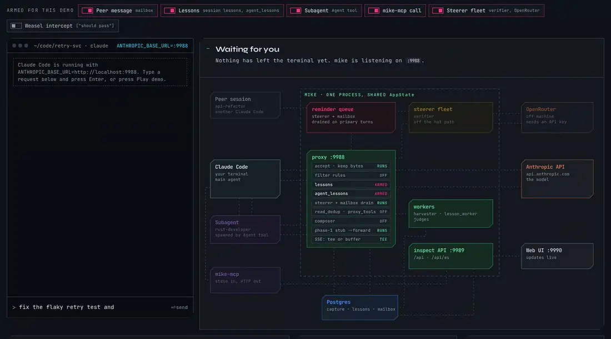

# mike

[](./LICENSE)
[](https://buymeacoffee.com/dawiddutoih)

A local reverse proxy for Claude Code. It sits between the CLI and `api.anthropic.com`, captures proxied requests and streaming responses, and gives you a browser UI to inspect, search, and analyse what Claude Code is actually sending and receiving. Capture, local analysis and maintenance are enabled by default. Request and response rewriting, background OpenRouter judges and remote embeddings require their respective configuration; authored filter rules, explicit mailbox messages and hook sentinel handling have separate conditions described in [`docs/FEATURES.md`](docs/FEATURES.md#things-that-are-not-feature-toggles).

On top of that capture core, mike ships a set of **optional** features that either rewrite your traffic (recall, lesson, reminder, mailbox and steerer injection, filter-rule rewrites, prompt compositions, read deduplication and file-read compression, proxy-declared tools, and a weasel intercept that can replace the model's whole answer) or send captured text off the machine (LLM judges, verifiers and classifiers via OpenRouter; remote embeddings). Mutation and background OpenRouter toggles default off. Filter rules and compositions also need matching authored configuration, while file-read compression currently records shadow estimates only. Configure features at <http://localhost:9990/settings>. See [`docs/FEATURES.md`](docs/FEATURES.md) for the full table.

Upgrading from an older install does not change your behaviour — a stored setting always wins over the code default, so whatever you already had enabled stays enabled.

<p align="center">
  
</p>

More animated walkthroughs, one per subsystem, are in [`docs/animations/`](docs/animations/README.md). This recording follows two turns of a simulated Claude Code session through mike, a subagent, mike-mcp and the steerer fleet, and back:

<p align="center">
  
</p>

To drive it yourself, open [`docs/animations/live-turn.html`](docs/animations/live-turn.html) in a browser from a checkout. You can type your own message and switch features on and off.

## Why you'd want this

Claude Code is a black box by default — you see prompts go in and answers come out, but not the full conversation with the model, the system prompt that was assembled, the tool results that got injected, the diagnostics the API returned, or the token accounting.

This proxy gives you:

- **Full visibility** into every request and SSE streaming response, live as it happens
- **Session grouping** so you can scroll back through an entire Claude Code session turn-by-turn
- **System prompt inspection** — see exactly what context and instructions were sent on each turn
- **Response quality analysis** — built-in regex detectors for hedging language, shortcuts, and weasel patterns in model output, reported alongside each response; the optional diagnostic-reminder feature can feed findings back on a later turn
- **Structured access via MCP** — query your captured traffic from inside Claude Code itself as tools, not just through a browser

Use it to debug why Claude Code misbehaved on a particular turn, to audit what your system prompt actually contains, to measure response quality over time, or just to understand what's going on under the hood.

## Security in one paragraph

**The inspect API has no authentication, and mike is only supported on a machine you alone use.** Any process running as any user on the machine can read every prompt, response and system prompt mike has captured, change any runtime setting (including your OpenRouter API key), and `POST /api/launches` to start a Claude Code session. A Host/Origin allow-list guard blocks DNS rebinding, cross-site WebSocket connections and cross-origin requests from a browser, but it is not an authentication layer and it does not restrict local processes. Do not bind mike to a LAN or public address; remote access is not supported. Read [`docs/SECURITY.md`](docs/SECURITY.md) before running it anywhere but your own workstation.

## Quick Start

> **Alpha:** mike is at `0.1.0-alpha.1`, for Linux x86_64 and Apple Silicon macOS. Expect
> rough edges and changes between alphas.

Install `mike` and `mike-mcp` with Homebrew or mise:

```bash
brew tap temet-ai/mike && brew install mike mike-mcp
# or
mise use -g github:temet-ai/mike@<version>
```

**Your Claude login stays yours.** Each person runs mike with their own Claude Code login.
mike forwards the credential Claude Code sends and never stores it. Background jobs set to a
`claude/` model run your own `claude` command, so they use your subscription.

**Another `mike` command:** the MkDocs tool of the same name may also put `mike` on your
`PATH`. Check with `which -a mike`, and put this mike's folder first or call it by full path.

Then set up, start and capture:

```bash
# 1. Choose a database: durable PostgreSQL or a trial that loses history on restart
mike setup

# 2. Start the proxy, inspect API and web UI; only serve applies the database migrations
mike serve

# 3. In another terminal, run Claude Code through the proxy
mike claude
```

Then open <http://localhost:9990> in a browser. Everything you type to Claude Code shows up live, grouped by session.

Stop the proxy with Ctrl-C. Upgrade, backup, restore and removal are covered in the
[installed setup guide](frontend/src/lib/help/content/installed-setup.md) and, for
PostgreSQL history, in the [recovery and maintenance guide](frontend/src/lib/help/content/recovery-and-maintenance.md).
The bundled help in the app (`/help`) carries the same steps.

Trial mode keeps captures in memory and loses them on restart. Durable history needs a
PostgreSQL database; see [installed database setup](docs/INSTALLED_DATABASE.md).

## How It Works

Primary path only — for the full process inventory (`proxy-forward` sidecar, Storybook) see [What's running](docs/GETTING_STARTED.md#whats-running). The animation at the top of this page walks the same path one step at a time.

```
                           ┌────────────────────┐
Claude Code ─HTTP:9988───► │  mike              │ ─HTTPS──► api.anthropic.com
                           │                    │
                           │  proxy bind  :9988 │
browser    ◄──HTTP:9990───►│  inspect bind:9989 │
                           │  SPA bind    :9990 │
                           └────────────────────┘
                                     ▲
                                     │ HTTP to :9989
                                     │
                    ┌────────────────┴────────────┐
                    │ mike-mcp (stdio binary)     │ ◄──── Claude Code MCP client
                    │ tool profiles + resources   │       (~/.claude.json)
                    └─────────────────────────────┘
```

The server can expose three binds; the development script serves the UI separately:

- **`:9988`** — the proxy. Claude Code points `ANTHROPIC_BASE_URL` here. mike forwards to `api.anthropic.com` over HTTPS. Without an applicable rewrite or queued delivery, request-body and response bytes pass through; forwarding still normalizes HTTP headers. Mutation features and authored rules can change the forwarded body. Capture starts from the original request, separately from the forwarded body. Compacted records can be reconstructed for inspection; source and fidelity metadata distinguish those from retained raw bytes.
- **`:9989`** — the inspect API. REST + WebSocket. The web UI and the MCP bridge both talk to this. No authentication (see [Security](#security-in-one-paragraph)).
- **`:9990`** — the web UI. The `mike` binary serves the SPA it was compiled with, and also serves the whole `/api/*` surface on this port. `scripts/start-proxy.sh` sets `MIKE_SPA_ENABLED=0` and hands :9990 to a `vite dev` process instead, so frontend changes hot-reload; that is the development layout, not the default one.

On the primary Claude Code → proxy path there is no TLS interception: Claude Code talks plain HTTP to localhost, and mike handles the HTTPS leg to Anthropic. There is no CA to trust for that path. The separate, optional `proxy-forward` sidecar on `:9987` *is* an HTTPS MITM with its own generated CA — it routes eligible Anthropic API traffic through mike, including Remote Control HTTP/SSE. WebSocket upgrades bridge directly to Anthropic and bypass capture. See [`docs/FORWARD_PROXY_WEBSOCKET_UPGRADE.md`](docs/FORWARD_PROXY_WEBSOCKET_UPGRADE.md).

The MCP catalogue changes with the build: run `mike-mcp list-tools --core` for the default
profile or `mike-mcp list-tools --json` for the full catalogue.

## Configuring Claude Code

Point Claude Code at the proxy with a single env var:

```bash
ANTHROPIC_BASE_URL=http://localhost:9988 claude
```

- `ANTHROPIC_BASE_URL` must **not** include `/v1` — Claude Code appends `/v1/messages` itself.
- Your API key (`x-api-key` or `Authorization: Bearer ...`) is forwarded verbatim to Anthropic. The proxy never logs credentials.
- Rate-limit headers and `retry-after` pass through unchanged, so Claude Code's own retry logic still works.
- Mutation does not overwrite the original capture. Inspection distinguishes retained raw bytes from reconstructed bodies and reports fidelity limits; see [`REQUEST_FLOW.md`](docs/REQUEST_FLOW.md). Headers are normalized for the upstream connection.

## Architecture

Key choices that keep this boring:

- **Reverse proxy on the main path** — no CA trust, no CONNECT tunneling and no dynamic TLS certs between Claude Code and mike. Just one env var on the client. The optional `proxy-forward` sidecar is the component that does selective MITM for the configured Anthropic host; WebSocket upgrades use its direct bypass.
- **Channel-based SSE tee** — streams to the client and parses into state concurrently via a bounded `mpsc`. Backpressure flows naturally; slow parser = slower upstream read = slower client, which is correct.
- **Postgres is the source of truth for terminal traffic** (persistence on by default) — the bounded in-memory store is a live-capture staging pool for in-flight/streaming requests only, not the durable primary store.
- **Capture is separated from mutation.** The regex analysers in `analysis/` record hedging and weasel-style findings locally. The separate `reminders` feature can inject those findings into a later request when enabled. Mutation and delivery conditions are documented per feature — see [`docs/FEATURES.md`](docs/FEATURES.md).
- **Process split** — the Rust binary, the `vite dev` SPA host, and the MCP bridge have independent lifecycles. In the development layout, killing the vite process cannot kill the proxy. When mike serves its own embedded SPA, the UI and the proxy are the same process.

Full rationale: [`docs/ARCHITECTURE.md`](docs/ARCHITECTURE.md).

## Commands

`mike` with no subcommand opens a terminal control centre when stdout is a TTY, and runs headless when it is not. `mike serve` always runs headless.

| Command | What it does |
|---|---|
| `mike` | Control-centre TUI (TTY) — setup wizard, sessions, requests, config, start/stop |
| `mike serve` | Run the proxy, inspect and SPA binds headless |
| `mike claude <claude args>` | Bring the stack up if it isn't already, then exec Claude Code wired to it (proxy address, sidecar, folder trust). Your arguments are forwarded to `claude`. |
| `mike spawn open \| kill \| list \| doctor \| warm \| fork \| templates \| reap` | Launch and manage Claude sessions in a terminal backend — see [`docs/LAUNCH_DOMAIN.md`](docs/LAUNCH_DOMAIN.md) |
| `mike print-config` / `mike print-config --shell` | Print boot config; normal output also shows the live DB overlay when available, while `--shell` is boot-only |
| `mike migrate-check` | Read-only pre-migration check against the target database |

Several further maintenance subcommands (backfills, compaction, space reclamation) exist for operators; `mike --help` lists them all.

## Docs

| Doc | Purpose |
|------|---------|
| [`docs/GETTING_STARTED.md`](docs/GETTING_STARTED.md) | Zero to a captured request: prerequisites, database, first run, what's running |
| [`docs/SECURITY.md`](docs/SECURITY.md) | Trust boundary: what each bind exposes, what the Host/Origin guard does and doesn't stop, what leaves the machine |
| [`docs/FEATURES.md`](docs/FEATURES.md) | The web UI, and every optional feature with its default, its class (rewrites traffic / sends text out), and where to enable it |
| [`docs/SETUP.md`](docs/SETUP.md) | The optional external dependencies (OpenRouter, embeddings, the sidecar, a terminal backend) and the `cc` launcher |
| [`docs/CONFIGURATION.md`](docs/CONFIGURATION.md) | Boot config precedence and every `MIKE_*` environment variable |
| [`docs/MCP_BRIDGE.md`](docs/MCP_BRIDGE.md) | Registering `mike-mcp` with Claude Code and the tool catalogue (core vs `--full`) |
| [`docs/LAUNCH_DOMAIN.md`](docs/LAUNCH_DOMAIN.md) | `mike spawn`, the terminal backends, and launch lifecycle observability |
| [`docs/REQUEST_FLOW.md`](docs/REQUEST_FLOW.md) | Runtime request flow across the proxy and inspect binds |
| [`docs/STARTUP_FLOW.md`](docs/STARTUP_FLOW.md) | Boot sequence for `mike` and `mike-mcp` |
| [`docs/animations/README.md`](docs/animations/README.md) | Animated diagrams and interactive turn and fleet simulations |
| [`docs/SCHEMA.md`](docs/SCHEMA.md) | Capture-database schema |
| [`docs/LOCAL_DB_FALLBACK.md`](docs/LOCAL_DB_FALLBACK.md) | Working when the primary capture database is unreachable |
| [`docs/RELEASE_READINESS.md`](docs/RELEASE_READINESS.md) | Current release assessment, verified blockers, and the acceptance checklist |
| [`docs/DEVELOPMENT.md`](docs/DEVELOPMENT.md) | Dev loop, house rules, and the pre-PR checklist |
| [`docs/TROUBLESHOOTING.md`](docs/TROUBLESHOOTING.md) | Build, toolchain and runtime failures, with fixes |
| [`docs/ARCHITECTURE.md`](docs/ARCHITECTURE.md) | Architecture decisions and rationale |
| [`docs/FORWARD_PROXY_WEBSOCKET_UPGRADE.md`](docs/FORWARD_PROXY_WEBSOCKET_UPGRADE.md) | How the sidecar routes API/SSE traffic and bridges WebSocket upgrades outside capture |
| [Mike Roadmap](https://github.com/orgs/temet-ai/projects/1) | What's planned next (GitHub Project — Issues + Phase/Status/Priority fields) |
| [Storybook Foundations](http://localhost:6006/?path=/story/foundations-style-guide--core) | Frontend style guide (binding for all Svelte/TS/CSS work); [`docs/frontend/STYLE_GUIDE.html`](docs/frontend/STYLE_GUIDE.html) is the design export it started from, reference only |
| [`frontend/src/lib/help/content/installed-setup.md`](frontend/src/lib/help/content/installed-setup.md) | Install, setup, start, stop, upgrade and uninstall for a package install |
| [`docs/RELEASING.md`](docs/RELEASING.md) | How release candidates are built and which channels they ship through |

## Developing from a checkout

Package users do not need this section. A source checkout runs the development stack
through `./scripts/start-proxy.sh`, which builds and deploys what changed and keeps the
stack running as systemd user units (`mike-stack-*`). Stop it with `./scripts/stop-proxy.sh`.
See [`docs/DEVELOPMENT.md`](docs/DEVELOPMENT.md) and [`docs/SETUP.md`](docs/SETUP.md).

## Contributing

Issues and PRs welcome. Use `scripts/test-suite fast` for the everyday
repository loop and `scripts/test-suite all` for the exhaustive test pass;
domain-specific Rust and frontend commands remain available for focused work.
Follow the style guide ([Storybook Foundations](http://localhost:6006/?path=/story/foundations-style-guide--core)) and see
[`docs/DEVELOPMENT.md`](docs/DEVELOPMENT.md) for the full pre-PR checklist.

## Support

If this saved you debugging time and you'd like to say thanks:

[](https://buymeacoffee.com/dawiddutoih)

## License

[MIT](./LICENSE) © Dawid du Toit
