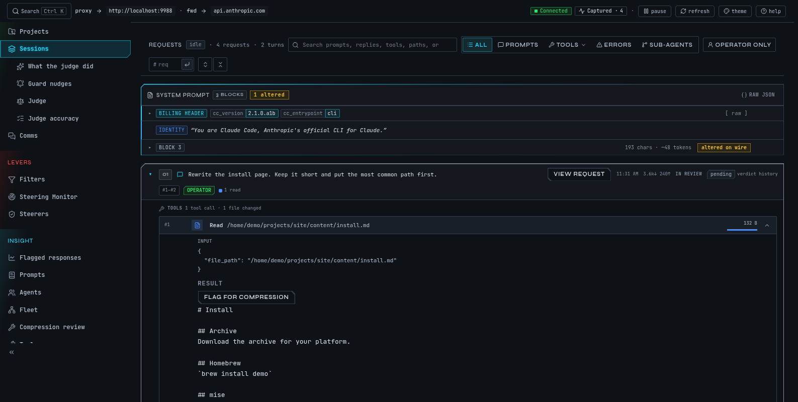
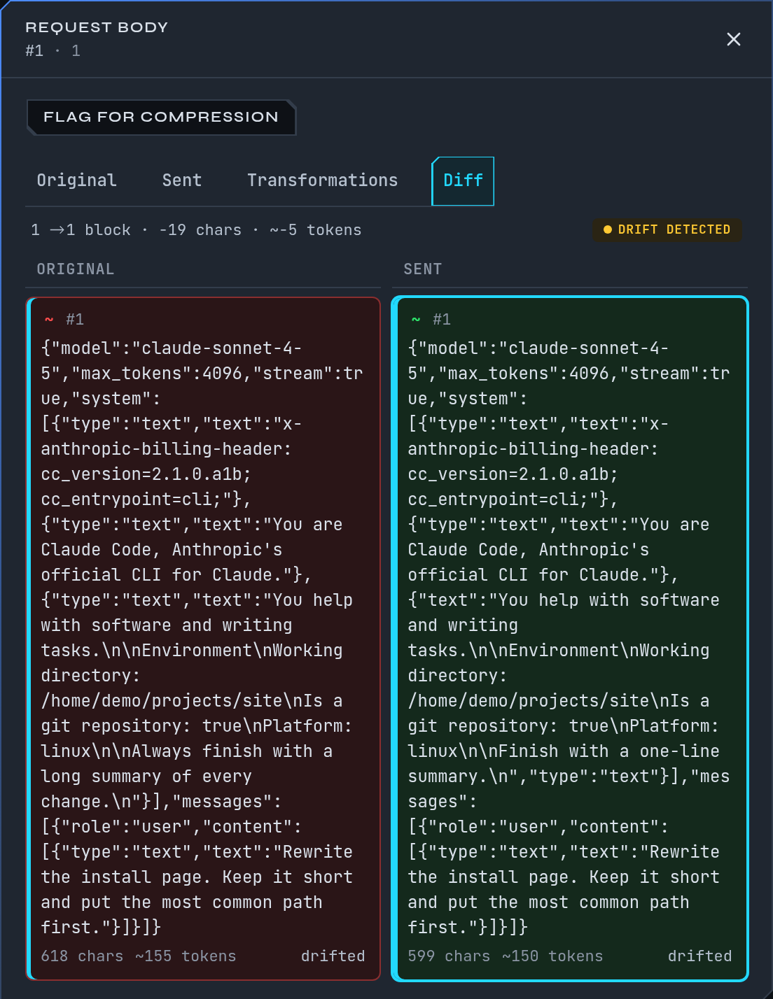
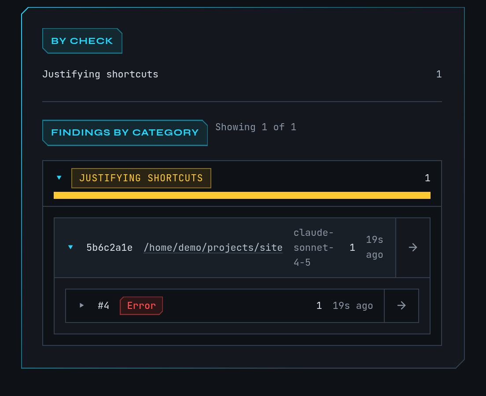
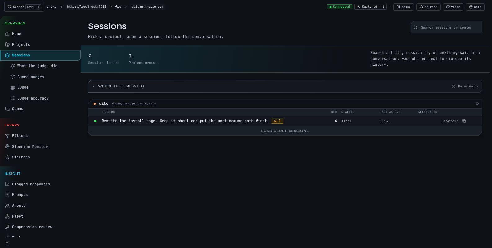
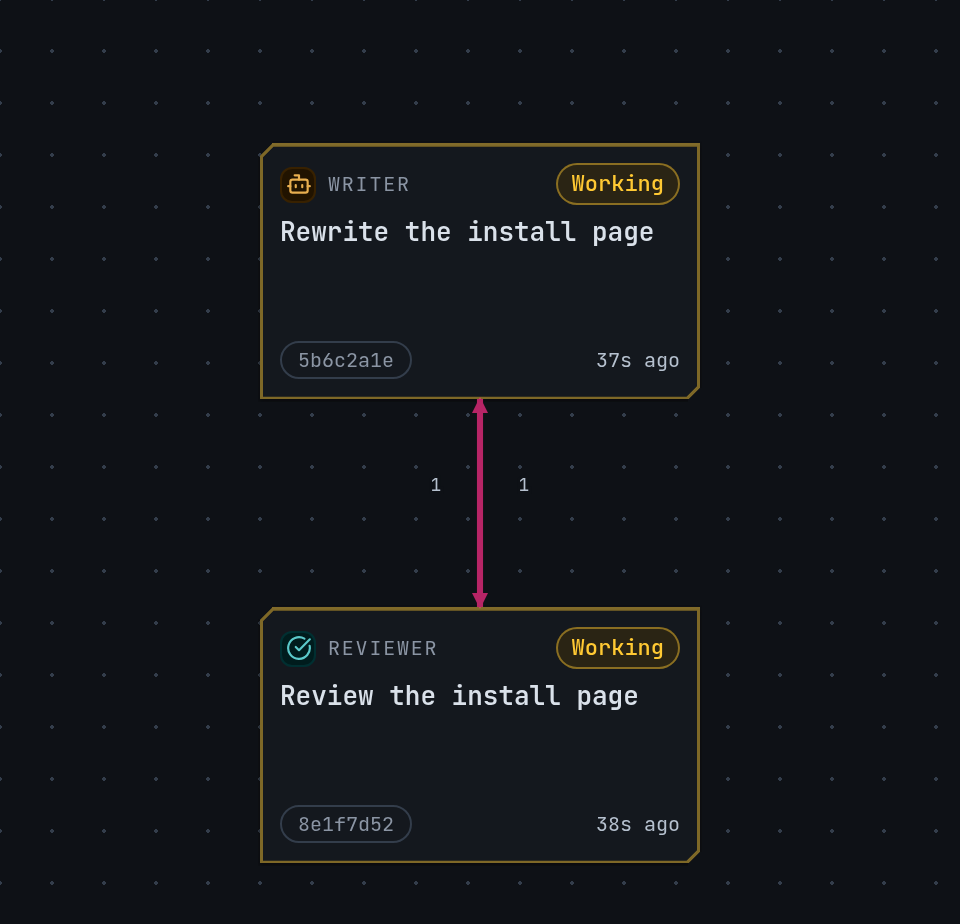

<h1 align="center"></h1>

<p align="center">
  <a href="https://github.com/temet-ai/mike/releases"></a>
  
  <a href="./LICENSE"></a>
</p>

<p align="center">
  <a href="#try-it">Try it</a> ·
  <a href="https://temet.ai/docs/mike/">User guide</a> ·
  <a href="#how-it-works">How it works</a> ·
  <a href="docs/user-guide/privacy.md">Privacy</a> ·
  <a href="https://github.com/temet-ai/mike/releases">Releases</a>
</p>

mike is an inspector for Claude Code, written in Rust. It records every request and answer of your sessions on your own machine, so you can open any turn in a browser, search your history, and turn a correction into something the next session starts with. It is for people who use Claude Code every day and want to see inside it.

**Status:** alpha, for Linux x86_64 and Apple Silicon macOS. The current release is [0.1.0-alpha.3](https://github.com/temet-ai/mike/releases). Expect rough edges and changes between alphas.



## What you can do with it

- **Read any turn as it was sent.** The system prompt, the messages, the tool results and the streamed answer, grouped by session and live as they happen.
- **See what changed before it left.** If a feature you turned on rewrites a request, the original and what was sent are shown side by side.
- **Ask Claude Code about its own history.** `mike-mcp`, the companion program, gives a session [tools](docs/user-guide/mcp.md) to search earlier turns and notes.
- **Keep a correction.** Tell Claude to record it as a [lesson](docs/user-guide/memory.md) and later sessions in that project can be handed it.
- **Spot weak answers.** Local pattern checks [flag](docs/user-guide/flagged-responses.md) unbacked claims, blame-shifting and avoided work beside the response.
- **Watch and steer.** Optional [steerers](docs/user-guide/steering.md) notice a session drifting from its goal, [filter rules](docs/user-guide/filters.md) rewrite the system prompt, and [fleets](docs/user-guide/fleets.md) run several sessions towards one goal.

A fresh install only captures: it forwards your requests unchanged and sends nothing to anyone but Anthropic. Features that rewrite a request or send text to another service stay off until you turn them on. [Privacy](docs/user-guide/privacy.md) lists what each one stores and sends.

## Try it

Homebrew works on macOS and on Linux, where mike needs glibc 2.35 or newer. [Install mike](docs/user-guide/install.md) also covers mise and archives.

```bash
brew install temet-ai/mike/mike temet-ai/mike/mike-mcp

mike setup    # where to keep history, and which features to turn on
mike claude   # starts mike if needed, then Claude Code routed through it
```

At setup, keep captures in memory for a first look, or choose a PostgreSQL database to keep your history; mike can run one for you in Docker. The **Watch only** choice leaves every optional feature off.

Then open <http://localhost:9990>. Your session is under **Sessions**, updating as you work. Only sessions started through mike are captured. [Get started](docs/user-guide/quickstart.md) walks through it.

## A look around

<table>
  <tr>
    <td width="50%" valign="top">
      <a href="docs/user-guide/images/request.png"></a>
      <br><strong>Original and sent, side by side</strong>
    </td>
    <td width="50%" valign="top">
      <a href="docs/user-guide/images/flagged-response.png"></a>
      <br><strong>Weak answers flagged, with the turn they came from</strong>
    </td>
  </tr>
  <tr>
    <td width="50%" valign="top">
      <a href="docs/user-guide/images/sessions.png"></a>
      <br><strong>Every session, searchable by project</strong>
    </td>
    <td width="50%" valign="top">
      <a href="docs/user-guide/images/fleet.png"></a>
      <br><strong>A fleet of sessions and the messages between them</strong>
    </td>
  </tr>
</table>

## Before you run it

**mike has no login, so use it only on a computer nobody else uses.** Its local API has no authentication: any program on the machine can read every captured prompt and answer, change mike's settings and start Claude Code sessions. Keep it on the loopback address it starts with. Remote access is not supported. [SECURITY](docs/SECURITY.md) has the full trust boundary.

**Your Claude login stays yours.** Each person runs mike with their own Claude Code login. mike forwards the credential Claude Code sends and never stores it. Background jobs set to a `claude/` model run your own `claude` command, so they use your subscription.

## How it works

mike sits between Claude Code and `api.anthropic.com`. Claude Code talks to it on `localhost:9988`, mike forwards to Anthropic over HTTPS and keeps a copy, and the web UI on `:9990` and the `mike-mcp` companion read that copy through a local API on `:9989`.



Named for Mike, the thinkum dinkum who ran the Moon in Heinlein's *The Moon Is a Harsh Mistress*. He heard every line on Luna and forgot nothing. This one settles for your Claude Code sessions.

A name clash to know about: the MkDocs tool also called `mike` may be on your `PATH`. Check with `which -a mike`.

[More animated walkthroughs](docs/animations/README.md) cover each part. [`docs/ARCHITECTURE.md`](docs/ARCHITECTURE.md) has the design and its reasons.

## Documentation

The [user guide](docs/user-guide/README.md) covers everything a user needs: [install](docs/user-guide/install.md), [setup](docs/user-guide/setup.md), [every page and command](docs/user-guide/pages.md), and [what to do when something looks wrong](docs/user-guide/troubleshooting.md).

Reference and contributor docs. Start with the system map: one page that lists everything mike can do, where each ability lives in the code and how to verify it.

| Doc | What it holds |
|---|---|
| [`docs/SYSTEM_MAP.md`](docs/SYSTEM_MAP.md) | Every capability, its surface, its default and its code; the index of all other docs |
| [`docs/FEATURES.md`](docs/FEATURES.md) | Every optional feature, its default and what it does to traffic |
| [`docs/CONFIGURATION.md`](docs/CONFIGURATION.md) | Boot config and every `MIKE_*` environment variable |
| [`docs/SECURITY.md`](docs/SECURITY.md) | What each bind exposes and what leaves the machine |
| [`docs/REQUEST_FLOW.md`](docs/REQUEST_FLOW.md) · [`docs/STARTUP_FLOW.md`](docs/STARTUP_FLOW.md) | How a request and a boot run |
| [`docs/SCHEMA.md`](docs/SCHEMA.md) | The capture database |
| [`docs/DEVELOPMENT.md`](docs/DEVELOPMENT.md) | Working from a checkout |
| [`docs/RELEASING.md`](docs/RELEASING.md) | How releases are built |

## Contributing

Issues and pull requests are welcome; start with [CONTRIBUTING](CONTRIBUTING.md). A source checkout runs the development stack with `./scripts/start-proxy.sh`, and [`docs/DEVELOPMENT.md`](docs/DEVELOPMENT.md) has the loop. Run `scripts/test-suite fast` before you send a change.

## Support

If mike saved you debugging time and you'd like to say thanks: [buy me a coffee](https://buymeacoffee.com/dawiddutoih).

## License

[MIT](./LICENSE) © Dawid du Toit
