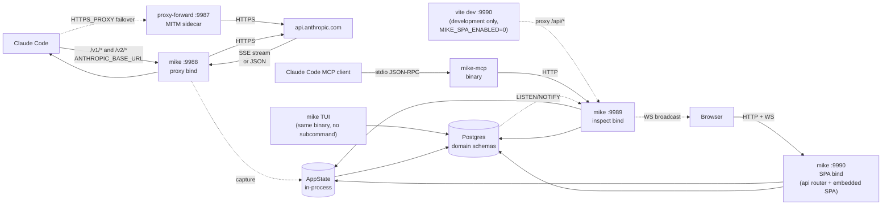

# Architecture

## 1. Overview

`mike` is a Rust reverse proxy that sits between Claude Code (or any other Anthropic-API client) and `api.anthropic.com`. It exists because two prior tools — `proxyclawd` (a forward MITM proxy with a TUI) and a mitmproxy-based weasel-detector — solved part of the problem but couldn't be operated together and couldn't scale past prototype. The proxy replaces both with a single design: capture every byte of Claude API traffic, store it in Postgres, surface it through a browser UI and an MCP bridge, and never break the client.

**mike captures and forwards**, with optional request and response mutation (§3–4). Feature defaults come from `FeatureToggles::default` in `crates/mike-base/src/feature_toggles/mod.rs`; `TOGGLE_META` declares whether changes are session-frozen, immediate, live-disable or restart-bound. Autonomous steering, model judges, dossier building, turn guard, directive proposals and the request-mutating feature toggles default off. Capture/maintenance helpers, harvesting, lesson refresh, semantic context and the operator-invoked prompt assistant default on. These are not a promise that all background activity is local: embeddings use their configured endpoint, and model-backed actions have additional settings and credentials. The semantic embedding path requires loopback unless `semantic.allow_remote_embedding` is enabled.

With no configured rewrites, queued reminders or recognized hook tokens, the forwarded request body is unchanged. Recognized hook resolver tokens are stripped even with `reminder_on_token` off; the toggle enables resolution, not stripping. Explicit mailbox messages can be delivered by the shared drain without the steerer toggle, while filter/lazy-section rules and compositions have their own gates. On the response side, `weasel_intercept` can withhold the first model answer and send a correction request whose upstream answer reaches the client (§4.5); `proxy_tools` can answer a proxy-declared tool call in-process and request the follow-up answer.

Capture starts from the **original inbound request bytes** before mutations. Original and sent views are distinct, but stored traffic is not uniformly a raw-wire archive: compacted requests are reconstructed from normalized data and streamed responses from assembled content blocks (§10). Ordinary traffic without a usable canonical session id is forwarded uncaptured from `engine::accept`; `guards::evaluate_capture_admission` also sheds unmutated capture under memory pressure. Persistence failures or deliberately disabled persistence can leave no durable capture.

What's running at full deployment:

- **`mike` binary** — one Rust process that opens **three** TCP listeners (`crates/mike/src/serve/listeners.rs`).
  - `:9988` — proxy bind. Routes `/v1/{*rest}` and `/v2/{*rest}` to the proxy handler (`crates/mike/src/app.rs`). Claude Code points `ANTHROPIC_BASE_URL` here. Forwards to `api.anthropic.com` over HTTPS.
  - `:9989` — inspect bind. `/api/*` REST + `/api/ws` WebSocket. **There is no authentication on it.** A Host/Origin allow-list middleware (`crates/mike-base/src/web_base/host_guard.rs`) wraps the whole router and blocks DNS rebinding, cross-origin requests and cross-site WebSocket upgrades; it does not stop any local process, and it is not a login. See [`SECURITY.md`](SECURITY.md).
  - `:9990` — SPA bind. `spa_enabled` defaults to `true`. It serves the **whole `/api/*` router merged with the embedded SPA** (`spa_router` in `crates/mike/src/app.rs`), so the browser never has to cross ports.
  - Run with no subcommand on a TTY, `mike` starts its terminal UI instead of the server (`main.rs` → `bare_dispatch_target`); `mike serve` always serves.
- **`proxy-forward` binary** — the third workspace binary, on `:9987`. An HTTPS_PROXY MITM failover sidecar for traffic that can't go through the reverse-proxy path; auto-started by `scripts/start-proxy.sh` and runs alongside the other two for the lifetime of the stack. Ordinary `/v1/*` and `/v2/*` HTTP traffic can be routed through mike; WebSocket upgrades bypass capture and go directly upstream. See [`crates/proxy-forward/`](../crates/proxy-forward/).
- **`vite dev` (SPA host)** — a **development** alternative for `:9990`, not the default. `scripts/start-proxy.sh` sets `MIKE_SPA_ENABLED=0` to hand the port to an independent Node process serving the SvelteKit SPA from source with HMR, proxying `/api/*` and `/api/ws` through to the inspect bind. Outside that script — a plain `mike` launch, and `scripts/deploy-proxy.sh` — `mike` serves the built SPA itself (`frontend/build/`, embedded via `rust-embed` — [`crates/mike/src/spa.rs`](../crates/mike/src/spa.rs)). The two are mutually exclusive on the same port (`MIKE_SPA_ENABLED` / `MIKE_SPA_BIND`).
- **`mike-mcp` binary** — separate Rust binary, spawned by Claude Code over stdio (`~/.claude.json`). Talks HTTP to the inspect bind and exposes the MCP tool catalogue: a lean `core` profile and additional named/full profiles, plus the resources in §6. Use `mike-mcp list-tools --core --json` or `mike-mcp list-tools --full --json` for the installed catalogue; source changes do not prove the installed binary is current.
- **Postgres** — single database holding every captured request, response, tool call, system prompt, operator turn, filter rule, and prompt composition. The source of truth for terminal traffic since the Phase 11 cutover (2026-05-03). pgvector is required for the embedding columns. The connection string is `MIKE_DATABASE_URL`; `scripts/capture-db/docker-compose.yml` defines a container that satisfies it. The database is split across domain schemas (`requests`, `sessions`, `memory`, `tools`, `agents`, `steering`, `launch` and more) — [`SCHEMA.md`](SCHEMA.md) is authoritative for which table lives where.

The proxy has no Anthropic-side credentials of its own — it forwards whatever the client sent. It has no global state beyond `AppState`, which is constructed once at startup and shared by reference across all three binds.

### Codex integration boundary

Codex protocol transport, hook/OTEL decoding and incremental Responses metadata parsing
live in the independent `mike-codex` library. Mike owns the adapters to common session
observations, quota admission, mail and readers. The library has offline tests and no
dependency on Mike, SQLx, Axum or a running model; host tests cover those interfaces.
This adds no process or separately released service.

Routine Codex ingestion retains bounded metadata. Optional diagnostic bodies have separate
record/session/global limits and expiry; streaming request forwarding never depends on
collecting the body. The existing retention worker expires facts, receipts and diagnostic
evidence. Common reader views adapt Claude's existing requests without a second copy.
Ordinary Codex sessions receive bounded mail notices through trusted hooks or the local
queue; only an explicit mailbox acknowledgement means consumed. See
[the runtime contract](RUNTIME_CONTRACT.md), [capture bounds](CODEX_CAPTURE.md) and
[focused development checks](CODEX_DEVELOPMENT.md).

## 2. System Map





Three TCP listeners, one process, one shared `AppState`. The MCP bridge is a separate binary so it can crash, restart, or be replaced without touching the proxy's hot path. `proxy-forward` is a separate binary because it is a different interception model (CONNECT + per-domain TLS) that most operators never need. Postgres is the only persistent component — restart the proxy and all terminal traffic survives. During frontend development `vite dev` takes `:9990` from the SPA bind so a CSS edit doesn't require a `cargo build`; that swap is the only reason the SPA bind is optional at all.

## 3. Request Lifecycle

The path from `ANTHROPIC_BASE_URL=http://localhost:9988` to a streamed response in the browser is one async pipeline. `proxy/handler.rs` is now only the axum entry point — about forty lines that call four things in sequence:

```
engine::accept              → AcceptedRequest (parts, body, signals, session toggles, stored_body)
engine::run_request_pipeline → mutation stages + composer + capture + in-flight admission
engine::forward_to_upstream  → reqwest send
engine::finalize_and_respond → tee/buffer the response, snapshot, respond
```

The body-path work lives under `crates/mike-features/src/proxy/engine/` and `crates/mike-features/src/pipeline/`. The proxy router itself (`crates/mike/src/app.rs`, `proxy_router`) carries **no Tower layers at all** — it is two routes and `with_state`. The inspect and SPA routers are where the middleware is (§6).

`crates/mike-features/src/pipeline/mod.rs`'s `STAGE_ORDER` is the declared order of the mutating stages, and `proxy/engine/mutation_stages.rs` executes it in three phases, with the composer running afterwards from `proxy/engine/request_pipeline.rs` by way of `guards.rs`:

```
accept: extract parts + RequestSignals, resolve session toggles, keep the ORIGINAL bytes
        (no usable session id → proxy::sessionless: forward unchanged, store whole in
         requests.sessionless_requests; no mutation stages run)

run_mutation_stages — phase 1, pipeline::stages_before_steerer()
 1. filter                  (operator rule: drop/replace/append on text blocks)
 2. reminder_on_token       (strip/resolve the PUA resolver token from the last user message)
 3. lazy_sections           (strip a section, re-inject as <system-reminder> on trigger token)
 4. recall_injector         (<mem:recall> tag → lesson lookup → <system-reminder>)
 5. lessons                 (consolidated session-lesson injection)
 6. self_identity           (self-identity reminder)
 7. workspace_briefing      (roster and peer briefing, once per session per content)
 8. agent_lessons           (per-agent lesson injection)
 9. reminders               (prior-request analyzer findings)
10. change_record_tail      (what other sessions changed since this one last looked)
11. code_findings           (mike-code: warnings and errors the session's own edit added, up to 3 per request, tool loops included)
12. git_read_hint           (fixed hint to read git history before editing)

run_mutation_stages — phase 2
13. steerer / mailbox drain (deliver queued nudges and cross-session mail on Primary turns)

run_mutation_stages — phase 3, pipeline::stages_after_steerer()
14. repeated_notices        (keep the first copy of each notice Claude Code adds to a delivered message, drop later copies)
15. read_dedup              (collapse repeated file-read results)
16. file_read_compression   (SHADOW MODE — computes a reduction, forwards the body unchanged)
17. shell_output_compression (SHADOW MODE at a forward share of 0 — records each would-be cut of an older Bash result)
18. proxy_tools             (declare the proxy's own tools into body.tools[])
19. context_focus_question  (add a focus field to the session's tool definitions)

then, in request_pipeline.rs
20. composer                (byte-splice system[2] for the first composable request of a session)
20. capture-admission guard (shed → forward_without_capture, no row written)
21. DB stub insert          ← Phase 1 of the two-phase write; the INSERT ... RETURNING id
                              is where the canonical RequestId comes from
22. in_flight.register      (HTTP 503 + Retry-After if at capacity)
23. forward_to_upstream     (reqwest send)
24. tee SSE stream (streaming) OR buffer (non-streaming)
25. snapshot_request        ← Phase 2 of the two-phase write
26. NOTIFY proxy.row_changed → PgListener → WS broadcast
```

The per-session injection stages — `lessons`, `self_identity`, `workspace_briefing`, the diagnostic `reminders`, `change_record_tail`, `code_findings` and `git_read_hint` — run only on the session's own lane: `pipeline::is_session_own_lane` requires a primary-lane origin and no `x-claude-code-agent-id`, so a subagent, workflow agent or misfiled agent-id request never receives the parent's identity, lessons, briefing or findings. The gate only removes injections; each stage keeps its toggle.

The stages use a mixture of session-frozen toggles, live settings, rule caches, DB lookups and the reminder queue. They are not uniformly a boolean-only fast path: rule stages inspect their configuration, mailbox delivery claims rows, and the drain may await the same-request turn-close judge with `steerer.request_timeout_secs` as its deadline. Requests marked `x-mike-client: prompt-assistant` are mutation-exempt and skip the stages and composition. See the gate table in [`REQUEST_FLOW.md`](REQUEST_FLOW.md).

Steps 21 and 25 are the two halves of the two-phase write (covered below in §5). Step 24 is the SSE tee — a bounded `mpsc` channel splits the upstream byte stream into two consumers: the client-bound body channel (zero-copy `Bytes::clone`) and the parser task that produces `ProxyEvent`s. Backpressure on the parser channel propagates to the upstream read, which propagates to the client, which is the correct behavior — never drop events to keep the client fast. When `weasel_intercept` is armed (enabled *and* a non-empty forbidden-word list) or `proxy_tools` is on, `proxy/response/streaming.rs` replaces the plain tee with a buffered forwarder that can withhold the stream long enough to decide whether to replace it (§4.5).

Step 26 is the bridge between capture and inspection. `pg_notify` fires on row insert/update; a `PgListener` task spawned at startup converts every NOTIFY into a `ProxyEvent::RowChanged` and broadcasts it on the same `broadcast::Sender` that already carries SSE token deltas. Every WS subscriber sees both classes of events on one channel.

If the upstream returns a non-streaming response, step 24 collapses to a single buffered read and the snapshot runs immediately. If the client disconnects mid-stream, the body channel's send fails, the upstream read task exits, and the parser drains what it has before `close_aborted_request` (`store/persistence/request_lifecycle_close.rs`) flips the row to the `error` status with the message `stream aborted` — read back as `Error: stream aborted`. If the process crashes between the stub insert and the snapshot, `run_crash_recovery` (`startup.rs`, called from `serve/startup_sequence.rs` on the next boot) runs `recover_stale_pending_rows`, which flips every still-`Pending` row to the `error` status with the message `proxy_crashed_during_stream` — read back as `Error: proxy_crashed_during_stream` — so the row is never silently incomplete.

Identity across this pipeline is the ordinary case, not a guarantee: it is what happens when no stage fires, subject to the mailbox and hook-token exceptions in §1. Header masking and the per-pair `MAX_HEADERS` / `MAX_HEADER_BYTES` caps apply only to the **inspection projection** in `InterceptedRequest.request_headers` — inspection masking does not change forwarded credentials. `proxy/headers.rs` separately strips hop-by-hop headers and `Content-Length`, rewrites `Host`, and sets `Accept-Encoding: identity`. The body sent upstream is whatever the last firing stage produced. The composer's byte-splice preserves bytes outside the selected string and the placement of `cache_control` on `system[2]`, though changed text can change cache identity; the filter's `Rewrote` path does not — it reserialises the whole body (see §4.1).

For the symbol-cited walkthrough of the proxy bind and the async capture pipeline see [`REQUEST_FLOW.md`](REQUEST_FLOW.md).

## 4. Request Modification Pipeline



Eighteen stages plus the composer sit on the request path (the animation above predates five of them and shows thirteen), and two can replace the response. They run in the fixed order declared by `pipeline::STAGE_ORDER`, listed in §3, each able to fail-closed without bringing the others down. Most can alter what Anthropic sees; `file_read_compression` and `shell_output_compression` run in shadow mode and forward the body unchanged. The sections below describe the ones with non-obvious design rationale.

Most mutation features default off. The filter and `lazy_sections` instead depend on operator-authored rule rows; composition has its boot gate and per-class mode. The shared steerer/mailbox drain runs on Primary/PrimaryFirst requests and applies source-specific delivery checks. Explicitly authored mailbox messages do not require the autonomous steerer toggle.

Weasel intercept (§4.5) and `proxy_tools` are the response-side pair: weasel intercept scans the response, while `proxy_tools` first adds declarations to the request. Both can withhold the model's stream and send a follow-up upstream answer in its place.

### 4.1 Filter pipeline

Operator-authored rewrites of arbitrary text blocks in `system[]` and `messages[*].content[]`. Lives in [`crates/mike-features/src/filter/`](../crates/mike-features/src/filter/).

A rule has a matcher (`kind ∈ {text_substring, xml_tag}` against a block's `.text`) and an action (`action ∈ {drop, replace, append}`). First-match-wins per block. `drop` removes the block; `replace` overwrites `.text` in place (preserving `cache_control` and other sibling keys); `append` inserts a new text block immediately after the matched one. The bytes upstream sees are the post-filter bytes — there is no separate "pre-filter" path that runs alongside.

**Reserialisation, not a byte-splice**: a `Rewrote` result reparses the body into `serde_json::Value` and serialises it with `serde_json::to_vec`, so the original JSON whitespace/escaping/order need not survive. The filter walker targets text blocks, not thinking/signature blocks; a JSON round trip alone is not evidence that an untouched thinking signature will fail. Fresh filtering is limited to `PrimaryFirst`; later eligible requests replay the captured system rewrite only when the system prompt matches (`filter/stage/mod.rs`).

Rules are **DB-only state**: every rule lives in `rules.rules` (Postgres). On startup, `AppState::new` loads the table, sorts by `(updated_at asc, id asc)`, and stores the ruleset into the in-memory `ArcSwap` the proxy hot path reads. There is no config-file projection — the old file-based bootstrap is not part of the runtime path, and the proxy never writes it. A single-writer mutex (`write_lock` in `filter/service`) serialises the read-modify-write of the `ArcSwap` across concurrent API mutations. CRUD is exposed via `GET/POST/PATCH/DELETE /api/filter/rules` on the inspect bind; create/patch return `{rule, warnings}` (the `warnings` array is always `[]` today, retained as a stable wire shape), and delete returns 204.

The filter's failure posture is fail-closed: any non-fatal failure — bad JSON, no match, reserialisation error — returns `FilterOutcome::Unchanged` and the original bytes flow upstream untouched. Zero-alloc fast paths fire for empty rule list and all-disabled-rules.

### 4.2 Lazy prompt sections

Two trigger-conditional injection kinds sharing one once-per-context-window injector. Lives in [`crates/mike-features/src/lazy_sections/`](../crates/mike-features/src/lazy_sections/). Runs against the post-`reminder_on_token` body, after the filter pipeline (§4.1) and before the recall injector (§4.3).

Like the filter, `lazy_sections` has **no feature toggle** — it is gated only by whether an operator-authored rule row of the relevant `FilterKind` matches. With no such rows it never fires.

- **`FilterKind::LazySection`** — strips a heading-delimited system-prompt section, replaces it with an operator-authored stub, and re-injects the full section as a `<system-reminder>` block only when the rule's trigger token appears in the MOST RECENT assistant turn.
- **`FilterKind::InjectReminder`** — injects an operator-authored reminder body when the trigger token appears in the MOST RECENT assistant turn, with no section strip (pure injection). `value` is the operator label (not a match target), `text` is the injected body, `trigger_token` is the marker.

Every request re-strips the configured sections from that request's own current system block — re-extraction, not storage; nothing is cached server-side between requests. Fail-safe: any parse/shape failure returns `Unchanged` and the post-filter bytes forward untouched. Rewrites contribute to the transformation manifest and sent-view patches, with firing rule ids folded into the shared `firing_rule_ids` list. `filtered_request_body` is retained for legacy rows.

### 4.3 Recall injector

Same-turn recall injector. Lives in [`crates/mike-features/src/recall_injector/`](../crates/mike-features/src/recall_injector/). Runs after `lazy_sections` (§4.2), against the post-lazy-sections body.

When the agent emits `<mem:recall topic="X"/>` in assistant text, the proxy detects the tag on the *following* request (when the assistant text is replayed in conversation history), queries `memory.lessons` for matching topic rows in the session's project, and appends a `<system-reminder>` block to the next user message. The one-turn latency is structural and intentional.

Gated by the `recall_injector` feature toggle (session-scoped, **default `false`**, settable via `/settings`). The fast path (no `<mem:recall>` tags present, or the feature disabled) is a synchronous scan only — zero DB calls; a hit while enabled performs one DB lookup to resolve `project_id` plus one lookup per distinct topic, capped at `max_lessons_per_topic` (default 5) lessons per tag.

A session learns the tag grammar from the topic catalog that the session-start lesson reminder carries when `recall_injector` is on and at least one selected lesson is withheld from the reminder's content because a topic skill that carries it is installed in its project (the withheld set is `list_topic_lessons_withheld_from_content`, refreshed with the lesson snapshot; a topic lesson with no installed skill is delivered in full like any other lesson) (`format_topic_catalog` in [`crates/mike-lessons/src/recall_injector/formatter.rs`](../crates/mike-lessons/src/recall_injector/formatter.rs)). The catalog names `<mem:recall topic="X"/>` and `<mem:update topic="X" kind="...">the rule</mem:update>`; a test feeds the catalog's own `<mem:update>` example through the harvester so the taught form and the parsed form cannot drift apart. The weekly learning audit counts both tags per project ([`docs/LEARNING_OPERATIONS.md`](LEARNING_OPERATIONS.md)).

### 4.4 Prompt composition

System-authored, class-keyed rewrites of `system[2].text` (the agent identity prompt — typically a 10–80 KB body shared across thousands of requests). Lives in [`crates/mike-features/src/compose_prompt/`](../crates/mike-features/src/compose_prompt/).

Every request gets a `prompt_sha256 = sha256_hex(system[2].text)` computed after the volatile-line registry strips operator-authored regex patterns (e.g. the billing header carrying `cc_version=...`) — these strips affect only the classifier hash, never the bytes sent upstream. Matching compositions are looked up in an `Arc<ArcSwap<HashMap<String, Composition>>>` cache.

Composition mode is per-class:

- **`observe`** (default) — stamp `prompt_sha256` on the request observation row, do not rewrite bytes.
- **`template`** — byte-splice the composition's text into `system[2]` of the **first non-title-sidecar request of each session**. Subsequent requests in the same session take the passthrough path so Anthropic's prompt cache stays hot.
- **`replace`** — full all-three-blocks rewrite. Gated for V2; rejected at the API layer with 400.

The skip-haiku gate (`is_first_composable_request_in_session`) is how the cache stays hot. Title-sidecar requests (haiku model + the title-gen markers Claude Code emits) are always passthrough and do not consume the session's "first composable" slot — the opus main-agent request that follows is the composable target.

The byte-splice rewrite is the cache-preserving primitive. `compose_template` finds the original `system[2].text` value's JSON-encoded form inside the raw body bytes and substitutes it with the composition's text encoded the same way. Every byte outside that one string-value range — field order, whitespace, unicode normalisation, the `cache_control: {type: ephemeral, ttl: 1h}` annotation on block 2 — survives untouched. Failure modes (signature mismatch, parse error, splice miss) return `Passthrough` and the original bytes flow upstream.

The `prompt_sha256` stamp is attempted beyond composable requests, subject to recognizable system shape and `TurnOrigin::stamps_capture_identity`. Composable (`PrimaryFirst`, non-probe) requests get it as a side-effect of `classify_and_compose`; other eligible origins get it via capture-only `ComposerService::observe_prompt_identity()` (`compose_prompt/mod.rs`), which runs the identical `parse_system_blocks → strip_volatile_lines → prompt_sha256_from_block_text` pipeline before the compose match and never touches the upstream bytes. Before Phase 14 the stamp was `PrimaryFirst`-only, so ~99% of requests stored no system prompt.

The full composition schema (`system_prompts`, `prompt_compositions`, `request_system_prompts`, `prompt_composition_revisions`, `volatile_line_patterns`) is documented in [`SCHEMA.md`](SCHEMA.md). The inspect API surface (`/api/prompts/compositions`, `/api/prompts/anomalies`, `/api/volatile-lines`) declares its MCP coverage in [`crates/mike/src/api/manifest.rs`](../crates/mike/src/api/manifest.rs).

### 4.5 Weasel intercept

A buffer-then-decide SSE intercept that can suppress an upstream response entirely and replace it with a correction request. Lives in [`crates/mike-features/src/weasel_intercept/`](../crates/mike-features/src/weasel_intercept/).

The `weasel_intercept` toggle **defaults off**, and even when on it arms only if `forbidden_words` is non-empty (`proxy/response/streaming.rs`: `weasel_armed = session_toggles.weasel_intercept && !forbidden_words.is_empty()`). With an empty word list the request takes the normal zero-latency streaming path.

Scanning covers streamed (`text/event-stream`) responses only. When the intercept is armed and the upstream answers with a buffered body, no scan runs, so a forbidden word in that answer is never seen. That case is recorded rather than silent: the request gets a `not_scanned_buffered` row in `requests.response_intercepts`, and every weasel correction and proxy-tool answer writes a `weasel_correction` or `proxy_tool_answer` row there too. Rows are keyed by session and only optionally by request, so they survive an original request that never persisted. The `requests.intercepted` flag alone is not evidence that an intercept ran: it is written by an UPDATE that matches no row when the original request has none.

When armed, the normal SSE tee (§3 step 24) is replaced by a **gated forwarder** (`weasel_intercept::run_gated_forwarder`). It splits the upstream bytes into SSE frames and passes each frame to the client as it arrives. Nothing is held except the newest text: the last `longest phrase − 1` characters of text stay back until newer text shows they cannot be the start of a listed phrase. Thinking, tool calls and every other frame pass at once.

- **No phrase appears** — the client receives the upstream bytes unchanged, a few characters of text behind.
- **A listed phrase completes** — the gate cuts the reply there. The frames that carry any part of the phrase were still held, so none of it reached the client. The forwarder closes the text block the client has open, mints a new `RequestId`, builds a `CorrectionRequest` body from the original request + the reply's text up to and including the phrase + the operator's correction prompt, and sends it upstream. The corrected answer is stitched onto the same message: its `message_start` is dropped and its content blocks are renumbered to follow the blocks the client already has. The client sees one message: the opening of the first answer, then the corrected one.

The rest of the first upstream answer is still read to its end for capture, in the background, while the correction is already streaming.

Both the original and the correction request are persisted. The original is marked `intercepted=true` with `correction_request_id` populated — a bigint FK to `requests(id)` ON DELETE SET NULL; the correction has a stub row written before its upstream connect.

The same gated forwarder carries `proxy_tools` (also default off), and only for a request the `proxy_tools` stage added a tool to. Its `ToolCallScanner` watches for a call to that tool. The call's own frames are held from the block's first frame, so the client never sees a tool it does not have; everything before the call has already streamed. When the call's block closes, mike answers it in-process and stitches the follow-up answer onto the same message.

### 4.6 Steerer fleet

An evaluation fleet that reacts to response/diagnostic completion, turn-close and quiescence events and can produce a structured session nudge. Lives in [`crates/mike-features/src/steerer/`](../crates/mike-features/src/steerer/). Most evaluations run in background tasks. The request-time drain also invokes a bounded same-request turn-close judge on an eligible human prompt (`steerer/stage/judge.rs`), so steering is not exclusively off the forwarding path.

The fleet is managed as a background task. Each member steerer follows the same two-stage pattern:

1. **Cheap gate** — a pure, synchronous predicate. If the gate misses, no LLM call is made.
2. **LLM verdict** — an OpenRouter `response_format: json_schema` structured-output call using the fleet's configured model (`openai/gpt-5.6-luna` default). The verdict is a typed struct; a `confidence` field must clear the steerer's `confidence_threshold` (per-row `params`, default 0.7) before the candidate fire is trusted, and a 2-of-3 quorum of independent verdict samples must then agree (temet-ai/mike-private#116). Deterministic overrides and `force_fire` bypass both. Verdict calls retry up to 3 attempts on transient failures (empty content, schema parse errors, transport errors, timeouts); HTTP 4xx responses are definitive and are not retried. The retry logic lives in `crates/mike-base/src/llm/openrouter/` and is shared by the Verifier and the LLM judge.

When a steerer fires, its intervention and delivery state are recorded, and the delivery path can push through an available Remote Control channel or queue a `SystemReminder` for request-time fallback. Mailbox messages prefer an active MCP channel listener before the Remote Control path; other reminder sources have their own delivery policies. The Primary/PrimaryFirst drain claims pending reminders, checks mailbox/staleness/dedup policies, and appends admitted content using `reminders::inject::inject_system_reminder`. A pushed reminder may reach an idle session without waiting for a human follow-up; an acknowledgement prevents duplicate fallback. Per-steerer debounce and one-fire-per-turn gates suppress repeat interventions.

**The whole fleet is off by default.** The `steerer` feature toggle defaults `false`, and every sub-config `enabled` in `steerer/config.rs` (`steerer`, `refocus`, `correction`, `judge`) defaults `false` as well. This is not an oversight to be corrected: the fleet reads a session's traffic, sends a digest of it to a third-party model, and then writes into the session's next prompt. Both halves — content leaving the machine, and proxy-authored text entering a conversation — are why it stays opt-in. Even with the toggles on, a missing `MIKE_STEERER_OPENROUTER_API_KEY` makes verdict calls fail fast and skip; background failures do not abort forwarding; an eligible same-request judge is still awaited up to its configured timeout.

**RefocusSteerer** (`refocus.rs`) — the original fleet member. Re-grounds a drifting session toward the thread worklog anchor. Requires session enrolment; `debounce_turns = 3` default.

**Verification-discipline filter rules** — the "Done means done — verification discipline" block (rules R1–R8) is spliced into a session's `system[]` by the runtime filter engine. The filter rewrites afresh only on a session's first main-lane request (`PrimaryFirst`); every later request in that session replays the stored rewrite (`FilterStage::apply_replay`), and the replay is skipped when the request's `system[]` is not the captured one (`crates/mike-features/src/filter/stage/mod.rs`). Filter rule 55 is anchored on the main Claude Code system-prompt preamble, so it reaches main sessions. Filter rule 57 is anchored on `"running within the Claude Agent SDK."`, which only a subagent's own `system[]` carries; a subagent request never takes the fresh path and never matches a main session's replay, so rule 57 does not rewrite subagent traffic. The rules are live rows in `rules.rules`, hot-swappable via the filter CRUD API, but a change reaches only sessions whose first request comes after it, because a running session keeps replaying the rewrite it captured.

**VerifierSteerer** (`steerer/verifier/`, evaluation in `steerer/fleet/steerer_eval/`) — detects an assistant claiming completion without backing evidence. It evaluates a turn only when the session has an active `steering.enrolments` row for it, and only on main-lane turns (`primary` and `primary_first`): subagent, sidecar and probe turns are skipped in `steerer/fleet/triggers/`. The verifier row carries `auto_enrol = true`, so a session is enrolled when its first request creates it; a session that started before the row existed, or a row with `auto_enrol = false`, is never evaluated.

Evaluation applies the following gates. A declined nudge need not create an intervention; evaluation/abstention state is separately observable, so an absent intervention alone does not mean the turn was never considered:

- **Invocation gate:** the steerer row's `invocation`. `every_turn` passes. `pattern` passes when a line of the row's newline-separated `pattern` column matches the response text or the tool-call summary; `invocation_gate_passed` and `pattern_matches` in `steerer_eval/gates.rs` define the matching, and the operator-edited `pattern` column decides which completion claims are ever judged.
- **Limit per session:** before anything else, and before any judge call, the notes this session received recently from any steerer. The rule is `steerer/note_policy.rs`, the one place that decides whether a note may be sent, and it reads the notes with `session_notes_since`, which counts a note that was delivered, pushed or is still waiting to be, and leaves out one that was withdrawn or never sent. At `steerer.session_note_limit` notes inside `steerer.session_note_window_minutes` (3 in 60 by default) the steerer is not judged at all. A steerer whose last note to this session was labelled wrong is also not judged, for `steerer.wrong_note_mute_hours` (24 by default). The turn guard asks the same rule (see Turn guard below), and `mike verifier-replay` applies it as of the replayed moment.
- **Debounce and one fire per turn:** a per-session, per-steerer `DebounceLedger` (`debounce_turns`), then a check that the steerer has not already fired for this operator turn.
- **Arming:** `derive_arming_state` (`steerer/arming.rs`). A turn is armed when a `corrected` outcome sits within the last `arming_window_turns` closed turns. A session's first `suppress_first_n_turns` closed turns are suppressed unless the text carries an explicit done-claim marker (`has_explicit_done_claim`).
- **Judge call and gates:** an OpenRouter verdict, then one deterministic override (an unread inbound mailbox message forces a fire, because the judge cannot see the mailbox; a non-zero Bash exit does not, because the judge already reads every call's outcome in the trajectory digest), the `confidence_threshold`, the need grade, and the 2-of-3 quorum.
- **Need grade:** every verdict carries `need` (low, medium or high; the rubric is `NEED_RUBRIC` in `steerer/verdict.rs` and travels in the schema every judge call sends). A session with no note in the window gets a note at medium or high; once it has had one, only high passes. The order of checks on a verdict (fires, confidence, need) is `stop_before_quorum` in `steerer/note_policy.rs`, which the live path and the replay both call. A verdict stored before the grade existed reads as high.
- **What every judge is also shown:** four sections of the session's dossier, rendered by the dossier's own steerer renderer and appended to the judge's message (`steerer/fleet/session_block.rs`): the notes this session already received in the window with how it took each one (`notes`), what opened the turn (`opening`: the operator, or a background task, mail, a steering note, Claude Code's compaction request), how the earlier turns ended, from the last turn the operator opened up to this one (`turns`: who opened each and the last 600 characters it wrote, so an ask an earlier turn delivered is not judged as open), and the operator's last three reactions with their replies word for word (`reactions`). The block is cut to 8,000 characters by the dossier's allocator and loads only what those sections read (`Needs::for_sections`).
- **What counts as the operator's ask:** text the operator did not write (Claude Code's compaction request, a task notification, mail) is not written to the session's ask ledger and is left out wherever the ledger is read for a model (`written_by_the_operator` in `steerer/verifier/ask_ledger.rs`). A message the operator sent mid-turn is reduced to the operator's words (`operator_words` in `dossier/genuine/words.rs`): Claude Code's lead-in and closing sentence are dropped before the text is stored as an ask, and wherever a steerer's judge is shown the operator's messages, replies or corrections.
- **Verdict input:** the originating user ask (`last_user_message`), a compact summary of the turn's tool calls (name + Bash `command` or Read/Write/Edit `file_path`, capped at 30 calls / 4 000 chars), and the assistant response text sourced from `DiagnosticReady` (race-free). The setting `steerer.verifier.input_budget` (default `verifier-input-v1`) caps every section of the verifier's user message: the response text is cut from the front (the tail is kept), the accumulated ask keeps the first and the newest entries, and the session action list becomes a counted projection of the newest calls; every cut says what it left out. The pattern gate, arming and the deterministic overrides still read the uncapped inputs, and `uncapped` restores the whole message.
- **Evidence cross-check:** the judge is instructed to verify claims against what actually executed. "Tests pass" with no Bash test-runner command in the tool calls is flagged unbacked. "Removed X / 0 matches" with no rg/ast-grep command is flagged unbacked. A Write/Edit to the relevant file is considered backing evidence for "file updated".
- **On confident verifier:** injects a nudge built from the `SteererVerdict` (`steerer/verdict.rs`: `fires`, `confidence`, `reason`, `nudge`, `need` and the per-criterion `checklist` with its evidence).
- **Fire persistence:** each successful nudge is persisted best-effort as a `steering.interventions` row via `insert_intervention` (`store/persistence/steering/intervention.rs`). The fires table went through two renames — `steering.false_done_fires` → `steering.interventions` (`20260629000002`), and the steerer itself `false_done` → `verifier` (`20260826000001`, which also replaced `steering.false_done_rate_v` with `steering.verifier_rate_v`). The rate view joins interventions to `memory.operator_turns` via a set-based range join (`start_request_id <= trigger_request_id <= end_request_id`) to compute, per project, the fraction of nudged turns whose outcome was subsequently classified `corrected`, excluding judge-failed fires. Rate data is exposed at `GET /api/steering/verifier-rate` and the `get_verifier_rate` MCP tool.
- **Config:** `steerer.verifier` — `enabled = false`, `confidence_threshold = 0.7`, `debounce_turns = 2`, optional `model` override.
- **Advisory notes wait for the end of a turn:** a note from an efficiency-class steerer is marked advisory on its reminder. The drain holds it while the request is part of a tool loop and delivers it with the session's next turn, and the operator's next message does not make it stale (`stage/reminder_dispatch/staleness.rs`).
- **Labels:** the reply labeller (`steerer/reply_label/`) grades each delivered note once the turn that carried it has ended, or ten minutes after delivery, and reads everything the session wrote from the note to the end of that turn. A label written by an older labeller version inside the last 72 hours is graded again and replaced.

**Judged outcomes** — see the current turn-judge/projection design in §8 and the turn lifecycle in §15. Terminal capture emits `OperatorTurnClosed` after a successful snapshot (`store/terminal_snapshot.rs`). Outcome projection combines eligible live verdicts and operator labels through the single projection writer.

### 4.7 Client-served stages (temet-ai/mike-private#442)

A client such as tether can take a stage over for one session: it reads from a mike route what the stage would add, delivers it inside Claude Code, and from then on the proxy stands aside for that session and records why in the request manifest. Each stage has its own `client_serves_*` feature toggle (global, applies immediately, settable from `/settings`). While a stage's toggle is off its route takes nothing over: `/context` leaves that block out and the single-purpose routes answer `409 Conflict`, and the proxy keeps the stage. `client_serves_self_identity` defaults on, because tether#1 measured step 1 reading 99.7% of its prompt from cache with tether placing the text against 43.6% with mike splicing it; every other stage defaults off and is moved one at a time.

| Stage (`pipeline::STAGE_ORDER`) | Route tether takes it from | Toggle | Manifest outcome when mike stands aside | Stays in the proxy because |
|---|---|---|---|---|
| `filter` (`text_substring`, `xml_tag`) | none: tether reads them but cannot apply them in Claude Code | none | none | they rewrite text inside Claude Code's own prompt, which no hook can: [`decisions/prompt-shaping-wire-only.md`](decisions/prompt-shaping-wire-only.md) |
| `reminder_on_token` | none | none | none | it matches tool results inside the request, which no hook sees before the model does |
| `lazy_sections` | `GET /api/sessions/{id}/prompt-shaping?project=`: tether turns each `inject_reminder` rule with `append` and a text into a standing section | `client_serves_prompt_shaping` | those reminder rules are left out of the stage for that session; lazy-section rules still run | stripping a section out of Claude Code's prompt only works on the wire |
| `recall_injector` | `POST /api/sessions/{id}/recall` `{project, topics}` | `client_serves_recall` | `recall_served_by_client` | |
| `lessons` | `POST /api/lessons/for-prompt` (per lesson, with revisions and the control arm) | `mod_lesson_delivery` | `session_lessons_held_by_client` (this one stage writes its manifest rows as `session_lessons`) | |
| `self_identity` | `POST /api/sessions/{id}/context` `{project}`, block `self_identity` | `client_serves_self_identity` (on) | `self_identity_served_by_client` | |
| `workspace_briefing` | `/context`, block `workspace_briefing` | `client_serves_workspace_briefing` | `workspace_briefing_already_delivered` | |
| `agent_lessons` | `POST /api/sessions/{id}/agent-context` `{agent_type}` (agents resolve by `agents.name` too) | `client_serves_agent_lessons` | `served_by_client`, for that agent type only | |
| `reminders` (analyzer findings) | `/context`, block `reminders`, with `findings_ready` | `client_serves_reminders` | `reminders_served_by_client` | |
| `change_record_tail` | `/context`, block `change_record_tail` (one cursor: each read advances it) | `client_serves_change_record_tail` | `change_record_tail_served_by_client` | |
| `git_read_hint` | `/context` with `serves: ["git_read_hint"]`, block `git_read_hint` (the hint's text; tether gives it after a main-loop Bash git read) | `client_serves_git_read_hint` | `git_read_hint_served_by_client` | |
| `steerer` (drain: mailbox and launch briefs) | `POST /api/sessions/{id}/mail/claim` | `client_serves_mail` | `mailbox_served_by_client` | steerer notes still drain: they are mike's own |
| `repeated_notices`, `read_dedup`, `file_read_compression`, `shell_output_compression` | none | none | none | they rewrite the request's history, which only the wire carries |
| `proxy_tools` | `GET /api/sessions/{id}/proxy-tools`, calls through `POST /api/sessions/{id}/proxy-tools/{name}` | `client_serves_proxy_tools` | `proxy_tools_served_by_client` | |
| `context_focus_question` | none | none | none | it edits the tool definitions in the request, which only the wire carries |
| compositions (`compose_prompt`, before the pipeline) | none: tether applies none | none | none | they replace Claude Code's own system blocks, which only the wire carries |
| `weasel_intercept` (response side) | `POST /api/sessions/{id}/weasel-guard` | `client_serves_weasel_guard` | `weasel_served_by_client`, at request time | |

Every route answers 400 for a session id that is not a UUID. The marks are held in memory in each stage's own module, so after a proxy restart the proxy may inject once more until the client calls again; a session that never calls a route is unchanged. Each block is rendered by its stage's own builder, so the text the client delivers is the text mike would have added, and a fleet template seat gets no blocks.

## 5. Data Model

Postgres is the source of truth for terminal traffic. The in-memory `RequestStore` is a live-capture staging pool — it holds in-flight stream state until snapshot, then the entry is removed.

Tables fall into four families. See [`SCHEMA.md`](SCHEMA.md) for the full reference (columns, indexes, constraints, migration history).

The database has since been split into domain schemas — `requests.requests`, `sessions.sessions`, `tools.uses`, `tools.results`, `agents.dispatches`, `memory.operator_turns`, `rules.rules`, `overrides.overrides`, `system_prompts.system_prompts`, and so on. The bare names below are the family names, not the qualified identifiers; take the qualified names from `SCHEMA.md` or the migrations, never from this section.

**Core traffic.** `requests.requests` is the request parent table with a database-generated bigint identity. The initial capture writes its pending row before forwarding; terminal snapshot updates its status and, when response metadata exists, inserts `responses.responses`. Streamed content is coalesced into `responses.stream_blocks` (text, thinking and tool-use blocks), not one row per SSE delta. `requests.messages` and `requests.tools` link canonical messages/tool definitions, `requests.deltas` supports per-turn retrieval, and envelope/sent patches support compacted original and forwarded views. See §10 for reconstruction and fidelity limits.

**Tool plane.** Normalised in the 2026-05-05 cutover; FK shape finalised in the 2026-06-04 squash. `tool_uses` has `id bigint GENERATED ALWAYS AS IDENTITY` as its PK; the wire-format `tool_id` (`toulu_...`) is retained as a UNIQUE natural key. `tool_results` holds one row per tool result block; **`tool_use_id REFERENCES tool_uses(id)`** (bigint FK, ON DELETE CASCADE) is the matcher — restart-stable, enforced by Postgres, no in-memory state. `agent_dispatches` is the typed extension table for `Agent` tool calls (FK to `agents(id)`). `request_tools` holds tools **declared** in `body.tools[]` (distinct from `tool_uses`, which is invocations). Per-tool JSONB-path indexes on `(input->>'file_path')` for Read/Write/Edit and a trigram GIN on `(input->>'command')` for Bash drive the file-touch and command-search queries.

**Operator turns.** One row per Claude Code user prompt, spanning everything the model did between that prompt and the next operator input. Two-state lifecycle: `OPEN` (`closed_at IS NULL`) → `CLOSED` (`closed_at IS NOT NULL`). At-most-one-OPEN-per-session is *not* DB-enforced — the `operator_turns_one_open_per_session` partial unique index was dropped intentionally in the 2026-06-04 migration squash (data-backed: concurrent same-session traffic overwhelmingly *extends* the open turn rather than opening a second one, so the invariant held with 0 violations). Re-add it only if a future feature introduces 3+ concurrent primary `user_prompt` requests per session. Aggregates are read-side: `operator_turn_aggregates_v` (tool counts, tokens, files touched, agents dispatched) and `operator_turn_text_v` (user_prompt + final_assistant_text reconstructed from `responses.stream_blocks` via `STRING_AGG`) — never denormalised columns. `operator_turn_chunks` holds the embedded chunks (`vector(768)`, the configured `embedding.model`, `embeddinggemma` by default) for semantic recall via pgvector HNSW.

**Prompt composition.** `system_prompts` has `id bigint` PK with `prompt_sha256 TEXT UNIQUE` as the content-address — the 30 kB main-agent blob stored once. `prompt_compositions` has `id bigint` PK with `uuid UNIQUE` and `prompt_sha256 UNIQUE`; it FK-references `system_prompts(id)` via `system_prompt_id bigint`. `request_system_prompts` is the 1:1 per-request observation. `prompt_composition_revisions` is the history table (every PATCH writes a snapshot row in the same transaction). `volatile_line_patterns` is the operator-authored regex registry applied before classification.

**Sessions, projects, agents, lessons, messages.** `sessions` has `id bigint` PK with `session_uuid UUID UNIQUE` as the external key; all children carry `session_id bigint FK → sessions(id)` — the string is only joined back at query time, and the API contract (string-keyed REST/MCP responses) is preserved. `projects` is the cascade root. `agents` is the named agent registry (`id bigint` PK, `uuid UNIQUE`, source ∈ `observed/file_backed/dynamic`); `agent_instances` tracks one row per `(agent_id, dispatch_id)` pair. `lessons` is project-scoped agent memory consumed by `recall_project_context`. `messages` + `request_messages` + `request_deltas` is the canonical message dedup subsystem: one row per unique canonical-JSON message keyed by SHA-256, eliminating the N² redundancy of repeating the conversation tail in every request body.

**Launch domain.** `launch.launches` is one row per launch attempt by mike's own terminal launcher, whatever the outcome — `id bigint` PK, the full claude argv and full brief text (never a slice), and a `result` of `pending`/`success`/`unconfirmed`/`failed`. `launch.templates` holds the warm templates `mike spawn fork` starts from, one live row per name (a re-warm supersedes rather than overwrites, so historical forks keep a resolvable `template_id`). `launch.runs` groups launches sharing a `--run <id>` into one backend workspace/tab. `launch.backend_validations` is the history of every live terminal-backend validation, whoever triggered it. See §18 and [`LAUNCH_DOMAIN.md`](LAUNCH_DOMAIN.md).

The ER diagram and full column listing are in [`SCHEMA.md`](SCHEMA.md).

## 6. Inspection Surface

The inspect bind (`:9989`) is the operator's entire interface to captured traffic; the SPA bind (`:9990`) serves the identical `/api/*` router merged with the embedded SPA, so anything said here about `:9989` is equally true of `:9990`. Three transport layers share the same `AppState`.

**There is no authentication on either bind.** The only gate is `crates/mike-base/src/web_base/host_guard.rs`, a Host/Origin allow-list middleware applied to the whole router alongside the CORS layer. It rejects a request whose `Host` is not a bind address or a configured host, and a request or WebSocket upgrade whose `Origin` is not in the CORS allow-list — which stops DNS rebinding and cross-site requests from a browser, and stops nothing at all from a local process. Configure extra hosts with `inspect_allowed_hosts` / `MIKE_INSPECT_ALLOWED_HOSTS` (default empty) and extra origins with `spa_origins` / `MIKE_SPA_ORIGINS` (default `http://127.0.0.1:9990` + `http://localhost:9990`). [`SECURITY.md`](SECURITY.md) is the reference for the trust boundary; it is not repeated here.

**REST.** Every route is declared in [`crates/mike/src/api/manifest.rs`](../crates/mike/src/api/manifest.rs) as the single source of truth. Each route declares a `Coverage::Tool(...)`, `Coverage::Resource(...)`, `Coverage::AggregatedInto(...)`, or `Coverage::Exempt { reason }`. MCP tools are demand-driven, not parity-driven (decision 2026-06-12, issue temet-ai/mike-private#133): `Exempt` is the default for new routes, and a tool is added only when a real agent workflow needs one. `crates/mike-mcp/tests/manifest_coverage.rs` enforces integrity only — every declared tool/resource must exist, and every MCP tool must be backed by a manifest entry (no orphan tools). Adding a route requires a manifest entry (usually `Exempt { reason }`); it does not require an MCP tool. Inspect traffic reads use the helpers in `store/persistence/rehydrate/`; raw versus reconstructed body provenance is exposed by body APIs (§10). Writes are CRUD on `/api/filter/rules`, `/api/prompts/compositions`, `/api/volatile-lines`, `/api/agents`, plus pin/TTL mutations on `/api/sessions/{id}/pin` and `/api/projects/{path}/pin`.

The router's layer stack is assembled in `crates/mike/src/api/manifest.rs`, outermost first: `CorsLayer` (origin allow-list) → `CompressionLayer` → `PropagateRequestIdLayer` → `TraceLayer` → `TimeoutLayer` → `SetRequestIdLayer` → the `host_guard` middleware. None of it wraps the proxy bind, which is the point of splitting the routers (§8, "Decision: Separate Routers for the Proxy and the Inspection Plane").

**WebSocket.** `/api/ws` upgrades to a broadcast subscriber. Two classes of frames:

- **Per-request payload frames** (`TextDelta`, `ThinkingDelta`, `ToolUseStart`, `ToolInputDelta`, `ToolUseEnd`, `ResponseComplete`, `ResponseError`, `UsageReceived`, `DiagnosticReady`, `StreamingStarted`, `ModelConfirmed`) — emitted by the SSE parser as the upstream stream unfolds. Drive mid-stream rendering in the SPA's request-detail view.
- **`RowChanged` frames** — emitted by the `PgListener` task in response to `pg_notify('proxy.row_changed', ...)` triggers. Carry `{table, id, session_id, op}`. The authoritative refetch trigger for list stores in the SPA. The covered tables are the variants of `RowChangedTable` (`store/models/proxy_event.rs`), each backed by a `*_row_changed` trigger in the migrations — requests, sessions, filter rules, prompt compositions, interventions, mailbox messages and threads, lesson injections, steering evaluations, consolidation actions and runs, session-judge verdicts, LLM calls, session embeddings, launches. Add a trigger and a variant together; neither alone does anything.

`MemoryShed` and `MemoryTick` frames push the live system panel without polling. `Lagged` is a synthetic frame the broadcast layer emits when a subscriber falls behind — carries `skipped: number` so the SPA can render a reconnect banner.

**MCP bridge.** [`crates/mike-mcp/`](../crates/mike-mcp/) is a separate binary using `rmcp 3.1` over stdio. It talks HTTP to the inspect bind — no shared in-process state, no Cargo dependency on the proxy crate. Tools are registered in [`crates/mike-mcp/src/tools.rs`](../crates/mike-mcp/src/tools.rs); run `mike-mcp list-tools` for the authoritative list and count. The bridge serves a lean **`core`** profile by default; additional named profiles and `--full` / `MIKE_MCP_PROFILE=full` expose other catalogues. Deferred tools remain callable by name. Derive membership from `mike-mcp list-tools`, rather than copying a fixed count or list into this document. The bridge is **not read-only**: alongside the read tools (`list_requests`, `get_request`, `get_request_body`, `get_session`, `list_session_tool_uses`, `diagnostic_stats`, `recall_project_context`, etc.) it exposes mutating tools — full `*_filter_rule` and `*_prompt_composition` CRUD, `record_lesson` and `delete_lesson`. Session/project pin+TTL lifecycle is SPA/operator-only via the REST API — no MCP tool wraps it (removed after zero usage ever, [issue #226](https://github.com/temet-ai/mike-private/issues/226)). Alongside the tools, `crates/mike-mcp/src/resources.rs` publishes three listed resources — `proxy://status`, `proxy://requests`, `proxy://sessions` — as synthetic JSON indices, and reads two further URI prefixes that are not listed but resolve: `proxy://requests/{id}` and `proxy://sessions/{id}` for a single row. All tracing goes to stderr — stdout is reserved for the JSON-RPC wire so a stray log line cannot corrupt the protocol. Every tool also accepts an optional `select` argument — RFC 6901 JSON pointers with `*` wildcard support — that projects the result down to just the requested parts; it's stripped before per-tool argument parsing and applied to the result envelope after the tool returns, so it never reaches tool-specific validation. See [`crates/mike-mcp/src/tools/select.rs`](../crates/mike-mcp/src/tools/select.rs).

The SPA is the consumer of REST + WS. It is a SvelteKit app served by `mike`'s own SPA bind on `:9990`, or by `vite dev` on the same port during frontend development (see §1). The full route map, component inventory, store catalogue, WS event taxonomy, and TypeScript type list are in [`ROUTES.md`](frontend/ROUTES.md).

For per-turn request rendering, the SPA reads `GET /api/sessions/{session_id}/requests/{request_id}/deltas` (full canonical message JSON per added/removed row, session-scoped so a cross-session request id 404s instead of leaking) and resolves the predecessor via `predecessor_request_id` on the request projections — targeted retrieval against the `request_deltas`/`messages` dedup store rather than fetching two whole request bodies per band and diffing in-browser. This is a retrieval optimization, not display truncation (bodies still render in full); the inline `request_body` remains the source of truth and the empty-deltas fallback. Phase 14.

## 7. Configuration

Configuration loads in a 4-layer figment pipeline. Earlier layers provide defaults; later layers win on conflict.

```
defaults  <  per-user config file  <  MIKE_* env  <  CLI flags
```

Precedence is named and documented by the library, not by manual `if-let` chains.

**The config file is a figment layer; `.env` is not read.** `config::load` resolves the installation's paths (`config::paths::InstallationPaths`: `$XDG_CONFIG_HOME/mike/config.toml`, else `~/.config/mike/config.toml`, or the file `--config <path>` selects), reads that TOML as the layer above the defaults, rejects keys that are not boot settings, then merges the `MIKE_*` environment and the CLI flags. The binary does not search for or load a `.env`; an existing one is imported explicitly with `mike import-dotenv`, and the repository's development scripts export their checkout's environment themselves. The file is written atomically with mode 0600, and its format and key mapping are in [`CONFIGURATION.md`](CONFIGURATION.md). `mike print-config` renders the boot config as TOML *output* followed by a labelled `LIVE OVERLAY` section read from `config.settings` and `config.feature_toggles`, and `--shell` renders the boot config only, as shell exports for launcher scripts; neither is a file loader.

So there are exactly three things to know about configuring mike:

- **Boot-time shape** — `MIKE_*` environment variables (or the per-user config file) and CLI flags, over the defaults in `crates/mike-base/src/config/proxy_config_defaults.rs`. These cover the things that cannot change while the process runs: bind addresses (`MIKE_LISTEN_ADDR`, `MIKE_INSPECT_ADDR`, `MIKE_SPA_BIND`, `MIKE_SPA_ENABLED`), the upstream URL, the timeout matrix, body caps, `MIKE_DATABASE_URL`, and the two security allow-lists `MIKE_SPA_ORIGINS` and `MIKE_INSPECT_ALLOWED_HOSTS` (§6).
- **Secrets** — `MIKE_STEERER_OPENROUTER_API_KEY` for every OpenRouter caller (steerer fleet and the judges). Env only; never persisted through `/settings`, which reports only whether it is present.
- **Everything else** — `/settings`, backed by Postgres. That is the runtime source of truth, described below.

`persist_enabled` defaults to `true` and needs `MIKE_DATABASE_URL`. When the URL is missing or unreachable, `AppState::new` fails fast — there is no silent fallback to in-memory mode. `persist_enabled = false` selects that mode deliberately.

> **Filter rules are not configuration.** They live only in the `rules.rules` table and the in-memory `filter_config` ArcSwap, authored at runtime via the inspect API / MCP `*_filter_rule` tools. There has never been a `[filter]` block to look for.

### Live settings subsystem

`MIKE_*` env vars are the boot-time defaults. Once the proxy is running, the operator's canonical surface is `http://localhost:9990/settings` — one page, two disjoint sections:

**Master feature toggles** (`GET /api/settings/features`, `PATCH /api/settings/features/{key}`) — the feature enables declared by `FeatureToggles` in `crates/mike-base/src/feature_toggles/mod.rs`. They map to `config.feature_toggles` and the in-memory ArcSwap; `TOGGLE_META` carries scope and reactivity. Use the endpoint or source registry for current membership and defaults.

**Settings catalogue** (`GET /api/settings`, `PATCH /api/settings/{key}`) — the tunable, non-boolean parameters, validated at runtime against the compile-time `SETTINGS_META` registry. The registry is assembled in `crates/mike-base/src/settings/meta.rs` from per-area files — `meta_global.rs`, `meta_pipeline.rs`, `meta_session_scoped.rs`, `meta_workers.rs`, `meta_operations.rs`, `meta_launch.rs` — which are the catalogue's source of truth; read the count from them or from the endpoint, never from a number written here. Values are persisted in the open-keyspace `config.settings` Postgres table. The GET response shape is `{ settings: SettingMeta[], steerer_openrouter_configured_via_env: bool }` — the OpenRouter API key value is never exposed, only its presence.

Reactivity is encoded in each entry's `scope` and `applies` fields:

- **`scope: "session"` / `applies: "new_sessions"`** — resolved once at a new session's first request and frozen for that session's lifetime. A flip via `/settings` affects only sessions that start afterward; in-flight sessions keep their snapshot. The `SettingsOverlay` lives on `AppState` in an `ArcSwap`; `resolve_session_toggles` snapshots both `FeatureToggles` and `SettingsOverlay` at the same time, once per session.
- **`scope: "global"` / `applies: "on_restart"`** — folded onto `ProxyConfig` at `AppState::new` (via `apply_settings_overrides`). A flip persisted in the DB takes effect on the next process restart.
- **`applies: "immediate"` or `"live_disable"`** — consumers consult the live toggle/setting. A live-disable worker can be stopped immediately, but re-enabling may need a restart if its task was never spawned. Read the particular entry and worker gate rather than assuming all settings have the same lifecycle.

The two surfaces are intentionally disjoint: `/api/settings/features/{key}` for the master enables; `/api/settings/{key}` for fine-grained parameters. Setting `steerer` to `false` via the features endpoint suppresses the steerer fleet; tuning `steerer.confidence_threshold` goes through the catalogue endpoint.

## 8. Architecture Decisions

The sections below preserve the historical "why" for every major architectural choice — the rationale that survives even when the implementation evolves. New work should respect these decisions or change them explicitly.

### Decision: Reverse Proxy (not Forward/MITM)

**Choice**: Client sets `ANTHROPIC_BASE_URL=http://localhost:9988`, proxy forwards to `api.anthropic.com` over HTTPS.

**Why not forward proxy (MITM)**:

- Requires generating a CA certificate and trusting it system-wide or via NODE_EXTRA_CA_CERTS
- Requires CONNECT tunnel handling with dynamic TLS cert generation per-domain
- More code, more failure modes, more user setup
- The old proxyclawd's entire proxy.rs (500+ lines) was dedicated to this complexity

**Why reverse proxy works**:

- Client sends plain HTTP to localhost — no TLS between client and proxy
- Proxy connects to upstream over HTTPS using reqwest (standard TLS, webpki roots)
- Full read/modify access to request and response bodies
- Simpler setup: one env var (`ANTHROPIC_BASE_URL`)
- Same inspection and modification power with less code

**Tradeoff**: Only intercepts traffic explicitly pointed at it (not all HTTPS). This is fine — we only care about Claude API traffic.

### Decision: Channel-Based SSE Tee

**Problem**: Proxy must forward SSE events to the client in real-time AND parse them for inspection/storage. The old mitmproxy setup solved this by disabling streaming entirely (buffer-streams.py) — unacceptable UX.

**Pattern**:

```
Upstream SSE stream (Bytes chunks)
        |
   Poll loop task
        |
        +---> mpsc::Sender --> SSE parser task (extracts events, stores in state)
        |
        +---> Response body channel --> Client receives SSE in real-time
```

- Bounded mpsc channel (32–64 items) for the parser
- If the parser is slow, backpressure propagates to the upstream read, which slows the client stream — correct behavior
- Parser task uses `eventsource-stream` for robust SSE parsing (handles split UTF-8, multi-line data)
- Client disconnect detected via sender close — triggers upstream request cancellation
- `Bytes::clone()` is O(1) (Arc refcount bump); no data copy on the tee

### Decision: Bounded State with Eviction

**Problem**: Old proxyclawd stored requests in `Vec<InterceptedRequest>` with no limit. Under sustained traffic, memory grew unboundedly.

**Design**:

- `HashMap<RequestId, InterceptedRequest>` for O(1) lookup
- `VecDeque<RequestId>` for ordering (newest first)
- Maximum capacity (default 1000 requests) — caps the live-capture staging pool
- `tokio::sync::RwLock` (not Mutex) — reads don't block each other
- WebSocket snapshot + broadcast for real-time UI updates

**Phase 11 cutover (2026-05-03)** changed the role of the in-memory store. Postgres + the BYTEA body columns became the source of truth for terminal traffic. Every inspect-API read endpoint now queries the DB directly via `store/persistence/rehydrate/` (`fetch_request_by_id`, `fetch_session_request_summaries_paginated`, `list_diagnostic_findings`, etc.). In-flight stream state lives in the bounded `InFlightRegistry` (a `DashMap` keyed by `RequestId`) until snapshot, then is removed. The `RequestStore` struct stays — it is still exercised by the live capture path (handler insert, SSE updater, terminal snapshot staging) — but boot-time rehydrate was deleted outright (it was a multi-gigabyte RAM bomb on populated databases).

Eviction now runs **DB-side** via the per-session TTL sweep in `crates/mike/src/retention_worker.rs` (the old `sweep.rs` is gone), with pin/TTL cascade through the `effective_ttl_for_session` helper. The in-memory pruner is retained but is no longer the retention authority.

### Decision: Normalised Tool Data Plane + Operator-Turn Lifecycle (cutover 2026-05-05)

**Problem**: The tool surface lived as JSONB blobs on `requests` (`tool_calls`, `tool_results`) plus three compatibility views and a per-process in-memory `tool_use_id → request_id` matcher in `store/mod.rs`. Operator turns carried 13 denormalised aggregate columns maintained by a periodic `recompute_for_session` recompute job. Three compounding failure modes:

1. **The matcher only worked while the proxy was running.** A restart between a tool-use being captured and its tool-result arriving silently dropped the linkage — no FK to enforce it on disk.
2. **Aggregates drifted from source.** The recompute job rewrote columns from JSONB on a session-keyed schedule; a missed tick or partial settle left `tool_call_count` and `tools_used` stale.
3. **JSONB-as-storage hid relationships.** "Show me every Bash invocation across the last 24 hours" required `jsonb_array_elements` over every `requests.tool_calls` blob.

**Cutover** (migration `20260505000001_normalised_tool_data_plane.sql`, against a stopped proxy; FK shape subsequently finalised in the 2026-06-04 migration squash):

- **`tool_uses`** (`id bigint` PK; `tool_id TEXT UNIQUE` natural key) — one row per tool call, `input` JSONB carrying the wire payload verbatim. Per-tool JSONB-path indexes; new tools require no schema migration.
- **`tool_results`** — one row per `tool_result` block. **`tool_use_id REFERENCES tool_uses(id)`** (bigint FK) replaces the in-memory matcher.
- **`agent_dispatches`** — typed FK from a tool_use row to `agents(id)` for `Agent` calls.
- **`operator_turns`** thinned to two states (OPEN / CLOSED) with one-time transition. The cutover added an `operator_turns_one_open_per_session` partial unique index; the 2026-06-04 squash dropped it again, so at-most-one-OPEN-per-session is a convention the write path maintains, not an enforced constraint (see §5).
- **Read-side aggregate views** — `operator_turn_aggregates_v`, `operator_turn_text_v`, `file_touches_v`. Aggregates are SQL, not columns.

What got deleted: `requests.tool_calls`, `requests.tool_results`, three compatibility views, 13 dead aggregate columns on `operator_turns`, `recompute_for_session`, the in-memory matcher, and the `truncate_for_preview` / `truncate_utf8_safe` helpers (inspection-fidelity scar tissue removed in the same pass).

**Why this shape**:

- The matcher is a foreign key. Restart-stable, enforced by Postgres, no in-memory state.
- Operator turns are event-sourced and append-only. CLOSED rows never mutate, so chunks can be embedded once with no invalidation.
- New tools require no schema work. `tool_uses.input` is JSONB at exactly one place — the captured wire payload.
- Aggregates that prove measurably slow can be materialised via trigger into a cache table without re-introducing JSONB columns or recompute jobs.

### Decision: Durable Snapshots via Two-Phase Write

**Problem**: SSE content-block rows (`responses.stream_blocks`) need a parent row to FK against, but the parent row's terminal data (status, stop_reason, token_usage) is only known when the stream completes. The original "write the row once at completion" design forced either a deferred FK or losing chunks on crash.

**Two-phase write** (introduced in pre-squash migration `20260516000001`; present in the squashed schema baseline):

- **Phase 1 — `insert_request_initial`** — `capture::insert_stub_and_mint_id` runs before insertion into the in-memory store and before the upstream send. `IdMode::Mint` obtains the canonical request id and writes request-side auxiliary rows. Response tool uses are written as their stream events complete, not pre-created by the initial request insert. Terminal `IdMode::Ensure` recovers a missing stub where possible.
- **Phase 2 — `snapshot_request`** — a terminal transaction updates request status/completion, inserts `responses.responses` when response metadata exists, and records diagnostics and operator-turn lifecycle changes. For SSE, the response body is assembled from the captured blocks; `stream_blocks_gapped` records incomplete block capture. Interception links are also written by the intercept path itself.

**Crash recovery**: `run_crash_recovery` (`startup.rs`) calls `PersistHandle::recover_stale_pending_rows` (`store/persistence/request_lifecycle_close.rs`) on every boot; it flips each still-`Pending` row to the `error` status and writes a `requests.errors` row with the message `proxy_crashed_during_stream`, which readers render as `Error: proxy_crashed_during_stream`. `close_aborted_request()` in the same file handles clean abort paths (message `stream aborted`); it closes the session's open operator turn without stamping an outcome, so the turn keeps the default `unknown` until the judge grades it.

**Body storage**: Postgres holds inline bodies and normalized content, with compaction/reconstruction and provenance as described in §10. No content-addressed filesystem blob store is used.

### Decision: Layered Config via figment (env + CLI)

**Choice**: `ProxyConfig` loads from a 4-layer figment pipeline. Defaults → the installation's `config.toml` → `MIKE_*` env vars → CLI flags. Earlier layers provide defaults; later layers win on conflict. No `.env` is loaded by the binary.

**Why figment over ad-hoc merging**:

- Precedence is named and documented by the library, not by ordering of manual if-let chains
- A missing config file is not an error: the file layer is empty and the defaults apply, and `/settings` takes over once the proxy is running
- `MIKE_*` env provider handles the prefix strip and case-folding without us rewriting it

**Operator surface**: `print-config [--shell]` and `migrate-check`. Without `--shell`, `print-config` prints the boot config, then the stored runtime overlay (secret-looking keys redacted), or a line saying the overlay is unavailable and why; the boot block alone does not show what a running session got. `scripts/start-proxy.sh` sources the Rust binary as its authoritative source via `eval "$(mike print-config --shell)"`.

**`persist_enabled` defaults to `true`** (asserted by a unit test) — not because of any default-on policy, but because capture *is* the product. A mike that does not persist has nothing to inspect, so persistence-off is the deliberate exception (`persist_enabled = false` / `MIKE_PERSIST_ENABLED=0`) rather than the safe starting point. A missing or unreachable `MIKE_DATABASE_URL` with persistence still enabled is a boot-time failure (`AppState::new` fails fast), not a silent fallback to in-memory mode — see §7 and the launcher's DB preflight in `scripts/start-proxy.sh`.

### Decision: Request Body Filter (Reduce Token Waste)

**Problem**: Claude Code injects a large system prompt (30–40 KB) and a set of `<system-reminder>` blocks in the first user message on every request. Much of it is static boilerplate the operator doesn't need the upstream model to see: hook success pings, MCP tool listings, skills enumerations, session-start reminders. Forwarding it verbatim wastes tokens and increases latency.

**Design**: An optional, transparent transform applied to the JSON body of `/v1/messages` requests before they are forwarded upstream. The filter walks `body["system"][]` and every `body["messages"][*]["content"][]` and applies a list of rules first-match-wins per `{type: "text"}` block.

**Rule shape**:

- `kind = "text_substring"` — case-insensitive substring of `block.text`
- `kind = "xml_tag"` — `block.text.trim()` wrapped by `<tag>...</tag>` (attributes allowed)

Each rule pairs the matcher with `drop`, `replace`, or `append`. First-match-wins per block. `drop` rules MUST have no `text` field; `replace` / `append` MUST have non-empty `text`. Enforced at deserialize-time and via `FilterRule::validate()`.

**Byte-identity caveat (request side)**: the filter serialises the parsed request again, so JSON formatting can change outside the matched text block. Signed thinking content must remain untouched; the text-only walker does not itself rewrite those blocks. The SPA rule badge describes matching, not a proof of upstream acceptance or cache reuse.

**Safety**: Any non-fatal failure returns `FilterOutcome::Unchanged` — the proxy never drops a request due to filter failure.

**Stored vs. sent**: Pre-filter bytes are at `GET /api/requests/{id}/body/request`; the sent view is at `GET /api/requests/{id}/body/request_sent`. Consult reconstruction metadata and the transformation manifest: compacted originals can use canonical JSON, and unsupported sent-envelope mutations can fall back to the original view with a warning.

**Live updates**: `AppState.filter_config: Arc<ArcSwap<FilterConfig>>`. Rules are not read from the config file at all — they live in the `rules.rules` table and are mutated at runtime through `FilterService`, which owns every CRUD path (inspect API / MCP `*_filter_rule` tools). Each mutation writes the DB and then does `load_full → mutate → store` on the ArcSwap, an atomic swap — in-flight requests see the old config for their lifetime, the next request picks up the new one. On boot the ArcSwap is seeded from the table (or stays `FilterConfig::default()` empty when persistence is disabled). There is no config-file mtime poll.

### Decision: Prompt Composition Pipeline

**Problem**: Claude Code's `system[2].text` is the agent identity prompt — a 10–80 KB body that is supposed to be stable per agent class but in practice fragments across sessions because of harness-injected volatile lines (billing headers carrying `cc_version`, `cch=...`, etc.). Operators want to (a) classify each request by agent class regardless of those harmless variations and (b) optionally rewrite the body for that class without breaking Anthropic's prompt-cache key.

**Design**: A second request-body pipeline that runs **after** the filter pipeline on every `/v1/messages` POST. Composer logic lives in [`crates/mike-features/src/compose_prompt/`](../crates/mike-features/src/compose_prompt/).

**Class identity**: every captured request gets a `prompt_sha256 = sha256_hex(system[2].text)` after the volatile-line registry strips harness-injected lines from block 2. Stored canonically in `system_prompts.system_prompts` (`id bigint` PK; `prompt_sha256 TEXT UNIQUE`).

**Locked-in semantics**:

1. **First-of-session composition.** The composer authors the prompt for the FIRST request of a session. Subsequent requests in the same session take the byte-identical Passthrough path so Anthropic's prompt cache stays hot.
2. **Skip-haiku gate.** Title-sidecar requests (haiku model + title-gen markers) are always Passthrough and DO NOT consume the session's "first composable" slot. The opus main-agent that follows is the composable target. Implemented via the parallel `composable_session_index` on `RequestStore`.
3. **Byte-splice rewrite, not parse-and-reserialize.** `compose_template` finds the original `system[2].text` value's JSON-encoded form inside the raw body bytes and substitutes it with the composition's text encoded the same way. Every byte outside that one string-value range survives untouched. Anthropic's prompt-cache key + `{type: ephemeral, ttl: "1h"}` placement on block 2 are not disturbed.
4. **Fail closed.** Failure modes (signature mismatch, parse error, splice find-string miss) return `Passthrough`.

**Pipeline order**:

```
Capture original body → Filter → Composer (against post-filter) → Forward upstream
```

Filter is operator-authored mutation; composer's `prompt_sha256` is computed against post-filter bytes because that is what Anthropic sees and what Anthropic's cache key is computed against.

**Composer modes (per-class)**:

- **`observe`** (default): classify, stamp `prompt_sha256`, do not rewrite bytes.
- **`template`**: byte-splice substitute block 2's text on the first non-title-sidecar request of each session.
- **`replace`**: full all-3-blocks rewrite. **Gated for V2** — rejected at API layer with 400.

**Cache discipline**: `Arc<ArcSwap<HashMap<String, Composition>>>` on `AppState`, seeded at startup, refreshed atomically after every CRUD write. Same pattern for `Arc<ArcSwap<Vec<VolatilePattern>>>`.

**Schema**: 5 normalised tables (`system_prompts`, `prompt_compositions`, `request_system_prompts`, `prompt_composition_revisions`, `volatile_line_patterns`). See [`SCHEMA.md`](SCHEMA.md) §"Prompt Composition" for full details.

**Out of scope (deferred)**: response modification hooks, A/B prompt variant assignment, `replace` mode end-to-end with cache-control preservation, agent identification drift-detection (tracked in [issue #155](https://github.com/temet-ai/mike-private/issues/155)).

### Decision: Proxy-Native Agent Memory System

**Problem**: Claude Code's `# Persistent Agent Memory` block (~8 KB of verbatim prose) is injected into every sub-agent's `system[2]` at runtime, explaining how to write MEMORY.md files. For `frontend-developer`, block 2 grew to 47 KB — the memory instruction combined with accumulated MEMORY.md content exceeded the persona itself. At observed session volumes (1,870+ requests, mix of agents), the cost is measured. Two compounding failure modes: token waste and unbounded file growth with no proxy visibility (zero lessons recorded in the proxy DB despite thousands of requests).

**Historical Step 0 — Template compositions + filter fallback (2026-05-21)**. The composition pipeline's `template` mode gives each agent a leaner block 2. The full PAM instruction is stripped and replaced with a 2-sentence `record_lesson` stub. At that time, three template compositions were registered against the then-active `prompt_sha256` for `rust-developer`, `frontend-developer`, `ui-designer`. **Filter rule 1b** is a catch-all: any agent whose block 2 still contains the full PAM header has it replaced with the 2-sentence stub. Token savings: 14–33 KB per request per agent.

**Sha256 staleness**: template compositions match on `sha256(system[2].text)` of the incoming block. Every time an agent's MEMORY.md grows, block 2 changes and the sha256 changes — the composition stops firing. The anomaly feed surfaces new unknown sha256s.

**Steps 1–5 — Staged memory pipeline (Phase 15)**. Three stages analogous to human memory consolidation: RAW (in-session scratch, NOT injected) → DAILY (deduplicated, injected at session start) → LONG_TERM (stable project conventions). Embeddings computed once on RAW → DAILY promotion via the embedding server (`embedding.model`, `embeddinggemma` by default, 768-dim) and reused for all subsequent comparisons. Embedding failures leave the lesson raw for retry; other retrieval surfaces can fall back to text search.

The `lesson_worker` toggle defaults **on** and maintains lesson state/cache, but consolidation can call the configured embedding HTTP endpoint; it is not a guarantee of zero network traffic or zero cost. Session lesson injection is separately gated by `reminders.inject_lessons`, the session-own-lane check and a non-tool-loop request. The `reminders` master toggle controls diagnostic reminders, while `agent_lessons` separately controls persona lesson injection. These injection paths default off.

All of Steps 1–5 are implemented: `record_lesson` / `list_lessons` / `delete_lesson` MCP tools, `recall_project_context`, the `memory.lessons` table (`stage_id` FK to `memory.lesson_stages` for RAW/DAILY/LONG_TERM/ARCHIVED, `agent_id` FK to `agents`), pgvector + `recall_similar_turns` (config-gated), DB NOTIFY infrastructure, `lesson_worker.rs` (RAW→DAILY→LONG_TERM consolidation), and the `apply_session_lessons` injection callsite in the reminders pipeline (§4). The `embedding vector(768)` column exists on `lessons` (migration `20260613000003_embedding_nomic_768.sql`).

### Decision: Session Judge (per-session outcome/quality — issue temet-ai/mike-private#24)

**Problem**: The eval harness wants to grade whole *sessions* (not just per-turn outcomes) and mine low-scoring sessions as improvement targets. Per-turn labels (`memory.operator_turns.outcome_id`) exist but answer a different question; there was no session-level quality signal.

**Design**: A background LLM judge (`judge_worker.rs`, modelled on `embed_worker`) polls settled sessions (`last_seen` older than `min_session_age_secs`) that have no verdict yet for the current `(judge_model, rubric_version)` — a `NOT EXISTS` anti-join, never a per-row sha lookup. For each, it builds a bounded turn digest and calls the judge model via the shared `OpenRouterClient`, then writes a `session_judges.verdicts` row (`outcome_id` → `success|partial|failure|unknown`, `quality_score`, full `rationale`, **`judge_model` + `rubric_version`** for reproducibility/re-runnability). Re-runs append rather than overwrite; the latest verdict wins via `DISTINCT ON` in the `session_quality_v` view.

**Exposure**: the latest verdict is surfaced two ways — `quality` on `get_session_overview` (per session) and `session_outcome`/`session_quality_score`/`session_judged_at` on the session list (sourced by a bounded top-1-per-group `LATERAL` in `rehydrate.rs`), so the harness can rank sessions.

**Was this turn judged?** `memory.operator_turns.outcome_id` is a projection with one writer, `project_turn_outcomes` (`store/persistence/operator_turns/projection.sql`). It reads the operator's gold labels (`eval.labels_as_of`) and the latest live verdict of the promoted bundle (`turn_judge.live_bundle_id`) and writes `reaction`, `delivery`, `outcome_source` (`judge`, `operator`, `frustration_close`, `no_verdict`; NULL means never projected), `live_verdict_id`, `outcome_bundle_id` and the legacy code, which it never sets to `abandoned`. A gold label wins over the judge. Before overwriting a pre-projection label it copies it to `memory.operator_turn_legacy_labels`. Turn close and the idle reap no longer write `outcome_id`. With `turn_judge.live_bundle_id = 0` the r3 sweep still labels turns; with a bundle id the sweep judges eligible turns (genuine, not synthetic, no agent-id start request, next message resolved or the session settled) through the v2 judge, stores the verdict and projects it in one transaction, and re-projects final ineligible turns to `unknown` / `no_verdict`. With `turn_judge.immediate` on, a subscriber to `OperatorTurnClosed` judges the turns a genuine prompt resolves after `turn_judge.immediate_delay_ms`; a machine prompt resolves nothing. `mike eval rejudge` (dry run by default) starts the one-off history re-judge in `eval.rejudge_runs`, which the server's judge worker drains within the `turn_judge.rejudge_daily_call_cap` daily admission allowance. For a whole session the marker is a row in `session_judges.verdicts`. With `session_judge.live_bundle_id` above 0 the session judge runs the v3 path (`judge_worker/session_end/`): it judges a session about 30 minutes after its ending turn settles, reads the session through `dossier::render` for the session-judge audience, labels why the session ended (`done`, `closed_in_frustration`, `cut_off_neutral`, `fleet_seat`, `unclear`, with the `fleet-seat-v1` and `done-v1` deterministic defaults the bundle enables), and writes `mode = 'live'` rows. A frustration close projects its final turn as a correction. Every session-judge call counts against `session_judge.max_attempts_per_day` per session, and the `judge_call_loop` alarm fires when calls outrun verdict rows. `mike eval run --role session_judge`, `mike eval gate --role session_judge` and `mike eval session-end-defaults` measure it; `mike eval rejudge --role session_judge` re-judges history once.

**Turn judgement ownership.** Immediate, sweep and history callers acquire a PostgreSQL session advisory lock for the bundle and turn before refreshing eligibility, backoff and the matching verdict. A stale selection is skipped; changed next-message evidence can still be judged. The existing expiring claim leases remain selection hints. Ownership lasts through verdict persistence, uses no open transaction during the model call, and releases explicitly on completion; cancelling the task drops its dedicated connection. Each persistence handle shares capacity across its clones for at most two turn connections and one history connection, leaving the normal eight-connection pool available. A separate run lock covers history status, allowance and batch execution for turn and session history. All judge runtimes sharing a database must adopt this protocol. A provider can already have accepted a request when the ownership connection fails, so recovery can repeat that external call. The daily turn-history counter measures persisted matching verdict rows as described in [Configuration](CONFIGURATION.md#turn-judge-promotion-runtime-settings).

**Fail-closed + default-off**: the `session_judge` toggle (and its per-turn sibling `judge_worker`) defaults **off** and is UI-settable (`/settings`). It sends session digests to a third-party model, which is content egress, so it is opt-in for the same reason the steerer fleet is (§4.6). Whether the toggle is off, persistence is unwired, or no OpenRouter key is present, the worker no-ops — it never panics and never touches the forward path.

**Offline judge evaluation (`eval/run`, `eval/score`, `eval/gate`).** `mike eval run` judges a fixed label set (JC07 labels as of a moment, gold over relayed over seed, single-model census labels excluded) with one configuration, records each verdict in `memory.turn_verdicts` with `mode = 'eval'` and an `eval.run_items` row, and scores the run (per-class precision and recall, kappa, Horvitz-Thompson weighted figures, a stratified bootstrap seeded from the run id). Calls bill the `eval` LLM role, whose default share is 0 so it draws only on the unguaranteed pool; the CLI checks the shared daily ceiling, the eval allowance and the run's `--max-usd` before every item, pauses with exit 3, and `--resume` continues the same run from its frozen bundle. `mike eval gate` compares a candidate run with a baseline on the same label hash: complete runs, holdout floors (corrected precision 0.85, recall 0.65), paired non-regression within the noise band, controls, and at most three gates per holdout batch without an override; a holdout pass records the gate on the candidate's bundle and never promotes it. `--rule e-slice` applies the JC00e slice rule on dev.

**Judgement metrics and alarms (`eval_metrics/`).** A worker spawned with the other background workers ticks every 15 minutes. Each tick reads the `eval.rollup.*` and `eval.alarm.*` settings (`eval.rollup.enabled` off skips everything), evaluates the operational alarms (`unjudged_backlog`, `judge_stalled`, `budget_refusals`, `change_without_gate`) and upserts their episodes, and on the first tick at or after `eval.rollup.hour_utc` runs the day's rollup in one transaction (claimed by `(for_day, sql_version)`), then the daily alarms (`label_mix_shift`, `gold_label_by_agent`). All of it is SQL over captured rows: no LLM call, no egress. `mike eval rollup|rates|alarms` runs the same SQL from the CLI; `alarms backtest` reconstructs an alarm as of past days or hours and writes nothing. `GET /api/eval/rates` and `GET /api/eval/alarms` return whole rows; `PATCH /api/eval/alarms/{id}/acknowledge` is the SPA's.

**Steerer evaluations, rollout and delivery.** `run_steerer_loop` records one `steering.evaluations` row per steerer past its invocation gate and resolves it on every exit (abstention, refusal, decline, fire, shadow would-fire). A steerer's `config.rollout` is `live` (default) or `shadow`; live steerers run before shadow ones in every window, and a shadow steerer never delivers. The evaluation's turn comes from the trigger request (its own turn, else the latest earlier turn of the session), and the steerer's `llm.calls` rows and fires carry that session and turn. `config.class = "efficiency"` marks an advisory steerer: at most one note per `min_interval_secs` (default 1,800) per session, none again within `advice_memory_hours` (default 24), none when `config.requires` is unmet, delivered by append rather than a push, and with no reply demand. A fire on an agent's request is addressed to the parent (`addressed_to = 'parent_for_actor'`). `PATCH /api/steerers/{id}` merges `config` into the stored object (`config || $new`), so keys a caller does not send survive; setting a key to JSON `null` removes its effect. The quiescence sweep evaluates only steerers whose config sets `quiescence_after_secs`.

**Every verdict is recorded.** The live turn sweep writes a `memory.turn_verdicts` row (`mode = 'live'`) in the same statement that stamps `operator_turns`, with the exact user message it sent and the call's usage; if another writer labelled the turn first the verdict is still kept, with `projected = false`. The stamp and the verdict carry the effective rubric version: `r3-2026-08-29` with the built-in prompt, `r3-2026-08-29+<first 12 hex of sha256>` when `judge_worker.system_prompt` holds a different text, so a prompt edit is visible in the label history. The two-axis judge (`analysis/judge/{rubric,two_axis,input_v2,run_v2}.rs`, `judge_worker/v2_judge.rs`) reads the operator's next genuine message from `memory.turn_facts`, cuts the assistant text at `text_cut_at` (builder `judge-input-v2.1`; `judge-input-v2.0` keeps the untrimmed shape) and returns a reaction and a delivery; its callers write `shadow` or `eval` rows and never touch `outcome_id`. `GET /api/operator-turns/{id}/verdicts` and `GET /api/turn-verdicts` return the rows whole.

**Where it is managed (2026-08)**: both judges — this one and the per-turn judge in the same file — are configured on `/settings/workers`, not on `/settings/steering` where their switches first appeared. They call the same OpenRouter model the steerer does, which is why they were grouped there, but neither writes into a live session: they read finished work and record a verdict. The page exposes each judge's model, its system prompt, and its batch/age/threshold settings. Model, prompt, batch size, settled-age and digest size are re-read at the top of every sweep or poll (`resolve_turn_judge_runtime` / `resolve_session_judge_runtime`, `SettingApplies::NextCycle`), so an edit takes effect within one interval; the loop timers and the HTTP timeout are built once at spawn and stay restart-only. An empty prompt setting means the compiled prompt, so clearing the editor restores the built-in rubric rather than sending an empty system prompt.

### Decision: One Dossier Renderer for Every Model's View of a Session

The turn judge, the session judge and the steerers share the dossier view/render pipeline.
`dossier::render::render(persist, session_db_id, as_of, audience, budget)` loads inputs, then
`render_inputs` performs pure rendering (`crates/mike-features/src/dossier/{view,render}/`).
The loader reads only what the audience may see (`Needs`), as of a moment T, and the renderers are
pure: no clock, no IO, every list ordered by (time, id). `inputs_digest` hashes the canonical
inputs, so the same session, moment and mode give the same bytes; `renderer_version`
(`dossier-r1`) changes whenever any output changes.

**The as-of rule.** `Knowledge` mode, the default for every live reader and for REST and MCP,
admits a row only if mike had recorded it at or before T. `Reconstructed` mode, for evaluation
over history only, also admits capture-derived rows recorded later about events before T. The
judge never sees promises, live verdicts, steering facts, base rates, holdout labels or the
subject's own next genuine message. REST (`GET /api/sessions/{id}/dossier`) and MCP
(`get_session_dossier`) return every item whole and paged, beside the exact rendered text.

**Steerer sections.** A steerer's view is a list of named sections (`SteererSection`,
`dossier/view/types.rs`): `ending`, `reactions`, `directives`, `promises`, `steering_facts`,
`asks`, `corrections`, the three `similar_*` sections, `notes`, `opening` and `turns`. A caller that
wants a few of them loads only what those read with `Needs::for_sections`; an integration test
(`dossier_view/sections.rs`) holds every section's narrow load equal to the full one. A list
written newest first (`reactions`) is cut from its old end when it does not fit. Context a
steerer's judge needs about the session is added here as a section, never formatted beside
the dossier. [`docs/STEERING_EXTENSION.md`](STEERING_EXTENSION.md) says how.

### Decision: Diagnostic Reporting (not Injection)

**Problem**: The mitmproxy weasel-detector injected corrections into Claude's system prompt. This was:

- Visible to Claude (detectable, can be reasoned away)
- Unbounded growth (corrections accumulate)
- Post-hoc (fires on next request, not the one that violated)
- Fragile (stateful inter-hook coupling)

**Design**: Response analysis produces findings attached to the analyzed request and visible in the web UI. The analyzer registry runs on streaming and buffered completion paths. Analysis itself does not edit a prompt; the separately enabled `reminders` stage can reuse available prior-request diagnostics and deliver them by request append or Remote Control.

The **weasel intercept** (§4.5) separately suppresses a buffered response and issues a correction request. Diagnostic reporting, diagnostic-reminder delivery, and response replacement are distinct mechanisms with distinct gates.

This decision describes the analyzer's responsibility. It does not prohibit downstream consumers from turning a finding into a reminder, or imply that the wider proxy never injects.

### Decision: Separate Routers for the Proxy and the Inspection Plane

The Rust binary runs **three `axum::serve` futures sharing one `AppState`** (`crates/mike/src/serve/listeners.rs`, `serve/shutdown.rs`) — not one axum instance for everything. Each listener gets its own `Router`.

```
Proxy bind (127.0.0.1:9988) — NO Tower layers at all
  /v1/{*rest} ..... Proxy handler → api.anthropic.com
  /v2/{*rest} ..... same handler

Inspect bind (127.0.0.1:9989) — full browser-facing layer stack (§6)
  /api/* .......... REST API
  /api/ws ......... WebSocket for real-time events

SPA bind (127.0.0.1:9990) — the inspect router merged with the embedded SPA
  /api/*, /api/ws .. identical to the inspect bind
  everything else .. SvelteKit build, index.html fallback for client-side routing
```

The decision being preserved here is the *router split*, not the bind count: the proxy path must not inherit a layer added for the browser API. It gets no response compression, no `accept-encoding` negotiation, no content-type negotiation, no body logging — the response is teed through byte for byte. The inspect and SPA routers get the opposite. Because `spa_router` is literally `inspect_router(state).merge(spa_router())`, the browser API exists twice, but the proxy router is the one thing nothing merges into.

This is a structural property of the proxy router's empty stack, not a byte-identity guarantee on the request body: the mutating stages in §3 still run on `/v1/*` and can rewrite what is forwarded. All three binds share one `AppState` clone and one `CancellationToken`, so a single SIGINT shuts the whole process down cleanly.

**Origin allow-list, not permissive CORS.** The inspect router's `CorsLayer` is configured with `AllowOrigin::list(..)` from `ProxyConfig::spa_origins`, falling back to `http://127.0.0.1:9990` + `http://localhost:9990` when that is empty. Any browser page served from another origin is denied at preflight, which prevents CSRF against mutating routes while the operator has another tab open. `host_guard` extends the same idea to the `Host` header and to WebSocket upgrades (§6). Set `MIKE_SPA_ORIGINS` and `MIKE_INSPECT_ALLOWED_HOSTS` (both comma-separated) to widen either list. Neither is authentication — see [`SECURITY.md`](SECURITY.md).

**Filter rules are DB-only state.** Rules live in `rules.rules` and the in-memory `ArcSwap`. The create/patch handlers return `201/200` with `{"rule": {..}, "warnings": []}` (the `warnings` array is a stable wire shape, always empty today), and delete returns `204`.

**Why the SPA bind can be given away.** `spa_enabled` defaults to `true` and `mike` embeds `frontend/build/` via `rust-embed` ([`crates/mike/src/spa.rs`](../crates/mike/src/spa.rs)) — no separate process, no `vite preview` step. Frontend development is the exception: `scripts/start-proxy.sh` sets `MIKE_SPA_ENABLED=0` so an independent `vite dev` can take `127.0.0.1:9990`, serve the SPA from source with HMR, and HTTP-proxy `/api/*` and `/api/ws` to the inspect bind. Changing a Svelte component then needs neither a `cargo build` nor a frontend rebuild, and restarting the Rust binary does not drop the browser's WebSocket the way it drops Claude Code's in-flight stream. `scripts/deploy-proxy.sh` uses the same switch to yield the port back to an already-running `vite dev`.

### Decision: Start Monolithic, Split Later

Begin with a single crate. Extract into a workspace when:

- Compile times exceed 30s incremental
- We need a separate MCP server binary
- Clear library boundaries emerge from usage

Premature crate splitting creates coupling through public APIs before the design is stable.

The workspace today builds three binaries: `mike` (`crates/mike/` — proxy bind, inspect bind, SPA bind, capture pipeline, TUI, `mike spawn` launcher), `mike-mcp` (`crates/mike-mcp/` — MCP bridge), and `proxy-forward` (`crates/proxy-forward/` — the HTTPS MITM sidecar). The MCP bridge does not depend on the proxy crate — it talks HTTP to the inspect bind. The edge/inspect process split is tracked in [issue #156](https://github.com/temet-ai/mike-private/issues/156); response-table normalization (formerly "Phase 12") has already shipped.

## 9. Rust Code Architecture

### Organizing Code: Domain Modules, Not Layers

Rust doesn't have classes, services, or dependency injection. The pattern is **domain-oriented modules** with structs + impl blocks as the unit of behavior.

**No "services/", "repositories/", "controllers/" directories.** Organize by what the code does.

### Module Map (`crates/mike/src/`)

**This table is abridged and hand-maintained — it names the modules whose *purpose* is not obvious from their name, and it omits many that exist.** For the complete list, read the directory, or the `mod` declarations in `lib.rs`. Where this table and the source disagree, the source is right.

| Module | Purpose |
|---|---|
| `proxy/` | Core proxy domain. `handler.rs` is the thin axum entry point for `/v1/*` and `/v2/*`; `engine/` holds the actual pipeline (`request_pipeline.rs`, `mutation_stages.rs`, `guards.rs`, `capture_register.rs`, `finalize.rs`). `response/` splits streaming from buffered responses. `upstream.rs` handles reqwest forwarding and URI rewriting. `headers.rs` is pure header filtering/rewriting. `remote_control/` is the push channel into a live session. |
| `pipeline/` | The stage abstraction the mutating stages implement: `RequestStage`, `StageBody`, `StageContext`, and `STAGE_ORDER` — the declared order §3 lists. Each domain module contributes its own `stage.rs`. |
| `extract/` | Pure functions for request/response body inspection. `request/` extracts model, prompt, system, tools, params, session_id. `response.rs` extracts usage, stop_reason, text/thinking/tool deltas. `content.rs` has content block helpers. No async, no state, fully unit-testable. |
| `sse/` | SSE parsing and tee. `tee.rs` is the channel-based byte-tee. `parser/` is the eventsource-stream wrapper that emits `ProxyEvent`s. |
| `capture/` | The capture-path helpers the engine calls: stub insert + id minting, tool-result attachment, in-flight registration. |
| `store/` | In-memory request store. `mod.rs` is `RequestStore` (`Arc<RwLock<RequestStore>>`). `models/` holds `InterceptedRequest`, `RequestStatus`, `TokenUsage`, `ProxyEvent`. `reminders.rs` is the per-session pending-reminder queue (`enqueue_reminder`). `updater/` is the background event consumer that applies `StoreEvent`s. `persistence/` holds Postgres write paths and `rehydrate/` the read paths. `operator_turns/` manages the OPEN→CLOSED lifecycle. |
| `api/` | Inspect bind REST/WS. `manifest.rs` builds the router and declares each route's MCP coverage (tool, resource, or exempt); `manifest/` holds the per-domain route tables. `handlers/` holds per-resource REST handlers for `/api/*`. `ws.rs` broadcasts `ProxyEvent` to WebSocket subscribers. `host_guard.rs` is the Host/Origin allow-list middleware. |
| `launch/` | mike's own terminal launcher (§18). `backend/` is the `TerminalBackend` trait + registry; `herdr/`, `herdr_core/`, `tmux/`, `terminal/` are the adapters. `cli/` is the `mike spawn` verb implementations (`open`, `kill`, `list`, `doctor`, `warm`, `fork`, `templates`, `reap`). `request/` splits and assembles a launch's claude argv; `brief.rs` stages the prompt; `channel_link.rs` finds a launched session's transcript; `reap/` classifies and signals orphaned claude processes. |
| `spa.rs` | SPA bind router (embedded SPA bind, `:9990` by default when `spa_enabled`). Serves the built SvelteKit SPA (`frontend/build/`) via `rust-embed`, with an `index.html` fallback for client-side routing; compiled empty (`has_spa_build` cfg off) on a Rust-only checkout with no frontend build. |
| `filter/` | System-prompt filter pipeline. Applies drop/replace/append rules against `system[]` and `messages[*].content[]`. Zero-alloc fast path when rules list is empty or all disabled. `FilterConfig` is hot-swapped via `ArcSwap`. |
| `lazy_sections/` | Trigger-conditional section strip + reminder re-injection (§4.2). Runs after the filter, before the recall injector. |
| `recall_injector/` | Detects `<mem:recall topic="X"/>` in replayed assistant text and injects matching `memory.lessons` rows as a `<system-reminder>` (§4.3). |
| `reminder_on_token/` | Strips (and, when enabled, resolves) the PUA-delimited resolver token a `PostToolUse:Bash` hook splices into the last user message; runs immediately after the filter, before `lazy_sections`. |
| `compose_prompt/` | Prompt composition pipeline. Runs after the filter pipeline. Only fires for `PrimaryFirst` turns (first composable per session); subsequent turns are `Passthrough`. Uses byte-splice (not parse-and-reserialize) to preserve cache keys and field order. `ComposerService` is backed by an `ArcSwap` composition cache. |
| `reminders/` | Appends `<system-reminder>` blocks: consolidated-lesson injection (`apply_session_lessons`) plus prior-request analyzer findings (`apply_reminders`). Fires before the upstream send. `workspace_briefing.rs` is the `workspace_briefing` stage: a roster and peer briefing appended on Primary/PrimaryFirst turns that are not tool loops, behind the `workspace_briefing` toggle. |
| `weasel_intercept/` | Streaming gate over an SSE reply (`gate.rs`, `frames.rs`, `stitch.rs`). Passes frames through as they arrive; cuts the reply at a listed phrase or at a call to a proxy-declared tool, and stitches a second upstream answer onto the same message. |
| `resolvers/` | Intent resolvers — pre-computed answers served via `reminder_on_token` for hook-emitted grep/find/rg queries. |
| `resync/` | Local-DB-fallback resync engine (Architecture B): idempotent, FK-remapping replay that merges rows captured against the local fallback Postgres back into the remote DB once it's reachable again. |
| `compress/` | Two things under one name. `manifest.rs` builds the per-request transformation manifest every stage records into. `file_reads` + `stage.rs` are the `file_read_compression` pipeline stage, and shell-output compression (`shell_output_compression`) sits beside it. Both run on the forward path under `mode = shadow \| forward` with a `forward_share`: in `shadow` (the default, share 0) each request's manifest records what would be shortened and the body is forwarded byte-identical; a session assigned to the forward arm (by `forward_share` in `shadow`, or every new session in `forward`) is sent the shortened request, with the marker carrying `get_request_body` arguments for the captured original. The rows in [`FEATURES.md`](FEATURES.md#rewrites-what-mike-forwards-to-anthropic) describe each policy. Measurement for `POST /api/compress/estimate` / `GET /api/compress/stats` comes from the same code. Both toggles default off. |
| `read_dedup/` | Pipeline stage that collapses repeated file-read results in the replayed conversation. |
| `repeated_notices/` | Pipeline stage that keeps the first copy of each notice Claude Code adds to a pushed message, a channel message or a message the operator sends mid-turn, and removes later copies from the forwarded body. Default off. |
| `proxy_tools/` | Tools the proxy itself declares into `body.tools[]` and answers in-process from the response stream (`scanner.rs`, `answer.rs`, `roster.rs`). Default off. |
| `feature_toggles/` | DB-backed, hot-swappable overlay for the feature toggles, mirrored into an `ArcSwap` for the hot path. `TOGGLE_META` declares each toggle's scope and reactivity; `ResolvedToggles` is the per-session snapshot every pipeline stage reads. |
| `settings/` | Central settings registry (`SETTINGS_META`, assembled in `meta.rs` from the `meta_*.rs` files) for the tunable, non-boolean `/settings` parameters — the expanded operator-tunable `ProxyConfig` surface. |
| `memory_harvester/` | Parses `<mem:update topic="X">body</mem:update>` from accumulated assistant text at stream-end and writes each as a `memory.lessons` row with `source='harvester'`. Gated by the `harvester` toggle (default on — it reads the model's own output and writes locally; it changes no forwarded byte). A `kind` outside `correction`, `convention`, `warning`, `preference` is stored as `convention`. Each reply that carried a tag adds a `memory.harvest_runs` row (tags found, lessons written, skipped, truncated) for the weekly learning audit. |
| `dossier/` | The dossier of per-turn facts. `genuine/` classifies every prompt (genuine operator message, machine event, probe, agent lineage) and resolves each turn's next genuine message as of any moment. `build/` derives a turn's facts (`resolve.rs`, `checks.rs`, `ended_on.rs`, `session_class.rs`) and orchestrates a batch (`mod.rs`, `load_step.rs`, `session_step.rs`, `assemble.rs`, `classify_step.rs`). `worker.rs` is the builder's own subscriber to `OperatorTurnClosed` with a backstop sweep, behind the `dossier_builder` toggle. |
| `steerer/` | Post-response evaluation fleet, default off. `mod.rs` + `fleet/` coordinate the fleet task. `config.rs` holds `SteererConfig` and the per-steerer sub-configs, all `enabled = false`. `refocus.rs` re-grounds drifting sessions. `verifier/` builds the verifier's judge input (ask ledger, session action list, tool-call summary, trajectory digest); `verdict.rs` holds `SteererVerdict`. `inject.rs` builds the interrupt-reminder framing for a fired steerer's message; `stage/` is the pipeline-side drain that actually delivers it, not a direct HTTP call. `gate.rs` is the shared stage-1 predicate helper. `registry.rs` tracks the debounce ledger per session. `verdict.rs` + `service.rs` wire the fleet evaluation loop. |
| `llm/` | `OpenRouterClient` — shared structured-output LLM client used by the steerer fleet and the judges. `openrouter/` wraps `verdict::<T>()` calls (structured JSON schema + response deserialization) and owns the retry policy. |
| `agents/` | Agent registry domain. `AgentSource` enum (Observed, FileBacked, Dynamic). `Agent` struct definition. `store.rs` re-exports `PatchAgentParams`. |
| `analysis/` | Diagnostic pattern analysis. 19 patterns across 5 categories; reporting only, never injected into responses. `EmbeddingService` for pgvector-backed `recall_similar_turns`. Correction labelling is done by the turn judge (`judge_worker/`, §8). |
| `config/` | `ProxyConfig` (serde) + figment 4-layer pipeline (defaults → config file → env → CLI). `load/` is the pipeline itself, `proxy_config_defaults.rs` the defaults, `app_state/` the `AppState` construction. `subcommands/` handles `print-config` and `migrate-check`. |
| `diagnostics/` | Process-level diagnostics wrapper around the `analysis/` analyzer framework; `rss.rs` reads max RSS. |
| `observability/` | Structured event emission (shed events, spans) — the tracing *subscriber* is set up in `serve/tracing_init.rs`. |
| `memory_cap/` | Global RSS cap manager. `Sheddable` trait + `ShedRegistry`. Background RSS tick loop. `capture_admission_throttled` atomic bool to shed new captures under memory pressure. |
| `in_flight.rs` | In-flight request registry. DashMap-backed with RAII `InFlightGuard`. Hard capacity bound (default 500) returns HTTP 503 + `Retry-After: 1` when saturated. |
| `seat_memory_worker.rs` | Keeps `memory.seat_memory_items` equal to what `memory.seat_memory(project)` returns for every project with seat launches, so knowledge search reads the seat tier through a GIN index. Gated by the `seat_memory_index` toggle (default off) and the `seat_memory_index` worker lease. Each 30 s tick reads the `seat_memory_sources` row of `memory.change_generations` (bumped once per statement inserting launches, fleet events or mail) and refreshes only when it moved, plus a 30-minute backstop; unchanged rows are not rewritten. Local only. |
| `retention_worker.rs` | DB-side TTL sweep on a timer, gated by the `retention_sweep` toggle (default on). Deletes expired sessions and orphaned messages; no filesystem orphan sweep (bodies are BYTEA in Postgres). Replaces the removed `sweep.rs`. |
| `db_listener/` | Postgres LISTEN/NOTIFY on `proxy.row_changed`. Re-broadcasts each notification as `ProxyEvent::RowChanged` for the tables in `RowChangedTable` (§6). Exponential backoff on errors (100 ms → 30 s). |
| `startup.rs` | Boot-time recovery and warm-up, called from `serve/startup_sequence.rs`: `run_crash_recovery` (stale `Pending` rows), `run_startup_session_sweep` (only when `sweep_at_startup`), `run_mailbox_reload` (re-enqueue undelivered cross-session messages), `run_composable_session_warmup` (seed the composable-session index from the ledger). There is no config watcher — mike does not read a config file. |
| `wright/` | Wright, mike's resident engineer. `watch/` is the worker behind the `wright` toggle: every 5 minutes (and 30 s after a failed request) it loads the enabled rows of `wright.checks` due for the pass's cadence, runs each (`bounded.rs` runs a stored sql query in a READ ONLY transaction with the row's `params` bound as `$1` and a 10 s statement deadline; `logs.rs` reads the newest `mike.*.log` for a level, repeat count and window; `forks.rs` is the cold-fork Rust probe) and records the run, opening, recurring or healing the `wright.problems` it finds. No check definition or threshold is compiled: `definition.rs` validates names, params and queries, and the checks are listed, added, changed, disabled and removed while mike runs through `GET/POST /api/wright/checks`, `PATCH/DELETE /api/wright/checks/{name}` and the `wright_checks` MCP tool (a sql query is executed once before it is stored). |
| `metrics/` | Prometheus metrics registry and handle, exposed at `GET /api/metrics`. |
| `serve/` | Server lifecycle: `listeners.rs` binds all three listeners and builds their routers, `workers.rs` spawns every background worker, `startup_sequence.rs` orders boot, `tracing_init.rs` installs the tracing subscriber and OTel layer, `shutdown.rs` owns the graceful-shutdown deadlines (§11). |
| `tui/` | Terminal UI, what a bare `mike` on a TTY starts instead of the server. |
| `app.rs` | Router assembly: `proxy_router` (two routes, no layers), `inspect_router`, `spa_router` (the inspect router merged with the embedded SPA). |
| `error.rs` | `ProxyError`, `SseError` — all domain error types. |
| `types.rs` | Shared value types: `RequestParams`, `TurnType`, `TurnOrigin`, etc. |
| `main.rs` | CLI parse and subcommand dispatch only. It answers the version and hook fast paths, then routes to `serve`, `tui`, `claude`, `spawn`, `config` or the corpus export. Tracing setup lives in `serve/tracing_init.rs`, not here. |

### AppState: The Dependency Root

One `AppState` struct holds everything. Handlers extract it via axum's `State<AppState>`. The definitive field list is `crates/mike-features/src/state/mod.rs`; what follows is the **shape**, grouped by role, not a transcript — the struct has grown well past what is worth mirroring here, and a mirrored copy is the thing that goes stale first.

| Group | Fields |
|---|---|
| Core capture | `store` (`Arc<RwLock<RequestStore>>`), `client` (shared reqwest client), `event_tx` (`broadcast::Sender<ProxyEvent>` feeding WS + the store updater) |
| Lifecycle | `config` (`Arc<ProxyConfig>`, immutable after startup), `shutdown` (`CancellationToken`), `tracker` (`TaskTracker`) |
| Persistence | `persist: Option<PersistHandle>` (None when `persist_enabled=false`), `retention`, `resync_status` |
| Counters / telemetry | `request_count`, `last_request_at_unix`, `started_at`, `metrics_handle` |
| Hot-swappable (`ArcSwap`) | `analyzer_registry`, `filter_config`, `steerer_registry`, `feature_toggle_overlay`, `settings_overlay`, plus `composer` and `lesson_cache` which wrap their own swaps |
| Services (`Option<Arc<S>>`, None without persistence) | `filter_service`, `steerer_service`, `feature_toggle_service`, `settings_service` |
| Per-session caches | `session_toggle_cache`, `channel_link_attempted`, `injection_gate` |
| LLM | `embedding_service`, `judge_llm`, `llm_usage_sink`, `steerer_openrouter_key`, `model_catalogue`, `openrouter_usage_cache` |
| Capacity | `in_flight`, `shed_registry`, `capture_admission_throttled` |
| Remote control | `remote_control_streams` |

**Where a request id comes from.** `RequestId::next()` (`store/models/request_id.rs`) hands out a process-local `AtomicU64` value, but that value is **provisional**. `run_request_pipeline` uses it to tag early events, then `capture::insert_stub_and_mint_id` runs the Phase-1 stub `INSERT ... RETURNING id` and replaces it with `RequestId::from_raw(outcome.id)` — the bigint Postgres assigned from `GENERATED ALWAYS AS IDENTITY`. Everything downstream (the in-flight registry, the snapshot, the WS frames, every inspect URL) uses that DB-assigned id. The process-local counter survives only as the fallback when persistence is disabled, where there is no database to ask.

Dependencies flow one direction: `main.rs` → `serve` → `AppState` → handlers/tasks. For tests: construct `AppState` with a wiremock server URL and test configuration.

### Error Handling: Three Layers

```
Layer 1: Domain errors (thiserror)     → ProxyError, SseError
Layer 2: Handler errors (IntoResponse) → map domain errors to HTTP responses
Layer 3: Application errors (anyhow)   → main.rs startup, CLI, config
```

For upstream error responses (429, 529, etc.): **forward verbatim** — don't wrap in ProxyError.

### Request Pipeline

The real stage order, its three execution phases, and where the composer and the two-phase DB write sit in it are in §3 — that is the single description, and this section deliberately does not restate it. Two points belong here rather than there:

- The proxy handler is **not** Tower middleware and the proxy router carries no layers, so nothing added for `/api/*` can wrap the forward path (§8, "Decision: Separate Routers for the Proxy and the Inspection Plane").
- `turn_origin` is promoted from `Primary` to `PrimaryFirst` when `store.is_first_composable_request_in_session(&session_id)` returns true — that promotion is what gates the composer.

### SSE Tee

`tee_sse_response()` in `sse/tee.rs`:

```
Upstream body stream (reqwest Bytes chunks)
        |
        +──── body_tx (mpsc 32-slot) ──────────────► client (Body::from_stream)
        |
        +──── parser_tx (mpsc 64-slot) ────────────► parser task
                                                       (eventsource-stream,
                                                        emits ProxyEvent stream)
```

Critical design decisions:

- **`send().await` on parser channel, not `try_send()`** — backpressure is intentional; the 64-slot buffer absorbs bursts.
- **Raw bytes to client** — never reserialize; preserves SSE comments/keepalives.
- **`Bytes::clone()` is O(1)** — Arc refcount bump, no data copy.
- **Client disconnect** — `body_tx.send()` fails → generator exits → `parser_tx` dropped → parser finishes.
- If `parser_rx` is dropped (parser task panicked): continues forwarding to client only.

### Weasel Intercept Module

`weasel_intercept/` implements the **buffer-then-decide** pattern described in §4.5.

```
upstream bytes stream
        │
        ▼
 ┌─────────────────┐     parser_tx (Bytes clone, O(1))
 │  gated          │────────────────────────────────►  parser task (capture)
 │  forwarder      │
 │  SseFramer      │   frame ─► StreamGate::admit
 │  StreamGate     │              Forward(frames) ─► body_tx ─► client
 └─────────────────┘              Cut(Word | ToolCall)
        │
        ▼ on a cut
   close the client's open block ─► second upstream request
   ─► stitch its frames onto the same message ─► body_tx ─► client
```

`WeaselInterceptConfig` fields: `enabled` (default false), `forbidden_words: Vec<String>`, `correction_prompt: String`.

**On `Cut::Word`**:

1. The gate hands over the reply's text up to and including the phrase.
2. `CorrectionRequest::build_body()` splices the original request body + that text + the correction prompt.
3. A provisional `RequestId` is allocated for the correction request.
4. A minimal `InterceptedRequest` is inserted into the in-memory store for the correction.
5. `RequestStore::insert_request_stub_to_db()` writes the correction stub row and returns the DB-assigned id, which supersedes the provisional one.
6. The original request is marked `intercepted=true` + `correction_request_id` (bigint FK → `requests(id)`) in both store and DB.
7. The correction request is sent upstream; its response is teed through its own parser+store_updater pair, and `stitch::onto_the_first_reply` renumbers its frames onto the message the client already has.

### Two-Phase Request Write

**Phase 1 — `insert_request_initial`**: the request parent and request-side auxiliary rows are written before forwarding; the database mints the canonical id. `ToolUseEnd` later drives `write_tool_use_row` and agent dispatch capture. See the complete lifecycle in §8 and [`REQUEST_FLOW.md`](REQUEST_FLOW.md).

**Phase 2 — `snapshot_request`**: updates request status/completion and writes terminal response, diagnostics and turn-lifecycle data. `store/terminal_snapshot.rs` ensures the stub, snapshots, removes the live entry only after success, and backfills agent instances.

**Crash recovery**: `run_crash_recovery` → `recover_stale_pending_rows` at startup flips every still-`Pending` row to the `error` status with the message `proxy_crashed_during_stream`. `close_aborted_request` handles clean abort paths. Both live in `store/persistence/request_lifecycle_close.rs`; see §3.

### Agent Instances Lifecycle

**`AgentSource` enum**: `Observed` (detected from tool_use in traffic), `FileBacked` (from `~/.claude/agents/` definitions), `Dynamic` (runtime-created by agent orchestration).

**Auto-capture on tool_use**: `write_tool_use_row` runs when a response `ToolUseEnd` event arrives. Agent calls create the normalized tool-use and dispatch records. Terminal primary capture then invokes `create_instances_for_dispatches` to create instances and backfill unbound subagent requests (`store/terminal_snapshot.rs`).

**`agent_instance_id` population** — two paths:

- **Path 1 (orchestrator terminal)**: a primary request snapshot creates instances for captured dispatches and backfills matching subagent requests; it does not turn the orchestrator request into a subagent instance.
- **Path 2 (inline subagent attribution)**: for subagent turns, `insert_request_initial` looks up the most recent bound agent instance by `(session_id, persona)` and back-fills `requests.agent_instance_id` immediately.

**`agent_instances` table**: tracks one instance per `(dispatch_id)` (UNIQUE). Created when the orchestrator fires an Agent tool call. Linked back to `requests` via `requests.agent_instance_id` (BIGINT).

### Event-Driven State Updates

```rust
pub(crate) enum ProxyEvent {
    ModelConfirmed { id, model },
    UpstreamMessageIdReceived { id, upstream_message_id },
    StreamingStarted { id },
    TextDelta { id, text },
    ThinkingDelta { id, thinking },
    ToolUseStart { id, tool_id, tool_name },
    ToolInputDelta { id, partial_json },
    ToolUseEnd { id },
    ResponseComplete { id, stop_reason, usage },
    ResponseError { id, error },
    UsageReceived { id, input_tokens, output_tokens },
    DiagnosticReady { id },
    RowChanged { table, row_id },  // from Postgres LISTEN/NOTIFY
    MemoryShed { bytes_freed },
    MemoryTick { used_bytes },
}
```

A background `store/updater.rs` task subscribes to `StoreEvent`s (derived from parser output) and applies them to `RequestStore`. `ProxyEvent`s are broadcast to WebSocket subscribers and any other listeners.

### Body Extraction Module (`extract/`)

All pure functions — no async, no state, fully unit-testable. Operates on `serde_json::Value`. Never panic on missing fields — return Option/default.

**Request extraction**: extract_model, extract_stream, extract_system_prompt, extract_last_user_message, extract_message_count, derive_session_id, detect_tool_loop, extract_tool_names, extract_params

**Response extraction**: extract_usage_from_message_start, extract_usage_from_message_delta, extract_stop_reason, extract_text_delta, extract_thinking_delta, extract_tool_use_start, extract_input_json_delta

**Content helpers**: extract_text_from_content, has_content_block_type

### mike-mcp Crate (`crates/mike-mcp/`)

A separate binary using `rmcp 3.1`, spawned by Claude Code via `~/.claude.json`. Talks HTTP to the inspect bind (`:9989`). Tools are registered in [`crates/mike-mcp/src/tools.rs`](../crates/mike-mcp/src/tools.rs); run `mike-mcp list-tools` for the authoritative catalogue and count rather than trusting anything hardcoded here — it drifts. The bridge serves a lean **`core`** profile by default (the investigation surface + the memory/filter-rule/composition-read steering loop + workspace coordination) and the full catalogue one flag away (`--full` / `MIKE_MCP_PROFILE=full`). Coverage integrity (declared tools exist; no orphan tools) is enforced by `crates/mike/src/api/manifest.rs` + `crates/mike-mcp/tests/manifest_coverage.rs`.

The per-tool tables live in [`MCP_BRIDGE.md`](MCP_BRIDGE.md), which is reconciled against `list-tools` output — this document deliberately does not duplicate them (an earlier copy here accumulated four tool names that no longer existed).

`resources.rs` lists three MCP resources — `proxy://status`, `proxy://requests`, `proxy://sessions` — as synthetic indices over the same data, and additionally resolves the unlisted `proxy://requests/{id}` and `proxy://sessions/{id}` prefixes for a single row.

### Visibility Rules

- Default to `pub(crate)` — nothing is `pub` unless consumed by another workspace crate
- Never `pub` struct fields — use constructor + accessor methods
- `main.rs` calls `lib.rs` functions; `lib.rs` re-exports what `main.rs` needs
- Test helpers in `tests/common/`, never in `src/`

## 10. Storage & Retention

### Full Body Storage

Capture retains complete logical content rather than truncating inspection text. Original inbound bytes are kept at ingress and initially stored in `requests.requests.request_body`. Compaction may replace that inline copy with an envelope plus normalized messages/tools; `reconstruct::rehydrate_body` then returns `reconstructed: true`, and message serialization need not match the original bytes. Forwarded views use legacy `filtered_request_body` or per-message/envelope patches; unsupported sent-envelope changes can warn and fall back to the original view. SSE capture stores assembled `responses.stream_blocks` and produces a JSON message body in `responses.responses.response_body`, not a verbatim SSE frame archive. `stream_blocks_gapped` exposes missing block capture. Non-streaming responses retain their buffered body. Retention and in-flight admission are controlled by:

- `default_ttl` (default `"365d"`) — per-entry TTL; overridable per-session and per-project
- `max_store_bytes` — total in-memory store cap; the RSS manager enforces this
- `max_in_flight` (default 500) — concurrent request cap; 503 when saturated

### Pruning: Two Sweeps, One Optional

There are two entry points into the same `PersistHandle::sweep_expired_sessions` SQL, and only one of them is on by default.

**The periodic sweep** is the retention authority. `crates/mike/src/retention_worker.rs` spawns a timer that runs the session sweep and an orphaned-message sweep on each tick. Its toggle, `retention_sweep`, defaults **on**: a capture proxy that never forgets fills the disk, and honouring a TTL an operator configured is the opposite of a surprise.

**The startup sweep** is opt-in. `startup::run_startup_session_sweep` runs the same SQL once per process start, after `run_crash_recovery` and before binding the listeners, but only when `sweep_at_startup` is `true` — and it defaults **false**. That default is recorded as a deliberate operator exception, not an oversight: a boot-time bulk delete is the least recoverable moment to discover a TTL was set wrong.

Either way the SQL drops sessions where `last_seen < NOW() - ttl`. The pin/TTL cascade is `session.pinned OR project.pinned` → exempt from eviction; `session.ttl_override → project.ttl_override → default_ttl` → effective TTL. Requests, system-prompt observations, diagnostics and operator turns cascade off the session row. No filesystem orphan sweep is needed — bodies are in Postgres BYTEA columns.

An earlier continuous-loop sweep (timer-driven, `sweep_interval=60s`) was retired on 2026-05-28 after producing 30s MVCC lock cascades against concurrent `snapshot_request` UPDATEs; the current worker is its replacement, not a revival.

### Eviction: Memory-Pressure Shedding

`memory_cap/mod.rs` runs an RSS tick loop. When RSS exceeds the configured cap:

1. `capture_admission_throttled` is set to `true` — new captures are shed at ingress
2. `ShedRegistry` walks registered `Sheddable` implementations in priority order and calls `shed(target_bytes)` until RSS is back under the cap

### InterceptedRequest (live-capture shape)

```rust
pub(crate) struct InterceptedRequest {
    // Identity
    id: RequestId,
    upstream_request_id: Option<String>,   // Anthropic's req_... from response
    upstream_message_id: Option<String>,   // Anthropic's msg_... from response
    session_id: String,                    // unified grouping key — always a canonical UUID (header-less requests are not captured)

    // Request metadata (extracted by extract::request)
    method: String, path: String,
    request_headers: Vec<(String, String)>, // masked, serializable
    request_body: Option<Bytes>,
    model: Option<String>, is_streaming: bool,
    message_count: usize, is_tool_loop: bool,
    last_user_message: String,
    tool_names: Vec<String>, params: RequestParams,
    project: Option<String>,
    human_prompt: String,
    turn_type: String, turn_origin: String,
    subagent_persona: Option<String>,

    // Response state
    status: RequestStatus,
    response_status: Option<u16>,
    response_headers: Option<Vec<(String, String)>>,
    response_body: Option<Bytes>,

    // SSE response accumulators (streaming only; written to DB at snapshot)
    tool_calls: Vec<ToolCall>,
    tool_results: Vec<ToolResult>,           // results matched against this request's tool_calls
    tool_results_in_body: Vec<ToolResult>,   // tool_result blocks carried IN this request's body
    token_usage: Option<TokenUsage>,
    stop_reason: Option<String>,

    // Timestamps
    created_at: DateTime<Utc>,
    completed_at: Option<DateTime<Utc>>,

    // Phase 3: diagnostics
    diagnostics: Vec<Diagnostic>,

    // Filter pipeline
    filter_applied: bool,
    filtered_request_body: Option<Bytes>,

    // System prompt observation
    system_prompt: SystemPromptObservation,

    // Weasel intercept
    intercepted: bool,
    correction_request_id: Option<u64>,

    // Agent attribution
    agent_instance_id: Option<i64>,
}
```

Headers stored as `Vec<(String, String)>` not `HeaderMap` — HeaderMap doesn't implement Serialize. Sensitive headers masked at ingress (`sk-***{last4}`).

**Tool fields are transient capture state, not the storage shape.** `tool_calls`, `tool_results`, and `tool_results_in_body` exist on `InterceptedRequest` only as the in-flight vehicles between extraction and the snapshot transaction. On settle, the snapshot tx writes them to the normalised `tools.uses`, `tools.results`, and `agents.dispatches` tables — there are no `tool_calls` / `tool_results` JSONB columns on the requests row post-cutover. Reads come back through the read-side aggregate views, never by re-walking JSONB blobs.

## 11. Observability

### OTel + Jaeger Integration

The proxy emits OpenTelemetry spans over OTLP/gRPC when `MIKE_OTEL_ENDPOINT` is set. Any OTel collector works; a common local setup is Jaeger all-in-one (OTLP on `:4317-4318`, UI on `:16686`).

Configuration:

- `--otel-endpoint` / `MIKE_OTEL_ENDPOINT` — OTel exporter URL; when unset, OTel is disabled entirely (no separate enable/disable flag)
- Console logging always on, OTel is opt-in via the endpoint being set

### Span Design

Two request spans, both at `INFO`, so every log line inside them carries their fields and OTel exports one trace per request:

- `proxy_request` ([`proxy/handler.rs`](../crates/mike-features/src/proxy/handler.rs)): `method`, `path`, then `session_id` once the request is accepted and `request_id` once the pipeline has stored it.
- `inspect_request` ([`api/request_span.rs`](../crates/mike/src/api/request_span.rs)), made by the inspect router's `TraceLayer`: `method`, `path`, `request_id` from `x-request-id`.

Tasks a request starts (SSE tee and parser, store updater, attribution and push stamps, Remote Control capture, weasel follow-ups) spawn through `spawn_tracked` / `spawn_detached` in `observability/spans.rs`, which carry the request span into the task. Long-running workers have no span: OTel exports a span only when it closes, and the module path already names the worker. API keys logged as `sk-***{last4}` only.

### Log levels and fields

- `error`: mike failed at its core job: forwarding, capture, startup. `warn`: a feature degraded and mike carried on; when the operator should know, it is also reported through `/api/capabilities` or `/api/health`. `info`: lifecycle. `debug`: expected fallbacks and routine decisions.
- Values go in fields, not the message: errors as `error = %e`, sessions as `session_id`. `scripts/lint-rust-log-fields` rejects the drifting names (`%err`, `err =`, `session_uuid =`, `%session`).
- Explicit `target:` names such as `mike::operator_notice` are stable filter names other docs refer to; everything else uses the module path.

### Prometheus

`GET /api/metrics` on the inspect bind exposes the standard Prometheus exposition. Built around `metrics`/`metrics-exporter-prometheus`. Three background gauges feed: `proxy_store_size` (every 2s), `db_pool_size` + `db_pool_idle` (every 2s), full memory ticker (every 5s).

### Shutdown

On SIGTERM/SIGINT (`crates/mike/src/serve/shutdown.rs`): stop accepting connections → broadcast `CancellationToken` → each of the three binds' `with_graceful_shutdown` gives in-flight connections a further 3s to finish → the joined-binds future is raced against `GRACEFUL_DRAIN_SECS = 10`, timed from the cancel signal, force-proceeding if connections (e.g. a long SSE stream) have not drained by then → `TaskTracker.wait` → flush OTel spans. A separate `SHUTDOWN_HARD_DEADLINE_SECS = 60` backstop task force-exits the process if the whole sequence wedges. See [`STARTUP_FLOW.md`](STARTUP_FLOW.md) for the exact source anchors.

## 12. Architecture Gap Fixes

### Timeout Matrix

| Timeout              | Value | Rationale                         |
| -------------------- | ----- | --------------------------------- |
| Connect              | 10s   | Fast fail on unreachable upstream |
| Read (streaming)     | None  | Opus runs 10+ min                 |
| Read (non-streaming) | 5min  | count_tokens can be slow          |
| Pool idle            | 90s   | Match upstream TCP keepalive      |
| Shutdown grace       | 3s per bind, then a 10s drain race, then a 60s hard deadline | Let in-flight complete without wedging the process — see §11 |

### Non-Streaming Response Path

For responses without `content-type: text/event-stream`: read full body, store, forward. The same request-mutation pipeline (§4) and identity-by-default posture apply as on the streaming path.

### Session Grouping

`extract::request::derive_session_id(headers) -> Option<String>` produces the grouping key. The proxy never invents a session identity — there are exactly two outcomes:

1. **`Some(uuid)`** — the `x-claude-code-session-id` header, when present and canonically well-formed (8-4-4-4-12 hex), returned verbatim. This is the authoritative Claude Code session id and the only value that is ever captured.
2. **`None`** — whenever a valid session UUID is absent (header missing, non-UTF-8, empty, or malformed). The request is still forwarded upstream byte-for-byte, but it is **not captured**: there is no honest `sessions.session_id` (a `uuid` column) for header-less traffic, and the proxy refuses to fabricate one. Real Claude Code always sends a UUID, so `None` only ever applies to non-Claude / probe traffic the inspection plane has no reason to record. `InterceptedRequest.session_id` (a non-optional `String`) therefore only exists on the capture path, after the `None` requests have been forwarded away.

`RequestStore` carries a `session_index: HashMap<String, VecDeque<RequestId>>` that holds ONLY ids — all summary fields (models, last_path, last_status, counts, timestamps) are computed live from `entries` on every read. Eviction drops the bucket entirely when its last member leaves. `list_sessions` / `get_session` readers on `RequestStore` back the `/api/sessions` + `/api/sessions/{id}` REST surface; the frontend `sessions.svelte.ts` store and `/sessions/[id]` SPA routes render them.

## 13. Web UI Architecture

The SPA's exhaustive route map, component inventory, store inventory, WS event catalogue, and TypeScript type list live in [`ROUTES.md`](frontend/ROUTES.md). This section keeps only the architectural shape.

### Frontend: Svelte SPA at Workspace Root

```
mike/                        # repo root
  frontend/                  # Svelte SPA
    package.json
    vite.config.ts           # SvelteKit 3 config (adapter-static) + dev/preview proxy /api/* + /api/ws → :9989
    src/
      app.css
      lib/
        api.ts               # REST client for /api/* (relative paths)
        api/memory.ts        # Memory-diagnostics REST helper
        ws.svelte.ts         # WebSocket for /api/ws (window.location.host)
        types.ts             # TypeScript types mirroring Rust DTOs
        context-keys.ts      # Symbol() keys for setContext/getContext
        components/          # Top-level + shell/, live/, message-view/,
                             # prompts/, filter/, help/, ui/ (shadcn-svelte)
        stores/              # *.svelte.ts — Svelte 5 runes stores
        state/               # liveSystem / memory state modules
        help/                # Glossary + guide content registry
        components/__storybook-stubs__/  # Stubs that sanitise stores for stories
      routes/
        +layout.svelte       # Single root layout — shell chrome + context providers
        +layout.ts           # ssr = false, prerender = false (SPA fallback)
        +page.svelte         # `/` — SystemLivePanel + onboarding card
        sessions/[sessionId]/+page.svelte                       # SessionOverview + timeline snippet
        sessions/[sessionId]/requests/[requestId]/+page.svelte  # RequestDetailColumn
        prompts/                                                # Composition + anomalies surface
        agents/                                                 # Agent registry
        analysis/                                               # Findings dashboard
        help/                                                   # Help landing + guides + glossary
        diagnostics/memory/                                     # Memory diagnostics page
    build/                   # Output of `pnpm run build` — embedded into the mike binary via rust-embed when present
```

Plain Svelte SPA, no SSR. **By default `mike` serves it itself on `:9990`** — `spa_enabled` defaults to `true`, and the build output under `frontend/build/` is embedded into the binary via `rust-embed` ([`crates/mike/src/spa.rs`](../crates/mike/src/spa.rs)). No separate process, no `vite preview` step. For frontend work, `start-proxy.sh` sets `MIKE_SPA_ENABLED=0` and runs `pnpm run start` (aliased to `vite dev`) on the same port instead, so edits under `frontend/src/` land in the browser with no rebuild.

### Shell Layout and Navigation

The root layout (`routes/+layout.svelte`) is the sole owner of the UI shell. It mounts:

1. **`TopBar`** — 44px top chrome: endpoint display + forwarding target, LIVE / PAUSED indicator, pause / refresh buttons, filter / help / palette triggers.
2. **`ConnectionBanner`** — WS reconnect / lagged-frame state.
3. **`.app` grid** — `DestinationNav` (left rail, grouped destination side-nav, ~260px collapsible) + a `{@render children()}` slot for the active route's content.
4. **Slide-in drawers** — `HelpDrawer`, `CommandPalette` (Cmd-K / Ctrl-K) are mounted once and surface state via `shellState`. Filter-rule authoring moved to the dedicated `/filter/workbench` route (`FilterWorkbench`); there is no longer a `FilterRulesDrawer` in the shell.
5. **`EvictionOverlay`** — gated on `?debugEvictions=1`.

The layout owns four cross-cutting lifecycle concerns:

- **Stats polling** — `getStats()` every 5s, paused on `document.visibilitychange` hidden.
- **WebSocket connection** — `proxyEvents.connect()` from `$lib/ws.svelte.ts`.
- **WS draining** — a single `$effect` walks the ring from `processedEvents` to `proxyEvents.totalEvents` and dispatches each frame into the layout-owned `SessionListStore` + `FilterRulesStore`. `Lagged` frames synthesised separately.
- **Context providers** — `SESSION_LIST_STORE_KEY`, `SESSION_DETAIL_STORE_KEY`, `COLLAPSE_STORE_KEY`, `FILTER_RULES_STORE_KEY`, plus a getter-wrapped `STATS_KEY` so child routes track `$state` reactivity.

Active session / request live in the URL (`/sessions/[sessionId]/requests/[requestId]`); the URL is the single source of truth for deep-linkable state. `shellState` (a `$state` module-singleton) holds ephemeral non-URL state.

### Navigation Structure

The left-rail `DestinationNav` groups destinations into four captioned sections. Source of truth is the `NAV` array in `frontend/src/lib/components/shell/DestinationNav.svelte`; regenerate this list from it rather than editing it here.

- **Overview** — Home (`/`), Projects (`/projects`), Sessions (`/sessions`) with its sub-pages What the judge did (`/sessions/improvement`), Guard nudges (`/sessions/improvement/guard`), Judge (`/sessions/labelling`) and Judge accuracy (`/sessions/labelling/accuracy`), Comms (`/comms`)
- **Levers** — Filters (`/filter/workbench`), Steering Monitor (`/steering`), Steerers (`/steerers`)
- **Insight** — Flagged responses (`/analysis`), Prompts (`/prompts`), Agents (`/agents`), Fleet (`/fleet`), Compression review (`/compression-review`), Tools (`/tools`), Agent dispatches (`/diagnostics/agent-dispatches`)
- **System** — Memory (`/memory`), Skills (`/skills`), Proposals (`/proposals`), Memory diagnostics (`/diagnostics/memory`), Settings (`/settings`) with its sub-pages Steering (`/settings/steering`), Workers (`/settings/workers`), Assistants (`/settings/assistants`), Embedding (`/settings/embedding`), Flagging (`/settings/flagging`) and Integrations (`/settings/integrations`), Help (`/help`)

The nav is not the full route list — deep-link-only routes (`/sessions/[sessionId]`, `/sessions/[sessionId]/requests/[requestId]`, `/prompts/[promptSha256]`, `/steering/[id]`, the `/help/guides/*` pages, `/diagnostics/tool-errors`) have no rail entry. The exhaustive inventory belongs in [`ROUTES.md`](frontend/ROUTES.md); the directory listing under `frontend/src/routes/` is the fastest cross-check.

### URL Routing

The Rust binary runs **three `axum::serve` futures** sharing one `AppState` — the proxy bind on `:9988`, the inspect bind on `:9989`, and the SPA bind on `:9990`. The layout and the reason for the split are in §8, "Decision: Separate Routers for the Proxy and the Inspection Plane".

What matters for the SPA: `:9990` serves the whole `/api/*` router alongside the SPA files, so the browser never crosses ports and never needs a dev-server proxy — except when `vite dev` has taken `:9990` (`MIKE_SPA_ENABLED=0`), which is exactly why vite's config proxies `/api/*` and `/api/ws` back to `:9989`. Claude Code only ever talks to `:9988`.

### Data Flow: REST + WebSocket Hybrid

The SPA combines REST snapshots with WS deltas. The pattern is consistent across every list/detail store:

1. **REST is authoritative for list-level fields**. List stores hit `GET /api/*` on mount and treat the response as the source of truth.
2. **WS deltas trigger refetches**. `RowChanged` frames are the canonical refetch signal — list stores throttle (trailing-edge, ~500ms) and call `refresh()`. Payload-bearing variants drive mid-stream rendering and the status-pill overlay.
3. **Detail stores merge in place**. `RequestDetailStore` is a process-global LRU keyed by request id (cap 50). WS events with matching `id` mutate fields in place so `$derived` selectors stay cheap.
4. **Heavy bytes are lazy**. `RequestDetail` carries metadata only (sizes, sha, status). Bodies live behind `getRequestBody(id)` / `getResponseBody(id)` / `getRequestSentBody(id)` and stream chunks behind `getStreamChunks(id)`. `bodyCache.svelte.ts` is a bounded LRU shared by `RequestBodyCard` + `ResponseBodyCard` via `bodyFetcher.svelte.ts`'s state machine.
5. **Pagination is honest**. Every listable endpoint takes `{offset, limit}` and echoes back a `total_count` (or `total_requests`); the SPA loops only when the caller asks for it. No implicit fetch-all.

### WebSocket Protocol

Server pushes `ProxyEvent` variants as JSON over `/api/ws`. The full variant set lives in `frontend/src/lib/types.ts`. Notable variants:

- **Per-request payload**: `ModelConfirmed`, `TextDelta`, `ThinkingDelta`, `ToolUseStart`, `ToolInputDelta`, `ToolUseEnd`, `ResponseComplete`, `ResponseError`, `UsageReceived`, `DiagnosticReady`, `StreamingStarted`.
- **`RowChanged`** — `table` (one of the `RowChangedTable` variants listed in §6), `id: string`, `session_id?`, `op: 'INSERT' | 'UPDATE' | 'DELETE'`. The list-store refetch trigger.
- **`MemoryShed`** — operator-visible cap-firing signal.
- **`MemoryTick`** — per-tick in-process byte breakdown + RSS + DB pool + broadcast stats.
- **`Lagged`** — synthetic frame emitted by `api/ws.rs` when the broadcast receiver falls behind.

`$lib/ws.svelte.ts` keeps a ring buffer of `MAX_EVENTS = 1000` events with reactive `totalEvents` monotonic counter. Reconnect: exponential backoff, max 5 attempts, capped at 30s.

### REST API Endpoints

Authoritative list lives in `crates/mike/src/api/manifest.rs`; the SPA's typed client in `frontend/src/lib/api.ts` covers every route. A short index of the consumed surface:

| Method | Path | Used by |
| --- | --- | --- |
| `GET` | `/api/health` | n/a (operator probes) |
| `GET` | `/api/stats` | Layout stats polling |
| `GET` | `/api/requests`, `/api/requests/{id}`, `/api/requests/{id}/summary` | Request list + detail |
| `GET` | `/api/requests/{id}/body/{request\|request_sent\|response}` | Lazy body cards |
| `GET` | `/api/requests/{id}/stream_chunks` | Streaming reconstruction (`getAccumulatedText` derives full text by `seq_ord`) |
| `GET` | `/api/sessions`, `/api/sessions/{id}`, `/api/sessions/{id}/tool_uses` | Sessions list / detail / tool-use panel |
| `PATCH` | `/api/sessions/{id}/pin`, `/api/projects/{path}/pin` | Pin toggles |
| `GET` | `/api/diagnostics/stats`, `/api/diagnostics/findings`, `/api/diagnostics/memory` | Analysis dashboard + memory page |
| CRUD | `/api/filter/rules`, `/api/filter/rules/{id}` | Filter rules |
| CRUD | `/api/prompts/compositions`, `/api/prompts/compositions/{id}`, `/api/prompts/compositions/by-sha256/{sha}`, `/api/prompts/compositions/{id}/revisions`, `/api/prompts/compositions/export`, `/api/prompts/compositions/import` | Composition surface |
| `GET` | `/api/prompts/anomalies` | Anomalies queue |
| `GET` | `/api/prompts/compositions/by-sha256/{sha}/stats` | Composition detail KPIs |
| CRUD | `/api/agents`, `/api/agents/{id}` | Agent registry |
| CRUD | `/api/volatile-lines`, `/api/volatile-lines/{id}` | Volatile-line registry |

All non-2xx responses surface as `ApiError(message, status, url)` so callers can branch on 404 / 409 / 503. DELETE endpoints normalise 204 and 200-with-warnings into one shape.

---

## 14. Diagnostic Analysis Subsystem

The diagnostic analysis subsystem detects weasel-language patterns in Claude's responses and surfaces findings as operator-visible diagnostics. It lives in `crates/mike-base/src/analysis/` with a thin process-level diagnostics wrapper in `crates/mike-base/src/diagnostics/`.

### Module layout

| Module | Role |
|---|---|
| `analysis/analyzer/` | `Analyzer` trait, `Finding` value-object, `AnalyzerRegistry` |
| `analysis/categories.rs` | 5 concrete `Analyzer` implementations |
| `analysis/patterns.rs` | 19 compiled patterns as `LazyLock<Regex>` statics |
| `analysis/config.rs` | `AnalysisConfig`, `CategoryConfig`, `PatternConfig` persisted in `/settings` and boot defaults |
| `analysis/embeddings/` | `EmbeddingService` (HTTP client to Infinity), `chunk_text` |
| `analysis/rerank/` | `RerankService` (HTTP client to llama-server `/v1/rerank`, health, circuit breaker), `RerankConfig` |
| `diagnostics/mod.rs` | Process-level diagnostics; currently only `rss` sub-module |
| `diagnostics/rss.rs` | `read_max_rss()` wrapping `getrusage(RUSAGE_SELF).ru_maxrss` |

### `Analyzer` trait and `Finding`

```
trait Analyzer {
    fn name(&self) -> &'static str;
    fn category(&self) -> DiagnosticCategory;
    fn analyze(&self, text: &str) -> Option<Finding>;
}
```

`Finding` carries: `pattern_name: &'static str` (a stable snake_case key, the identifier an operator override is filed under), `matched_text: String`, `match_range: (usize, usize)`, `other_hits: usize` (same-category hits beyond the first), and `advice: String` (default or operator-supplied override).

Five stateless category structs implement the trait: `JustifyingShortcutsAnalyzer`, `DeflectingBlameAnalyzer`, `AvoidingWorkAnalyzer`, `FakingUnderstandingAnalyzer`, `OversellingAnalyzer`.

### Pattern catalogue

19 patterns in 5 categories (all case-insensitive `(?i)` regexes compiled into `LazyLock<Regex>` statics; a panic at static init means a build-level regex bug):

| Category | Count | Examples |
|---|---|---|
| JustifyingShortcuts | 4 | `pragmatically`, `for_now`, `lightweight`, `minimal` |
| DeflectingBlame | 4 | (model-behaviour excuses) |
| AvoidingWork | 4 | (scope-narrowing language) |
| FakingUnderstanding | 3 | (false certainty markers) |
| Overselling | 4 | (exaggerated quality claims) |

The `CompiledPattern` struct carries `name: &'static str` (the override key), `regex`, and `advice`. Pattern names are stable across versions.

### `AnalyzerRegistry` — construction and run path

`AnalyzerRegistry::with_defaults(config)` builds one entry per `DiagnosticCategory`. For each category:

1. Reads the category's `false_positive_filters` regex strings from the resolved `AnalysisConfig` (boot defaults folded together with the persisted `/settings` overlay — see §7).
2. Compiles each filter with `RegexBuilder` using `size_limit(1_000_000)` (NFA bytes) and `dfa_size_limit(1_000_000)` (DFA cache bytes). Compilation failures are fatal — logged and returned as an error at config-load time, naming the offending category and pattern. This is the **ReDoS defence**: unbounded operator-supplied regexes are rejected before they can cause catastrophic backtracking.
3. Reads per-pattern advice overrides, keyed by `pattern_name`, into a side `HashMap<String, String>`. Unknown or empty keys are silently dropped with a `debug!` log.

`AnalyzerRegistry::run(text) -> Vec<Diagnostic>` iterates the 5 entries in order:

1. Calls `analyzer.analyze(text)` — returns the first matching `Finding` for that category (extra hits counted in `other_hits`).
2. Applies sentence-context false-positive suppression: `nearest_sentence_start` / `nearest_sentence_end` extract the sentence containing the match (delimiters: `.`, `!`, `?`, `\n`); `sentence_matches_any_filter` tests against the compiled filter list. If any filter matches the sentence, the finding is dropped.
3. Applies advice override from the side-map (pattern_name key).
4. Emits at most one `Diagnostic` per category. Total output ≤ 5 diagnostics per `run()` call.

The registry is hot-swapped on `AppState` via `Arc<ArcSwap<AnalyzerRegistry>>` — config reloads replace the registry without restarting.

### RerankService

`RerankService` (`crates/mike-base/src/analysis/rerank/`, held on `AppState` beside the embedding service) is the HTTP client for a reranker served by llama.cpp's `llama-server --reranking`. A reranker reads the query and one candidate passage together and scores how well the passage answers the query; it reorders candidates the first search already found. The service posts `{"model", "query", "documents"}` to `{rerank.url}/v1/rerank`, reads `{"results":[{"index","relevance_score"}]}` and returns the scores best first. Each document is cut to 600 characters (`MAX_DOCUMENT_CHARS`) and the query to 600 (`MAX_QUERY_CHARS`) before sending.

`RerankService` remembers scores (`analysis/rerank/service/score_cache.rs`). A score is kept per (model, query as sent, document as sent), stored as a 128-bit SHA-256 prefix of each text rather than the text, for 30 minutes and for at most 50,000 pairs; when the map is full it drops expired entries first and then the oldest tenth. `rerank_counted()` looks up every document after the disabled and egress checks and before the circuit breaker and the turn lock, sends the reranker only the documents without a score, stores what comes back (a failed call stores nothing) and returns scores for all documents in the same order as a single request would, plus the number answered from memory. When every document has a score it makes no request, does not wait for the turn and does not touch the breaker or the cold-start record, so a repeated search is served while the breaker is open. `rerank()` is the same call without the count. The overnight and run-now grading passes use the same service, so they read and write the same scores. The request itself is timed as `search_phase_duration_ms{phase="rerank_request"}`.

| Setting | Default | Meaning |
|---|---|---|
| `rerank.enabled` | off | Content egress: each reranked search sends the query and candidate passages to `rerank.url`. Off on a fresh install |
| `rerank.url` | `http://127.0.0.1:11435` | A non-loopback URL needs `semantic.allow_remote_embedding`, the same permission embeddings need (`semantic/egress.rs`) |
| `rerank.model` | `bge-reranker-v2-m3` | Model name sent with each request |
| `rerank.timeout_ms` | 800 | Hard limit per request while the reranker is warm |
| `rerank.cold_timeout_ms` | 6000 (1000 to 30000) | Limit when a cold start is expected, and the wait of a call queued behind another one; a 503 "loading model" answer is retried every 500 ms until it passes. One call never waits longer than this plus `rerank.timeout_ms`. The service sends one rerank request at a time per process |
| `rerank.min_query_words` | 1 (1 to 20) | A query with fewer words than this keeps plain order and is not reranked; 1 reranks every query |
| `rerank.candidates` | 50 | How many top results a search sends to the reranker |
| `rerank.tuning.enabled` | off | Gate for the overnight tuning worker |
| `rerank.rescue_score` | -1.25 | Reranker score a result under the embedding floor, or matching only some query words, needs to stay in a reranked search |
| `rerank.rescue_min_kept` | 3 | A reranked search keeps at least this many of its best-scored results, so it never comes back empty when it had candidates |
| `rerank.search_no_project` | on | A reranked search also draws candidates from the "(no project)" project, sessions started outside any repository, merged with its own by fused rank before reranking; each such item is marked `provenance.outside_project: true`, and after reranking it is ordered as if its score were lower by `OUTSIDE_PROJECT_SCORE_MARGIN` (3.0, `search_ranking/mod.rs`), so it ranks above a project result only when the reranker scored it at least 3.0 higher (the reported `rerank_score` and the rescue cut use the real score; rows with `identifier_hits` still come first). `GET /api/knowledge/read` with the asker's project opens such a reference when the setting is on, with `outside_project: true` in the answer |
| `rerank.nightly.start_hour_utc` / `end_hour_utc` | 22 / 4 | Window in which the overnight pass may start on its own |
| `rerank.nightly.max_load_per_cpu` | 0.5 | The pass starts, and keeps grading, only while the one-minute load average per CPU is at or under this; sessions may keep working overnight |
| `rerank.tuning.lookback_days` / `min_graded_searches` / `min_gain` | 14 / 20 / 0.01 | What the tuner learns from and how large a gain it keeps |
| `rerank.lesson_pairs.min_score` | 0.5 | Reranker score that sends a lesson pair to the relation detector first |
| `rerank.related.per_thread` | 10 | Reranked related items kept per work thread card |

Settings are declared in `settings/meta_rerank.rs` and `settings/meta_rerank_nightly.rs`, edited on `/settings/reranker`, folded into `ProxyConfig.rerank` at boot and applied live through one table, `analysis/rerank/keys.rs`, by `RerankService::apply_setting`, called from the `rerank.` branch of `patch_setting` in `api/handlers/settings_01.rs`. A change of `rerank.enabled`, `rerank.url` or `rerank.model` also clears the recorded outcomes and closes the circuit breaker.

The server starts on its first connection and stops after ten idle minutes, so a cold start holds the first request open instead of answering 503. A request or `health()` call that times out after connecting, while the last known state is unknown, loading or older than ten minutes, is reported as loading and does not count as a failure. A refused connection, an HTTP error, a malformed answer or a timeout on a server that answered recently counts as a failure; three in a row open the crate's `CircuitBreaker` (15 s cooldown, doubling to 300 s), and `rerank()` then returns `BreakerOpen` without calling the server. `health()` ignores the breaker so it can close it again. 503 with "Loading model" also maps to loading.

`/api/health` (`rerank` object) and `/api/capabilities` (`rerank` row) report the state from these recorded outcomes and never probe on their own, since a probe would start the server. Off, ready, idle and loading are healthy; a failing server is degraded with the last error and a remedy; a non-loopback URL without the egress permission is inert. The row does not change the overall health status, because search falls back to plain order. `mike doctor` has a `rerank` check built from the same health object; when the server does not answer it warns and names `mike setup rerank` as the fix. Source: `api/handlers/health/rerank.rs`, `doctor/checks.rs`.

### Reranked search and the search record

`search_project_knowledge` (`api/project_knowledge/rerank_page.rs`) and `recall_similar_turns` (`api/handlers/recall_turns_rerank.rs`) call `RerankService` when `rerank.enabled` is on; `recall_project_context` uses the plain order. With rerank on, the store is asked for `rerank.candidates` rows (50 by default) instead of the page size. A knowledge search fetches each candidate's text in one extra query beside `search.sql` (`store/persistence/project_knowledge/rerank_passages.sql`): the title plus the chunk of `memory.knowledge_embedding_chunks` nearest the query vector (the first chunk when the search had no vector), for artifacts, lessons, notes, comms threads and session overviews; turns and work threads are ranked on their title. Session overviews (kind `session`) are the roughly 500-character `sessions.overview` the session judge writes for each finished session that belongs to a project: `memory.knowledge_sources_with_sessions_v` (the older `memory.knowledge_embedding_sources_v` plus these rows; the older view stays as it was for builds that do not know the kind) lists them, the embedding sweep embeds the overview followed by a `Topics: a, b, c` line, `search.sql` matches the overview text through the GIN index `idx_sessions_overview_text` and returns the item with reference `session:<uuid>`, the session title (or the first 80 characters of the overview) as its title, `author.role: "judge"` and `provenance.written_by: "machine"` (it is labelled, not ranked lower), and `read_project_knowledge` on that reference returns the overview, the topics, the session's learnings, its title, first and last activity and number of operator turns. The reranker reads each knowledge item as one document: a header line `<label> | <YYYY-MM-DD> | <name>`, a newline, the title, a blank line, the passage, cut to 600 characters (`api/project_knowledge/item_header.rs`, used by `rerank_page.rs::document`, so the overnight pass, which calls `documents_for`, sends the same text and shares the remembered scores). The label is the item's `source_kind` plus the labels its provenance already carries (`note, decision` from the note's `kind`; `lesson, correction, database-migrations` from `lesson_kind` and `topic`); the date is `updated_at`; the name is the document `path`, the work thread's `slug`, or otherwise the session title in `author.session_title`, cut to 80 characters. A part the row lacks is left out with its separator. On 45 graded real searches the header put the answering result first in 35 searches against 25 without it (10 gained, none lost). The header is for the reranker only: it is never in an `excerpt`, in the first result's passage under `detail=best`, or in the search record. A recall fetches the prompt plus final reply, which the rows already carry, and sends them under the header `turn | <date of the turn> | <session title when it has one>` (the titles of the window's sessions come from one keyed lookup, `PersistHandle::session_titles`), the prompt cut to 200 characters and the whole document to 600. With a query vector, the candidate pool (`api/project_knowledge/rescue.rs`) takes every semantic hit with no score floor and matches any query word (`search.sql` `$11` turns the `&` of `websearch_to_tsquery` into `|` unless the query negates a word); after reranking, a row stays when it passes the plain floor and window or scores at least `rerank.rescue_score`. On the 14 lesson probes the true matches scored −0.79 or more and the closest wrong lesson −1.81, while their cosine scores overlapped (0.378 for a true match, 0.451 for a wrong one). A reranker failure falls back to the plain search with its floor. `POST /api/knowledge/rerank-pass` runs the overnight pass now, outside the window and without the load ceiling, until every waiting search is graded. The reranked order is cut to the requested page (`offset` and `limit` page through the reranked order, up to the first 200 results). A reranked item or turn carries `rerank_score`. On the reranked path the passage fetched for scoring is also shown: an item on the returned page without `identifier_hits` gets that passage (cut to the 600 characters the reranker reads) as its `excerpt` and `excerpt_from: "passage"`; an item with `identifier_hits` keeps its identifier-centred excerpt. Every answer carries a `rerank` object, `{"state": "reranked"|"loading"|"off"|"unavailable", "ready_in_s": n|null, "detail": sentence, "cached": n}`; `detail` is absent when reranked and otherwise says why the results are in plain order, and `cached` (present when reranked) is how many candidates took their score from the score memory. A timeout, an error, an open breaker or a refused remote URL returns the plain order. The loading state uses a fixed estimate of 4 s, the measured cold start (3.56 s). The shared logic is `api/rerank_search/`.

One knowledge search waits on as little as possible (`api/project_knowledge/retrieval.rs`). It resolves the project once and passes the resolved project to the search, then runs the search and the `embedding.coverage` count at the same time. A reranked search that draws candidates from the "(no project)" project (rows marked `provenance.outside_project`, weighted by `OUTSIDE_PROJECT_SCORE_MARGIN` in `search_ranking/outside_project.rs`, line suffix ` · outside this project`; recall of similar turns never reads that project) queries both pools at the same time; that project is looked up once and remembered for ten minutes (only when found). The coverage figures are remembered per (project id, model key) for 60 seconds, and the by-meaning size decision (`knowledge_nearest_first`, whether the project holds at least a fifth of the embedded items) per (project id, model key) for ten minutes, so a repeated search runs neither count. These maps live on `PersistHandle` (`store/persistence/project_knowledge/memos.rs`), not in a static, because project ids are per database; an error is never remembered. Timers: every database call of a search or recall is wrapped in `time_db` (`knowledge_resolve_project`, `knowledge_no_project_lookup`, `knowledge_nearest_first`, `knowledge_embedding_health`, `knowledge_search`, `knowledge_rerank_passages`, `session_titles`, `newest_turn_of_session`, `recall_turns_by_embedding`, `recall_turns_by_fts`), and `metrics::time_phase` records `search_phase_duration_ms{phase}` for the two handlers (`knowledge_search_handler`, `recall_similar_turns_handler`) and the reranker request (`rerank_request`).

`GET /api/knowledge/search` and `POST /api/recall/similar-turns` take `detail`: `full` (the default over HTTP, the shape described above) or `best`; any other value is a 400 naming both. With `detail=best` the `items` array keeps its place and order. Item 0 keeps only `reference`, `source_kind`, `title`, `updated_at`, `excerpt`, `excerpt_from`, `session_uuid` (lifted out of `author` or `provenance`), `identifier_hits` when above zero, `also` (at most three references) with `also_count` when `also_count` is above zero, and a `provenance` object holding only `written_by` and `outside_project` when set. Its `excerpt` is the matched passage extended to the stored chunk, at most 1,500 characters, with `excerpt_from: "passage"` (or the identifier-centred excerpt when it has `identifier_hits`, or the stored excerpt when the reranker did not run). Every later item is exactly `{reference, line}`, where `line` is `<label> · <YYYY-MM-DD> · <title>` of at most 120 characters (the label is the kind plus the labels the row carries, for example `note, decision` or `lesson, correction, database-migrations`; the title is cut further to fit), with ` · machine-written` when `provenance.written_by` is `machine`. The answer keeps `items`, `more: {shown_in_full: 1, pointers: n, how}` (present whenever there is a first result, also when `pointers` is 0, because `how` also asks the session to cite the reference it relies on, `Cite the reference you use.`; a best-shaped similar-turn recall carries the same `more` and sentence), `has_more`, `next_offset`, `project_uuid`, `rerank` reduced to `state` plus `detail`, `left_out` and a non-zero `ready_in_s`, and `embedding: {fallback}` only when the fallback is not null; `read_tool`, `retrieval_path` and the rest are dropped (`api/project_knowledge/best_lean.rs`). Recorded search events are written from the full answer before it is reduced. A recall under `detail=best` keeps for the first turn only `turn_id`, `reference`, `session_id`, `created_at`, `user_prompt`, `final_assistant_text` and `outcome` (no ranks, scores, token counts or tool lists), and reduces later turns to `{turn_id, reference, created_at, session_id, prompt}` (the first 100 characters of the prompt) and adds the same `more`. The MCP bridge sends `best` unless the caller passes `full` (`shape: api/project_knowledge/best_shape.rs`, `api/handlers/recall_turns_detail.rs`).

A small task (`analysis/rerank/warmup.rs`, spawned in `serve/workers.rs`) subscribes to `AppState.event_tx`; on a `RowChanged` for `Sessions` with `Insert` it calls `RerankService::health()` once, at most once per 60 s and only while `rerank.enabled` is on, so a new session starts the on-demand server before its first search.

Each of the two tools writes one row to `memory.search_events` after it has answered, from a task spawned on `AppState.tracker` (a failed write is logged and nothing else): the query, the kind filter, the references returned in order with their scores, and the rerank state. The calling session comes from a `session_id` the MCP bridge adds to these two tools from `CLAUDE_CODE_SESSION_ID` (the same trusted caller context it uses for `write_session_note`); the request is the one whose response emitted the matching `tools.uses` row, else the session's newest request. A caller that sends no session id, such as the SPA or an older `mike-mcp`, is recorded with a NULL session. The `search_events` worker (`search_events/worker.rs`, lease role `search_events_used`, every 2 minutes) fills `used_references`: a returned reference is used when the same session later calls `read_project_knowledge` or `get_operator_turn` on it, or names it in the final reply of a turn, from the request after the search through the fifth operator turn following the turn that held the search. An event stops being re-evaluated when those turns have closed or it is a day old. The SQL is `store/persistence/search_events/mark_used.sql`.

Conversation search (`search_session_content`, `GET /api/content/search`) and text search (`find_text`, `GET /api/body/find`, in all three scopes) write rows the same way (`search_events/lookups.rs`). A conversation-search row stores the query and one `{reference: "session:<uuid>", matches: <n>}` per session returned, in the order returned. A text-search row stores the needle as its query and one `{reference: "request:<id>"}` per distinct request with a match, in order, at most 50. Both tools take the calling session from a `caller_session_id` query parameter that the MCP bridge adds from `CLAUDE_CODE_SESSION_ID` (`mike-mcp/src/caller.rs`); `find_text` cannot use `session_id` for this because there it names the session to search. A call without `caller_session_id`, such as the SPA's search pages, writes no row, because a row without a session can never be marked. One `find_text` tool call can reach the route several times while the bridge waits out a slow scan; a page that is empty with `scan_complete` false writes no row, so one tool call writes one row. For these rows a returned `session:<uuid>` counts as used when a later tool call by the same session has `session_id` or `id` equal to that uuid, unless that uuid is the calling session itself, and a returned `request:<id>` counts as used when a later call has `request_id` equal to that id, or `id` equal to it on a call that is not `get_operator_turn`, `read_project_knowledge` or `work_thread_get` (the same numeric `id` means a turn id on `get_operator_turn`).

Each element of a row's `returned` array can also carry `shown`, the text of that result as it was delivered to the caller (`search_events/shown.rs`), cut to 1,500 characters and kept for the first ten results only. A knowledge search stores each result's `excerpt` under `detail=full`; under `detail=best` the log is built from the full answer for the scores and then told which shape was delivered, so only the first result carries `shown` (its passage) and the pointer lines carry none. A similar-turn recall stores the first turn's prompt and answer, joined by a blank line. The marking pass also counts a returned reference as used when the final answer of one of the turns in the event's window quotes its `shown` text: a run of at least 8 consecutive words and at least 40 characters that occurs in both, compared case-insensitively on words only (letters and digits; everything else separates words). A run that touches the same turn's prompt does not count, because the session may be quoting the operator. The pass first reads the open events of its batch with their `shown` texts and the window turns' answers and prompts (`store/persistence/search_events/open_shown.sql`, same selection and order as the `open_events` CTE of `mark_used.sql`), compares them in Rust (`quoted.rs`: at most the first 1,500 characters of each of at most ten shown texts per event) and hands the matched event and reference pairs to `mark_used.sql` as two parallel arrays that are unioned into its used set. A row without `shown` is marked exactly as before.

### EmbeddingService

`EmbeddingService` is an async HTTP client wrapper around an OpenAI-compatible embedding server (`embedding.model`, `embeddinggemma` by default, 768 dimensions). There is no in-process ONNX model — no fastembed, no native subtree, no model download at startup. The `embeddings` cargo feature is gone; the service is unconditionally compiled in. It exists in two states:

| State | Condition | Behaviour |
|---|---|---|
| Disabled | `enabled = false` in the persisted embedding settings | `is_available()` → false; every `embed_*()` call returns `EmbedError::Disabled` immediately; callers fall back to pg_trgm FTS |
| Enabled | `enabled = true`; Infinity at `url` (default `http://127.0.0.1:7997`) | Requests go through; connection errors surface as `EmbedError::Http` and callers degrade gracefully (FTS fallback for recall; embed worker retries next tick) |

Key properties:

- **Cheap clone**: `EmbeddingService { inner: Arc<Inner> }` — every clone shares the same reqwest client.
- **No in-process model memory**: inference runs in the Infinity OS process. The proxy's RSS does not grow when embeddings are enabled.
- **Graceful degradation**: when Infinity is unreachable, `embed_*()` returns `EmbedError::Http`. `recall_similar_turns` falls back to the pg_trgm path; the embed worker leaves rows with `embedded_at IS NULL` and retries next backfill tick.
- **Task prefixes** are chosen per model in `analysis/embeddings/prefixes.rs`: use `embed_documents` for corpus chunks and `embed_query` for recall queries. `embeddinggemma` gets `title: none | text: ` and `task: search result | query: `; `nomic-embed-text` gets `search_document: ` and `search_query: `; any other model gets none. The lower-level `embed` / `embed_batch` pass text verbatim.
- **Knowledge sources are embedded with a header.** The knowledge sweep (`embed_worker/knowledge.rs`) embeds each chunk of a source through `embed_titled_chunks`, with the source's `header` from `pending_embeddings.sql`: `<label>: <name>`, whitespace collapsed and cut to 120 characters, no date. The label is the kind plus the labels the item has, the same wording as the reranker header (`note, decision`; `lesson, correction, database-migrations`; `memory` and `skill` for artifacts of the `claude-memory` and `skills` sources; the kind alone otherwise). The name is the item's own title (document title, note title, mail thread subject, session title of a session overview, work thread slug for a thread entry), otherwise the title of the session the item came from; with neither the header is the label alone. For `embeddinggemma` the document prefix becomes `title: <header> | text: `; for any other model the header is the first line of the text, after the model's document prefix. Every chunk of a source carries the same header; the stored chunk `body` and the query side are unchanged. The form `<label>: <name>` is assembled once, in the last `SELECT` of `pending_embeddings.sql`.
- **Prefix versions and the two keys readers accept.** The prefix version of `embeddinggemma` is `embeddinggemma-v2` (`embeddinggemma-v1` was `title: none`). `embed_worker/knowledge_key.rs` builds `model_key` from it, so every knowledge source embedded under the previous key counts as stale and the sweep embeds it again, one source at a time. Until it has, search by meaning must still find it: every reader that decides what the embedded rows are (`search.sql`, `nearest_first.sql`, `rerank_passages.sql`, `guidance.sql`, `embedding_health_*.sql` and the state counts in `embeddings.rs`) accepts the keys of the current and of the previous prefix version of the model (`ModelKeys`, `store/persistence/project_knowledge/model_keys.rs`, bound as an array with `= ANY(...)`), and only the sweep's candidate query treats a row under any key but the current one as stale. The coverage object of a search answer and the knowledge capability row count `ready` under either key and report `current_version`, the rows already under the current key, so the progress of the re-embed can be read from either. A model with no previous version accepts its one key. The score floor and window for `embeddinggemma` (`ScoreFloor` in `prefixes.rs`) were measured for the `title: none` form and are unchanged until measured again after the re-embed.
- **RSS attribution**: `attributed_rss_bytes` is always zero for the HTTP backend — model memory lives in the Infinity process, not this one.

`chunk_text(text, max_chars)` splits text into chunks ≤ `max_chars` characters (default 1500) for the 512-token model limit. Split-point priority:

1. `\n\n` (paragraph boundary)
2. Sentence break (`. `, `! `, `? `)
3. Any whitespace
4. Hard split at Unicode char boundary (never mid-codepoint)

No characters are dropped. Used by the embed worker before batching across turns.

### Reranker server (on demand, one machine serves the others)

A second external process, set up by `mike setup rerank` on a Linux machine with an NVIDIA
card: llama.cpp's `llama-server --reranking --pooling rank` (pinned build `b11895`, Vulkan)
serving `bge-reranker-v2-m3` (Q8_0 GGUF), both downloaded with their SHA-256 checked into
`~/.local/share/mike/`. It reranks a search's candidates by reading the query and each
candidate together; it finds nothing the first search missed. Wire format: `POST /v1/rerank`
`{model, query, documents}` → `{results: [{index, relevance_score}]}`; `GET /health` answers
503 while the model loads and 200 when ready.

Three systemd user units, templates in `scripts/systemd/` compiled into the binary, keep it
off the graphics card when no one is searching:

| Unit | Role |
|---|---|
| `mike-stack-rerank.socket` | Listens on `0.0.0.0:11435`, so the Mac's and infra's mike call this machine directly (omit's inspect API is loopback-only) |
| `mike-stack-rerank-proxy.service` | `systemd-socket-proxyd --exit-idle-time=600 127.0.0.1:11436`; started by the first connection, exits after 10 idle minutes |
| `mike-stack-rerank.service` | `llama-server` on `127.0.0.1:11436`, `StopWhenUnneeded=yes`, so it stops with the forwarder; `ExecStartPost` holds the first connection until `/health` is 200 |

mike itself never starts or stops it. `rerank.url`, `rerank.model` and `rerank.enabled`
(set by the setup step through the running proxy) tell the search tools where it is.
`deploy-proxy.sh` does not install these units: they are not part of `STACK_UNITS`.

### Overnight reranker grading and ranking tuner

The ranking values are settings (`search.ranking.lexical_weight`, `semantic_weight`, `semantic_floor`,
`semantic_window`, `kind_weights`; group "Search ranking"). They reach the running proxy the way
`rerank.*` does: `RerankService::apply_setting` on a write through the settings API and
`apply_stored_setting` from the 10-second running-service sync, so `RerankService::ranking()` is a
`RankingConfig` the handlers read without a query. `api/project_knowledge/rerank_page.rs` reorders the
candidate rows the (untouched) search SQL returns with `search_ranking::order` whenever the config is
not the default, then reranks and cuts the page as before; with the default config the answer is
unchanged. `order` is pure and the night's replay calls the same function, so both score with identical
arithmetic.

The `rerank_nightly` worker (`rerank_nightly/mod.rs`, lease role `rerank_nightly`, every 10 minutes)
does nothing unless `rerank.tuning.enabled` is on, the hour is inside the quiet window (the
`judge_lessons.quiet_*` settings, default 22-04 UTC, `QuietBudget::in_window`), no primary request
came in during the idle period (`judge_lessons.quiet_idle_secs`, default 300 s) and this machine holds
the lease. It then grades up to 200 recorded `search_project_knowledge` events whose `used_references`
are final and non-empty, one at a time and checking for activity before each:
`rerank_nightly/grade.rs` re-runs the plain search for 200 candidates, reranks all of them in chunks of
25 and stores the candidates, the reranker's scores and the position of each used reference in the plain
and in the reranked order in `memory.search_grades`. When nothing is left to grade and no tuning run has
been recorded since the quiet window opened, `rerank_nightly/tune.rs` reads the last 14 days of grades
(at least 20, else it records nothing) and runs `search_ranking::tuning::tune`: coordinate descent over
the five settings from their current values. A candidate value is kept only if the share of used
references landing in the top 5 improves by at least 0.01 and no result kind's share drops; at most one
change per setting per night. A kept change is written with `SettingsService::set_with_source` as actor
`rerank_tuner` (detail: before, after, score_before, score_after, graded_events) and applied to the
running service; every setting's kept change or best rejected candidate is recorded in
`memory.search_tuning_runs`.

After tuning, and under the same quiet window, idle check before each unit of work and lease, the night
pass builds two more derived sets. `rerank_nightly/candidates.rs` visits each open work thread (any status
but done, complete, parked or superseded): the query text is the thread's title, goal and the latest
checkpoint's tldr, where_we_are and next_up, cut to the reranker's 600-character query cap. It runs the
project's knowledge search for 100 candidates (the query's terms joined with `or`, so a long text matches
documents that share any term; the embedding comes from the text as written), keeps lessons, thread entries
(stored as `entry:<id>`), notes and turns, drops every entry of the thread itself, reranks the rest in
chunks of 25 and replaces the thread's rows in `work.thread_card_candidates` with the top 10 in one
transaction. A reranker failure leaves the thread's rows alone and ends the pass. The card worker
(`memory_keeper/cards/build.rs`) reads the best three rows per thread that are still live (a lesson that
passes the `list_injectable_lessons` predicate, a note that is not superseded, archived or rejected, an
entry or turn that exists), ordered by score descending then reference ascending, and renders a `Related`
section after `Unmet asks` (120 bytes; lessons show the reference and the first line cut to 80 bytes). The
section is the first to go when the card is full and is absent when a thread has no rows, so such a card is
byte-identical to one built before the table existed. A write to the table bumps `thread_card_sources` and
counts as a source change, so the card is rebuilt.

`rerank_nightly/lesson_pairs.rs` takes, for each project with embedded lessons, the pairs
`find_candidate_relation_pairs` returns at the configured `lesson_relations.candidate_distance_threshold`
plus 0.10 (capped at 0.6), at most 300 by distance, and reranks each lesson against its partners in both
directions. Pairs whose larger score is at least 0.5 are upserted into `memory.lesson_pair_candidates`.
`mike detect-lesson-relations` first judges the unjudged queued pairs (`run_detection_on_reranked`, highest
score first, at most 100) through the same `detect_one_pair` as the distance pass, marks them judged, and
tells the distance pass to skip them. The worker never writes `memory.lesson_relations`.

---

## 15. Operator-Turn Lifecycle

An **operator turn** represents one complete human-prompt / assistant-response exchange across potentially multiple internal requests. The lifecycle is managed in `crates/mike/src/store/persistence/` (`snapshot_request`) and in the embed worker under `crates/mike-base/src/store/operator_turns/`.

### Two-state model

| State | Condition | Semantics |
|---|---|---|
| **OPEN** | `closed_at IS NULL` | The trailing turn of a live session. Receives trailing-edge extensions. |
| **CLOSED** | `closed_at IS NOT NULL` | Frozen, immutable. No further writes except `embedded_at`. |

At most one turn per session is OPEN at a time, but **nothing in the database enforces it**. The `operator_turns_one_open_per_session` partial unique index that used to was dropped in the 2026-06-04 squash (§5). The invariant is maintained by the write path below — the `SELECT ... FOR UPDATE` in step 1 serialises the close-then-open against concurrent settles for the same session — and by the observed shape of the traffic, not by a constraint.

### Trigger predicate

A lifecycle write (close-then-open) is triggered only when:

- `turn_origin ∈ {primary, primary_first}` (not a sidecar title request, not a tool loop)
- `turn_type = user_prompt`
- the request carries no `x-claude-code-agent-id` (an agent id decides the lane before the text is read, so such a request is stored `subagent` or `workflow_subagent`)
- `dossier::genuine::classify_prompt` calls the prompt a genuine operator prompt (opens a row with `opened_by = 'operator'`) or an in-lane machine event (opens a row with `opened_by = 'machine'`); a probe (activity label, analysis probe, session recap) touches no turn

Non-matching requests (tool loops, sidecar requests, agent lineage) only extend the trailing edge of the current open turn. `docs/OPERATOR_TURN_ATTRIBUTION.md` has the full disposition table.

### Write path in `snapshot_request`

On each settled request the write path does the following, all within a single transaction:

1. **Lock the current open turn** (if any):
   ```sql
   SELECT turn_id FROM mike.operator_turns
   WHERE session_id = $1 AND closed_at IS NULL
   FOR UPDATE
   ```

2. **If this is a user-prompt request**:
   - UPDATE the open turn:
     ```sql
     SET closed_at = NOW(),
         outcome = 'unknown',
         outcome_evidence_request_id = $2   -- the request that triggered the close
     ```
   - INSERT a new open turn anchored at the current request:
     ```sql
     ON CONFLICT (session_id, start_request_id) DO NOTHING  -- idempotent re-settle
     ```
   The `outcome_evidence_request_id` column stores the ID of the next user-prompt request (the evidence that the prior turn was acted on). `operator_turn_text_v` reconstructs outcome evidence text via `last_user_message` on that request.

3. **If this is a non-prompt in-session request** (tool loop, streaming continuation):
   - UPDATE the open turn's trailing edge only:
     ```sql
     SET end_request_id = $2, end_request_created_at = $3
     ```

4. **If no open turn exists yet** (pre-prompt sidecar requests): no-op — the first user-prompt creates the initial open turn.

`close_aborted_request()` (`store/persistence/request_lifecycle_close.rs`) is called for requests that settle with an error; it closes the open turn (`closed_at = NOW()`) and stamps no outcome, so a timed-out or cancelled turn keeps the default `unknown` outcome until the turn judge grades it.

### Read-side views

Aggregate columns (`tool_call_count`, `files_touched`, `tools_used`, `agents_dispatched`, `weasel_findings_count`, token counts, `duration_ms`) are **not stored** on `operator_turns`. They are computed on demand by:

| View | Source |
|---|---|
| `operator_turn_aggregates_v` | COUNT/SUM over `tool_uses`, `tool_results`, `agent_dispatches`, `requests` between `start_request_id` and `end_request_id` |
| `operator_turn_text_v` | `last_user_message` from the first request of the turn; `accumulated_text` from the last |
| `file_touches_v` | Distinct file paths extracted from `tool_uses.input` for Read/Write/Edit calls |

`TURN_SELECT_BASE` in `store/persistence/operator_turns/` joins all three views plus the evidence request to produce the full `OperatorTurnRow` in a single query.

### Turn facts

`memory.turn_facts` holds one row per closed `operator_turns` row: the opening prompt's kind and rule as of `built_at` and as of `closed_at`, the operator's next genuine message and whether it is resolved, pending or the session settled without one, the character offset where sidecar text starts (`text_cut_at`) with the per-origin `text_spans`, the stop reason, `interrupted`, `aborted` and `close_cause`, the checks the turn ran (`checks_run`), how the non-sidecar text ends (`ended_on`) and the session class. The row is a cache derived from captured data by `dossier::build`; nothing is copied from assistant text, only offsets and ids ([`SCHEMA.md`](SCHEMA.md)).

The builder is its own worker (`dossier/worker.rs`), not part of the steerer loop. It subscribes to `OperatorTurnClosed`, debounces per session (`dossier.flush_interval_ms`), and builds each affected session in one batch: classify any prompt not yet classified by the current classifier, fill `operator_turns.opened_by` where NULL, load the session's prompt stream, resolve every closed turn, compute the text, stop and check facts for turns that are new or stale, and upsert the batch in one statement that writes nothing when no value changed. The idle reap and the abort path send no event, and the broadcast bus can lag, so a backstop tick (`dossier.backstop_interval_secs`) finds closed turns without facts, pending facts that a later message or the settle window can resolve, facts built by an older builder, and requests attached after the build. The turn judge's sweep calls the same batch function for the turns it claims. A circuit breaker stops a failing builder after five consecutive failed batches and leaves the sessions to the backstop. `mike dossier-backfill` runs the same code over history.

### Thread cards (memory-keeper)

`memory_keeper/worker.rs` keeps one card of at most 1,500 bytes per open work thread in `work.thread_cards`, so a session continuing a thread can be handed its state without a query on the prompt path. It is a background worker spawned from `serve/workers.rs` when the `memory_keeper` toggle is on; it re-reads the toggle each tick and exits when it goes off. One machine builds: the worker holds the `memory_keeper_cards` lease (`persist.holds_worker_role`) and does nothing without it. The in-process event bus is not used, because a write made through another machine's mike never reaches it; the change signal lives in the shared database instead. Every 10 s the worker reads the `thread_card_sources` row of `memory.change_generations` (one primary-key read); when it moved, it rebuilds the open threads whose own sources (thread, state, log, session links) are newer than the card's `source_max_at`. Once a minute it runs one set-based sweep from the open threads, through `work.thread_sessions`, to the newest thread-tagged note, promise and live verdict, and rebuilds the threads whose busy sources moved. A batch of dirty threads is read with six set-based queries under `try_join!` (`work_threads/cards/inputs.rs`), rendered with per-section byte budgets that sum to 1,500 and shorten an item before dropping one (`memory_keeper/cards.rs`), and written with a hash-guarded upsert followed by an update of `source_max_at` that the `thread_cards` trigger ignores. A circuit breaker pauses the worker after three failed passes; a failed build leaves the old card. The `memory_keeper` row of `/api/capabilities` reports Active, Degraded (last build failed), Inert (lease held elsewhere, or the toggle is on but the worker is not running) or Off. No model is called.

Every machine, leader or not, holds the open threads' cards in memory (`state.keeper_snapshot`, `memory_keeper/snapshot.rs`), reloaded by the same loop when the `thread_cards` change counter moves (`memory_keeper/refresh.rs`). At prompt time `memory_keeper/supply.rs` resolves which open thread the prompt means from that snapshot alone: a named slug or ticket, a session linked to the thread, the session's checkout directory, a non-default branch, recency, and shared words (`resolve.rs`). It returns one card, a short list when two or three threads are close, or nothing. One session in five is a holdout that gets nothing (`arm.rs`). The card reaches a session through the route its client already uses: the `memory_keeper` block of `POST /api/sessions/{id}/context` when tether asks for it in `serves`, the `memory_keeper` field of `/api/lessons/for-prompt` for the mike mod (outside the lesson arms), both behind `client_serves_memory_keeper`, or the `memory_keeper` pipeline stage for a session neither serves. Each block is wrapped as `<system-reminder source="memory-keeper">` with a `[keeper:<hash>]` marker and is byte-identical for the same card. Each supply is recorded to `memory.keeper_supplies` from a spawned task after the answer.

memory-keeper does not supply earlier work for prompts that point at the past. Two designs were tried on 2026-11-10 against the 23 labelled past-pointing prompts and removed: reranked knowledge search put the answer's session in its top three for 3, and a time-window lookup by meaning for 9 while supplying three unrelated sessions for the other 14; reranking those candidates gave 1 right and 8 wrong. The `earlier` value of `memory.keeper_supplies.resolution` is left from those trials and is no longer written.

### Turn guard

`steerer/guard/` is the `turn_guard` kind behind JC14's kind seam (`steerer_eval/guard_seam.rs`), evaluated last in each fleet window after the response has reached the client, and on the quiescence sweep for the wait question. It exempts agent requests, fleet seats, templates, synthetic, subagent and workflow sessions and machine-opened turns before anything else; then each question's gate (the phrase gates ported from JC00d plus facts: a live corrected reaction for relapse, `wait_backing = none` for the wait with a phrase arm at turn end and a phrase-free arm when quiet, an in-force directive authorising a non-boundary step for the hand-back, `observed_after_change = false` for done) decides whether a model call is made. One call covers every open question; relapse and the wait get a provisional 2-of-3 quorum with the first vote recorded beside it. In JC16 every answer is a shadow row and nothing is delivered; `guard::label` labels the rows from the operator's next genuine message and JC13's session-end labels on every fifth quiescence tick, and `/settings/steering`, `GET /api/steering/guard/metrics` and `mike guard report` show the funnel, precision, recall and the exemption audit.

### Promoted guard questions

A question an operator promotes (`steerer/guard/promotion/service.rs`, after the gate in `promotion/gate.rs` passes or with an override reason) is dispatched as a live evaluation. Each would-fire draws an arm from the policy's salt (`guard/holdback.rs`): held back (no intervention, labelled from the next message like a shadow row) or treated, which `steerer_eval/guard_delivery.rs` writes as an intervention queued for the next request at once, with a due time when the question wakes. Before the arm is drawn the guard asks the session's note rule (`steerer/note_policy.rs`) with the question's fixed need (relapse, the wait and done are high; the hand-back is medium). A refusal is recorded as the live decision `exempt` with the rule's reason (`session_note_limit`, `quiet_after_wrong_note` or `need_below_level`) and joins neither arm, so the trial compares only notes that could have been sent. The guard still judges such a turn, because its shadow rows and its labels measure the question, not the delivery. `quiescence_worker/due_wakes.rs` pushes due wakes on its 60 s tick if they are still undelivered and the session is idle with an open stream, and records reach for both arms. `promotion/effect.rs` estimates the causal effect from the holdback arm on the first turn that carried or would have carried the nudge, and `promotion/demotion.rs` demotes a question hourly on lost precision, measured harm or too many wrong wakes.

### Cross-session calibration and directive proposals

`cross_session/` runs a 60 s worker that holds the guard's cross-session snapshot: the newest `eval.rollups` generation that carries `steer_calibration` rows (a later generation holding only other families, such as the manual `action_effect` rollup, is skipped), whose calibration rows are JC18's candidate bins over guard evaluations with operator, session-reply, shadow or holdback labels, split by label source, plus fact-conditioned base rates (written by the `guard_calibration` rollup family), the thresholds in force from `steering.guard_thresholds`, and its settings. The guard reads only the snapshot: `steerer/guard/threshold_select.rs` picks each question's threshold (project, then global, then static) and `calibration_input.rs` adds the `cal-v1` block when the input mode is live. On a new generation the worker runs the threshold pass and the SQL-only directive proposer. The pass counts each question's labels per source at the weights in `guard.threshold.weight.*`, then runs the Wilson lower bound walk, hysteresis, cooldown and wake floor; it also writes one `fire` row per verifier and monitor-over-sleep steerer from their labelled fires, which `steerer_eval/steps.rs` reads through `effective_fire_threshold` when `guard.threshold.mode` is `apply`. Every pass records its outcome, including why it wrote nothing useful, in `steering.threshold_pass_runs`. The worker then then republishes the guard's bundle when anything it describes changed. `CrossSessionSnapshot::load_as_of` rebuilds the snapshot at any past time.

### Steering facts

After the facts and entry steps, the builder fills three steering facts for each closed turn, as of its `closed_at` (`dossier/steering_facts/`): what backs a wait (a running registry work item, a scheduled wake, a live monitor, an unanswered message to a live peer, a wait the operator asked for, `unknown` for Monitor, ScheduleWakeup and CronCreate launches the registry does not parse yet, or `none`), whether a reading or checking call with a result followed the turn's last change (the tool-effect table in `tool_effect.rs`, reusing the builder's check classifier), and the session class with its rule and evidence from the builder's classifier. No LLM is called and nothing leaves the machine. `SteeringFacts::as_of(session, turn, t)` computes the same facts for any moment without writing anything; every source it reads is bounded by `t`, so a later backing event never changes an earlier answer. The steerer dossier carries a `steering_facts` section for the evaluated turn; the judge dossier does not. `mike dossier-backfill --stage steering-facts` refills rows below the current `STEERING_FACTS_VERSION`, and is the last stage of `--stage all`.

### Semantic context

`semantic/` makes the local embeddings part of the dossier. An embedder is identified by the vectors a fixed canary set returns (`memory.semantic_embedders`), not by its settings, because the same model name has produced different vectors across backend changes; its key is plain text (`<model>|<dim>|<chunk>|doc-prefix-v1|since:<time>`). The worker (toggle `semantic_context`, `ToggleApplies::Immediate`) builds immutable items per closed real turn (`turn_prompt`: chunk 0 of the prompt, copied from `operator_turn_chunks` only inside the embedder's verified copy window; `turn_ending`: the last non-sidecar characters), per directive, and per audited mirror anchor, each storing the exact text embedded. Every embed call goes through `EmbeddingService::embed_documents_checked`, which refuses before any request unless the call's own config snapshot names a loopback host or `semantic.allow_remote_embedding` is on. Similarity is scored against chance floors per facet pair (`memory.semantic_floors`), pinned per embedder: the weekly recompute writes monitoring rows and only `mike semantic floors promote` changes a floor in force. `semantic::neighbours` validates audience against kind (judge: corrections and exchanges; steerer: all four; label_free: exchanges; internal: corrections), filters as of a moment, re-checks eligibility against `memory.turn_facts`, never returns a holdout turn, and qualifies a correction from gold or relayed labels (judge), plus projected live verdicts (steerer), plus the seed tier (internal jobs only). The tagger assigns a qualified correction to the nearest anchor's pattern above `semantic.tagger_min_score`, excluding same-session and self anchors, and never writes `eval.labels`; untagged corrections are grouped by mutual nearest neighbours into `memory.pattern_candidates`, which the operator names or dismisses in the SPA. Daily drift per stream (`eval.embedding_drift`) raises the `embedding_drift` alarm. The steerer dossier's similar-corrections, similar-directives and similar-lessons sections read `neighbours` and are record-only: they are not in the default steerer sections, so no steerer's LLM input includes them.

### State-keyed embed worker

`embed_closed_pending(handle, embedding_service)` runs on a periodic tick and produces vector embeddings for semantic search:

1. **Claim unembedded closed turns** — `SELECT ... FOR UPDATE SKIP LOCKED LIMIT 16`. The transaction commits immediately after the SELECT to release the row lock before the FK-constrained chunk INSERT runs. (Holding `FOR UPDATE` across the INSERT would deadlock: `replace_turn_chunks` opens a second connection and the `INSERT INTO operator_turn_chunks` needs a KEY SHARE lock on the referenced `operator_turns` row to verify the FK.)

2. **Chunk and embed** — for each claimed turn, `chunk_text` splits `user_prompt` (role="prompt") and `final_assistant_text` (role="assistant") into ≤1500-char chunks. All chunks across all turns in the batch are embedded in a single `embed_batch` HTTP call to Infinity.

3. **Write chunks** — `replace_turn_chunks(turn_id, chunks, vectors, model_name)` runs DELETE + INSERT in one transaction per turn. The vector literal is formatted by `vector_to_text_literal` for the `::vector` cast (`[f1,f2,...,f768]`).

4. **Stamp** — `mark_turns_embedded(turn_ids)` sets `embedded_at = NOW()` for each successfully written turn. Unstamped turns are retried on the next tick.

Per-turn errors are logged and skipped — embedding is best-effort. Turns with no text still graduate (stamped without chunk writes) to prevent worker stalls.

### Lessons system

The lessons system (`store/persistence/lessons/`) provides project-scoped operator memory independent of the turn lifecycle:

- `create_lesson(project_id, kind, text, source_turn_id)` — inserts with `kind ∈ {correction, convention, warning, preference}` and optional TTL expiry from DB default.
- `list_active_lessons(project_path)` — WHERE `expires_at IS NULL OR expires_at > NOW()`, newest-first.
- `delete_lesson(id)` — returns `false` (→ 404) if the UUID is not found.

## 16. Extension Points

| Area | Where | Hook point |
|------|-------|------------|
| A new request-mutating stage | `crates/mike-features/src/pipeline/` | Implement `RequestStage` in your domain module's `stage.rs`, add it to `stages_before_steerer()` or `stages_after_steerer()`, and add its name to `STAGE_ORDER`. Add a feature toggle in the same change, defaulting off (§1). |
| Response modification (streaming) | `crates/mike-features/src/proxy/response/streaming.rs` | The gated forwarder already exists for `weasel_intercept` and `proxy_tools`; a new scanner joins it rather than replacing the tee again. |
| Response modification (non-streaming) | `crates/mike-features/src/proxy/response/buffered.rs` | Body is `Bytes` and can be rewritten before storage. |
| Post-analysis actions | `crates/mike-base/src/store/updater/` | After the analysis run, on the `DiagnosticReady` path — quarantine, alert, suppress. |
| A new analyzer | `crates/mike-base/src/analysis/` | `AnalyzerRegistry` is data-driven for *patterns and advice*; a genuinely new analyzer is a new `Analyzer` impl, which is code. |
| A new background worker | `crates/mike/src/serve/workers.rs` | One `spawn_*` call per worker, all behind their own toggles. |
| A new inspect route | `crates/mike/src/api/manifest/` | The route table entry is mandatory and defaults to `Coverage::Exempt { reason }`; an MCP tool is added only when a real workflow needs one (§6). |

Line numbers are deliberately absent — an earlier version of this table cited them and every one of them had moved. Search for the symbol.

The RAW→DAILY→LONG_TERM consolidation pipeline (automatic lesson promotion and merging, Phase 15) is implemented in `lesson_worker/` — see the "Proxy-Native Agent Memory System" decision above for the staged design.

## 17. Development Session Hooks

Contributor-harness material rather than runtime architecture: the Claude Code hooks used while working *on* this repository belong in [`DEVELOPMENT.md`](DEVELOPMENT.md), not here.

## 18. Launch Domain

`crates/mike-launch/src/launch/` is mike's own terminal launcher: it opens a terminal surface in a folder and starts a fresh Claude Code session in it, wired to the proxy, with a preassigned session id. Reached three ways — the `mike spawn` CLI verbs, the `POST/GET/DELETE /api/launches` inspect routes, and the `spawn_session`/`list_launches`/`kill_session` MCP tools, which are HTTP clients of those routes. They do not share an `AppState`: `mike spawn` runs the launch in its own process with its own `ProxyConfig` and `Runner` and never calls the inspect API, while the API path runs the same launch code inside the running server. What they share is the Postgres-backed `launch.*` ledger, which is why a launch made through any one of them is visible through the others. The CLI also carries verbs the API does not — `warm`, `fork`, `templates` and `reap` are CLI-only. Full reference: [`LAUNCH_DOMAIN.md`](LAUNCH_DOMAIN.md).

Every backend implements the `TerminalBackend` trait (`launch/backend/mod.rs`) and declares its own `Capabilities` (placement modes, `agent_state`, whether the prompt travels in the argv, whether the backend can close by session). `herdr` (`launch/herdr/`) drives a persistent server and is the only backend that reports `agent_state`; `tmux` (`launch/tmux/`) and `terminal` (`launch/terminal/`, `xdg-terminal-exec` + `hyprctl`) have no agent-state channel, so a session launched into either reads its liveness from the workspace roster's channel fields alone; `none` (`launch/backend/none.rs`) is a real hand-launch-only implementation so the domain never special-cases "no backend configured". `ghostty` is a recognized `BackendId` with no adapter yet. The operator picks one backend for the whole host (`launch_backend`/`MIKE_LAUNCH_BACKEND`); there is no per-call backend selector.

A launch is asynchronous end to end: `POST /api/launches` returns `{launch_id, session, backend}` as soon as the ledger row exists and the fast, local checks pass (trust gate, worktree refusal, the surface cap) — not once the surface has actually opened, the session has registered on the workspace roster (`registered_via: launcher`), or its Remote Control channel has been confirmed (`channel_check: "found"` is the only pass). Progress after that point is observable by polling `list_launches`/`mike spawn list`, by a `GET /api/launches/{session}` drill-down, or on `/api/ws` as a `RowChanged` event on `launch_launches` over the same `proxy.row_changed` NOTIFY channel every other live-updating table uses (migration `20260916030000_launch_launches_row_changed_trigger.sql`).

The `launch` Postgres schema (`launches`, `templates`, `runs`, `backend_validations` — see [`SCHEMA.md`](SCHEMA.md#domain-launch)) is the durable record: every launch attempt is a row whatever its outcome, including the full claude argv and the full brief text (never a slice — the brief is the one thing a launched session was told that a captured transcript can fail to show). `mike spawn warm`/`fork`/`templates` build the fleet's one-job-per-session pattern on top of this: `warm` launches and records a named template's argv, `fork` resumes it (`--resume <template session> --fork-session`) with the template's recorded argv and prompt-cache-prefix flags (`--model`/`--agent`/`--append-system-prompt-file`/`--settings`/`--add-dir`/`--mcp-config`) prepended and protected against silent drift. Fleets are this domain's primary consumer.

## 18a. The change record

mike keeps one record of what happened in each checkout a session works in, with who made each change and the content before it, and answers "what changed since I last looked" from it in one call. It is fed by its own watcher and by the handlers that already write a note, a mail, a commit or a check, never by the capture path. Both toggles, `change_record` and `change_record_tail`, ship off. Full reference: [`CHANGE_RECORD.md`](CHANGE_RECORD.md).

**mike-code scans** (`crates/mike-code`, a leaf crate holding ast-grep 0.51.2 with fourteen grammars (Rust, TypeScript/TSX, Bash, Python, Go, C, C++, Java, Kotlin, Lua, Ruby, Swift, Elixir, Zig) and the built-in rules in `crates/mike-code/rules/`; a checkout's `sgconfig.yml` `ruleDirs` and `.mike/code-rules/` add project rules, reloaded on change). The scan worker (`mike-fleet` `change_record/code_scan/`, toggle `code_scan`, default on, acts only while `change_record` is on) reads each new `edit`/`shell_change` event of a checkout this machine watches, every 3 s, loads the before and after blobs from git, scans both in `spawn_blocking` with a 2 s limit, and writes one `workspace.code_scans` row per event (language, rules version, rules run, bytes, time, findings before/after/added/fixed, or why it was skipped) and one `workspace.code_findings` row per finding the change added. A later scan of the same file that no longer has a finding closes it as `fixed`; deleted paths are closed as `superseded` in one update per batch; every 30 s an outcome sweep marks fixes by another session `fixed_by_other` and told findings still present at commit or after 30 minutes `ignored` (migration `20261114120000_workspace_code_findings_outcomes.sql`); the same sweep copies the session's answer on the delivering request into `reply` (migration `20261114150000_workspace_code_findings_reply.sql`). Stage `code_findings` (toggle `code_findings`, default off) tells the session about its own warnings and errors and records `delivered_request_id`. The code findings pusher (`mike-features` `reminders/code_findings_push.rs`, toggle `code_findings_push`, default on, ticks every 2 s) pushes findings no request took within 8 s to the idle session over Remote Control (reminder source `CodeFindings`, `remote_control.injections.source_kind = 'code_findings'`); the next captured request of that session is recorded as the delivering request. `GET /api/code-findings` reads scans, per-rule counts and findings. See [`CHANGE_RECORD.md`](CHANGE_RECORD.md#mike-code-scans).

## 19. Judgement-Driven Improvement

Full reference: [`IMPROVEMENT_LOOP.md`](IMPROVEMENT_LOOP.md). This section is the domain-layout summary; that doc is the plain-words explanation for a future session or the operator.

The turn judge already labels every turn's `reaction` (`memory.turn_verdicts`). Before 2026-09-29 a `corrected` verdict was display-only. The **lesson proposer** (`crates/mike-features/src/lesson_proposer/`) closes that loop: run from the quiescence worker's tick, it selects resolved `corrected` verdicts above a confidence floor it hasn't examined yet (`crates/mike-features/src/store/persistence/lessons/proposals.rs`, anti-joined against `memory.lesson_proposal_evidence`), asks a model whether the correction generalises into a rule, compares it with the project's nearest active lessons by embedding distance and lets one model call decide store, skip, update, merge or contradicts for each (recorded as a `write_time` `memory.lesson_relations` row and applied by nightly consolidation; see `docs/IMPROVEMENT_LOOP.md`), and writes a `raw`-stage `memory.lessons` row plus an evidence row. A candidate promotes itself to stage `daily` once enough corrections back it (`judge_lessons.auto_promote_min_evidence`, `crates/mike-base/src/settings/meta_improvement.rs`); otherwise it waits on the operator's approve/reject (`crates/mike/src/api/improvement/lessons.rs`). Feature-gated by `judge_lessons` (default off, `crates/mike-base/src/feature_toggles/mod.rs` — the default-off-mutation-and-egress rule applies, since the proposer sends turn text to a model).

**Supplied memory and its review.** Every lesson and work-thread card put into a request is recorded in `memory.supplied_items`. The **supply-verdict pass** (`crates/mike/src/judge_worker/supply_verdict/`, lease role `supply_verdict`, gated by `judge_lessons`) labels each settled item `used`, `corrected_anyway` or `ignored` in `memory.supplied_item_verdicts`, 25 items per pass. It runs on its own in the lesson proposer's quiet window, and at once from `POST /api/supplied-items/verdict-pass`, which skips the window, the idle wait and the lease. Its instructions are the `supply_verdict.system_prompt` setting. The **daily memory review** scheduled job (`memory_review`, `scripts/memory-review`, `memory_review.enabled`, run now through `POST /api/scheduled-jobs/memory_review/run`) starts `claude -p` with file edits refused. It reads what memory returned (`memory.search_events`, supplied items and their verdicts) beside what each session did next, checks every link of this chain produced output, and records the patterns as findings on the memory-keeper work thread and as GitHub issues. Its instructions are the `memory_review.brief` setting.

An approved **directive proposal** (`memory.directive_proposals`, a repeated instruction or a confirmed handback — unrelated to the judge) reaches a lesson the same way, one per target project, linked back via `memory.directive_lessons`.

The turn guard's evidence gained three pieces without changing when a question fires: an outcome label on ordinary live-pass rows, not just holdback rows (`steerer.turn_guard.label_live_passes`, `crates/mike-features/src/store/persistence/steering/guard/labels.rs`); relapse-question evaluations carrying up to three similar earlier corrections as recorded evidence (`crates/mike-features/src/steerer/guard/semantic_evidence.rs`, `record` mode only); and an operator "was this right?" label on any delivered wake (`PATCH /api/steering/evaluations/{id}/label`).

Every lesson, directive and guard question gets an `eval.rates` `action_effect` row (family added by migration `20260929000001_improvement_schema.sql`): a before/after corrected-share comparison for a lesson or directive, or the question's own holdback-vs-treated arm comparison for a guard question — never a number borrowed from the other action kind's convention. Below its read point the actions feed reports `not_enough_data` with the sample size, never a bare percentage.

Surfaced under Sessions › **What the judge did** (`/sessions/improvement`, `/sessions/improvement/guard`, `/sessions/improvement/lessons/[id]`) in the SPA; Sessions › Judge (`/sessions/labelling`, unchanged) keeps the judge's own accuracy and cost, with a banner pointing at the new area. "Review labels" is removed from the navigation; label review now happens only where a label decides an action.
