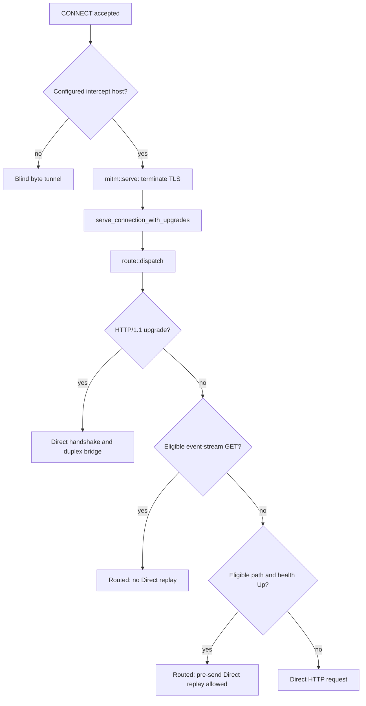

# Forward-Proxy WebSocket / HTTP-Upgrade Bridging

`proxy-forward` (`crates/proxy-forward/`) is an HTTPS forward proxy with selective
TLS interception. It routes eligible HTTP requests through mike's capture bind,
while HTTP/1.1 upgrade requests use a direct, uncaptured duplex bridge.

These are separate paths. Remote Control's
`GET /v1/code/sessions/<id>/worker/events/stream` with
`Accept: text/event-stream` is an ordinary streamed HTTP response, not a
WebSocket upgrade. It stays on the routed leg even when the health probe says
mike is down. The bridge described below applies only when the request actually
contains an HTTP/1.1 upgrade handshake; it makes no assumption about the
transport chosen by a particular Claude Code release.

The inspect API's `/api/ws` (`crates/mike/src/api/ws.rs`) is a separate WebSocket
that fans capture events out to the browser SPA. See [Request flow](REQUEST_FLOW.md)
for mike's Remote Control relay and capture behavior.

## 1. Wiring and capture boundary

On the reverse-proxy path, `ANTHROPIC_BASE_URL=http://localhost:9988` sends
Claude Code's API requests straight to mike. The sidecar offers a second path
for HTTPS traffic, including requests that do not use that base URL:

```text
Claude Code --HTTPS_PROXY--> :9987 proxy-forward --HTTP--> :9988 mike --TLS--> Anthropic
                                            \----TLS directly-----> Anthropic
```

The client must trust the sidecar's CA for intercepted TLS. `connect::handle`
parses `CONNECT`, acknowledges it and selects by hostname, case-insensitively.
The configured intercept host defaults to `api.anthropic.com`; other hosts are
blind-tunnelled to their requested host and port without decryption. The host
comparison itself does not restrict the CONNECT port to 443.

Defaults come from `crates/proxy-forward/src/config/mod.rs`:

| Role | Default |
|---|---|
| Sidecar CONNECT bind | `127.0.0.1:9987` |
| Routed capture leg | `http://127.0.0.1:9988` |
| Inspect health URL | `http://127.0.0.1:9989/api/health` |
| Intercept host / direct TLS target | `api.anthropic.com` |
| Maximum buffered request body | 64 MiB |

Capture happens in mike on the routed leg. The direct leg and blind tunnels
bypass it. Upgraded bytes are always direct and uncaptured.

## 2. Routing and failure decisions

`route::dispatch` in `crates/proxy-forward/src/route/mod.rs` checks for an
upgrade before reading the body. For ordinary requests, `leg_for` applies the
following rules; `/v1/` and `/v2/` are the eligible path prefixes.

| Request on the MITM connection | Initial leg | On routed connection/build failure |
|---|---|---|
| HTTP/1.1 upgrade handshake, any path | Direct, regardless of health | No routed attempt or replay |
| Eligible path, `GET`, Accept value containing `text/event-stream` | Routed, even while health is Down or Unknown | Return 502; never replay Direct |
| Other eligible request, health Up (stays Up until two consecutive probes fail) | Routed | Replay once Direct if failure is classified as pre-send |
| Other eligible request, health Down or Unknown (Down after two consecutive failed probes) | Direct | No routed attempt |
| Any non-eligible path | Direct | No routed attempt |

`is_event_stream_request` tests the method and the request's Accept header,
not the upstream response's content type. A streaming `POST /v1/messages`
therefore follows the ordinary health/failover rules; it does not get the
special GET event-stream treatment.

`route/legs.rs::send_routed` classifies request-rebuild errors and client
`is_connect()` failures as `Replayable`. Other request failures are
`AfterSend`: the sidecar marks health Down and returns 502 without retrying,
because replay could duplicate an upstream action. An upstream HTTP error
response is relayed, rather than treated as a transport failure. Errors after
a response body has begun remain stream errors; they cannot be replaced with
a new response or replayed.

For an event-stream GET, even a replayable failure marks health Down and
returns 502 so the client can reconnect through mike. A direct fallback would
leave a long-lived stream outside capture after mike recovers. This rule is
implemented by `event_stream_replay_skipped` and applies independently of the
health prober's current state.

The health prober checks both TCP reachability of the routed bind and the
inspect health response (`health.rs::probe_once`). Ordinary requests use that
state; eligible event streams deliberately override it.

The prober marks health Down only after two consecutive failed probes
(`DOWN_AFTER_CONSECUTIVE_FAILURES`); a success resets the streak and sets Up at
once. A single failure leaves Up as Up and Unknown as Unknown, so one slow
answer never sends ordinary traffic Direct. The probe timeout is never below
`MIN_PROBE_TIMEOUT` (5 s, applied over `MIKE_FORWARD_PROBE_TIMEOUT`): the health
handler runs its embedding reachability check, database ping and newest-capture
read together, each capped at 300 ms (`LIVE_PROBE_DEADLINE` in
`crates/mike/src/api/handlers/health/probe.rs`), and serves its slow sections
from values a background task refreshes every 60 s, so its worst case is about
0.3 s, below `HANDLER_WORST_CASE` (4 s) and the probe timeout.



## 3. Upgrade detection and request treatment

`route/upgrade.rs::is_upgrade_request` requires all three:

1. HTTP version is `HTTP/1.1`.
2. An `Upgrade` header is present.
3. A `Connection` header contains an `upgrade` token, matched case-insensitively
   across comma-separated tokens and all Connection header values.

`Connection: keep-alive, Upgrade` with `Upgrade: websocket` meets that test.
The detector is not restricted to the word `websocket`. HTTP/2 extended CONNECT
is outside this bridge's implementation.

`dispatch_upgrade` always uses the direct TLS client, including for `/v1/` or
`/v2/` requests while mike is healthy. The capture leg does not implement this
raw upgraded-stream handoff.

| | Ordinary HTTP request | Upgrade request |
|---|---|---|
| Request body | Buffered for possible replay; limit or read failure returns 413 | Forwarded live; no replay buffer |
| Connection/Upgrade headers | Removed by `route/rebuild.rs`, along with other hop-by-hop and framing headers | Preserved by `rebuild_upgrade` |
| URI authority | Routed bind or direct TLS target | Direct TLS target |
| Host header | Original Host retained on Routed; intercept host on Direct | Intercept host |
| Response | Streamed from the selected leg | Non-101 response streamed; 101 becomes a raw duplex bridge |

## 4. The handshake bridge

The ordering inside `route/upgrade.rs` matters:

```mermaid
sequenceDiagram
    participant Client
    participant PF as proxy-forward
    participant Upstream as Direct TLS upstream
    Client->>PF: HTTP/1.1 Upgrade request
    Note over PF: Claim client OnUpgrade before consuming request
    PF->>Upstream: rebuild_upgrade: live body and handshake headers
    Upstream-->>PF: 101 Switching Protocols
    Note over PF: Claim upstream OnUpgrade; spawn tracked bridge
    PF-->>Client: Mirrored 101 and headers, empty HTTP body
    Note over PF: Await both OnUpgrade futures
    Client->>Upstream: copy_bidirectional through upgraded streams
    Upstream->>Client: Raw duplex bytes
```

1. **Claim the client slot.** `hyper::upgrade::on(&mut req)` runs before
   `rebuild_upgrade` consumes the request. This future resolves only after the
   successful handshake response has been written back to the client.
2. **Send the live request Direct.** `request_upgrade_upstream` rewrites the
   URI to HTTPS and the direct authority, preserves the path/query and
   handshake headers, and sets Host to the intercept host. A request-build or
   direct transport failure returns 502.
3. **Handle a declined upgrade.** If the status is not 101, the upstream
   response is streamed back and no bridge is spawned.
4. **Claim the upstream slot and spawn.** For a 101, take
   `hyper::upgrade::on(&mut upstream_resp)`, prepare the mirrored response and
   call `tracker.spawn(bridge_upgrade(...))` before returning it.
5. **Return the 101.** `mirror_switching_protocols` copies the upstream status
   and headers into a response with an empty body. Returning it permits the
   client-side upgrade future to resolve.
6. **Relay bytes.** `await_upgrade_pair` joins both upgrade futures.
   `relay_upgraded_streams` wraps the resulting handles in `TokioIo` and runs
   `tokio::io::copy_bidirectional`. A handshake error drops the bridge; a relay
   error is logged after the HTTP handshake is already complete.

The MITM server must use `serve_connection_with_upgrades` in `mitm.rs`.
Without upgrade-aware serving, returning 101 is insufficient to make the
client-side upgraded stream available.

The shared `TaskTracker` in `MitmContext` and `DispatchCtx` owns the bridge.
`serve.rs::drain_connections` closes that tracker and gives tracked work,
including upgrade bridges, the five-second `SHUTDOWN_GRACE` drain window.

## 5. Egress must not loop into the sidecar

The intended topology has two upstream dialers: mike on the routed leg and
proxy-forward's direct TLS client. Neither should send its upstream request
back through `:9987`.

The current mike client is built by
`crates/mike/src/config/app_state/construction_pipeline.rs::build_http_client`
with `reqwest::ClientBuilder::no_proxy()`. It ignores inherited HTTP proxy
environment variables. `scripts/deploy-proxy.sh` also unsets upper- and
lower-case HTTP(S)/ALL proxy variables before launching processes.

The sidecar's direct client is constructed in `upstream.rs::UpstreamClients::build`
from a hyper `HttpConnector` wrapped by hyper-rustls. It dials the request URI
and has no environment-proxy resolver in this construction. An inherited
`HTTPS_PROXY` value alone therefore does not demonstrate an egress loop.
If either client construction changes, preserve this direct-dial behavior and
check the configured upstream/direct target; do not diagnose a loop solely
from the process environment.

## 6. Verification and source map

Existing tests exercise the distinct paths:

| Test | File under `crates/proxy-forward/` | Evidence checked |
|---|---|---|
| `websocket_upgrade_bridges_through_direct_leg_and_v1_still_routes` | `tests/forward_proxy/upgrade.rs` | 101 and headers, bidirectional upgraded payload, ordinary `/v1/messages` still routed, upgrade absent from capture stub |
| `remote_control_sse_stream_relays_each_frame_through_routed_leg` | `tests/forward_proxy/streaming.rs` | SSE frames arrive in order with streaming timing through Routed |
| `event_stream_while_health_down_goes_routed_not_direct` | `tests/forward_proxy/tunnel_and_failover.rs` | Event-stream GET returns routed 502 while down; Direct receives nothing |
| `dispatch_routed_event_stream_replayable_failure_marks_health_down_and_returns_502` | `src/route/mod.rs` | Pre-send event-stream failure marks Down and returns 502 without replay |
| `is_upgrade_request_detects_websocket_shape` / `is_upgrade_request_rejects_plain_request` | `src/route/upgrade.rs` | Upgrade detector behavior |

Run the forward-proxy suite without Postgres:

```bash
scripts/cx nextest run -p proxy-forward
```

When changing the bridge, retain upgrade detection before buffering, claim the
client slot before consuming the request, preserve handshake headers, and
spawn the tracked bridge before returning 101. Keep the event-stream
health override and no-Direct-replay rule intact alongside ordinary failover.

| Source under `crates/proxy-forward/src/` | Responsibility |
|---|---|
| `connect.rs` | CONNECT parsing and case-insensitive intercept-host selection |
| `mitm.rs` | TLS termination and upgrade-aware HTTP serving |
| `route/mod.rs` | Dispatch, GET event-stream override and failure handling |
| `route/decision.rs` | `/v1/` and `/v2/` eligibility and ordinary health-based routing |
| `route/upgrade.rs` | Upgrade detection, handshake and tracked duplex bridge |
| `route/legs.rs` | Routed/direct clients and pre-send failure classification |
| `route/rebuild.rs` | Ordinary request rebuilding and header removal |
| `upstream.rs` | HTTP/TLS client construction and direct-leg trust roots |
| `health.rs` | Routed TCP plus inspect-API health probe |
| `serve.rs` | Accept loop, task tracking and shutdown drain |
| `tunnel.rs` | Opaque relay for other CONNECT hosts |
