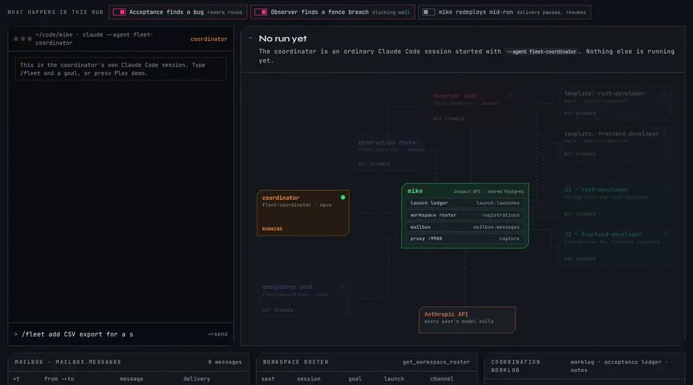

# Launch Domain

`crates/mike-launch/src/launch/` opens a terminal surface in a folder and starts a fresh Claude Code
session in it, wired to the proxy, with a preassigned session id — mike's own replacement for a
standalone terminal-launcher process. It is reached three ways: the `mike spawn` CLI verbs, the
`/api/launches` inspect routes, and the `spawn_session`/`list_launches`/`kill_session` MCP tools
(documented in [`MCP_BRIDGE.md`](MCP_BRIDGE.md)), which are HTTP clients of those routes.

These do not share one process or one `AppState`. `mike spawn` runs the launch in its own
process: it loads its own `ProxyConfig` (`crates/mike-launch/src/launch/cli/mod.rs`) and builds its own
`Runner` over the backend, the ledger and the trust gate
(`crates/mike-launch/src/launch/cli/runner.rs`), never calling the inspect API. The API path runs the
same launch code inside the running `mike` server, entered through
`open_for_server`/`kill_for_server`/`doctor_for_server` (`crates/mike-fleet/src/launch/cli/server.rs`),
with the server's own `AppState`. What all of them share is the `launch.*` ledger in Postgres —
which is why a launch made through any entry point shows up in the others.

## 1. Terminal backends

Every backend implements `TerminalBackend` (`crates/mike-launch/src/launch/backend/mod.rs`):

```rust
trait TerminalBackend: Send + Sync {
    fn id(&self) -> BackendId;
    fn capabilities(&self) -> Capabilities;
    async fn probe(&self) -> ProbeReport;
    async fn validate(&self) -> ValidationReport;
    async fn open(&self, req: &OpenRequest) -> Result<Surface, LaunchError>;
    async fn find_by_session(&self, session: Uuid) -> Result<Option<Surface>, LaunchError>;
    async fn close(&self, surface: &Surface, wait: Duration) -> Result<CloseOutcome, LaunchError>;
    async fn list(&self) -> Result<Vec<Surface>, LaunchError>;
}
```

`Capabilities` declares what a backend can actually do — `placement_workspace`/`placement_tab`/
`placement_split`, `agent_state`, `prompt_in_argv`, `close_by_session`, `events` — so a caller
checks a capability before relying on it rather than discovering the gap at runtime. A backend
without `agent_state` cannot tell you whether a launched session is idle, working or blocked;
liveness for those backends comes from the workspace roster's channel fields alone (the
workspace-coordination tools in [`MCP_BRIDGE.md`](MCP_BRIDGE.md)), not from the backend.

`backend_for(BackendId)` hands out a backend. Five ids have a real adapter today
(asserted by `backend_for_herdr_tmux_terminal_and_none_exist_ghostty_absent` in
`crates/mike-launch/src/launch/backend/mod.rs`):

| Backend | Module | What it is |
|---|---|---|
| `herdr` | `crates/mike-launch/src/launch/herdr/` | Drives the `herdr` CLI (JSON on stdout, one process per call, bounded timeouts, never a shell) against its persistent server. The only backend with `agent_state` and a session-uuid join, so it gives the richest liveness reads. |
| `herdr-core` | `crates/mike-launch/src/launch/herdr_core/` | The Herdr desktop app. Starts claude with `hc run --bg --keep` labelled `herdr.space`/`herdr.tab`, which the app adopts as a tab: in the caller's space when it is in the folder, else a space already in the folder, else a new space (a fleet run gets one space). `mike.session`/`mike.name`/`mike.run`/`mike.seat` labels drive find, list and kill (`hc kill`); the first prompt goes by `hc send`, confirmed when the agent reports working or its turn advances. herdr-core carries Claude Code's working/idle/blocked/done, so it has `agent_state`. Fleet focus uses `herdr-app do agent.focus`. |
| `tmux` | `crates/mike-launch/src/launch/tmux/` | Drives the `tmux` CLI for headless hosts — SSH sessions, containers, anything with no display for herdr's server. No `agent_state`. |
| `terminal` | `crates/mike-launch/src/launch/terminal/` | **Hyprland only.** A plain window per launch via `xdg-terminal-exec`, found again through `hyprctl clients -j` and closed with a direct signal on the window's pid — no persistent server and no multiplexer pane, so every launch is its own OS process tagged by an `--app-id`. `Capabilities::prompt_in_argv` is `true`: there is no side channel to submit a prompt after the window opens, so the prompt travels in the claude argv. |
| `none` | `crates/mike-launch/src/launch/backend/none.rs` | **The default.** Hand-launch only, and it means "no backend chosen yet", not "launching is disabled". A real implementation so the domain never special-cases "no backend"; every launch verb refuses with the remedy ("`mike claude` in the current pane; `mike spawn open` is unavailable"), and every read answers "nothing". |

The `terminal` backend's probe (`crates/mike-launch/src/launch/terminal/probe.rs`) requires all three of
`xdg-terminal-exec` on `PATH`, a `hyprctl version -j` that answers, and a non-empty
`$WAYLAND_DISPLAY` — it reports unavailable if any one fails, so it is not a generic
Wayland or X11 backend. On a host without Hyprland, use `herdr` or `tmux`.

`ghostty` is a recognized `BackendId` (it appears in the schema's CHECK constraint and the setup
wizard's backend list) with no adapter yet — it parses, but `backend_for(BackendId::Ghostty)`
returns `None`, and configuring it makes every `mike spawn` verb fail with
`BackendUnavailable`.

A launch opens where its caller runs (`crates/mike-launch/src/launch/backend_choice.rs`, temet-ai/mike-private#691). A caller
in a Herdr app terminal (`HC_TERMINAL_ID`) gets `herdr-core`; one in an old herdr pane
(`HERDR_PANE_ID`) gets `herdr`; one in tmux gets `tmux`. `spawn_session` forwards those variables
as `caller_env`. With no caller to go by (a fleet seat, a phone over Remote Control), the first of
`herdr-core`, `herdr`, `tmux` whose socket answers is used, else `launch_backend` /
`MIKE_LAUNCH_BACKEND` (default `none`, set by the setup wizard's terminal step or directly).
`launch_backend_follow_caller = false` always uses `launch_backend`, and a `POST /api/launches`
body may name a `backend`. The choice and its reason are recorded on
`launch.launches.backend_reason`, returned by the launch API and printed by the CLI; kill reuses
the backend a launch recorded. While `launch_backend` is `none` nothing is chosen and every launch
verb refuses. `mike spawn doctor`
re-runs the configured backend's probe and, when it is available, a live validation in a scratch
workspace; every validation is recorded on `launch.backend_validations` (see
[`SCHEMA.md`](SCHEMA.md#domain-launch)) so setup, `/settings` and doctor all read the same "when
did this backend last actually work" history.

## 2. The `mike spawn` CLI

Eight verbs, all in `crates/mike-launch/src/launch/cli/`:

| Verb | Does |
|---|---|
| `open <folder> [placement] [flags] [claude args]` | Opens a terminal surface in `folder` and starts `claude` in it with a preassigned session id. |
| `kill --session <uuid>` | Closes the surface hosting `<uuid>`, and only that one; a second call is an exit-0 no-op. |
| `list [--run <id>]` | One line per surface the backend hosts, joined against the ledger's open launches, newest launch first; unmatched surfaces follow in surface-ref order. `--run` scopes to one run's seats. |
| `doctor` | Runs every dependency check for a launch (backend, sidecar, CA certificate, the `claude` binary, the inspect API, the database) with the remedy beside each failure. |
| `warm <folder> --name <discipline> [flags] [claude args]` | Launches exactly like `open`, then records the claude arguments as a named template; a second `warm` under the same name supersedes the previous one. |
| `fork <discipline\|session-uuid> [--folder <dir>] [flags] [claude args]` | Resolves a template by name or session uuid, then launches through the same path as `open` with `--resume <template session> --fork-session --session-id <new>` and the template's recorded argv prepended ahead of the caller's own. |
| `templates [list\|show <name>\|delete <name> --yes]` | Lists, inspects or closes warm templates on record. |
| `reap [--yes]` | Lists (dry run by default) orphaned claude processes — never the caller's own process or any of its ancestors — and, with `--yes`, signals them. |

`open`, `warm` and `fork` share one argument shape: the folder (or, for `fork`, the template)
comes first, spawn's own flags may appear anywhere after it, and every other token is a claude
argument kept in order; a literal `--` forwards the rest verbatim. The shared flags are parsed by
`split_launch_args` (`crates/mike-launch/src/launch/request/split.rs`); the rest are verb-specific.

| Flag | Verbs | What it does |
|---|---|---|
| `--tab` | open, warm, fork | Tab placement — what a launch gets when no placement flag is given. Mutually exclusive with `--split`. |
| `--split <l\|r\|u\|d>` | open, warm, fork | Split placement in that direction. A backend without split support ignores it and reports what it actually did in the launch's `actual_placement`. |
| `--panel` | open, warm, fork | Panel placement. Unlike `--split`, it may be combined with `--tab`. |
| `--anchor-terminal <surface ref>` | open, warm, fork | Targets a specific existing pane for a split placement. Refused (`Unsupported`) by a backend with no addressable-pane concept to anchor against. |
| `--run <id>` | open, warm, fork | Groups the launch with its run's siblings. On herdr, when no placement flag is given, the first launch under a run id creates a workspace labelled with the run id and records it on `launch.runs`; every later launch under that id goes into that workspace. The seat's role picks its tab: coordinator, observer and acceptance go to `control`, a seat named `template…` to `templates`, everything else to `workers`. Inside a tab the largest pane is split, to the right when it is at least twice as wide as it is tall and down otherwise, and never below 100 columns by 30 rows; a tab with no room starts `workers 2`. The pane is named after the seat and the seat name is reported to herdr for its sidebar (`crates/mike-launch/src/launch/herdr/run_layout.rs`). An explicit `--tab`, `--split` or `--panel` places the launch the old way, by folder. tmux and terminal do not group by run. |
| `--seat <name>` | open, warm, fork | Names this launch's seat within its run, recorded on the ledger row alongside the run id. Also becomes the session's roster **name** unless `--session-name` overrides it. |
| `--role <role>` | open, warm, fork | The role the new session declares — free text, open set, and what `role:` mailbox fan-out resolves against. On `warm`, defaults to the template's `--name <discipline>`. |
| `--instructions <text>` | open, warm, fork | The standing brief the new session works under, distinct from its goal and from the first-turn prompt. |
| `--goal <text>` | open, warm, fork | What the new session is working on. |
| `--session-name <name>` | open, warm, fork | The roster name, when it should differ from `--seat`. Note `--name` is **not** this: on `warm` it already means the template's discipline. |
| `--prompt-file <path\|->` | open, warm, fork | Reads the brief from a file, or from stdin with `-`. There is no inline prompt flag. |
| `--worktree-ok` | open, warm, fork | Permits launching inside a linked git worktree that sits outside the repository's `.claude/worktrees/`, which is otherwise refused; a worktree under `.claude/worktrees/` needs no flag. |
| `--no-carry-config` | open, warm, fork | Skips copying the main checkout's carried config files into a linked worktree the launch accepts. |
| `--trust` | open, warm, fork | Records the folder in `~/.claude.json` before launching, so Claude Code's own trust dialog cannot swallow the prompt. |
| `--no-trust` | open, warm, fork | Refuses an untrusted folder instead of trusting it — overrides `launch_auto_trust`. |
| `--no-proxy-env` | open, warm, fork | Launches without `HTTPS_PROXY`/`NO_PROXY`/`NODE_EXTRA_CA_CERTS` pointed at the forward sidecar. |
| `--no-remote-control` | open, warm, fork | Launches without appending `--remote-control` to the claude argv. |
| `--no-channels` | open, warm, fork | Launches without adding `--dangerously-load-development-channels server:mike`, opting out of the default MCP channel wake path. |
| `--json` | every verb | Prints exactly one JSON object on stdout instead of the human rendering. |
| `--name <discipline>` | warm | Required. The template name this launch is recorded under. |
| `--folder <dir>` | fork | The folder to launch the fork in, when it differs from the template's. |
| `--allow-prefix-change` | fork | Opts into a prefix-flag divergence from the template (see below). |
| `--session <uuid>` | kill | Required. The session whose surface to close. |
| `--run <id>` | list | Scopes the listing to one run's seats. |
| `--yes` | reap, `templates delete` | Confirms the destructive action; without it `reap` is a dry run. |

The legacy `-m <model>` and `-p`/`--prompt` forms are rejected with a usage error rather than
being passed through to claude.

When `open`, `warm`, `fork` or `spawn_session` names a recorded `fleet-<slug>-<8 hex digits>`
run and supplies a role or seat, it inherits the fleet's effective seat settings before opening:
scratch directories, config isolation, plugin defaults, MCP profile and the definition's
`seat_settings` overrides. The explicit role selects the profile; otherwise the seat name does,
including numbered control successors such as `acceptance-2`. The lookup verifies the exact
recorded run id and is bounded to five seconds. Missing, mismatched or unavailable fleet records
refuse the launch with `fleet_settings`, rather than opening a partially configured successor.

An existing Claude `--settings` or `--settings=...` argument is a complete override: mike keeps
it verbatim and skips automatic inheritance and its lookup. This applies to caller arguments,
template arguments and operator launch defaults. To inherit fleet defaults plus a custom
override, put the custom fields in the fleet definition's `seat_settings`; the explicit
`--settings` path does not merge them. Ordinary runs and detached `retro-*` runs are unchanged.

`fork` refuses when a caller-given `--model`, `--agent`, `--append-system-prompt-file`,
`--settings`, `--add-dir` or `--mcp-config` disagrees with what the template recorded for it —
these six flags fix a template's prompt-cache prefix, and a fork that silently diverged from them
would pay a full cache miss on its first request without saying why. `--allow-prefix-change` opts
into the divergence explicitly. The forked session's own id is always fresh, never the template's.

### Spawning a session that is already somebody

`--role`, `--instructions`, `--goal` and `--session-name` are the session's **identity**, and they
are applied without the session doing anything. Because the launcher preassigns the session uuid
(see below), mike records the identity against that uuid on the ledger row
(`launch.launches.identity`, a JSONB handoff payload). When the session starts, the launcher's
registration (or, failing that, mike's passive registration on its first captured request)
reads the pending identity and writes it to `sessions.session_goals`. The seat is on the roster as `observer-1 [observer]`, with its charter
readable by peers, **before its first turn and without a single tool call**.

Precedence is strict: a value passed explicitly on the registration call wins; otherwise the
launch-seeded value applies; otherwise whatever the session already has is left alone. A seed never
overwrites an identity a session declared for itself — SessionStart re-registers on every start, so
a stale seed clobbering a mid-run self-declared role is exactly the failure this ordering prevents.

A seat launched without these is a uuid prefix with no role, which means `role:` mail never reaches
it and a later "what did the observers find" query does not see it. `spawn_session` over MCP takes
the same fields under the plain names `name`, `role`, `instructions` and `goal`.

### Session id and brief delivery

`--session-id <uuid>` after `--` preassigns the launch's session id; the launcher pushes it first
in the claude argv it hands to the backend. Without it, a fresh launch gets a freshly generated
uuid. `--resume <uuid>` keeps that uuid as the launch's session id (nothing is preassigned: the
resumed session already has it). `--continue`, `--resume` with no uuid, and `--resume … --fork-session`
without `--session-id` leave the session id unknown, because claude picks or mints it. The literal placeholder `{{session_id}}`, wherever it appears
in the prompt or in any claude argument, is substituted with the launch's real session id — known
or generated — before the surface opens, so a brief can state a seat's own identity without the
caller minting a uuid and threading it through by hand.

There is no inline prompt flag. `--prompt-file <path|->` reads the brief from a file, or from
stdin with `-`. Once mike has the text, `launch_brief_inline_max` (default 800 characters,
`MIKE_LAUNCH_BRIEF_INLINE_MAX`) decides how it reaches the surface: at or under the limit it
travels with the claude invocation itself (or however the backend submits a prompt, when
`Capabilities::prompt_in_argv` is false). The launch row (`launch.launches.brief_text`) always
carries the whole text, never a slice.

**Briefs are session notes.** When the session id is known and the ledger is reachable, the
launcher mints a note uuid (`launch.launches.brief_note_uuid`) for every brief, inline ones too.
Workspace registration turns the launch row into a `workspace.session_notes` entry under exactly
that uuid (`kind` `brief`, tags `brief`/`launch`, `data` carrying launch id, run, seat, model and
agent), so `list_session_notes` with `kind: "brief"` finds what any spawned session was told.

**Over the limit, the brief is pushed over Remote Control, or staged to a file.** With the
`launch_brief` feature toggle on (global, default on, `/settings`; the launcher reads it at each
spawn), the launch's `brief_mode` is `note` and nothing is typed into the session. Once the
channel check links the session's Remote Control stream, the launcher calls
`POST /api/launches/{session}/brief`. mike mails the brief from itself (no sending session) under
the note's uuid and pushes it over Remote Control. Claude Code presents that push as "Another
Claude session sent a message … treat it as a teammate's request", so the idle session starts
work on it; the brief is inserted once and stays in the session's own history. Brief mail is never
delivered through the mike channel, which Claude Code frames as untrusted data it will not act on
(see [`INJECTION_TRUST.md`](INJECTION_TRUST.md)). Claude Code's receipt of the push marks the mail
consumed, and `launch.launches` rows (`mike spawn list`, `list_launches`) carry that as
`brief_read_at`: the moment the session took its brief in. If nothing was pushed (no Remote
Control stream, no proxy, a failed call), the launcher types a short pointer instead, the
operator's own first message telling the session to read its brief note with
`list_session_notes`. With the toggle off, the session id unknown, or the launch row not written,
mike falls back to `brief_mode` `file`: it stages the text to a private 0600 file under its briefs
directory (`~/.local/state/mike/briefs/<session>.md`) and tells the session to read it. The file
is the last resort for a launch mike cannot record; a brief kept only in a file cannot be read
from another machine or by a later session.

**A fleet keeps its briefs as notes.** A fleet whose definition carries
`briefs: {"as_notes": true}` stores each brief as notes. `define_fleet` writes that value into
every new definition (`api/fleet/definition_patch.rs`, `parse_new`), and a definition may set it
to `false`. A definition stored before that default, with no `briefs` field, reads as `false`,
so a fleet that was already defined keeps the delivery it started with. A fleet stores each brief in parts instead of as one text per seat. A note of kind `brief` tagged `part:run`
holds the run's part: the goal, the ask, the criteria, the rules, how the project is built and
checked, and the shared files. One note tagged `part:task` and `task:<id>` holds each task's part:
its name, brief, criteria and files. The discipline's template is given the run's part when it is
warmed, so every seat forked from it starts with that already in context. The file a worker reads
at launch is written from the notes: the task's part, then one line naming the run note and
saying how to read it. It does not list the other seats; a seat reads them with `get_fleet`.
With `briefs.as_notes` on, a seat's first message is composed from its run note and its task
note, each headed with the note id and version, with a "Brief parts given" line recording the
versions, and no brief file is written; if `as_notes` is off or a note cannot be read, the file
is written as before.
When the task list changes, the changed part is stored as a new note with the next version and
`supersedes` naming the old one, and the seat is mailed only the lines that differ. Each new note
also writes a `brief` event to the [change record](CHANGE_RECORD.md) while that is on. Without
the item every brief is exactly what it was.

By default a launch also gets `--remote-control`, the MCP channel flag
`--dangerously-load-development-channels server:mike`, and the proxy environment —
`HTTPS_PROXY`/`NO_PROXY`/`NODE_EXTRA_CA_CERTS` pointed at the forward sidecar. `remote_control`,
`channels` and `proxy_env` are **per-launch** fields, not boot config: on the API they are fields of the
`POST /api/launches` body defaulting to true (`CreateLaunchRequest`,
`crates/mike-fleet/src/api/launches/mod.rs`), and on the CLI they are the same three booleans carried in
`SplitLaunchArgs`, turned off per launch with `--no-remote-control`, `--no-channels` or
`--no-proxy-env`. There is
no `launch_remote_control` or `launch_proxy_env` in `LaunchConfig`. What *is* boot config is
where the environment points — `launch_proxy_forward_url`, `launch_no_proxy`, `launch_ca_cert`
— and the rest of the `launch_*` knobs in [`CONFIGURATION.md`](CONFIGURATION.md).

MCP channel delivery requires the `mike` server to be configured at user scope and Claude Code's
development-channel confirmation. The herdr adapter watches for that confirmation and accepts it
when it appears; other backends may need the operator to do so. A live mike-mcp listener takes
mailbox delivery ahead of Remote Control; without it, Remote Control push or next-request
injection remains the fallback. A launch's Remote Control `channel_check: found` does not prove
the MCP listener is live or a message has been read. See [`MCP_BRIDGE.md` §7](MCP_BRIDGE.md#7-channel-push-mailbox-wake-over-mcp).

An untrusted folder is refused unless `--trust` (or `launch_auto_trust`, default false) records it
in `~/.claude.json` first, so Claude Code's own trust dialog cannot swallow the prompt.
A linked git worktree under the repository's `.claude/worktrees/` launches as usual; one anywhere else is refused unless `--worktree-ok` is passed, because worktrees live inside their repository.

### Exit codes

`LaunchError::exit_code` (`crates/mike-launch/src/launch/error.rs`) is the authoritative mapping:

| Code | Meaning |
|---|---|
| `0` | The verb did what it was asked. |
| `1` | Refused or failed — `Usage`, `Refused`, `Failed`, `Io`, `Timeout`, `BackendResponse`, `Malformed`, including a channel-check timeout on an otherwise-open surface. |
| `2` | `Unsupported` (the backend has no such capability, e.g. `--anchor-terminal`) or `Unconfirmed` (the action may have happened; nothing proved it). |
| `69` | `BackendNone` or `BackendUnavailable` — no backend chosen, or the configured one has no adapter / is not answering. |
| `127` | `ExecutableNotFound` — a required executable is missing (the backend CLI, or `claude` itself). |

The `after_help` text on `mike spawn open` lists only 0/1/69/127 and omits 2; the table above
matches the code.

## 3. Lifecycle and how it is observed

`POST /api/launches` (also used by MCP `spawn_session`) starts a launch in the background.
The CLI `open`, `warm` and `fork` commands wait for surface opening, prompt delivery and the
channel check before returning: `open::execute` awaits `launch`, which awaits `finish`; `warm`
also awaits `open::finish`, and `fork` calls `open::execute`. The session itself continues
running after either entry point returns.

The HTTP surface is narrower than the CLI: `crates/mike/src/api/manifest/launches.rs` registers
create (`POST /api/launches`), list (`GET /api/launches`), detail
(`GET /api/launches/{session}`), kill (`DELETE /api/launches/{session}`), doctor
(`GET /api/launches/doctor`) and the brief push (`POST /api/launches/{session}/brief`). Beside
them sit routes only mike's own processes call: `POST /api/launches/{session}/mcp` (mike-mcp
reports that a session listed its tools) and `/api/launch-ledger/*` (the ledger `mike spawn`
reads and writes through the server when its own database connection is unavailable).
`warm`, `fork`, `templates` and `reap` are CLI-only; there is no route and no MCP tool for them. `mike spawn open`/`warm`/`fork` do **not**
call `POST /api/launches`; they run the launch in-process. The route is what `spawn_session` and
the SPA call.

`POST /api/launches` returns `{launch_id, session, backend}` as soon as the ledger row exists and
the fast, local checks pass — the trust gate, the worktree refusal, the surface cap (`launch_warn_surfaces`/
`launch_max_surfaces`). Opening the surface, registering the session on the workspace roster
(`registered_via: launcher`, before the session's first request; carries `location_uuid` when the folder's repository has a `.mike/knowledge.json` and the machine has a `machine.json`, see [`PROJECT_KNOWLEDGE.md`](PROJECT_KNOWLEDGE.md)), and waiting for its Remote
Control channel all continue afterward. A synchronous refusal (bad folder, an untrusted folder
without trust, no backend configured, the surface cap reached) returns an error instead of a
`launch_id` and never reaches the ledger.

Four ways to watch a launch finish landing, in order of cost:

- **Poll `GET /api/launches`** (MCP `list_launches`, optionally `?run=`) for the
  same session and read `opened`, `delivered`, `confirmed`, `channel_check` and `result` —
  `pending` until the outcome is known, then `success`/`unconfirmed`/`failed`.
- **`GET /api/launches/{session}`** for one launch's full row.
- **Subscribe to `/api/ws`** and watch for a `RowChanged` event on `launch_launches` carrying the
  launch's `id` and `session_id` — the same `proxy.row_changed` NOTIFY channel every other
  live-updating table already uses, fired by the trigger in migration
  `20260916030000_launch_launches_row_changed_trigger.sql` on every insert, update and delete.
- **`GET /api/workspace/roster`** for the session's own row, once it should have registered.

`mike spawn list` is a surface inventory, not the same response shape as `list_launches`: it
shows the surface, folder, session, backend agent state, run and seat. Use the API or MCP tool
for `result`, `channel_check` and the delivery fields. The ledger query orders newest first
(`created_at DESC, id DESC`); the CLI preserves that order for joined surfaces.

`channel_check` records whether the launcher found the session's Remote Control channel:
`found` is the only pass; `timeout`, `db_unreachable`, `no_session_id` and `disabled` are not.
`result` on the ledger row is the terminal verdict: `pending` while still in flight, `success`
once opened/delivered/confirmed/channel-checked all landed, `unconfirmed` when the surface opened
but delivery or the channel check could not be confirmed, `failed` otherwise — with `reason` and,
for a failed backend call, a capped `stderr_text`/`stderr_truncated` pair.

`DELETE /api/launches/{session}` (`mike spawn kill` / `kill_session`) closes the surface hosting
a session, waiting up to `launch_kill_wait_secs` (default 20s) for the claude process to exit and
reporting `process_exited` in the response. A session with no known surface, or a surface already
gone, comes back as a no-op (`closed: false`) rather than an error. Closing a surface calls the
backend's own close (a herdr pane close, a tmux kill-window, a direct signal on the terminal
adapter's tracked pid) — there is no interactive window-close dialog to answer, but the claude
process under it can still take on the order of ten to twenty seconds to exit after the surface
is gone, so `list_launches`/`mike spawn list` reporting the surface closed is not by itself proof
the process has too.

## 4. Storage

The `launch` Postgres schema (`launches`, `templates`, `runs`, `backend_validations`) is the
durable record of every launch attempt, whatever its outcome, and of the warm templates a fork
starts from — see [`SCHEMA.md`](SCHEMA.md#domain-launch) for the full column reference. Nothing
here is in memory only: a restart of the `mike` binary loses no launch history, and the CLI, the
MCP tools and the inspect UI all read the same rows.

## 5. Fleets

A fleet is one goal split into tasks, each given to its own launched session, all committing to one branch of one checkout. The definition lives in mike's database (`launch.fleets`); a session writes it with `define_fleet` (see [`MCP_BRIDGE.md`](MCP_BRIDGE.md)) and mike starts and supervises the run (`crates/mike-launch/src/launch/fleet/`). The reader-facing description is [`user-guide/fleets/`](user-guide/fleets/README.md), with how a run proceeds in [`user-guide/fleets/how-a-fleet-runs.md`](user-guide/fleets/how-a-fleet-runs.md); this section is the mechanism.

`mike fleet` is the operator's window onto a fleet. Its operator commands hold no database connection: they call the inspect API at the configured `inspect_listen_addr`, so they work from any shell that can reach that address. `<fleet>` is a fleet uuid or a slug, passed through unchanged.

| Command | Calls | Prints or does |
|---|---|---|
| `mike fleet status <fleet> [--watch <seconds>] [--json]` | `GET /api/fleets/{fleet}/status` | One screen: what is missing, the header, every task, every open seat, the newest verdicts and what is blocked. `--json` prints the answer as received. |
| `mike fleet list [--project <path>] [--json]` | `GET /api/fleets` | One line per fleet: slug, state, how many items are missing, when it was created, the run id. |
| `mike fleet start <fleet>` | `POST /api/fleets/{fleet}/start` | The state the fleet is now in. Needed only when the `fleet_auto_start` setting is off. |
| `mike fleet stop <fleet>` | `POST /api/fleets/{fleet}/stop` | Closes each open seat's pane (as `mike spawn kill --session` would), records each launch closed with reason `fleet stop`, closes the run and marks the fleet `done`. Refused with `409` unless the fleet is `running`. It never closes the whole workspace, which can hold panes that are not seats. |
| `mike fleet summary` | status | One line for a status bar: the newest running fleet's progress. |
| `mike fleet focus <fleet> [seat]` | status | Brings a seat's pane to the front: the named seat, else the first blocked seat, else the seat of the newest FAIL. |
| `mike fleet record <fleet> [--recompute] [--against <fleet>] [--json]` | `GET /api/fleets/{fleet}/record` | A finished run's record (below). |
| `mike fleet commit`, `check`, `where`, `gate` | `/commit`, `/check`, `/where`, `/gate` | For the sessions inside a fleet; described below. |

Exit codes: `0` when the call succeeded, `1` when the API answered with an error (a `409` from `start` prints its message) or could not be reached; an unreachable API is reported with the address that was tried. `--watch N` clears the screen and redraws every N seconds (N at least 1) until interrupted; a failed call is drawn where the frame would be and the loop keeps going, so a proxy restart does not end a watch.

The drawing is `launch::fleet::render::render(&FleetStatus, width)`, a pure function of the status the API answered. The width is the terminal's, then `COLUMNS`, then 170; a row wider than the width is cut and ends with `…`, never wrapped. Colours are 24-bit ANSI codes, dropped when standard output is not a terminal or `NO_COLOR` is set. The context bar is 20 cells for a 1,000,000-token window with a mark at 600,000, where a reference seat is replaced: green below 400,000, yellow below 600,000, red from there, with the word `replace` after the number.

### What mike carries

The `fleet-rule-auditor` and `fleet-capability-author` agent files, the `fleet-worker` skill (appended to every worker seat), the shared rules, the three leaf prompts, the outcome-check script and the `/fleet` command are compiled into the binary (`launch/fleet/bundle.rs`). mike calls the leaf prompts from the binary and never writes them to disk. When a fleet is checked for readiness, mike writes the rules, the worker contract and the outcome-check script to `~/.local/state/mike/fleet/` (seats read the rules by path, Claude Code takes the contract with `--append-system-prompt-file`, and the script is run), the agents and skill under `~/.claude/` (only files it wrote before, never one the operator edited) and the command to `~/.claude/commands/fleet.md` (only when nothing is there). A project's own copy under its `.claude/fleet/` or `.claude/agents/` takes precedence, file by file; `workers.<discipline>.contract` names another contract file for that discipline, and `"none"` appends none. A worker's brief carries facts (its task, files, criteria, rules, peers and the tools and what each does) and no working method, which is the definition's to give; a project says how it is built in `.claude/fleet/project.md`, which every brief names when it exists. So a fleet starts in any project mike runs, and a project that wants different seats or rules keeps its own versions.

### How a fleet starts and staffs itself

On `ready` (or `mike fleet start`), `mike serve` (`launch/fleet/start.rs`):

1. Runs the definition's `gate.command`, when declared, on the clean fleet-branch commit in the managed gate slot (`start_baseline.rs`). A dirty tree, changed commit, timeout or unverified result stops startup without discarding edits. A verified failure opens no workers; only a dependency-free repair task named by `baseline.repair_task` may start until the current clean commit has a passing gate result. A fleet with no declared gate is not held.
2. Opens the status pane (`status_pane.rs`), and records its pane and workspace on the fleet row. When the fleet is done the stop closes the pane and, if the run created it, the workspace.
3. Warms one template per discipline that has a task (`warm.rs`): a session that reads `.claude/fleet/rules.md`, the discipline's load list under `.claude/fleet/templates/` (the file named for the discipline, else the one named for its role file) and the fleet's definition, and ends its turn. When the template's pane reads idle, mike records it as the template `<run id>:<discipline>` and closes the pane; its transcript is what forks resume. A template that does not load within 480 seconds is not recorded, and that discipline's workers start cold. Only a template of the same run is forked from.
4. Forks a reference seat from a loaded template (below).
5. Records fresh session ids under `coordinator.session` and `acceptance.session` on the definition. No coordinator, acceptance or observer session is opened; the tick's steps and three model calls (the leaves) do their work.

The status-pane worker then runs a pass on every running fleet every 20 seconds (`display.rs`). Its first step, `staff`, starts a worker for every task whose derived state is `queued` (no live seat, not done) and whose `after` tasks are ready, accepted or done (`staff.rs`), so a task starts within a pass of the verdict that frees it. An in-process claim per run and task (`staff_claims.rs`) keeps two passes from starting one task. The claim holds past the launch row opening and is released only when a later status snapshot no longer lists the task as `queued` (the seat is confirmed), when the launch failed with no pane possibly open, or after ten minutes unconfirmed. Before it picks tasks, each pass marks as opened any launch of the run that was never marked opened but whose session has sent requests (a pane that opened while its receipt failed to save), and does not start those tasks again. Closing a launch that was never marked opened (`POST /api/launch-ledger/launches/{id}/closed`) records the closure and, once the process is known gone, settles it. The seat's launch is recorded as events, not written onto the definition. `launch_max_surfaces` limits how many workers run, and the definition may add two limits of its own under `staffing`: `max_seats` (live plus starting worker seats) and `min_free_memory_gb` (no new seat starts while the host's free memory is at or below it); with neither set, nothing else limits staffing. When there is no room the tasks wait for the next pass. `define_fleet`'s `at_ready.capacity` and the fleet status's `capacity` report the planned and live seat count, free host memory, builds in flight and queued per lane, each queued check's place in line and expected wait (from the measured run time of its command), and the run's measured build waits. A fleet also ends without being stopped: an open seat whose recorded process id is gone is recorded closed with reason `process exited`, and once no open seat is left the run is closed, its templates are retired and the fleet is marked `done`. A seat with no recorded process id counts as live.

**Fleet seats refuse accidental desktop opens by default.** On Unix, every fleet role, warm template and inherited successor gets `BROWSER=true` plus a private helper directory (`browser_guard.rs`). Mike installs the helpers before launch and refuses a launch when installation fails. The terminal backend activates that directory in the actual launch shell before Claude starts, so MCP servers the seat launches inherit it too. For Herdr, mike waits for the existing shell-prompt check, submits activation once and requires an exact private per-launch receipt within 20 seconds before requesting agent start; absent, mismatched or uncertain activation refuses the launch. A SessionStart hook also appends the activation to Claude's environment file for later Bash tools.

PATH-resolved `xdg-open`, `open`, `gio open` and `gio launch` return exit 126 with a blocked diagnostic. Other `gio` operations resolve the original executable with only the helper directory removed from the lookup path; their arguments, output and exit status are preserved. Nothing changes the desktop session, default browser, MIME configuration or the operator's global environment. Set `seat_settings.env.MIKE_FLEET_BROWSER_GUARD` to `"0"` to opt out for newly launched seats. This is accidental-launch containment, not a sandbox: absolute executable paths, other desktop launchers, aliases, deliberate PATH replacement and MCP servers that do not inherit the seat environment are outside it. Seats return links to the operator instead of opening their desktop.

An existing Claude `--settings` override bypasses fleet defaults entirely, including this guard's hook; disabling hooks skips the Bash refresh but keeps prelaunch activation.

**Declared background commands.** With `execution.background_commands` set, fleet seat settings append a Bash `PreToolUse` hook that requests native background execution for each declared command. An entry is a program and leading words (`npm run build`, `scripts/slow`); a seat's command matches when it starts with those words, including plain environment assignments, numeric `timeout` and supported compound shell commands, and a bare program name also matches that program by absolute path. Only `run_in_background` changes; the hook neither executes the command nor grants permission, and no executable or PATH entry is replaced. The hidden `mike fleet background-hook` helper reads bounded JSON on stdin without loading configuration or a database, and requires a `MIKE_RUN_ID` beginning with `fleet-` and a declaration in `MIKE_FLEET_BACKGROUND_COMMANDS`. A seat's own `seat_settings.env.MIKE_FLEET_BACKGROUND_COMMANDS` of `"[]"` opts out; `disableAllHooks` and `CLAUDE_CODE_DISABLE_BACKGROUND_TASKS=1` are respected. Unsupported shell syntax, undeclared commands, aliases and opaque wrapper scripts are left alone; use `fleet_check(command)` for those long jobs. The result is Claude's native background task id and completion notification, not a mike receipt or mail; native tasks are session-bound. For durable queueing, deduplication and completion mail use `fleet_check(command)`. An unconfirmed native completion stays `completion_unknown` in fleet results; elapsed time never turns it into a pass. See Claude Code's [PreToolUse input updates](https://code.claude.com/docs/en/hooks#pretooluse-decision-control) and [background Bash commands](https://code.claude.com/docs/en/interactive-mode#background-bash-commands).

### Watching the checkout

The status-pane worker starts one watcher per running fleet (`launch/fleet/watch.rs`). Once a second it runs `git status --porcelain=v2` in the run's repository and, when the output moved, reads the index and hashes the changed files; every path added, changed or deleted becomes a row in `launch.tree_changes` with its blob hash and the time. Attribution distinguishes direct file-tool evidence from inferred shell candidates; concurrent shell calls and ownership alone do not prove authorship, so ambiguous changes keep their candidates. `GET /api/fleets/{fleet}/changes` (tool `list_fleet_changes`) lists them with the seat, the owning task and a note for a write outside a task's files. `GET /api/fleets/{fleet}/results` (tool `list_fleet_results`) lists the seats' captured Bash commands and the changes observed since each started. `still_valid: null` means commit binding, dependency closure or change coverage is unproven; observed invalidation or update mode yields false. `paths` filters displayed changes only; `include_output` adds tool error flags, output tails and exact session and use ids; tool success does not establish a test pass.

### Project-declared operations

mike assumes no language or build tool. What a project's builds need is declared in `execution`, usually from `.claude/fleet/operations.json`, beside prose rules in `.claude/fleet/project.md`; a project that declares nothing gets none of it.

| Setting | What it does |
|---|---|
| `operations` | Named exact commands and their contracts, below. |
| `timed_commands` | A map from a bare program name to `{subcommands, resources, through}`. mike puts a shim of that name first on the seats' `PATH`, in their Bash tool only. See *Timed commands*. |
| `background_commands` | Commands a seat's foreground Bash call is moved to the background for (*Declared background commands*). |
| `strip_environment` | Variables removed from the environment of every command mike runs itself (checks, gates, rulings). An operation's own `environment` is applied after, so it still wins. Changing the list invalidates recorded check and gate results. |
| `disabled_plugins` | Plugin ids turned off in every seat's `enabledPlugins`. `seat_settings.enabledPlugins` overrides an entry. |
| `build_directory_settings` | Names of an environment variable or option that picks a build directory. When briefs name two or more directories, other than the check's own, the definition is refused: each one builds cold. An entry starting with `-` also matches its value as the next word. |
| `package_manifests` | `{file, contains, label}` entries. A directory holding `file` with `contains` in it is a unit; `at_ready` warns when two tasks change the same unit. A nested `package.json` counts without being declared. |

A key under `execution` that mike does not read parses and does nothing, and `at_ready` names it as a warning, so a mistyped setting shows up before the fleet starts and a stored definition with a retired key keeps working. The retired `execution.cargo` and the top-level `build_slots` are ignored this way: neither has any effect on seats, and a project that relied on them declares the settings above.

mike holds no machine-wide build queue. A managed command waits only for the resources its operation names (`execution.operations.<name>.resources`). A resource entry is a name (exclusive, capacity 1) or an object `{"name": "rust-build", "capacity": 2}`; an operation takes one unit of each resource it names and waits when every unit is taken. A resource must declare the same capacity in every operation that names it, and a capacity is between 1 and 64; the definition is refused otherwise. Resource names are locks shared by the current user across fleets on the host, acquired in sorted order and kept until the owned process group is cleaned up; cancellation releases partial acquisitions. An undeclared command takes the global exclusive lock, excluding declared operations too. How many jobs a build may use is the project's setting: put it in the definition's `seat_settings.env`. An operation's brief shows a counted resource as `name (3 at once)`.

`execution.operations` maps names to exact commands and their contracts. `fleet_check(command)` / `mike fleet check --command` selects a declaration by exact trimmed command equality, so wrappers and compound commands must be declared in full. An operation's `purpose` describes the evidence it produces; a successful exit establishes command success, not acceptance of a task. Undeclared commands still run and produce receipts, but have no inferred purpose or completed-result reuse. Full fleet and seat views include `operation_adoption` (declaration count, whether the configured check and gate are declared, how many timed commands are declared); run records expose exact declared shell commands as `direct_operation_bypasses`. Wrapped and undeclared commands are outside that measure.

```json
{
  "execution": {
    "cargo": false,
    "operations": {
      "types": {
        "command": "npm run typecheck",
        "purpose": "frontend type checking",
        "resources": ["my-project-typescript-cache"],
        "environment": {"CI": "true"},
        "inputs": ["src", "package.json", "package-lock.json", "tsconfig.json"],
        "cache_key": "node-and-typescript-versions-from-project-locks-v1"
      },
      "database-tests": {
        "command": "python3 -m unittest tests.test_database",
        "purpose": "database integration assertions",
        "resources": ["my-project-test-database"],
        "timeout_seconds": 600
      },
      "links": {
        "command": "scripts/check-links",
        "purpose": "document links resolve",
        "resources": []
      }
    }
  }
}
```

**Operation profiles.** Creating a fleet imports the project's checked-in `.claude/fleet/operations.json` (`schema_version: 1`, `execution` with the schema above). Explicit definition fields override the profile; each explicit operation replaces its inherited declaration whole. An operation set to `null` removes it; `execution: null` opts out of the profile. An invalid profile fails creation before any seat starts, and the resolved file must stay inside the project. The merged definition is persisted, so editing the profile does not change existing fleets. Keep `check.command` exactly equal to its declared command to get its resource and reuse contract. Environment values belong in fleet configuration only when nonsecret.

### The configured check

The definition's `check.command` is the project's own check, and `check.paths` declares the source paths its answer depends on. Configured checks capture the run branch's SHA and execute in a locked, reusable checkout under the project's `.claude/worktrees/` (`check_run.rs`, `check_state.rs`, `gate_isolation.rs`). There are two such check slots, `mike-check` and `mike-check-2` (`CHECK_SLOT_NAMES`, `gate_slot.rs`); a check takes whichever slot's lock is free, so two run at once, and the gate uses its own `mike-gate` slot. A slot stays detached and keeps its own build cache; how a slot is locked, checked and put back is in [`fleets/isolated-checks.md`](fleets/isolated-checks.md). A check does not read the workers' unfinished edits. Mike does not reset, stash or clean worker edits, copy `target/`, or carry untracked dependency files or checkout-hook setup into the slot; required ignored dependencies belong in the configured command, and managed Git operations disable checkout hooks. Each check appends `check_queued` and `check_finished` ([`fleets/events.md`](fleets/events.md)).

An explicit `commit` (`--commit`), including `HEAD`, resolves the ref before execution and records historical baseline proof in a separate ledger using the same slots (`check_baseline.rs`). `test` (`--test`) uses the declared `check.test_command` template with `{test}` (or appends the quoted test name if the placeholder is absent) and refuses a missing template rather than guessing. An explicit `command` without `commit` is different: it queues that exact narrow command in the workers' shared checkout with its uncommitted files and warm build directory. Its receipt does not establish clean-commit proof, and a fresh request does not reuse an old completed result merely because the committed tree is unchanged; a matching active request can join the running one. All commands use the managed `sh -c` runner with whole captured output. The default cap is thirty minutes; a declared operation may set `timeout_seconds` (1 to 7200).

Completed-result reuse requires an exact declaration under `execution.operations` with a nonempty `cache_key` and explicit `inputs`. The reuse key covers the operation declaration (environment and `cache_key` included), the exact command, the source-verification version and each covered committed path's Git mode, type and blob identity. Paths are normalised like task files (`lib/`, `lib/**` and `lib` cover the same folder); `["."]` covers the committed tree, and declared paths matching no committed file are refused. A commit changing nothing in that scope can reuse the result. This is source-scope evidence, not a dependency closure or a guarantee about ignored dependencies, environment or unrun tests, so a project changes its `cache_key` when an external dependency, toolchain or ambient environment changes and omits the key when it cannot promise that. On each pass `check_run::queue` checks for new fleet-owned commits and grades the newest captured commit when its state has no receipt and no check is in flight; it does not promise a run per intermediate SHA.

`POST /api/fleets/{fleet}/check` (tool `fleet_check`, command `mike fleet check`) reads or starts the requested check. Compatible completed receipts in `launch.tree_checks` are reused and matching in-flight runs joined; a request for another state while a run is active is refused as not queued. The default wait is zero: an unfinished answer returns at once with its receipt, state, commit and start time, and completion is mailed to remembered askers. `--wait` is capped at 90 seconds; `status: true` (`--status`) reads recorded or in-flight state and starts nothing. Queued, running, recording-result and blocked-completion states are not passes. Diagnostics are parsed for `path:line` shapes (rustc's `-->`, Python's `File "…", line`, tsc's `path(line,col)` and plain `path:line`) and sorted into the asker's files, other tasks' files with their seats, and unowned files. Verified configured or focused results notify declared file owners once per receipt; explicit-command receipts do not. For the ordinary configured check, `check_proof.rs` writes a `result` note tagged `check` for the checked commit's `Fleet-Seat` owner, naming the SHA and marking it proven only when the passing receipt matches its own covered content state. The check, commit and gate routes have their own time limits (`api/manifest.rs`); other inspect routes answer within 30 seconds or return 408.

**Where a name is defined.** `GET /api/fleets/{fleet}/where?symbol=…&path=…` (tool `fleet_where`, command `mike fleet where`) runs one `git grep --untracked` over the tree with a definition pattern for the common languages and lists the file, line and text of each definition, plus files named after the symbol. It also returns textual references, up to eight source excerpts, file paths and SHA-256 hashes, the checkout commit, dirty state and read errors. This is textual discovery, not a call graph. Any session can use `mike discover --repo . --symbol <name>` (`--path` for prose, `--context-lines 0..40` for the excerpt radius).

### The gate

The definition's `gate.command` is the project's quick, non-mutating per-push gate. `POST /api/fleets/{fleet}/gate` (command `mike fleet gate`, for the acceptance seat; no MCP tool) captures the local fleet branch's tip and runs in the locked `mike-gate` slot (`gate.rs`, `gate_execution.rs`, `gate_isolation.rs`). The automatic queue targets `origin/<branch>` when available, falling back to the local branch, and reports whether the target is pushed. Workers' uncommitted source is excluded, and dependency files such as `.env` and `node_modules` are not copied, so the command must prepare required ignored dependencies itself. A slot in an unexpected state is refused (see [`fleets/isolated-checks.md`](fleets/isolated-checks.md)), and a result whose source is unverified after execution cannot prove the commit. Legacy `gate.link` and `gate.warm` fields are ignored.

Gate receipts live in `launch.tree_checks` under `<run>#gate:isolated-source-v2` (with an execution-policy hash suffix when an operation or `strip_environment` is declared) and the captured commit as state. A new request reuses completed results only for a declared operation with `cache_key` and the exact gate command. `--status` reads recorded state and starts nothing. The default request wait is 45 seconds; if the run continues, the caller gets its running state and later completion mail. The command has a two-hour cap, reduced by a declared operation's `timeout_seconds`. Completion mail carries the full SHA, command, recognized failure inventory and a warning when source verification failed. Full output is kept in the persisted result and in an execution-specific log under the gate slot's `.claude/worktrees/`, named with the SHA, command hash and execution id (`gate_queue::completion_log`), so a later run cannot replace earlier evidence.

Named gate failures are matched against files committed at the gate's SHA and routed through current declared ownership (`gate_failure_routes.rs`, `gate_failure_delivery.rs`). This identifies contacts, not who introduced a regression. Closed owners fall back to an open successor; unknown, ambiguous or undeliverable matches go to the coordinator session id the definition records. Notices carry up to three newest retained report references per matched task, each with its session, reported commit and notebook lookup (`gate_failure_handoff.rs`), and state explicitly what is omitted or unavailable.

### Commits go through mike

`POST /api/fleets/{fleet}/commit` (tool `fleet_commit`, command `mike fleet commit -m ...` in a launched pane, which knows its session from `MIKE_SESSION_ID` and its run from `MIKE_RUN_ID`) commits a seat's work without the shared index (`launch/fleet/commit.rs`). It takes the changed files the seat's task owns, excluding foreign-owned files even when the change record attributes them to that seat; an explicitly named file may override ownership with a warning, and a named folder skips foreign-owned files. It never refuses on a judgement. These come back as `warnings`: a path outside the task's files, a check failing in the committed files, the definition's `commit_check` failing on them (`commit_check.rs`: the declared command run with the committed files of the declared endings as arguments), and a committed `.rs` file that adds `mod <name>;` while neither `<name>.rs` nor `<name>/mod.rs` is in the commit's tree (`commit_modules.rs`).

The commit is built from the current head plus only those paths in a private index under one lock per repository; `.git/hooks/pre-commit` runs against that index (only that file: a hook kept elsewhere through `core.hooksPath` is not run, because in a shared tree it would scan every seat's unfinished files). The commit carries a `Fleet-Seat` trailer, the branch moves only if the head is still the one read, the real index is refreshed for those paths, and mike pushes, merging first if the push is rejected. `commit_verify.rs` says how the commit was verified: it is proven when a declared reusable operation has already passed at the commit's own tree state and execution-policy identity; otherwise the `Fleet-Verified` trailer says it is not yet proven and mike checks it once it lands. A `result` note for the seat records the message, each file's added and deleted lines, how it was verified and the warnings (`commit_note.rs`).

The server often has no credentials for the remote, so a failed push comes back as `push_error` with git's own words, and the caller (the MCP bridge in the seat's session, or `mike fleet commit` in its pane) pushes from its own environment. When that push is refused because the remote holds commits the checkout does not, the caller fetches, asks `POST /api/fleets/{fleet}/integrate`, which merges `origin/<branch>` into the checkout under the commit lock and aborts the merge if it would touch a file a seat has not committed, then pushes again (`launch/fleet/push.rs`). Every launched process also carries `MIKE_SESSION_ID`, `MIKE_RUN_ID` and `MIKE_SEAT`.

`define_fleet` accepts a linked git worktree as the fleet's `repo`; its seats launch there, commit hooks come from the main checkout's git directory, and the answer's `at_ready.notes` says once that the worktree lacks the main checkout's untracked project files. At ready mike runs `git push --dry-run origin <branch>`; when that fails for want of credentials and `gh` is logged in, it sets the checkout's `credential.https://github.com.helper` to `!gh auth git-credential` and tries once more, and a fleet that still cannot push does not go ready (`at_ready.machine` gives git's words). The once-only record of mike's own mail is the table `launch.told`, so a restart does not repeat a notice.

### The reference seat

When a template has loaded, mike forks one more seat from it (`reference`, role `reference`, recorded as `reference.session` on the definition). It waits for mail, reads what changed in the area (`list_fleet_changes`), finds the definition (`fleet_where`), reads the file and answers with file and line; it never edits, builds, assigns or decides. Every worker's brief names it. `reference.enabled: false` turns it off; `reference.discipline` picks the template. `reference.quiet_minutes` (unset by default) has mike mail a seat, and ask the reference seat about it, once the seat has worked that many minutes without a commit; unset, no seat is called quiet. When its context passes 600,000 tokens mike starts a successor (`succession.rs`).

### Reports, the floor and verdicts

A worker reports a slice with `fleet_report` and the judge decides; neither is mail. The report is a `report` note in the seat's notebook carrying the seat's newest commit, the check's verdict at that commit, whether the check ran after the seat's last change (the change record's `mine` view), the brief version the seat read and the evidence paths. The `mike-mcp` tool is typed: `sha` (or `commit`), `criteria`, `exercised` (`command`, `exit`, `output_ref`), `tests_changed` (paths, or `"none"`) and `unestablished` (`[]` when nothing) are required, and the bridge refuses a report missing one, naming the field (`crates/mike-mcp/src/tools/fleet_report.rs`). The server refuses the same incomplete report itself (`crates/mike-fleet/src/api/fleet/report.rs`): "fleet_report is incomplete: `<field>` is missing".

A task that declares `done_when` (`checks` with an expected exit, `files_changed`, `tests_added_under`, an `exercise` with its command and expected output) has that floor run by mike at the reported commit before any model reads the report (`floor.rs`). A pass appends `floor_passed`. A failure appends `floor_failed` with the sha and a one-line reason, tells no judge, and mails the reporting seat a code: `check_failed`, `files_not_changed`, `no_test_added`, `exercise_failed` or `floor_unrunnable`. A task with no `done_when` goes to the judge at once. A verdict names the brief version it judged, and the seat is told once. A task's shown state is worked out from these notes and the seat (rework, passed, ready, awaiting acceptance while a report waits, working while the seat is open); a hand-set `tasks.<id>.state` is ignored where mike can derive it.

`fleet_verdict` (`POST /api/fleets/{fleet}/verdict`) records a verdict from the fleet's acceptance session when the run's record seats one. It accepts an optional `regressions` array: each entry names another `task`, nonempty `criteria` belonging to it, a `reason`, `failing_tests` and `evidence`. Mike stores each as a required, failed `acceptance-obligation` note before writing the original verdict, tries to notify the target's live seat or successor, and returns the saved note uuids as `regression_obligations`; a failed obligation write prevents the original verdict. Session-note writes tagged `acceptance-obligation` are validated against the tagged fleet's locked definition in the same transaction, and an invalid author, kind, outcome, observation or task/criterion scope is refused. Acceptance can register a versioned command and expected exit on a scoped obligation; `fleet_check(ruling=<note uuid>, commit=<sha>)` runs it in a clean historical checkout, and `fleet_report` and acceptance read the exact durable receipt.

### The tick

Each fleet's pass runs the steps in `STEPS` (`launch/fleet/tick.rs`, called from `display.rs`) in order: `staff`, `supervise`, `settle_checks`, `shared_tree`, `judge`, `problems`, `introduce`, `wake`, `tell`, `escalate`, `close`. A new behaviour is a new entry in `STEPS`, not a new branch in the pass.

**The fold.** A shown seat, task and fleet state is worked out from the event record, not stored (`fold.rs`). `fold(events, until)` replays `launch.fleet_events` up to a time and yields what was true then: a seat is live once `seat_launch_confirmed` and until `seat_closed` or `seat_process_gone`; a `seat_launch_failed` seat is never live; `seat_of(task)` is the newest live seat of that task. `awaiting_verdict` is a `report_filed` newer than the newest `verdict_recorded`. A fleet recorded `running` or `stopping` is shown `stopping` while a stop was requested and a seat is live, `done` once a stop was requested and none is live, and `done` when seats existed, none is live and every task is accepted. A seat with no recorded `seat_launch_confirmed` gets implied launch and close events from its seat row (`implied_seat_events`). The seat behind a `fleet_commit`, `fleet_check`, `fleet_gate`, ruling run or `fleet_report`, and the task a `what_changed` answer is for, come from the same record (`seated.rs`): a session is a seat while its `seat_launch_confirmed` has no later close, and until the supervisor records that confirmation its open launch row seats it under the task its seat name carries. These reads do not use the definition's `tasks.<id>.seat`, `.session` and `.state` fields (still accepted in a definition, but ignored where mike can derive the answer: `task_run` and `definition::task_session` answer from the derived status). The event kinds are listed in [`fleets/events.md`](fleets/events.md).

**The supervisor** (`supervise.rs`, `supervise_facts.rs`, `supervise_live.rs`) recovers what a person used to. It reads facts, decides with pure functions (`decide_seat`, `decide_check`, `decide_slots`) and applies the result through an `Effects` trait. A seat with no first request 90 seconds after its launch request appends `seat_launch_failed`, is killed and relaunched up to twice; after that the route is recorded suspect and a needs-you line is raised. A seat whose process is gone appends `seat_process_gone` and is replaced. A seat silent for 5 minutes with unread mail is woken over Remote Control (`seat_woken`); still silent 2 minutes after the wake, it is killed and replaced. A check past its timeout is killed and requeued once, then failed against its task. A dirty or unexpected build slot is recorded suspect, with a needs-you line when every slot is. At a stop each seat is killed up to three times, then recorded `seat_closed` as unkillable with a needs-you line.

**The shared tree** (`shared_tree.rs`): every seat works in one checkout, so a broken tree is attributed within a tick. The step takes the seats from the fold, attributes an uncommitted break to the seat whose edit caused it, tells that seat once, tells the reference seat after ten minutes, and appends `tree_broken_by` when the breaking commit is known. The status line draws how many minutes the tree has been broken.

**Records, not mail.** `wake.rs` wakes a seat silent for five minutes with unread mail, once per silence. The `tell` step reads the seats' commands of the last forty minutes (`tell.rs`) and mails, once per notice key in `launch.told`: a seat that ran the check's own program itself (the same leading words as `check.command`), to ask `fleet_check`; and a seat that ran `git worktree add`, with a copy to the coordinator session. The reference seat is mailed (`tell_reference.rs`) each acceptance FAIL of the last ten minutes with the seat that did the work, and one list of the seats ten minutes into a task with no commit (from the `Fleet-Seat` trailers). Every seat is launched with `CLAUDE_BASH_MAINTAIN_PROJECT_WORKING_DIR=1`, so its shell returns to the checkout after each command.

**Timed commands.** `mike fleet timed-run <program>` is the shim a seat's declared program resolves to (`timed_command.rs`). It reads `execution.timed_commands` from the seat's `MIKE_FLEET_TIMED_COMMANDS`, takes the shim folder off `PATH` and runs the real program with its arguments and exit status unchanged. An entry with no `subcommands` measures every run; otherwise only a run with one of those words before `--`. A measured run takes a unit of each of its `resources` through `build_admission` first, so seat-side runs queue against the same units as managed checks, and `build_timing` records the program, `started_at`, `admitted_at` and the finish. A run the declaration does not measure, or a program with no declaration in the environment, passes through. `through` names scripts that run the program. They need no shim of their own, because their child process resolves the program on `PATH`; naming them counts their open commands in the inferred queue in `list_fleet_results`, `get_fleet view=digest` and `GET /api/fleets/{fleet}/reuse`, which treats commands past the capacity of a declared resource as waiting. The verb `fleet build-slot` that shims written by older binaries still call is kept in `main.rs` and passes through to the real program.

### The leaves: judge, checker, problem-solver

Three model calls do what control seats did (`launch/fleet/leaves/`, prompts compiled in from `.claude/fleet/leaves/`). Each takes a typed input and returns an answer that must fit a strict schema (every property in `required`, no additional properties, because the transport refuses any other shape); an answer that does not fit is `LeafError::Invalid`, and a call the budget refuses is `LeafError::Refused`. The judge and the problem-solver run on the steerer's model and key (`leaves::model`, an OpenRouter client); without them a report is answered as unjudged and stays awaiting.

- **The judge** decides product fit from the diff, the typed report, the task's brief, the criteria and open obligations, not from the worker's summary, and is called only after the floor passed (`LeafError::FloorNotPassed` otherwise). Its verdict is `pass`, `fail` or `check`: a `fail` carries `needed`, the one thing the worker must do next, which `verdict_recorded` records. `check` asks the checker one bounded question per missing fact, once, and the judge must then pass or fail. The `judge` step (`leaves/judge_pass.rs`) judges a task's newest `report_filed` with no `verdict_recorded`, once its `floor_passed` is recorded when the task declares `done_when`, at most two reports a tick and oldest first, inside the turn judge's share of the LLM governor's rate limit. A call the governor refuses is tried next tick; any other failure counts, and after five the seat is told once and the report waits until it is filed again. A `fleet_report` goes to an acceptance seat instead when the run's record seats one. The judge's `verdict_recorded` events are the task's acceptance in `mike fleet status` (`acceptance.rs`), and the seat is mailed the verdict with what a fail needs.
- **The problem-solver** is handed a dossier (`solver.rs`) for one problem and decides it.

A problem is opened by one of twelve triggers (`problems.rs`: `red_baseline`, `unowned_failure`, `unestablished`, `worker_question`, `disputed_fail`, `criterion_failed_thrice`, `stalled_seat`, `criterion_amended`, `budget_exhausted`, `all_seats_idle`, `environment_fault`, `predating_gate_failure`) and appends `problem_opened`. A decision is one of eleven kinds (`record_fault`, `instruct_seats`, `patch_definition`, `new_task`, `waive_obligation`, `amend_ruling`, `accept_substitute_proof`, `disregard_receipt`, `rerun_targeted`, `change_setting`, `escalate`) with a reason and the evidence read, and appends `problem_decided`. The solver is bounded: 3 decisions per problem, 40 turns and 60 minutes per problem, 20 problems per run; the third decision on a problem appends `problem_escalated`. The `problems` step calls `leaves::pass` (`leaves/pass.rs`), which hands each active problem's dossier to a `Solver` (`ModelSolver` in production) and appends the resulting events. `POST /api/fleets/{fleet}/decide` and the `fleet_decide` MCP tool (`crates/mike-mcp/src/tools/fleet_decide.rs`) record a manual decision and refuse a kind outside the eleven.

**Without control seats.** A fleet opens no coordinator, acceptance or observer session; the retrospective is on by default (`retrospective.enabled`, `retrospective.rs`). The tick's `close` step stops a running fleet through `shutdown::stop` once the status says every task is accepted and the run's record seats no coordinator or acceptance session. Setting `retrospective.enabled` schedules an independent retrospective after closure and replaces an in-run analyst with automatic tripwires; its default is findings-only, described in the project's `.claude/fleet/observer-retro.md`. Its `MIKE_MCP_PROFILE=retrospective` server exposes the inspection tools in `RETROSPECTIVE_TOOLS` (`crates/mike-mcp/src/profiles.rs`), rejects unlisted calls and binds its writes to the trusted process session. File changes by a retrospective require the definition's explicit bounded `write` authorization and a separate branch.

### Questions, tasks added during a run, and carry-over

**Questions between seats.** `ask` writes a row in `workspace.questions` for the recipient (a session, `task:<id>`, `owner:<path>` or the reference seat), with the asker, whether the asker is blocked and the note it is about. It stays in the recipient's `what_changed` view `standing` until `answer` or `decline` settles it, and the asker is mailed once. On the tick (`questions.rs`) a blocked question open five minutes is mailed once to the reference seat and listed in the digest. An answer given with `amend: true` adds the question and the answer to the end of the brief part the question is about, as a new note version.

**Tasks added during a run.** `fleet_propose` adds a task to a running fleet when every file exists or is listed as new, every criterion, `after` task and the discipline exist and no open task owns a file; the new task gets the next id and the staffing pass starts its seat. A file an open task owns holds the proposal (the definition's `proposals` and the task's `held` entry record it) and that task's seat is mailed: it releases the file by editing its task, or declines. `fleet_split` moves named files and criteria from the caller's task into a new task after it. Two definition items extend this: `staffing.adopt_unowned` (off unless the definition sets it on) has mike propose a task once for a change no task owns after ten minutes and for a check failing in files no task owns; `staffing.warm_siblings` (off unless set) starts one fork of a template first and the others after its first request has returned, so the later forks read the prefix the first wrote. A fork that waited records `sibling_wait_seconds` and `waited_for_seat` on its `launch.launches` row.

**Carry-over between runs.** A session note whose `data.carry` is `true` becomes a lesson candidate in the approval queue (`GET /api/improvement/lessons`, source `carry`), scoped to the author's project and to the discipline named in `data.discipline` (else the author's launch agent), with the tag `carry:<slug of the title>`; the lesson text is `data.line` or the title. A later carry note with the same tag and discipline, or a finding tagged `carry:<slug>`, adds one to the item's later-findings count instead of making a second candidate. An approved item is added, one line each, to that discipline's template prompt after the run's part when a fleet is warmed, and its runs-given count moves once per run. The lesson worker never consolidates a `carry` candidate: only the operator's approval moves it.

**Repeated commands carry receipts.** The introducer matches normalized working commands across different seats, excluding shell utilities, git reads, inline scripts and heredoc contents (`work_of.rs`). A proactive notice requires an authoritative measured duration of at least five seconds for each matching command in both invocations; a compound shell invocation's total time cannot establish one subcommand's duration, and legacy Bash captures carry no authoritative duration, so they produce no introductions. A notice carries a bounded command preview, exact session and use ids, the recorded tool outcome, measured durations, an unknown commit binding, false-or-unknown `still_valid` and a retrieval reference; it never turns tool success into a test pass. The conservative reuse fallback treats every observed checkout change since the first command's start as invalidating; an empty change log does not establish complete event coverage.

### What the operator must see, and goals

The status (`GET /api/fleets/{fleet}/status`, `mike fleet status`) carries `needs_operator`, every note of the run with `status: "operator"`, and `every_seat_idle_seconds`, set when the fleet is running, no open seat is working or starting, and the newest request of any open seat is five minutes old or more. The pane draws them straight under the header as NEEDS YOU and NOTHING IS MOVING, and `mike fleet summary` adds them to its one line.

The definition's `goals.workers` and `tasks.<id>.goal` are completion conditions in the words of Claude Code's `/goal`, empty unless set. `launch/fleet/goals.rs` resolves one per worker seat: control seats, templates and the reference seat never have one, and `goals.fleet`, `goals.coordinator`, `goals.acceptance` and `goals.observer` in an older definition are ignored. A worker reads its task's `goal` or else `workers`; `{criteria}` expands to criterion ids and that task's assigned contribution, never the full fleet outcome. The seat receives the author's text as written, prefixed only with `Task <id>, seat <seat>:`; mike adds no evidence or waiting rules of its own, so what counts as met, and whether a recorded blocker ends the loop, is the author's to say. The status (and `by-session`) carries each seat's `session` and resolved `goal`. The fleet-comms mod finds its own row by session after each turn and runs the built-in `/goal` with the text when it differs from the one it armed. Independently, the mod counts main-session Stop-hook re-entries in its persistent store and stops automatic continuation after 20; set `seat_settings.env.MIKE_FLEET_GOAL_MAX_CONTINUATIONS` to an integer from 1 to 200 to change that limit. Exhaustion clears the built-in goal without accepting the task or deleting its transcript; restarting or receiving mail does not replenish the budget, while a changed fleet goal or a new non-meta request typed at the terminal renews it. Remote Control and SDK prompts do not, and child-agent stops do not count. mike's own readiness check lists a goal over 4,000 characters once filled in, or a worker goal with an unknown placeholder, as missing. A mod can run `/goal` from `turn.complete` but not from a `command.run` hook (measured on Claude Code 2.1.294), and a first prompt that starts with `/goal` arms it too.

### The run record

When a run closes (every seat's process exited, or `mike fleet stop`), mike writes one row to `launch.run_records` from the capture tables, once per fleet (a second close keeps the first). Per seat it holds the minutes working and waiting (gaps between a seat's main-thread requests, under three minutes and three minutes or more), requests, tool calls, reads of git state, declared operation commands, minutes and calls to its first commit, and the tools offered on its first request against the tools used; for the run, the median and longest minutes to first commit, reports to acceptance and until acceptance answered, reads of git state per 100 worker tool calls, declared operation commands and those repeated across seats, mail to and from the reference seat, mail by seat pair, and forks that started after a sibling's first request. Every number is measured (`measure_version` names the queries) and none is rewritten by a model. Run record v3 adds the four numbers a run is scored on: time to done, minutes lost to faults (no-seat minutes, relaunch gaps, reports waiting for a verdict, resource waits, checks past their timeout, stopping), tokens per accepted task, and manual interventions (operator turns in seats, hand-started seats, answered operator notes), with the counts that explain them. `mike fleet record <fleet> [--recompute] [--against <fleet>] [--json]` prints them; `--recompute` measures the run again and replaces the stored record, and `--against` prints the difference from another fleet. `GET /api/fleets/{fleet}/record[?against=…][&recompute=true]` returns it, and the `get_fleet_record` MCP tool (full profile) reads the same route.

Records with `measure_version: run-record-v2-declared-operations` expose `operation_commands` and `operation_repeats_across_seats`, counting exact declared commands seen in captured session tools; managed runner executions live separately in `launch.tree_checks`. New completed managed commands write receipt-bound `operation-timing-v1` JSON under `<state-dir>/managed-builds/timings` (`$MIKE_STATE_DIR`, else `$XDG_STATE_HOME/mike`, default `~/.local/state/mike`); historical receipts and early failures can lack them.

`scripts/efficiency-report`, `scripts/efficiency-prompt-audit` and `scripts/efficiency-pilot` are measurement tooling over this data: the report joins the newest runs of one or more projects with accepted-task obligations, roster-scoped request usage and managed receipts (bounded read-only queries; exact tokens per task stay unknown when usage is missing, and observed tokens are neither dollar cost nor savings); the prompt audit compares captured original and sent bodies with local instruction sources and writes hashes, sizes and normalized paragraph matches, never captured text; the pilot prepares paired-arm navigation tasks and runs them against an explicit model. Each states its coverage limits in its output.

### Reference fleets

A reference fleet is a definition, a repository state and a known answer, run through the inspect API and scored by the run record. The smoke reference, `fleet-ref-node`, is a small TypeScript package under `crates/mike/tests/fixtures/fleet-ref-node/` with five tasks defined in `scripts/fleet-refs/node.json`: two independent, one on the first's scaffold, one that fails its floor once and one whose brief names a missing file. The known answers sit under the fixture's `.answers/` and are put on a branch of a separate repository the fleet cannot see.

- `scripts/fleet-ref prepare [node] [--variant red-baseline]` copies the fixture to a temporary directory with a bare origin beside it. The `red-baseline` variant has no `node_modules`, so the baseline is red for a recipe fault.
- `scripts/fleet-ref run node --drill` defines the fleet and never starts it, and prints what the definition is missing and how many seats it would start. Set `FLEET_REF_NO_INSTALL=1` to skip the `npm install` the script otherwise runs in the prepared copy.
- `scripts/fleet-ref run node` defines, readies, starts and waits for done, then prints the record.
- `scripts/fleet-ref record <slug>` prints the four numbers of a run.

The Rust reference, `fleet-ref-rust` (`scripts/fleet-refs/rust.json`), is mike itself at a pinned commit in a long-lived worktree slot, `.claude/worktrees/fleet-ref`, which keeps its `target/` between runs: `prepare` checks the slot out on a new branch at the pin and reverts the known answers in one commit. No deploy runs a reference fleet; run `scripts/fleet-ref run node` by hand when a change to the fleet path needs it.

A reference run is scored as an eval run of kind `fleet` (`crates/mike-features/src/eval/fleet/`, `crates/mike/src/config/subcommands/eval/fleet_kind.rs`). Its items are run records and its metrics are the four numbers: `time_to_done_minutes`, `fault_minutes`, `tokens_per_accepted_task` and `manual_interventions`, each a plain value or an object with a `total`.

- `mike eval run --kind fleet --record-file <file>` (or `--fleet-run <fleet uuid>`, which reads the stored record) prints the four numbers as JSON. Exit `0` when all four are present, `2` when the record lacks one.
- `mike eval gate --kind fleet --baseline-record <file> --candidate-record <file> [--history-record <file>…] [--json]` compares a before-record with an after-record. A metric worsened when it rose by more than its allowance: 10% of the before value, or with ten or more `--history-record` runs two standard deviations of that metric across them. Exit `0` when no metric worsened, `1` when any did, `2` when either record lacks a number.
- A reference run's judge verdicts are labelled from the known answer: a task whose answer was re-landed with its test passing is `accepted`, otherwise `corrected`.

### Plan fields: `done_when`, `exports` and the compile-unit warning

A task in a fleet definition may carry two more optional fields, checked when the definition is checked for ready (`launch/fleet/checks_paths.rs`).

- `exports`: repository-relative paths the task writes for others to use. Each must be a plain path (no `..`, no glob) and one the task owns in `files` or `new_files`.
- `done_when`: what shows the task is finished, with at least one of `checks` (each an `operation` declared under `execution.operations` and an `expected_exit` from 0 to 125), `files_changed` and `tests_added_under` (paths the task owns), and `exercise` (a `command` and the `expect_output` that shows it worked, both non-empty). A `done_when` naming an undeclared operation, an unowned path or an empty body is refused.
- A warning, not a refusal: when two tasks that are not done have files in the same compile unit (one Cargo package, or one `package.json` workspace member), the ready check names the unit and the tasks, because one broken edit stops the build for all of them. Give the unit to one task, or order the tasks with `after`.

## 6. See also

- [`MCP_BRIDGE.md`](MCP_BRIDGE.md) — the `spawn_session`/`list_launches`/`kill_session` MCP tools and the fleet tools.
- [`SCHEMA.md`](SCHEMA.md#domain-launch) — the `launch` schema.
- [`CONFIGURATION.md`](CONFIGURATION.md) — every `launch_*` / `MIKE_LAUNCH_*` config knob.
- [`fleets/events.md`](fleets/events.md) and [`fleets/isolated-checks.md`](fleets/isolated-checks.md) — the event kinds and the managed check slots.
- [`docs/tui/screens/setup.md`](tui/screens/setup.md) — the setup wizard's terminal-backend step.
- [`animations/fleet-run.html`](animations/fleet-run.html) — an interactive walkthrough of a fleet run built on these verbs; open it in a browser from a checkout. A recording of its scripted run:

  
