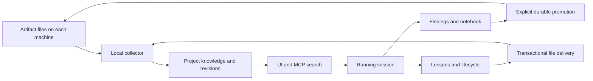

# Project knowledge in the UI and running system

## Organising principle

The logical project owns knowledge. A machine checkout is one location of that
project, and a session runs at a location. The UI should make these relationships
visible without requiring users to understand database identifiers. The permanent
project UUID is the route and API identity; names and paths remain display labels.

The first backend implementation is described in [PROJECT_KNOWLEDGE.md](PROJECT_KNOWLEDGE.md).
The project detail page now includes a live knowledge panel: it searches the
project-scoped hybrid endpoint and opens the retained full source through the
read endpoint. The location health, durable URL selection, source-kind filters,
and persisted retrieval-event views below remain follow-through work.
Tracking issue: [#288](https://github.com/temet-ai/mike/issues/288).

## Existing surfaces to extend

| Existing surface | Addition | Purpose |
| --- | --- | --- |
| Project detail | Knowledge section beside sessions, launches and memory | Browse artifacts, lessons, notes and turns in one project scope (implemented) |
| Project heading | Locations with machine name, root and last observation | Show that Mac and desktop checkouts belong to one project |
| Session overview | Project knowledge link and current location | Keep context available while inspecting a running session |
| Session notebook | Promote to project artifact | Preserve a finding before session retention removes its notebook |
| Fleet inspector | Project knowledge and session evidence links | Follow a worker's finding without leaving the work context |
| Lesson detail | Origin, lifecycle, file-delivery status and source links | Explain where a lesson came from and whether it reached each checkout |
| Request/turn inspection | Exact retrieved and injected references | Explain the evidence available to the model at that point |

Reuse the project page's SectionCard, existing drawers, typography, theme tokens,
loading/error components and collapse state. A standalone knowledge dashboard should
not become a second project directory. The project index must also list deliberately
created projects with no captured traffic; `/api/knowledge/locations` already returns
those identities, whereas traffic-derived project views may omit them.

## Knowledge browsing

Use a project-scoped route with a durable selection:

`/projects/{project_uuid}/knowledge?reference=artifact%3A123`

The browser URL preserves the search query, source-kind filter, historical toggle and
selected reference. Resolve legacy path-based project routes to the same UUID and
retain old inbound links. Do not make an absolute filesystem path the durable URL.

The list shows title, source kind, declared status, source location and observation
time. Search uses the common hybrid endpoint with explicit pagination, lexical fallback and
embedding coverage. Offer exact-text and semantic explanations using the returned
lexical and semantic scores; do not present similarity as confidence in truth. Selecting
an item calls the full-content read endpoint and opens a source drawer. The drawer
shows the entire document, its revision/hash, metadata, original path, and links to
its originating session or turn when available. Render source Markdown with the
application's safe Markdown renderer, with a raw-text view for exact inspection.

An artifact citation points to an immutable revision. Show whether that revision is
current and whether the original file is now missing. Keep historical citations
readable. Notes and lessons currently have stable entity references, not immutable
content revisions: label them accordingly. A future “what the model saw” view needs
a captured revision or hash plus retained content for these mutable sources.

Search defaults to current eligible material. The historical toggle includes archived,
superseded and deleted observations. Age is a freshness signal, never proof that a
decision is obsolete. A proposal must not silently become an accepted decision when
indexed or promoted. Link explicit supersession and provenance where recorded;
suggested semantic relationships must remain distinguishable from confirmed ones.

## Locations and collection health

Show one row per machine checkout, with its source roots and last completed scan.
Present collection freshness and lesson delivery as separate states: a location can
have fresh artifacts while a lesson file is conflicted. Do not label a machine online
from a historical last-seen timestamp alone.

The backend currently supplies location last-seen and per-artifact last-scan times.
Add a project-scoped source health endpoint before implementing a full health panel:
source root, successful generation, last success, collector heartbeat, last failure,
and pending/conflicted lesson count. Errors must be reported by the collector;
absence of a successful scan cannot identify its cause. Expose collector state through
REST and MCP so operators and agents see the same facts.

A “register this checkout” UI can generate a collector command using the selected
project UUID. It cannot read a remote Mac's disk from Mike's server. File open/reveal
actions require an explicitly connected local client and the matching machine UUID;
otherwise show a copyable path and the retained server copy.

## Connections to running sessions

At session start, the local integration reads `.mike/knowledge.json`, registers its
machine checkout and supplies `location_uuid` with workspace registration. The new
collector `session` command supports this today; wiring every launcher/session-start
hook to invoke it is a deployment follow-up. Legacy clients keep their existing
registration path. Reconnection refreshes the same location identity.

The backend binds the session to the canonical project. The lesson snapshot and
recall injector use that binding, so a Mac checkout can receive the same project's
lessons as a desktop checkout. Collection, indexing and embedding run outside request
forwarding. Session briefings advertise knowledge search and full-source reads;
`recall_project_context` can include relevant project knowledge for an explicit query.

The initial integration makes evidence discoverable. It does not claim an agent read
or followed a document merely because that document was indexed or mentioned in a
briefing. UI wording must distinguish “available”, “retrieved” and “injected”.

For full runtime traceability, add a persisted retrieval event carrying session UUID,
request/turn identity when known, project UUID, tool/query, selected references,
retrieval time and source hashes. Attribute it from the authenticated/captured tool
execution context where possible; an optional caller-supplied session id alone is not
proof of who read the source. Record automatic injection separately using the existing
lesson-injection evidence conventions. Writes belong in the asynchronous persistence
path and must not introduce network or SQL waits into forwarding.

Display these events on the session timeline and request drawer. “Used by sessions”
on a source means recorded retrieval/injection events, not inferred agreement or
causality. Each event links back to exact retained evidence. If retention removed the
source, the UI must say so rather than quietly displaying its current replacement.

## Decisions and learning loop

The intended loop is:

Promotion is an explicit action with destination preview and original-source link.
The backend collector currently performs it locally. The UI follow-up needs a durable
job addressed to a specific location, collector acknowledgement, and visible failure
or conflict states before it can promise to create a file on another machine. The
same principle applies to edits: distinguish database lifecycle changes from local
file writes. Never silently pick a machine or overwrite concurrent edits.

The graph view can later connect artifacts, revisions, notes, lessons and sessions.
Start with recorded provenance and supersedes relations; search similarity is not a
decision edge. OKF's useful contribution is portable Markdown metadata and provenance,
not a second generated directory that becomes a competing source of truth.

## Delivery order and acceptance

1. Add the project knowledge route and drawer using the implemented search/read APIs.
   A revision URL must survive reload and remain readable after its source file changes.
   Handle empty projects, API failure, historical material and missing source explicitly.
2. Add project/session/fleet entry links, UUID route resolution and the locations panel.
   A session on a different machine must land on the same logical project's knowledge.
3. Add source-health reporting and lesson delivery/conflict UI. Disconnect a collector
   and verify stale observation is shown without pretending the documents disappeared.
4. Instrument retrieval and injection with attributable evidence, then connect request
   inspection and “used by” links. Tests must verify project isolation and distinguish
   indexed documents from sources actually retrieved or injected.
5. Add collector-backed promotion/edit jobs and provenance graph edges. Test concurrent
   edits, offline locations, missing retained sessions, retries and duplicate delivery.

Frontend work should extend the existing project/session stories with realistic API
fixtures and route interactions, then pass `scripts/sb-test` and visual review. The
backend integration tests already cover revision retention, project isolation,
location/session binding, full-content retrieval and lesson synchronization conflicts.

## Embedding and recall controls

Make “Find in project” the common entry point. The query goes through the same
hybrid retrieval function as MCP and task-focused project recall. Show text and
semantic match indicators separately, with model identity, pending/failed source
counts and lexical fallback when the provider is unavailable. Similarity does not
establish correctness, approval or continued relevance.

The backend now indexes complete artifact/lesson/note text as chunks in the existing
background embedding sweep. It reuses existing model-matched turn embeddings.
Source and model fingerprints prevent a changed document or embedding configuration
from matching through obsolete knowledge vectors. The default backfill sweep runs
every five minutes and handles a bounded source batch; indexing is eventual. The UI
must show pending coverage while that backlog drains. A later worker wake-up on
completed scans can shorten that delay without putting embedding in ingestion or
request forwarding.

Recall has three distinct uses: project briefing (orientation), explicit find/read
(task evidence), and existing lesson injection (standing guidance). Keep all three
visible. Automatically injecting artifact paragraphs would need a separate relevance,
budget and attribution policy; the current implementation does not silently enable
it. Add exact-text/path lookup and operator-controlled requeue to the UI/API backlog
rather than making users infer either from semantic scores.
