# Request flow — mike

> Request-path audit 2026-11-06 against `crates/mike/src/proxy/handler.rs`, `crates/mike/src/proxy/engine/`, `crates/mike/src/pipeline/mod.rs`, and `crates/mike/src/weasel_intercept/`. Citations name a function, type or constant rather than a line number — grep the named symbol. Pair with [`STARTUP_FLOW.md`](STARTUP_FLOW.md) for what runs before the binds start listening, and [`SECURITY.md`](SECURITY.md) for the trust boundary the inspect API sits behind.

This doc maps the runtime behaviour of the proxy bind (`:9988`) and the inspect API (served on both `:9989` and `:9990`). Static call-graph tools cannot show this — axum routing is wired at runtime via `Router::route(...)`, and the SSE pipeline is dispatched through async channels, not through direct function calls.

## At a glance

- **Proxy bind** — `proxy_router` (`crates/mike/src/app.rs`) routes both `/v1/{*rest}` and `/v2/{*rest}` to one catch-all `proxy_handler`, which orchestrates `proxy::engine`: `accept` → `run_request_pipeline` → `forward_to_upstream` → `finalize_and_respond`. `run_request_pipeline` runs the eighteen stages of `pipeline::STAGE_ORDER` with the steerer drain spliced in the middle, then the composer, then the DB stub insert — and only then does `proxy_handler` send upstream. Header masking and captured-header caps apply only to the inspection projection; the inbound body size limit and ordinary forwarding-header rules still apply.
- **Ordered mutation stages** — `pipeline::STAGE_ORDER` (`crates/mike/src/pipeline/mod.rs`) is `filter`, `reminder_on_token`, `lazy_sections`, `recall_injector`, `lessons`, `self_identity`, `workspace_briefing`, `agent_lessons`, `reminders`, `change_record_tail`, `git_read_hint`, `steerer`, `repeated_notices`, `read_dedup`, `file_read_compression`, `shell_output_compression`, `proxy_tools`, `context_focus_question`. `run_mutation_stages` (`proxy/engine/mutation_stages.rs`) executes `stages_before_steerer()`, then the steerer/mailbox queue drain, then `stages_after_steerer()`.
- **Two-phase DB write** — `capture::insert_stub_and_mint_id` fires inside `capture_and_register` to create the parent FK row **before** the upstream request is built; `snapshot_terminal` (`insert_request_initial` idempotent + `snapshot_request` terminal transaction) fires at stream completion, writing response metadata and the terminal response row. Content-block FK writes land between the two phases. Tool call rows (`tools.uses`) are written per-event via `write_tool_use_row` in `spawn_store_updater` when `ToolUseEnd` fires — before the terminal snapshot.
- **Two response-replacing branches** — `forward_streaming` (`proxy/response/streaming.rs`) buffers the SSE stream whenever `weasel_armed || tool_loop_armed`, where `tool_loop_armed` means the `proxy_tools` stage added a tool to this request. Weasel discards the model's answer on a forbidden-word hit and re-asks upstream; `proxy_tools` answers a `mike_*` tool call inside the proxy and re-asks upstream with the result. Both stream the *second* upstream answer to the client.
- **agent_instances capture** — `snapshot_terminal` calls `create_instances_for_dispatches` (Phase 14) on orchestrator primary turns to create `agent_instances` rows and back-fill unbound sub-agent requests.
- **Async capture pipeline** — the SSE parser task accumulates events, updates the in-memory `InterceptedRequest`, flushes terminal metadata to `requests.requests` and `responses.responses`, and Postgres `NOTIFY proxy.row_changed` propagates to the inspect bind via the LISTEN task spawned at startup.
- **Inspect API `/api/*`** — REST + WebSocket, mounted on the inspect bind (`:9989`) and merged into the SPA bind (`:9990`) by `spa_router`. Reads use Postgres, including inline request bytes, normalized messages/tools and sent patches, and response content blocks. Compacted requests and streamed responses can be reconstructed; see the fidelity notes below. WebSocket subscribers receive `ProxyEvent::*` from the same channel that the capture pipeline feeds. There is no authentication on either bind; see [`SECURITY.md`](SECURITY.md).
- **Remote Control** — `/v1/code/sessions/cse_*` is recognised before the ordinary pipeline and handled by `proxy/remote_control/`, which captures the channel traffic and can splice a synthetic user-turn SSE frame into a live reply stream.

## Animated

Three looping diagrams walk the parts of this flow that are easiest to misread: the stages that can rewrite a request, the two capture writes, and the gated forwarder. They sit in the sections below and play wherever this page is shown. [`animations/mike-in-motion.html`](animations/mike-in-motion.html) has the same scenes with controls, where each stage can be armed and disarmed and each response scenario played; open it in a browser from a checkout.

## Mermaid

```mermaid
flowchart TB

  %% ─── Proxy bind /v1/* and /v2/* ───────────────────────────────────────
  subgraph Proxy[":9988 — proxy_router  /v1/{*rest} · /v2/{*rest}"]
    direction TB
    R0([Client request]) --> R1
    R1["proxy_handler\nproxy/handler.rs"]
    R1 --> R1a["engine::accept"]
    R1a --> R2{"body within\nmax_request_body_bytes?"}
    R2 -- "no" --> R413(["413\npayload_too_large"])
    R2 -- "yes" --> R2a{"remote_control::recognise\n/v1/code/sessions/cse_* path?"}
    R2a -- "yes" --> RC1["remote_control::capture::forward_and_capture"]
    R2a -- "no" --> R2b{"canonical session-id header?"}
    R2b -- "no" --> RNC(["sessionless::forward_and_capture\nrequests.sessionless_requests"])
    R2b -- "yes" --> R3["RequestSignals::from_parts_and_body\nmodel · streaming · tools · system_prompt\nturn_origin · subagent_persona"]
    R3 --> R4["capture headers\nMAX_HEADERS · MAX_HEADER_BYTES\nmask sensitive · NOT applied to forwarded"]
    R4 --> R5["stored_body = original inbound bytes"]
    R5 --> R6["engine::run_request_pipeline"]
    R6 --> R6a["run_mutation_stages — stages_before_steerer()\nfilter · reminder_on_token · lazy_sections\nrecall_injector · lessons · self_identity\nworkspace_briefing · agent_lessons · reminders\nchange_record_tail · git_read_hint"]
    R6a --> R7b["steerer::stage::drain\nsteerer + mailbox reminder queue"]
    R7b --> R6c["stages_after_steerer()\nrepeated_notices · read_dedup · file_read_compression · shell_output_compression · proxy_tools\ncontext_focus_question"]
    R6c --> R8["guards::compose_and_guard\ncompose_prompt::stage::run\n+ cache-scope tripwire"]
    R8 --> R8c{"capture admission\nthrottled by memory pressure?"}
    R8c -- "yes, and body unmutated" --> RNC
    R8c -- "no" --> R9["capture_register::capture_and_register\nbuild InterceptedRequest · status = Pending"]
    R9 --> R9b["capture::insert_stub_and_mint_id\nPhase-1 DB write"]
    R9b --> R10["engine::forward_to_upstream\nbuild URL · filter headers · send\nrecord HISTOGRAM_UPSTREAM_LATENCY"]
    R10 --> R11["engine::finalize_and_respond"]
    R11 --> R13{content-type?}
    R13 -- "text/event-stream" --> R14{"weasel_armed\n|| tool_loop_armed?"}
    R13 -- "json or other" --> R15["buffer upstream response\n429/500/529 byte-identical\ncomplete_non_streaming → snapshot_terminal"]
    R14 -- "no" --> R16["plain tee → channel\nspawn run_parser + spawn_store_updater"]
    R14 -- "yes" --> R17["run_buffered_forwarder"]
    R16 --> R18([Response to client])
    R15 --> R18
    R17 --> R18
    R16 -.parser side-effect.-> SideStore
    R17 -.gated forwarder.-> Weasel
  end

  %% ─── Gated-forwarder path ──────────────────────────────────────────────
  subgraph Weasel["run_gated_forwarder (weasel_intercept armed, or a tool was added to this request)"]
    direction TB
    W1["SseFramer splits upstream bytes into frames\nall bytes also go to parser_tx for capture"]
    W1 --> W3{StreamGate::admit}
    W3 -- "Forward" --> W4["frames → body_tx → client, as they arrive\nnewest text held by a few characters"]
    W3 -- "Cut::Word" --> W5["correction::run_weasel_correction\nbuild correction body from the text so far"]
    W3 -- "Cut::ToolCall" --> P5["proxy_tool::run_proxy_tool_loop\nanswer_tool_call inside the proxy\nbuild_followup_body with the tool result"]
    W5 --> W6["close the client's open block\nmint follow-up request id\ninsert follow-up InterceptedRequest + stub"]
    P5 --> W6
    W6 --> W8["mark_intercepted on original request\nintercepted=true · correction_request_id"]
    W8 --> W9["send follow-up upstream\nrest of the first answer drains to capture"]
    W9 --> W10["spawn_stitched_tee → body_tx\nspawn run_parser + spawn_store_updater"]
    W10 --> W4b([Second upstream answer continues the same message])
    W4 --> W4c([Original stream → client])
  end

  %% ─── Async side-effects driven by the SSE parser ──────────────────────
  subgraph SideStore[Capture pipeline async]
    direction TB
    S1["sse::parser::run_parser"] --> S2["accumulate text · parse events"]
    S2 --> S3["update InterceptedRequest in store\nspawn_store_updater"]
    S3 --> S3a["write_tool_use_row on ToolUseEnd\n(write-as-you-go, C2 refactor)\nbefore terminal snapshot"]
    S3a --> S4["snapshot_terminal at terminal event\ninsert_request_initial (idempotent)\n+ snapshot_request transaction\nresponse body · status · headers\ndiagnostics · operator-turn data\nstore/terminal_snapshot.rs"]
    S4 --> S4a["create_instances_for_dispatches\n(Phase 14 agent_instances)"]
    S4a --> S5["NOTIFY proxy.row_changed"]
    S5 -.->|via db_listener| S6["event_tx broadcast → ProxyEvent::RowChanged"]
    S6 -.->|/api/ws subscribers| Inspect
  end

  %% ─── Inspect API /api/* + /api/ws ─────────────────────────────────────
  subgraph Inspect[":9989 inspect_router · :9990 spa_router (same /api/* routes)"]
    direction TB
    I0([REST or WS client]) --> IHG["host_guard middleware\nHost/Origin allow-list — NOT authentication"]
    IHG --> I1{path}
    I1 -- "GET /api/health" --> Ihealth["api::handlers::health"]
    I1 -- "GET /api/requests" --> Ilist["list_requests"]
    I1 -- "GET /api/requests/{id}" --> Iget["get_request — captured / reconstructed"]
    I1 -- "GET /api/sessions/{id}" --> Isess["get_session"]
    I1 -- "PATCH /api/sessions/{id}/pin · /ttl" --> Ipin["session pin / ttl mutators"]
    I1 -- "/api/ws" --> Iws["WebSocket\nsubscribe to event_tx\npush ProxyEvent::*"]
    Ilist --> IDB[(Postgres — requests.*, sessions.*, tools.*\nbodies are bytea columns)]
    Iget --> IDB
    Isess --> IDB
    Iws --> EvBroad((event_tx broadcast))
  end

  %% Cross-bind link: capture writes feed inspect reads
  S6 -.-> EvBroad

  classDef ok fill:#e6f4ea,stroke:#137333,color:#0d2e1a;
  classDef warn fill:#fce8e6,stroke:#a50e0e,color:#3c0d0d;
  classDef io fill:#e8f0fe,stroke:#1a73e8,color:#0b2858;
  class R413 warn;
  class R0,R18,I0 ok;
  class IDB,EvBroad,SideStore io;
```



## Mutation gates and default behaviour


Request-body mutation is opt-in through feature toggles, settings or operator-authored rules and compositions. A fresh configuration with no rules, queued messages or recognized hook tokens forwards the body unchanged. The shared steerer/mailbox drain is an exception to a blanket “every stage has an off toggle” description: it runs on eligible primary requests and can deliver explicitly authored mailbox messages independently of the steerer feature toggle. The gates below describe the implementation. Requests marked `x-mike-client: prompt-assistant` bypass the mutation stages and composer through `mutation_exempt`.

Header masking and the per-pair `MAX_HEADERS` / `MAX_HEADER_BYTES` caps apply only to the **inspection projection** in `InterceptedRequest.request_headers` — forwarding uses `proxy::headers::filter_request_headers`, which strips hop-by-hop headers and `Content-Length`, rewrites `Host`, and requests `Accept-Encoding: identity`. Credentials are forwarded rather than inspection-masked. The request body sent upstream is whatever the last stage to fire produced.

Where each gate lives — some stages answer `enabled()` from the resolved session toggles, others return `true` and re-check their own toggle or config inside `apply`:

| Stage | Gate | Default |
|---|---|---|
| `filter` | operator-authored rules in `FilterConfig` (DB-backed) | no rules |
| `reminder_on_token` | stage always runs; live toggle enables resolution | resolution off; recognized hook tokens are still stripped |
| `lazy_sections` | lazy sections in `FilterConfig` | none defined |
| `recall_injector` | `recall_injector` toggle | off |
| `lessons` | `reminders.inject_lessons`, session own lane, not a tool loop | off |
| `memory_keeper` | `memory_keeper` toggle, session own lane, not a tool loop; stands aside when tether or the mod served the session or the body already carries a `[keeper:…]` card | off |
| `self_identity` | `self_identity_reminder`, session own lane, not a tool loop | off |
| `workspace_briefing` | `workspace_briefing`, session own lane, not a tool loop | off |
| `agent_lessons` | `agent_lessons` toggle, Subagent turns only | off |
| `reminders` | `reminders` toggle and session own lane | off |
| `change_record_tail` | `change_record_tail` toggle, session own lane, not a tool loop; declines for a session whose client serves it (`change_record_tail_served_by_client`) and for template seats | off |
| `git_read_hint` | `change_record` toggle and session own lane; declines for a session whose client serves it (`git_read_hint_served_by_client`) and for template seats | off |
| `steerer` | drain runs on Primary/PrimaryFirst; same-request judge and reminder producers have their own gates; delivery checks source policy, staleness and mailbox claims | autonomous steering off; explicit mailbox delivery does not require it |
| `repeated_notices` | `repeated_notices` toggle and session own lane | off |
| `read_dedup` | `compression_dedup.enabled`, read inside `apply` | off — measures only, forwards byte-identical |
| `file_read_compression` | `file_read_compression` toggle | off — and shadow-mode even when on: `apply` computes a reduction and logs it, never rewriting the forwarded body |
| `shell_output_compression` | `shell_output_compression` toggle | off; when on, shadow with a forward share of 0: the manifest records each would-be cut of an older Bash result and the body is forwarded unchanged |
| `proxy_tools` | `proxy_tools` toggle | off |
| `context_focus_question` | `context_focus_question` toggle; declines for sidecar calls that do not resend the session's tool list (`context_focus_sidecar_call`) | off |
| composer | `composition_enabled` boot config | off |

“Session own lane” means Primary/PrimaryFirst with no `x-claude-code-agent-id` (`pipeline::is_session_own_lane`). The drain may await `judge_turn_close_before_drain` on a genuine human prompt, bounded by `steerer.request_timeout_secs`; steering is not exclusively background work. Eligible reminder producers may also use Remote Control delivery and leave the body unchanged.

How each one rewrites, when it does fire:

- **filter** `Rewrote` — reparses the whole body to a `serde_json::Value` and reserialises with `serde_json::to_vec`. Does **not** preserve the original JSON serialization outside the matched block. The text-block walker excludes thinking blocks; reserialization alone does not establish that a thinking signature is invalid.
- **`lazy_sections`**, **`recall_injector`**, the reminder stages (`lessons`, `self_identity`, `workspace_briefing`, `agent_lessons`) and **`reminders`** — each appends or replaces JSON string content via the same `serde_json::Value` round-trip as the filter; same reserialisation caveat applies.
- **`change_record_tail`** and **`git_read_hint`** — append a `<system-reminder>` block through `try_append_reminder`, so the same round-trip caveat applies; the first lists what other sessions changed since this one last looked, the second is a fixed hint text.
- **`context_focus_question`** — adds a focus field to the session's tool definitions in the forwarded body (`context_focus::inject`); it does not touch messages.
- **steerer drain** — appends a `<system-reminder>` block to the last user message via `reminders::inject::inject_system_reminder`; same round-trip caveat.
- **`repeated_notices`** — `rewrite_forwarded_only`. It decodes only the texts that hold a notice, removes the later copies, and writes that one JSON string back in place, so every other byte of the body is the client's. It reads system and user text, and the reminder blocks Claude Code appends after a tool's output; it never changes what a tool printed, an assistant turn, or what a person typed. From a message the operator sent mid-turn it removes only Claude Code's closing sentence, and only when that sentence is the last line of a block that opens with Claude Code's lead-in; the operator's words and the lead-in stay. A request that carries the whole conversation is judged by what it holds, so the first copy always stays and the earlier part is sent the same on every request (the prompt cache holds). A request that only continues a thread (`thread.type = "continue"`) carries no history, so mike remembers per session, in memory, which notices it has already forwarded; a restart or a new thread without the notice lets one more through. Capture stores each rewritten message again on every request that carries it (`compute_sent_patches`).
- **`read_dedup`** and **`proxy_tools`** — `rewrite_forwarded_only`, so the stored audit copy stays the client's bytes while the forwarded body carries the stub or the tool declaration.
- **composer** (`template` mode) — the one byte-order-safe rewrite: `compose_template` finds `system[2].text`'s JSON-encoded form inside the raw body bytes and substitutes it in place, so every byte outside that one string-value range survives untouched (preserves surrounding serialization and `cache_control` placement; changing prompt text can still change cache identity).

A `verify_global_cache_scope_tripwire` in `proxy/engine/guards.rs` logs an `error!` whenever a fired stage breaks the global cache-scope prefix, so a rewrite that would invalidate the prompt cache is visible in the log rather than silent.

### Capture, reconstruction and uncaptured paths

`stored_body` keeps the inbound request bytes before any mutation. The persisted original and sent views are distinct, but storage is not an eternal raw-wire archive: compaction can remove inline request bytes after preserving the envelope, canonical messages and tool definitions, and the read path marks reconstructed bodies. The sent view uses legacy `filtered_request_body` or message/envelope patches; unsupported envelope changes can log a warning and fall back to the original request view (`request_write::compute_envelope_patch_for_insert`). Envelope patch offsets form a half-open byte range `[start, end)`; equal start and end offsets represent a pure insertion. Streamed responses are assembled from `responses.stream_blocks`, with `stream_blocks_gapped` marking missing capture blocks. Do not infer byte-for-byte SSE capture from a complete rendered response.

**No canonical session id.** When `RequestSignals::from_parts_and_body` fails with `SessionIdMiss::{Missing, Malformed, NonUtf8}`, `engine::accept` calls `proxy::sessionless::forward_and_capture` and increments `proxy_sessionless_requests_total` with the miss reason. The request is forwarded unchanged. Its whole request and the response, teed as it streams, are stored in `requests.sessionless_requests`. Claude Code's control-plane calls take this path: `/v1/mcp_servers`, `/v1/design/mcp`, `POST /v1/code/sessions` and `/v1/ultrareview/quota`.

One ingress path intentionally forwards without a capture row:

1. **Memory pressure.** `guards::evaluate_capture_admission` checks `state.is_capture_admission_throttled()`; when the cap manager has throttled capture admission and the body was **not** mutated by any stage, the request is forwarded without capture (`uncaptured_requests_total{reason="capture_throttled"}`). A request that *was* mutated is captured anyway, and logs `capture_throttle_override_total` — the proxy will not hide traffic it changed.

## Two-phase DB write



For captured requests with working persistence, two lifecycle phases bracket forwarding (each phase can write several rows):

1. **Phase 1 — stub insert** (`capture::insert_stub_and_mint_id` → `insert_request_initial`): fires inside `capture_register::capture_and_register`, which runs at the end of `run_request_pipeline` — that is, **before** `proxy_handler` calls `engine::forward_to_upstream`, not after. Creates a minimal row so SSE chunk FK writes have a parent row, and it is what mints the `RequestId` used for the rest of the flow. The `IdMode::Mint` path obtains the database identity; terminal `IdMode::Ensure` is idempotent. Persistence disabled or a failed stub insert can leave a fallback id and no durable capture.
2. **Phase 2 — terminal snapshot** (`snapshot_terminal` → `insert_request_initial` idempotent + `snapshot_request` terminal transaction): fires when the SSE parser emits a terminal event or when `complete_non_streaming` finishes. Updates request status, inserts the `responses.responses` row when response metadata exists, and records diagnostics and operator-turn data. SSE bodies are assembled from stored content blocks. See `store/terminal_snapshot.rs` and `store/persistence/request_snapshot.rs`.

Tool call rows (`tools.uses`) are **not** written at the Phase 2 terminal snapshot. Since the write-as-you-go refactor (C2), `write_tool_use_row` is called per-event in `spawn_store_updater` when a `ToolUseEnd` event fires — before the terminal snapshot completes.

A follow-up request minted by the gated forwarder follows the same two-phase pattern: its stub is written inside `correction.rs` / `proxy_tool.rs`, and its terminal snapshot fires from its own `spawn_response_tee` store updater at stream completion.

## The gated forwarder: two ways a reply gets cut and continued



`forward_streaming` (`proxy/response/streaming.rs`) decides between a plain tee and the gated forwarder from one predicate:

```rust
let weasel_armed = session_toggles.weasel_intercept
    && !session_toggles.weasel_intercept_forbidden_words.is_empty();
let tool_loop_armed = proxy_tools_declared;
let body_may_be_replaced = weasel_armed || tool_loop_armed;
```

`proxy_tools_declared` is true only when the `proxy_tools` stage added a tool to this request. A session that brought mike's tools itself through the MCP server, and every sidecar call that shares nothing with the session, get no tool and so a plain tee.

Weasel intercept therefore needs **both** the `weasel_intercept` toggle on at [`/settings`](http://localhost:9990/settings) and a non-empty forbidden-words list; `proxy_tools` needs its own toggle and a request the stage actually added a tool to. Neither is on by default, and no TOML file is read at boot — the runtime config source of truth is `/settings`.

When either is armed:

1. `weasel_intercept::run_gated_forwarder` sends every upstream chunk to `parser_tx` for capture, and splits it into SSE frames (`frames::SseFramer`).
2. Each frame goes through `gate::StreamGate::admit`. Thinking, tool calls to the client's own tools, pings and the message's start and end are forwarded at once. Text is forwarded too, except the newest `longest phrase − 1` characters, which stay back until newer text shows they cannot begin a listed phrase. With no listed phrase nothing is held.
3. A reply that ends with neither a phrase nor a proxy tool call has reached the client byte for byte.
4. On **`Cut::Word { word, text }`** — `correction::run_weasel_correction`. A listed phrase completed. No frame carrying any part of it was sent.
   - The forwarder closes the text block the client has open with a `content_block_stop` of its own.
   - A correction body is built from the original body + the reply's text up to and including the phrase + the configured `correction_prompt`, and sent to the same upstream URL.
   - A follow-up `InterceptedRequest` with a fresh `RequestId` and its Phase-1 stub are written.
   - The original request is marked `intercepted = true` and `correction_request_id = <new id>` in both the in-memory store and the DB via `mark_intercepted`.
   - `followup::spawn_stitched_tee` forwards the **second** upstream answer to `body_tx` and to a new parser + store-updater pair for its own capture. `stitch::onto_the_first_reply` drops its `message_start` and renumbers its content blocks to follow the ones the client has, so the client sees one message.
   - The rest of the first answer is read to its end in the background (`capture_the_rest`), so its capture is complete.
5. On **`Cut::ToolCall { call, prelude }`** — `proxy_tool::run_proxy_tool_loop`. The model called one of the `mike_*` tools that `proxy_tools::stage` declared into the request. The call's frames were held from the block's first frame, so the client never saw it. The proxy answers it itself (`proxy_tools::answer::answer_tool_call`, against `AppState` — the roster tool is the only entry in `proxy_tools::catalogue()` today), builds a follow-up body carrying the assistant prelude plus the tool result, and re-asks upstream. From there the path is identical to the correction path: `mark_intercepted`, then `spawn_stitched_tee` continues the client's message with the second answer.
6. If the second request cannot be built or sent, or upstream refuses it, the client's message ends with an SSE `error` event. The first answer cannot be put back, because its opening has already been sent.

A buffered (non-streamed) response is not scanned; see `evidence::note_unscanned_buffered`.

So weasel intercept is not the only place the proxy can cut the model's answer and continue it — `proxy_tools` is the other, and both run through the same forwarder.

## agent_instances capture (Phase 14)

After `snapshot_request` completes for an orchestrator primary turn (`turn_origin == "primary"` or `"primary_first"`), `snapshot_terminal` calls `persist.create_instances_for_dispatches(&req.session_id)` (see `store/terminal_snapshot.rs`). This creates `agent_instances` rows for every agent dispatch in the session and back-fills unbound sub-agent requests. Soft-fails on DB error (WARN + continue) so it never aborts the hot path.

## Remote Control: the other way a turn reaches the model

`/v1/messages` is not the only path into a session. Claude Code's Remote Control channel talks to `/v1/code/sessions/cse_<id>/<suffix>`, and `engine::accept` recognises that prefix (`remote_control::recognise`, `PATH_PREFIX = "/v1/code/sessions/"`, `ID_PREFIX = "cse_"`) *before* the ordinary pipeline, handing the request to `remote_control::capture::forward_and_capture` instead. Note that `proxy_router` also routes `/v2/{*rest}` to the same `proxy_handler`, so a v2-prefixed client is proxied by the same code.

Two halves live under `crates/mike/src/proxy/remote_control/`:

- **Relay and capture** (`capture/`, `relay.rs`, `streams.rs`) — forwards the channel call upstream and records a `CapturedCall`: method, path, endpoint label, HTTP status, request and response bodies with their sha256 and sizes, and each classified SSE payload as an ordinal row. `ReplyStreams` holds a sender per open `cse_id` so a live reply stream stays addressable.
- **Inject** (`inject.rs`) — the half that can reach the model without touching `/v1/messages` at all. `client_event` builds an SSE frame `event: client_event` whose payload is a `{"type":"user","message":{"role":"user","content":[{"type":"text","text":"<reminder>"}]}}` object — the shape Claude Code expects for a user turn — carrying the reminder text. `push_reminder` finds the most recently opened channel with a live sender, reserves an injection row (`reserve_remote_control_injection`), and hands the frame to the relay, which splices it into the live stream only at an SSE frame boundary (`Boundary::can_insert` in `relay.rs`, so a frame is never inserted mid-event).

`deliver_or_enqueue` tries a permitted Remote Control push and otherwise queues request-time fallback. Mailbox messages give an active MCP channel listener precedence: `push_reminder` skips Remote Control when that listener is live, and the mailbox drain also avoids duplicate channel delivery. Other reminder sources keep their own delivery policies. Delivery is confirmed out of band — the client `POST`s `/worker/events/delivery`, and `record_delivery_ack` matches the returned event ids back to the injection rows. A steerer push that is not acked within `STEERER_PUSH_ACK_GRACE` (10s) is released and requeued for request-time delivery.

The consequence for inspection: a reminder can arrive at the model with the session's `/v1/messages` bytes completely unchanged, so a diff of captured request bodies will not show it. Remote Control delivery is recorded in `remote_control.injections`; MCP channel mailbox delivery has its own claim/acknowledgement lifecycle (see [`MCP_BRIDGE.md`](MCP_BRIDGE.md)). WebSocket upgrades routed through `proxy-forward` bypass capture; the Remote Control flow described here is HTTP/SSE.

## Inspect-side reads serve from Postgres

Terminal traffic reads use Postgres through `store/persistence/rehydrate/`. `requests.requests` holds request bytes/envelopes, normalized message and tool tables support reconstruction, and `responses.responses` plus `responses.stream_blocks` hold response data. The in-memory `RequestStore` stages active captures; a successfully snapshotted entry is removed. Operational APIs can still read live process state, so “every inspect endpoint is a direct DB read” is too broad. Body endpoints distinguish original/reconstructed content rather than promising that all stored bodies are raw wire bytes.

These same routes are reachable on two ports. `app.rs`'s `spa_router` is `inspect_router(state).merge(spa::spa_router())`, so `:9990` serves the whole `/api/*` surface alongside the embedded SPA, and `:9989` serves it alone. `api::host_guard` middleware wraps the router in both cases: a Host/Origin allow-list (`inspect_allowed_hosts` / `MIKE_INSPECT_ALLOWED_HOSTS`, empty by default) that stops DNS rebinding, cross-origin requests and cross-site WebSocket upgrades. It is not authentication — there is none — and it does not stop any local process. [`SECURITY.md`](SECURITY.md) is the reference for what that means.
