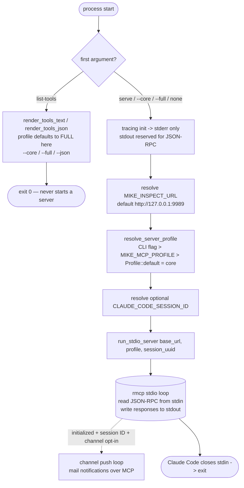

# Startup flow — mike + mike-mcp

> Last verified 2026-11-06 against `crates/mike/src/main.rs`, `crates/mike/src/cli.rs`, `crates/mike/src/serve/`, and `crates/mike-mcp/src/main.rs`. Citations name a function, type or constant rather than a line number — grep the named symbol. Pair this doc with [`REQUEST_FLOW.md`](REQUEST_FLOW.md) for what happens once the binds are listening.

## mike (`crates/mike/src/main.rs` dispatch → `crates/mike/src/serve/` server)

`main()` answers `--version` and `--build-info`, runs the fleet hook invocations and applies `umask(0o077)`, then parses `Cli`, records the selected config file (`user_config::observe_selected`) and matches the subcommand. The binary does not load a `.env`; the development scripts export the checkout's environment themselves, and an existing `.env` is imported explicitly with `mike import-dotenv`.

**A bare `mike` is not always a server.** With no subcommand, `cli::bare_dispatch_target(std::io::stdout().is_terminal())` decides: a TTY stdout opens the ratatui TUI (`mike::tui::run`), a non-TTY stdout serves headless (`mike::serve::run`). `mike serve` always serves regardless of the terminal. The remaining subcommands short-circuit before any of the server sequence:

Before `Cli::parse()`, `main()` also answers `--version`, `--build-info`, and the `fleet background-hook`, `fleet receipt-hook` and `fleet timed-run` invocations (plus `fleet cargo-background-hook` and `fleet build-slot`, which seats started by older binaries still call), then sets `umask(0o077)`.

| Subcommand | Goes to | Notes |
|---|---|---|
| `serve` | `mike::serve::run` | steps 1–23 below |
| `claude` | `mike::claude::run` | `claude` CLI wrapper that injects `ANTHROPIC_BASE_URL`; trailing args pass through |
| `spawn` | `mike::launch::cli::run` | `open` · `kill` · `list` · `doctor` · `warm` · `fork` · `templates` · `reap`; exits with the returned code. See [`LAUNCH_DOMAIN.md`](LAUNCH_DOMAIN.md) |
| `fleet`, `discover` | `mike::launch::fleet::run`, `mike::launch::fleet::discovery::run` | fleet control and discovery |
| `setup`, `database`, `mcp`, `db`, `service`, `uninstall`, `doctor` | `mike::setup::command::run`, `mike::setup::cli::run`, `mike::setup::mcp::run`, `mike::db_provision::run`, `mike::service::run`, `mike::uninstall::run`, `mike::doctor::run` | install, database provisioning, MCP registration, service management and diagnosis |
| `claude-code`, `features`, `thread`, `forward`, `config` | `mike::claude_code::run`, `mike::feature_presets::run`, `mike::work_threads::run`, `mike::forward::run`, `mike::user_config::run` | Claude Code integration, feature presets, work threads, the forward sidecar, the user config file |
| `export-analysis-corpus` | `mike::analysis::export_analysis_corpus` | pure static-table dump, no config or DB |
| `print-config`, `migrate-check`, and the backfill/maintenance verbs | `mike::config::subcommands::run` | `ConfigCommand` is `#[command(flatten)]`ed into `Command`, so these stay top-level rather than sitting under `config` (which is the user config file) |

`mike --help` lists the full set; the `Command` enum is in `crates/mike/src/cli.rs`.

```mermaid
flowchart TD
  Start([process start]) --> Fast[version, build-info and fleet hook fast paths\numask 0o077]
  Fast --> Cli[Cli::parse — clap]
  Cli --> SubCheck{subcommand?}
  SubCheck -- "claude / spawn / export-analysis-corpus\nprint-config / migrate-check / backfills" --> SubRun[short-circuit handler]
  SubRun --> Exit0([exit])
  SubCheck -- "serve" --> Cfg
  SubCheck -- "none" --> Bare{stdout is a TTY?}
  Bare -- yes --> Tui[tui::run — ratatui TUI]
  Bare -- no --> Cfg
  Tui --> Exit0
  Cfg[config::load — figment chain\ndefaults < config file < MIKE_* env < CLI\n+ listener_policy::validate] --> Owner[stack::DaemonOwner::acquire_unless_smoke_run\ninstallation ownership]
  Owner --> Trace[tracing_init::init_tracing_and_log_startup\njson or pretty format\n+ optional OTel layer\n+ optional daily file layer]
  Trace --> Control[stack::ControlServer::bind\nonly when this process owns the installation]
  Control --> State[AppState::new_with_shutdown\noptional pg pool, store, channels, tracker, shutdown token]
  State --> Seq[startup_sequence::run_startup_sequence]
  Seq --> LoopWarn[loopback warnings\nnon-127.x proxy or inspect addr]
  LoopWarn --> Crash[startup::run_crash_recovery\nclose stale Pending rows from prior crash]
  Crash --> BuildIdentity[startup::record_build_identity\nrecord build and code defaults when changed]
  BuildIdentity --> Fleet[install_fleet_files + spawn_bundle_retry\n+ feature_presets::apply_pending_at_start]
  Fleet --> StartupSweep[startup::run_startup_session_sweep\none-shot, gated on sweep_at_startup = false]
  StartupSweep --> MailboxReload[startup::run_mailbox_reload\nreload pending mailbox messages into reminder queue]
  MailboxReload --> ComposableWarmup[startup::run_composable_session_warmup\nwarm in-memory composable_session_index]
  ComposableWarmup --> Banner[observability::banner::emit_startup_banner]
  Banner --> Listen[change_feed::spawn_change_feed\n+ db_listener::spawn_listener\nPostgres LISTEN/NOTIFY -> ProxyEvent::RowChanged]
  Listen --> Workers[workers::spawn_background_workers_unless_smoke_run\n27 spawn calls; spawn-time or per-tick gates]
  Workers --> Obs[observability_tasks::spawn_observability_tasks\npruner + gauges + memory ticker + cap manager]
  Obs --> Bind[listeners::bind_and_log\n:9988 proxy + :9989 inspect\n+ :9990 SPA when spa_enabled]
  Bind --> Ready[announce_ownership\nservice token + control socket ready]
  Ready --> Signal[shutdown::install_signal_handler\nSIGINT/SIGTERM/SIGHUP -> cancel token]
  Signal --> HardBackstop[spawn hard-exit backstop task\nSHUTDOWN_HARD_DEADLINE_SECS = 60]
  HardBackstop --> Serve["axum::serve x 2 (proxy, inspect)\n+ SPA future: serves when bound,\notherwise awaits cancel as a no-op\ngraceful shutdown starts +3s after cancel"]
  Serve --> Join["tokio::select!\nserve_join (tokio::try_join! all three futures)\nraced against GRACEFUL_DRAIN_SECS = 10\ntimed from the cancel signal"]
  Join --> Drain[wait pruner / gauges / db-pool / tracker\ncapped 30s each; flush OTel]
  Drain --> Done([exit — hard backstop aborted])
```

### Numbered steps with citations

`serve` is a directory, not a file: `serve/mod.rs` holds `run()` and calls into `startup_sequence.rs`, `workers.rs`, `observability_tasks.rs`, `listeners.rs`, `shutdown.rs` and `tracing_init.rs`. Steps 1–23 all happen inside `serve::run`.

1. **`config::load(overrides)`** — first line of `serve::run` (`serve/mod.rs`). Figment chain: defaults < the installation's `config.toml` < `MIKE_*` env < CLI flags. The runtime source of truth for toggles and settings is `/settings`. `listener_policy::validate` then refuses non-loopback binds unless `unsupported_allow_remote_listeners` is set.
2. **Installation ownership** — `stack::DaemonOwner::acquire_unless_smoke_run`. A `smoke_run` process only observes; any other process takes ownership of the installation and gets an `instance_id` and `boot_generation`, which are written into the config.
3. **`tracing_init::init_tracing_and_log_startup(&config)`** — `serve/tracing_init.rs`. Builds three optional pieces and installs one subscriber:
   - **File layer** — only when `config.log_dir` is set. A daily-rotated `tracing_appender::rolling::Builder` with `filename_prefix("mike")` and `filename_suffix("log")`, so the files are `<log_dir>/mike.YYYY-MM-DD.log`. Retains `config.log_max_files`.
   - **OTel layer** — only when `config.otel_endpoint` is set.
   - **Format** — two branches by `config.log_format` (`"json"` vs pretty). The registry-level `EnvFilter` uses `RUST_LOG` when set, else `config.log_level`.

   Returns `TracingGuards`, whose `otel_provider` is flushed at the OTel flush step.
4. **Control socket** — `stack::ControlServer::bind`, only when this process owns the installation (not for a `smoke_run`).
5. **`AppState::new_with_shutdown(config, shutdown).await`** — the big one: initializes persistence when configured, builds the in-memory store, channels, `TaskTracker`, `CancellationToken`.
6. **`startup_sequence::run_startup_sequence(&state).await`** — the next steps (through `change_feed` and `db_listener`) are its body, in order.
7. **Loopback warnings** — `warn_on_non_loopback_binds`, one check per bind (`proxy_listen_addr`, `inspect_listen_addr`). Logs `tracing::warn!` when the address doesn't start with `127.` or `localhost`.
8. **`startup::run_crash_recovery(&state).await`** — synchronous crash-recovery sweep: closes any `Pending` rows left by a prior crash. Attempts recovery before the listeners bind; failure is logged and startup continues. No-op when persistence is disabled or `smoke_run` is set. Next, `install_fleet_files` copies mike's bundled fleet files into the home directory (a failure only logs a warning); then `startup::record_build_identity` records changed build identity and code defaults (also skipped without persistence or in smoke mode), then `startup::spawn_bundle_retry` starts the evaluation-bundle publication retry task when a publisher is present, and `feature_presets::apply_pending_at_start` applies a feature preset chosen at install time (env or config file) if one is pending.
9. **`startup::run_startup_session_sweep(&state).await`** — one-shot session sweep gated on `sweep_at_startup`, which defaults `false`; also skipped in smoke mode. When enabled, deletes sessions older than `default_ttl` via `PersistHandle::sweep_expired_sessions`. Runs once per process start in the window between crash recovery and listener bind, where no live traffic can compete for the sessions row lock.
10. **`startup::run_mailbox_reload(&state).await`** — reloads pending cross-session mailbox messages into the in-memory reminder queue so a restart between a message being queued and delivered does not strand it. Bounded queries for unclaimed, stale-claimed and redelivery rows; skipped without persistence or in smoke mode.
11. **`startup::run_composable_session_warmup(&state).await`** — warms the in-memory `composable_session_index` from the durable ledger's main-lane rows, so a restart mid-session doesn't re-arm the composer for a session already templated once.
12. **`observability::banner::emit_startup_banner(&state).await`** — operator banner: every byte budget, pool dim, persistence row count.
13. **`change_feed::spawn_change_feed` and `db_listener::spawn_listener`** — the change feed subscribes to `event_tx` and attaches to the persistence handle; the listener is Postgres `LISTEN proxy.row_changed` → re-broadcast on `event_tx`. No-op when persistence is disabled.
14. **`workers::spawn_background_workers_unless_smoke_run(&state)`** — 27 worker entry points. Some gate spawning; others spawn when persistence is present and check their work gate on each tick. `config().smoke_run` skips all of them. The table below is the full list.
15. **`observability_tasks::spawn_observability_tasks(&state)`** — `store::retention::spawn_pruner` (in-memory store pruner, driven by `state.retention()`), `metrics::spawn_store_gauge_updater`, `state.spawn_db_pool_gauge_updater()`, `observability::ticker::spawn_memory_ticker` (5s), and `memory_cap::manager::spawn_cap_manager` (RSS ceiling; polls `read_max_rss()` + `MemoryBreakdownView` and sheds in priority order when RSS crosses the high-watermark, observation-only when `rss_ceiling_bytes = 0`). The first three return `JoinHandle`s that step 19 awaits.
16. **`listeners::bind_and_log(state)`** — always binds `:9988` (proxy) + `:9989` (inspect); either failing aborts startup. Binds a third, `:9990` (SPA), only when `state.config().spa_enabled` is true — it is true by default; `scripts/start-proxy.sh` and the `mike-stack-proxy` unit set `MIKE_SPA_ENABLED=0` so `vite dev` owns the port instead. A failed SPA bind aborts startup the same way; a disabled one yields `None` and startup continues.
17. **Build routers** — in the same call. `proxy_router(state.clone())` (`/v1/{*rest}` and `/v2/{*rest}`), `inspect_router(state.clone())` (defined in `api::manifest`), and `spa_router(state)`, which is `inspect_router(state).merge(spa::spa_router())` — so **the SPA bind serves the entire `/api/*` surface too**, not just the embedded SvelteKit build. The `api::host_guard` Host/Origin middleware wraps the inspect router, and therefore applies on both `:9989` and `:9990`. It is not authentication; see [`SECURITY.md`](SECURITY.md). The SPA router is built regardless of whether the SPA bind is enabled.
18. **Announce ownership** — `announce_ownership`. When this process owns the installation it publishes the service token (with the inspect port) into the state directory and marks the control server ready with the bound addresses; a `smoke_run` logs that it takes none of these.
19. **Signal handler** — `shutdown::install_signal_handler`, spawned as its own task by `serve_until_shutdown`. Listens for SIGINT, SIGTERM **and SIGHUP** (a closed controlling terminal), and flips the shared `CancellationToken`. It also returns quietly when the token is cancelled from inside the process, logging that no OS signal was involved.
20. **Hard-exit backstop** — `spawn_hard_deadline_backstop`, spawned right after the signal handler. Awaits `shutdown_token.cancelled()`, then sleeps `SHUTDOWN_HARD_DEADLINE_SECS = 60` and calls `std::process::exit(1)` if the graceful sequence hasn't already returned. A healthy shutdown returns from `run` first and the runtime aborts this task before the timer fires.
21. **Serve and drain race** — `race_serve_against_drain_deadline`. The proxy and inspect binds each get a real `axum::serve(...).with_graceful_shutdown(...)` that waits a further **3s** after cancellation before signalling axum to stop accepting connections and begin graceful shutdown. The 3s wait is not a connection force-close deadline. The SPA slot is always present in the join but is only a real `axum::serve` when the bind is enabled — when disabled it is a bare future that awaits cancellation and resolves `Ok(())`. The three are joined with `tokio::try_join!` inside `serve_join`, raced via `tokio::select!` against a `drain_deadline` of `shutdown_token.cancelled()` then **`GRACEFUL_DRAIN_SECS = 10`**, timed from the cancel signal, not from process start. If the deadline wins, a `warn!` is logged and the serving future is dropped and teardown proceeds; the remaining connections are ultimately closed when the runtime exits.
22. **Shutdown drain** — `serve_until_shutdown` cancels the token again (no-op if already cancelled) and awaits the signal task. Back in `run`: `wait_for_observability_tasks` awaits the pruner, store gauge and db-pool gauge handles with a `tokio::time::timeout` of **30s each**, then `task_tracker.close()` and a further **30s** timeout on `task_tracker.wait()`.
23. **OTel flush** — `tracing_init::flush_otel(guards.otel_provider)`, a no-op unless `otel_endpoint` was set at boot.

### Background workers and their gates

These 29 entry points are called from `serve/workers.rs` in this order. The gate column distinguishes spawn gates from work gates inside already-running tasks. Defaults below are code defaults, before boot overrides and persisted settings; an enabled default does not guarantee that its dependencies are available. Toggle defaults come from `FeatureToggles::default()` in `crates/mike-base/src/feature_toggles/mod.rs`. `/settings` exposes runtime settings, while `TOGGLE_META` records whether a toggle is immediate, live-disable, or restart-bound. OpenRouter-backed workers are marked below; embedding and database destinations are separately configurable, so this is not a whole-process egress inventory.

| Worker | Gate | Default | Notes |
|---|---|---|---|
| `lesson_worker::spawn_lesson_worker` | `lesson_worker` toggle and persistence | **on** | Consolidates and expires lessons; embeddings use the configured service. Disabling exits the loop; re-enabling requires a restart |
| `resync::worker::spawn_resync_worker` | `db_resync_enabled` boot config, `db_resync` toggle, both database URLs; not booted on local fallback | **on** | Drains the local fallback database into the primary database; does not reconcile the in-memory store |
| `embed_worker::spawn_embed_backfill` | persistence present; embedding calls require `embedding.enabled` | embeddings **off**; loop runs | Backfills embeddings against an Infinity server, `http://127.0.0.1:7997` by default — local unless that URL is repointed. Also reaps idle open turns. Embedding calls have a circuit breaker (3 failures, 300s–3600s backoff) |
| `semantic::spawn_semantic_worker` | persistence present; the work is gated each tick by the `semantic_context` toggle | **on** | Embedder checks, semantic items, chance floors, the pattern tagger and drift. Every embed call is refused unless the embedder URL is loopback (`semantic.allow_remote_embedding` off), so it sends nothing off the machine by default |
| `judge_worker::spawn_judge_worker` | `judge_worker` toggle and persistence | **off** | **OpenRouter-backed** — calls OpenRouter (`https://openrouter.ai/api/v1`). Also runs the immediate-judging subscriber (`turn_judge.immediate`) and drains `eval.rejudge_runs` under the daily cap |
| `dossier::worker::spawn_dossier_builder` | persistence present; the work is gated by the `dossier_builder` toggle | **off** | Builds `memory.turn_facts` and `memory.dossier_entries` for closed operator turns; local only |
| `memory_keeper::worker::spawn_memory_keeper` | `memory_keeper` toggle and persistence; the work needs the `memory_keeper_cards` lease | **off** | Builds `work.thread_cards` for open work threads every 10s when `thread_card_sources` moves, and once a minute for notes, promises and verdicts. Re-checks the toggle each tick and *exits* when it goes off; turning it back on needs a restart. Local only |
| `steerer::spawn_steerer_fleet` | `steerer` toggle | **off** | **OpenRouter-backed** — builds an `OpenRouterClient`; does not spawn if the client cannot be built |
| `quiescence_worker::spawn_quiescence_worker` | `steerer` toggle (shares it), persistence | **off** | **OpenRouter-backed** — detects idle sessions for the steerer fleet; also runs the guard's labeller, due guard wakes and the guard's demotion check (all gated by `turn_guard`) |
| `judge_worker::spawn_session_judge_worker` | `session_judge` toggle, persistence | **off** | **OpenRouter-backed** — its own `OpenRouterClient` with `LlmRole::SessionJudge` |
| `mailbox_reaper::spawn_mailbox_reaper` | persistence present | on | Sweeps stale mailbox rows |
| `work_registry_worker::spawn_work_registry_worker` | persistence present | on | Reconciles work-item attention every 60s; only sends mailbox attention when `work_registry.wake_mode` is `deliver` and the item is recent |
| `eval_metrics::spawn_eval_metrics_worker` | persistence present; the work is gated by `eval.rollup.enabled` | on | The daily rate rollup and the alarm evaluation. SQL only; no LLM call |
| `cross_session::spawn_cross_session_worker` | persistence present | on | Keeps the guard's calibration snapshot; on each new rollup generation runs the threshold pass for the guard's four questions and for the verifier and monitor-over-sleep steerers (`guard.threshold.mode`, default off; every pass is recorded in `steering.threshold_pass_runs`) and the directive proposer (`directive_proposer` toggle, default off). SQL only |
| `channel_link_sweep::spawn_channel_link_sweep` | `channel_link_sweep` toggle, persistence | **on** | Re-checks the toggle each tick and *exits* when it goes off — flipping it back on in the UI needs a restart |
| `proxy::remote_control::spawn_repush_sweep` | persistence present | on | Every 10s retries eligible pending reminders for sessions with an open Remote Control stream |
| `workspace_reaper::spawn_workspace_reaper` | persistence present | on | Expires workspace roster registrations whose lease lapsed |
| `retention_worker::spawn_retention_sweep_worker` | `retention_sweep` toggle, persistence | **on** | See below |
| `seat_memory_worker::spawn_seat_memory_worker` | `seat_memory_index` toggle and persistence; the work needs the `seat_memory_index` lease | **off** | Refreshes `memory.seat_memory_items` from `memory.seat_memory(project)` when the `seat_memory_sources` generation moves, checked every 30 s, and every 30 minutes as a backstop. Re-checks the toggle each tick and *exits* when it goes off; turning it back on needs a restart. Local only |
| `knowledge_scan::spawn_knowledge_scan` | persistence present; `CLAUDE_CONFIG_DIR` or `HOME` set | on | Every 120s reads the Claude home's memory and skill files into project knowledge. Local only |
| `steerer::reply_label::demotion::spawn_steerer_demotion` | persistence and a steering service | on | Every 600s runs the steerer demotion check |
| `judge_worker::spawn_session_end_shadow` | persistence; an `OpenRouterClient` that builds | spawns on; its work is gated each tick | **OpenRouter-backed** — session-end shadow judging, interval from the `session_end_shadow_interval_secs` setting (at least 60s) |
| `launch::fleet::display::spawn_fleet_display` | persistence present | on | Every 20s refreshes the display of running or stopping fleets on this machine; also starts the fleet retrospective worker |
| `change_record::watch::spawn_change_record_watcher` | persistence present; watching is gated by the `change_record` toggle | **off** | Supervises one watcher per known checkout; it watches while the `change_record` toggle is on |
| `launch::fleet::brief_version::spawn_brief_refresh` | persistence present | on | Every 30s refreshes the task-list version line of running fleets' briefs on this machine |
| `launch::cli::spawn_queue_replay` | persistence present | on | One-shot: replays the local launch-ledger queue into the database at start |
| `api::handlers::spawn_health_refresher` | persistence present | on | Every 60s refreshes the stored health report |
| `db_cost::spawn_db_cost_monitor` | persistence present | on | Samples database cost on `db_cost.interval_secs` (at least 30s) |
| `scheduled_jobs::spawn_scheduled_jobs` | one task per entry in `scheduled_jobs::JOBS`; each reads its own `<job>.enabled` setting every tick; needs the working directory | **on** | Runs scripts from the proxy's working directory (the checkout it was started in) under `nice` with a per-job time limit; no LLM call. Per machine, no lease: `learning_promote` (`scripts/learning-promote`, hourly at :30 from 20:30 to 03:30 UTC, 15 min, writes skills into this machine's project checkouts) `cargo_sweep` (`scripts/cargo-sweep-all`, every six hours, 30 min, `nice` 19) and `lessons_commit` (`scripts/lessons-commit`, daily 01:30–03:59 UTC, 10 min, commits `.claude/lessons` in this checkout). One machine per database, by a lease in `llm.worker_leases` renewed every tick: `learning_audit` (`scripts/learning-audit --weekly --sync`, Monday 01:00–06:59 UTC, 30 min) `compressor_loop` (`scripts/compressor-loop --days 7 --apply`, daily 04:30–06:59 UTC, 20 min) and `usage_audit` (`scripts/usage-audit.sh`, Sunday 06:00–10:59 UTC, 30 min; exit 1 is an alarm, a finished run). Failures back off 30 min doubling to 4 h. A working directory with no `scripts` folder (an installed mike) runs none of them and takes no lease; each job reports `unavailable`. State is on `GET /api/scheduled-jobs` and the `scheduled_jobs` row of `/api/capabilities` |

Each OpenRouter-backed worker above also needs the role's lease in `llm.worker_leases` on every tick (see [`SCHEMA.md`](SCHEMA.md), `llm.worker_leases`): when two proxies share a database, only the machine holding a role's lease runs it, and the other skips the tick. The roles are `judge_worker` (turn judge and its immediate subscriber), `session_judge`, `eval` (session-end shadow and the guard's labeller), `steerer` (steerer fleet, quiet-session sweep and due wakes) and `lesson_proposer` (proposer, topic pass and skill author pass). The project-knowledge embedding sweep of `embed_worker` is leased the same way under the role `knowledge_embedding`, and only while embedding is enabled on that machine; at start it also rewrites knowledge embedding keys that still carry a server address to the host-independent key.

The table includes both toggle and dependency gates; `turn_guard` gates the guard inside the steerer fleet and the quiescence worker. The rest gate the request or response path rather than a spawned task — `reminders`, `recall_injector`, `weasel_intercept`, `reminder_on_token`, `agent_lessons`, `file_read_compression`, `proxy_tools`, `self_identity_reminder`, `workspace_briefing` and `workspace_capture_registration` are read per request (see [`REQUEST_FLOW.md`](REQUEST_FLOW.md)), `harvester` is read per response in `proxy/response/streaming.rs`, and `mailbox_redelivery` governs redelivery rather than a worker. `prompt_assistant` gates the prompt-assistance API. The full set, with each toggle's default, lives in `feature_toggles::FeatureToggles`,.

### The proxy does delete sessions

`retention_sweep` defaults **on**, and `run_retention_sweep_tick` calls `PersistHandle::sweep_expired_sessions(default_ttl, now)` on every tick, deleting sessions older than the TTL along with a batch of orphaned mailbox messages. `default_ttl` defaults to `"365d"` (`config/proxy_config_defaults.rs`), so sessions already older than that TTL are eligible as soon as the sweep runs. `sweep_at_startup` — the separate one-shot at step 7 — defaults `false`. Disabling the periodic worker exits its loop; turning it back on requires a restart.

## mike-mcp (`crates/mike-mcp/src/main.rs`)

### Numbered steps with citations

1. **Argument dispatch** — a `match` on the first argument, before tracing is even initialised. `list-tools` prints the catalogue and returns `Ok(())` without starting a server or contacting the inspect API; `serve` (optionally `--core`/`--full`), a bare `--core`/`--full`, or no argument at all fall through to the stdio server. Anything else is an error.
2. **`list-tools` branch** — accepts `--json`, `--core` and `--full`. **Its default profile is `Full`**, which is the opposite of the server's default, so `mike-mcp list-tools` lists the complete catalogue and `mike-mcp list-tools --core` lists what a default server session actually ships. Inspect the catalogue for the binary you actually launch with `mike-mcp list-tools --core --json` and `mike-mcp list-tools --full --json`. To inspect this checkout, use `cargo run -p mike-mcp -- list-tools --core --json` (or `--full`). Installed binaries can lag source; the profile filters advertised schemas, not the by-name dispatcher.
3. **Tracing init** — `tracing_subscriber::fmt()` with `.with_writer(std::io::stderr)`. Writing to stderr is critical — a single byte on stdout corrupts the JSON-RPC stream.
4. **Resolve inspect URL** — `MIKE_INSPECT_URL`, default `http://127.0.0.1:9989`. That API has no authentication; an inspect listener reachable beyond loopback exposes capture data and mutation endpoints, so its bind and network access matter; see [`SECURITY.md`](SECURITY.md).
5. **Resolve tool profile** — `resolve_server_profile`. `core` (lean) vs `full`, selected by CLI flag > `MIKE_MCP_PROFILE` env > `Profile::default()`, which is `core`; see [issue #133](https://github.com/temet-ai/mike-private/issues/133).
6. **Resolve session and start stdio** — reads optional `CLAUDE_CODE_SESSION_ID`, then calls `run_stdio_server(base_url, profile, session_uuid).await` in `mike-mcp/src/server.rs` (re-exported by `lib.rs`). Runs the rmcp 3.1 stdio transport (`rmcp = { version = "3.1", features = ["server", "transport-io", "macros"] }` in `crates/mike-mcp/Cargo.toml`) against the `tools/` catalogue/dispatcher and `resources.rs`. After initialization, MCP channel push starts only when the session ID is present and the parent Claude invocation opted into `server:mike`; otherwise existing Remote Control and next-request delivery paths remain available (`server::on_initialized`, `channel::client_opted_into_channel`).
7. **Exit** — when Claude Code closes the stdio connection.

## Notes

- The two crates do **not** share an in-process call graph. mike-mcp talks HTTP to the inspect API, which is why a workspace-only crate dependency graph (e.g. `cargo depgraph --workspace-only`) shows almost nothing connecting them.
- For per-request flow (what happens when a `/v1/*` POST lands, or an inspect handler runs), see [`REQUEST_FLOW.md`](REQUEST_FLOW.md). For the bridge's tool surface, see [`MCP_BRIDGE.md`](MCP_BRIDGE.md).
- `weasel_intercept` config, `agent_instances` init, and DB write hooks are not directly called from `main.rs` — they are wired inside `AppState::new` or the respective subsystem modules. They do not appear as discrete startup steps in the binary entry point.
