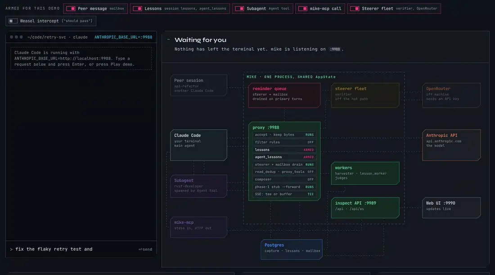
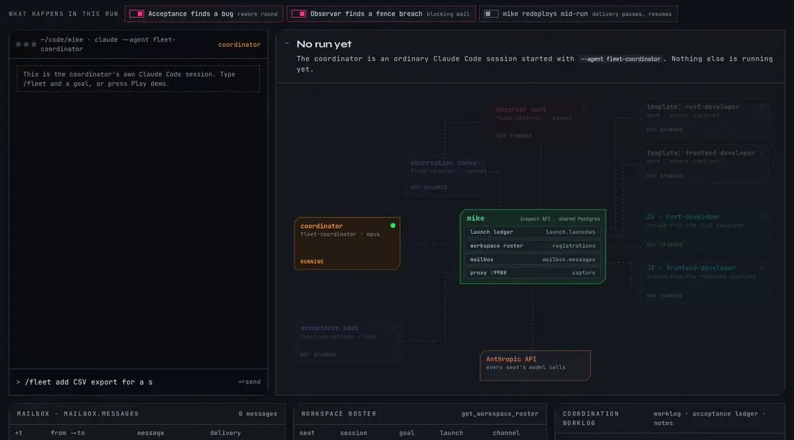

# Animated diagrams

Six looping diagrams of what mike does to a Claude Code turn. Each one is a
plain SVG that animates with SMIL and CSS, with no script, so it plays where
GitHub shows it as an image. The three interactive demos are HTML pages, which
GitHub shows as source. The two demos with a scripted run are recorded as
animated WebP below, and the recordings play on GitHub too.

| Diagram | Shows | Embedded in |
|---|---|---|
| [`mike-overview.svg`](mike-overview.svg) | One turn end to end: proxy, Anthropic, capture, web UI, MCP | [`README.md`](../../README.md) |
| [`system-map.svg`](system-map.svg) | Every port a turn touches, including the `proxy-forward` sidecar | [`ARCHITECTURE.md` §2](../ARCHITECTURE.md#2-system-map) |
| [`mutation-stages.svg`](mutation-stages.svg) | `pipeline::STAGE_ORDER` with four stages armed; the forwarded body changes and the capture does not | [`REQUEST_FLOW.md`](../REQUEST_FLOW.md#mutation-gates-and-default-behaviour), [`ARCHITECTURE.md` §4](../ARCHITECTURE.md#4-request-modification-pipeline) |
| [`answer-replaced.svg`](answer-replaced.svg) | The buffered forwarder on a weasel-intercept hit | [`REQUEST_FLOW.md`](../REQUEST_FLOW.md#the-buffered-forwarder-two-ways-the-response-gets-replaced) |
| [`two-phase-write.svg`](two-phase-write.svg) | The Phase-1 stub, per-event rows, and the Phase-2 terminal snapshot | [`REQUEST_FLOW.md`](../REQUEST_FLOW.md#two-phase-db-write) |
| [`boot-and-shutdown.svg`](boot-and-shutdown.svg) | `mike serve` from `.env` to exit: workers, listeners, drain deadlines | [`STARTUP_FLOW.md`](../STARTUP_FLOW.md) |



## Interactive demo: one turn, live

[`live-turn.html`](live-turn.html) is a simulated Claude Code terminal. Type a
message, or press **Play demo**, and follow it through mike: a peer session's
mailbox message, recalled lessons, a subagent dispatched with the Agent tool, a
mike-mcp call, the answer streaming back, the harvester and the steerer
fleet's verifier working off the hot path, and the queued nudge arriving with
your next message. Features can be switched on and off before the first turn,
including weasel intercept. Activity, the forwarded body and the Postgres rows
written update as it runs. Open it in a browser from a checkout.



## Interactive demo: a fleet run

[`fleet-run.html`](fleet-run.html) is the coordinator's terminal. Type
`/fleet <goal>`, or press **Play demo**, and follow a run with an observer,
persistent worker seats and a separate acceptance seat. The coordinator warms
templates with `mike spawn warm` and forks seats with `mike spawn fork`; seats
receive successive work packages through addressed mailbox messages and keep
scoped notes. Mail uses an active MCP-channel listener first, with Remote Control
and next-request delivery as fallbacks. Workers run focused checks, while acceptance checks the integrated
result independently and sends rework directly to the responsible worker.
The observer checks progress and reports exceptions while the other seats work.
Seats are torn down with `mike spawn kill` when the run is complete, rather than
after each package. Switches illustrate rework, a fenced-file finding and a
redeploy interrupting channels. The roster, mailbox and worklog are simulated.



## Interactive version of the diagrams

[`mike-in-motion.html`](mike-in-motion.html) has the same scenes with
controls: pause, step, jump to any step, arm and disarm each mutation stage,
and switch the response-path scenario (not armed, clean, forbidden-word hit,
proxy tool call, buffer overflow). It has no scripted run to record; the SVGs
above are its scenes. Open the file in a browser from a checkout. It needs no
server.

## Changing a diagram

The SVGs are generated. Edit `build.mjs`, then run:

```bash
make doc-animations        # or: node docs/animations/build.mjs
```

Scenes restate facts from [`REQUEST_FLOW.md`](../REQUEST_FLOW.md) and
[`STARTUP_FLOW.md`](../STARTUP_FLOW.md), which cite the source by symbol. When
one of those docs changes, update the matching scene in `build.mjs` and in
`mike-in-motion.html` in the same commit.

The WebP recordings are generated as well. After changing `live-turn.html` or
`fleet-run.html`, record them again in the same commit:

```bash
make doc-recordings        # or: node docs/animations/record.mjs [live-turn|fleet-run]
```

It plays each demo at 1× in headless Chromium with the features it starts
with, stops when the run is finished, and encodes the video with ffmpeg. It
uses the frontend's Playwright, so run `pnpm install` in `frontend/` first.
Colours are the FUNK Forge tokens
from `frontend/src/app.css`. The prompts, file names and answers inside the
scenes are made-up examples. The demos execute no shell commands, proxy calls
or model requests. Their font stylesheets are fetched from Google Fonts when
online; system font fallbacks keep the demos usable without that connection.
