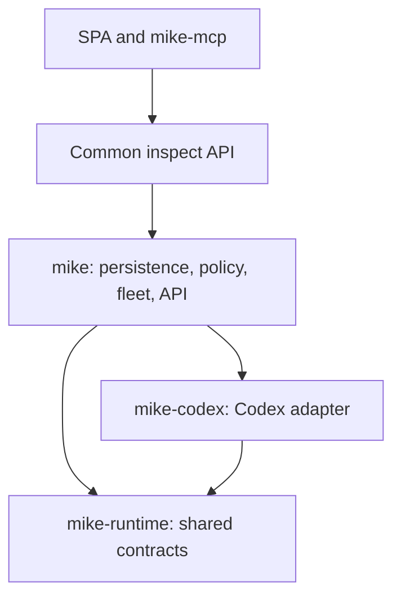

# Codex integration with bounded storage and independent crates

This proposal supplements [#181](https://github.com/temet-ai/mike/issues/181)
and the [Codex tracker #18](https://github.com/temet-ai/mike/issues/18).
It follows the operator's 12 November requirements: avoid the storage debt of
recording every request and response, make Codex feel native in mike, and isolate
Codex in a crate that can be developed and tested independently.

The operator subsequently clarified the primary constraint: reducing the time
from a requested change to a verified working result. A crate split is useful
only if it shortens that path. The complete architecture below is a destination,
not a prerequisite refactor before delivering the next useful Codex improvement.

The recommendation is to make normalized operational facts the durable record,
with independently bounded content and optional diagnostic capture. Normal
session visibility, tools, usage, mail and fleet control must work with raw wire
capture disabled. A new normalized table beside all the old copies would increase
storage debt; replacing the old read/write paths is part of the work.

This is a design and source review, not a shipped implementation. Source baseline:
`0f1a12bcd`. No live model calls, production storage measurements or fleet acceptance
runs were performed. Proposed limits below are starting values to validate, not
measured capacity requirements or current settings.

## What the review found

| Finding | Evidence in the checkout | Consequence |
|---|---|---|
| Full original and forwarded requests are stored separately although Codex forwarding is unchanged; the full response and extracted output items are also stored | `proxy/responses_capture/relay.rs:74`, `record.rs:183` | Duplicate payloads, plus repeated conversation context on subsequent model calls |
| Raw runtime events store both bytes and parsed JSON; item projection also stores effects and several text representations | `store/persistence/runtime/events.rs:32`, `runtime/codex/items.rs:81`, `store/persistence/runtime/codex/effects.rs:94` | Adding another projection is not a storage reduction |
| The session retention worker does not sweep runtime events or observed Codex facts; uncorrelated wire exchanges have a nullable session FK | `retention_worker.rs:15`, migrations `20261013130000_runtime_identity_events.sql`, `20261111190300_codex_observe.sql`, `20261111190000_responses_capture.sql` | Session TTL does not bound these data classes |
| Growing item state is serialized and updated for each delta; old projection generations are marked retired without cleanup | `store/persistence/runtime/codex/state.rs:47`, `runtime/codex/items.rs:275`, `store/persistence/runtime/codex/generation.rs:168` | Potential quadratic write amplification and retained obsolete projections |
| Wire requests are buffered with `usize::MAX`; the response tee grows until completion, then spawns a persistence task | `proxy/responses_capture/relay.rs:17`, `tee.rs:42`, `record.rs:89` | Disk policy alone would leave memory and pending-write growth unbounded |
| Hook/OTLP intake records a receipt before applying facts; a duplicate skips application | `runtime/codex_observe/ingest.rs:185`, `:228` | A crash between the two steps can leave facts permanently missing on ordinary retry |
| The managed runner tracks its active turn but discards other notifications instead of invoking the existing observation ingestion | `launch/codex/fleet.rs:165`, `:222` | Working launch and parser components do not establish end-to-end observation |
| The roster and other readers infer activity from Claude requests | [Runtime contract reader audit](../RUNTIME_CONTRACT.md#request-dependent-reader-audit) | A healthy Codex session can appear uncaptured; #180 is a symptom of the common-model gap |

Rust paths above are relative to `crates/mike/src/`; migration paths are under
`store/persistence/migrations/`. The write-amplification claim is an inference
from the update algorithm, not a measured WAL multiplier. The request-body limit
must be tested at the actual handler; a router's declared limit is not evidence
that manual `to_bytes(..., usize::MAX)` buffering is bounded.

Issues #19, #20, #21 and #24 were closed when inspected. #22, #23 and #25 remain
open, as do #179 and #180. The tracker checkboxes and portions of the runtime
contract lag that implementation. Closed issues are not proof that the complete
session workflow is connected or that all authentication/transport paths passed.

## Delivery time is the first acceptance criterion

The current gate routing would undermine a package-only development loop:

- `scripts/pre-push-check:66` recognizes `mike` and `mike-mcp` explicitly;
  a new crate's Rust paths select `--workspace` for lint and fast tests.
- `scripts/test-area:65` invokes nextest with `--all` and a test expression;
  selecting tests is not an explicit package/target compilation boundary.
- `scripts/lint-rust` supports package arguments, but also scans structural
  rules across the tree. Keep cheap shared checks; distinguish them from builds.
- `crates/mike/Cargo.toml` places Codex's current tests in the Mike package,
  alongside its SQLx, web server, TUI, telemetry and embedded-SPA dependencies.

These are verified routing/dependency facts, not a timing benchmark. Historical
timing artifacts are not evidence of today's warm or cold turnaround. Measure
the actual loop before claiming a speedup. A changed Rust library can still
invalidate downstream compilation/linking; extraction does not eliminate the
final Mike integration build.

Start with one small connected extraction and its existing useful tests. Include
package/target-aware gate selection in that slice, so an unfamiliar package is
not automatically treated as a workspace-wide change. Do not skip consumer
verification: changes to shared interfaces, host glue, manifests/dependencies or
persistence must still exercise the affected consumers. Prove that selection
with existing gate regression tests. Leave unrelated runtime generalization,
schema replacement and UI work for subsequent slices.

The local loop should compile and test Codex without Mike, Postgres, the frontend
or a live model. Integrate the verified adapter into Mike through one small
bridge and run the appropriate host checks once per candidate. Reuse the warm
checkout and existing tooling. Do not create a second release/deploy pipeline,
parallel implementation, or general plugin framework for this extraction.

Record before/after wall time and the packages/targets actually built for:

1. A warm adapter implementation edit and its focused tests.
2. An adapter public-contract edit and the affected consumer checks.
3. The complete first useful change, including gates and the Mike integration
   build, with time waiting on builds distinguished from implementation time.

Agree a numeric target from the baseline. If the first slice does not materially
reduce the ordinary change-to-verification loop, stop expanding the extraction
and address the measured bottleneck. Passing a fast parser test while every
delivery still waits for an unchanged monolithic gate is not success.

Keep the adapter in this workspace initially. A different repository changes
ownership and release coordination, not the Rust dependency graph by itself.
Reconsider repository separation only when measured delivery needs justify its
versioning and integration overhead.

## Crate boundary

The intended boundary has a Codex library and a small shared-contract library in
the existing workspace, without a new daemon. Extract only the contract required
by the first real consumer; do not design an entire cross-provider SDK up front:

| Owner | Responsibilities | Dependencies it must not acquire |
|---|---|---|
| `mike-runtime` | Stable Mike identity and opaque provider references; typed session, turn, model-call/attempt, tool, command, change and usage facts; evidence metadata, completeness, capabilities and delivery results | Codex protocol, Claude protocol, SQL, Axum, fleet policy or `mike` |
| `mike-codex` | App-server transport and lifecycle, Codex schema/version handling, event decoding, history pagination/reconciliation, hook/OTLP decoding, Codex control operations and Responses parsing/correlation | `mike`, SQLx/Postgres, `AppState`, inspect routes, fleet scheduling, retention configuration, UI or MCP implementation |
| `mike` | Session registration, fleet policy, mailbox/outbox, persistence and migrations, common queries, budget admission, cleanup, API/WS and integration wiring | Reader-specific knowledge of Codex event names or `codex_*` storage |

`mike-codex` receives validated configuration, an injected transport/process
factory and explicit limits. It emits typed facts, transient progress, optional
diagnostic evidence and adapter health. It does not choose what to retain or
write a private database. Mike supplies the common bounded ingestion sink and
evidence storage. The adapter enforces its own frame, queue, pending-call and
assembly limits so invalid or slow input cannot bypass host policy.

Expose operations such as start/resume/fork, send, steer, interrupt and stop,
with explicit capabilities and typed outcomes. Keep raw JSON-RPC methods and
Codex structures inside the adapter. Separate observation from control: seeing
an unmanaged thread does not grant control of it. Approval ownership and trusted
peer-mail handling remain explicit; see [Injection trust](../INJECTION_TRUST.md).

The shared contract must not make `raw_payload` mandatory. Every fact includes
identity, source/version, observed time, freshness and completeness. Optional
evidence references carry availability separately from fidelity: retained,
not collected, expired, budget refused, incomplete or lost. A requested model
is distinct from an observed model; missing usage or cost remains unknown.

Extraction map:

- Move pure `runtime/identity.rs` and reusable contract types to `mike-runtime`.
  Separate optional raw evidence from the existing capture-first envelope.
- Move `runtime/codex/` decoding, reducers, history and reconciliation to
  `mike-codex`; promote only genuinely common facts to `mike-runtime`.
- Move the transport/protocol parts of `launch/codex/rpc.rs`, `seat.rs`,
  `model.rs` and `options.rs`. Keep fleet registration, contract rendering,
  launch planning and supervision policy in Mike's composition layer.
- Split hook/OTLP decoding from `runtime/codex_observe/` SQL/application code.
  Move protocol parsing/correlation from Responses capture; keep Axum handlers,
  routing configuration and persistence in Mike. Remove direct SQL from them.
- Keep Claude's adapter in `mike` initially. It publishes the same facts from
  existing capture; there is no need to move every legacy module in this change.

Use a narrow public facade and private modules; a folder move with hundreds of
public internals is not a boundary. Re-export temporarily from old paths only
where needed for migration. Never use a feature that makes `mike-codex` depend
back on `mike`. A consumer compiles the adapter without the Mike binary or DB.
Keep workspace versions and the existing release process; independence here is
about development and tests, not a second deployment or publication pipeline.

## Storage contract

Separate facts, canonical content, recovery and diagnostic evidence. Each class
has a finite age, row/byte budget, owner and cleanup path. Budget totals apply
across runtimes, with project/session shares so one noisy session cannot consume
everything. Pinned sessions are not an exemption from all storage accounting.

| Class | Retained form | Proposed initial policy |
|---|---|---|
| Operational facts | One current state per entity, bounded lifecycle/delivery transitions, scoped usage and provenance | 90-day history; explicit row/byte ceiling; preserve active control state and small durable project artifacts under separately accounted quotas |
| Conversation/tool content | Complete canonical items stored once and referenced by facts; large output belongs here, not in several JSON documents | 30 days; finite installation and per-session byte quotas calibrated before rollout |
| Recovery journal | Unapplied records and bounded checkpoints; no forever event archive | 1 hour / 256 MiB installation ceiling; acknowledge only after durable application or durable retry registration |
| Raw wire/event diagnostics | Exact admitted payloads with metadata and optional references | Off by default; enabling a session expires after 30 minutes; retained evidence expires after 24 hours, with 1 GiB installation / 256 MiB session ceilings |
| Project knowledge | Authored notes, goals, lessons, accepted results and artifact references | Separate existing product policy and explicit quota; do not pin all source traffic implicitly |

The implementation must choose and measure the fact/content ceilings before
enabling the new default; TTL-only or unlimited settings do not satisfy this
proposal. Limits must cover simultaneous writers and in-flight reservations,
not just a periodic count after writes. Byte quotas cannot replace row limits
for tiny events. Reserve capacity for control state and terminal outcomes.

Complete canonical user messages and assistant answers remain useful for
search, recall and judging; an LLM summary alone is insufficient. They are
stored once, not copied with every request's growing input history. Tool input,
output and diffs have one canonical payload where admitted. If content cannot
be retained, the fact says so; a small excerpt is never presented as the full
record. Reading retained content must still return all of that content.

Original and forwarded wire bodies may reference one payload ID when identical.
Keep distinct evidence roles and hashes for verification; use ordinary database
surrogate identities. Do not solve repeated contexts with a bespoke global
deduplication engine. Disabling routine raw capture removes that repetition at
its source. Retained raw bytes stay exact, with documented credential redaction.

Progress deltas feed the live UI through bounded channels. Persist completed
items once, with batched or chunked recovery checkpoints; do not rewrite the
entire growing output for every token. Streaming parsers extract status/usage
without keeping the whole wire body. Independently bound compressed bytes,
decoded bytes, individual frames, unfinished items, queue bytes, pending RPCs,
diagnostic spools and concurrent persistence tasks. A count-bounded queue alone
is not a byte budget.

On diagnostic-budget exhaustion, continue forwarding the original model stream
and report evidence unavailable. On transient progress overload, coalesce or
discard progress and reconcile final state. Do not silently drop terminal facts,
approval decisions or mail acknowledgements: reserve their capacity, persist a
retry/checkpoint, or report degraded/unavailable and refuse new managed work
that requires durable tracking. Never acknowledge a mail enqueue that was not
durable. Existing Codex execution must not hang behind a diagnostic DB write.

Projection and its durable receipt/checkpoint must be atomic, or use a retryable
state machine that retries incomplete applications. Prune a journal only after
its checkpoint is committed. If the hard journal ceiling prevents recovery,
record the gap and attempt supported history reconciliation; never claim full
replay. Retain small deduplication keys/checkpoints independently of raw bytes.
Delayed history must not recreate deleted content or retired generations.

Cleanup must cover uncorrelated exchanges, multi-thread OTLP batches, unresolved
identities, retired/failed generations, orphaned payloads, retry queues and
session/project deletion. Optional evidence expiry must not cascade-delete
useful facts. Remove raw-event FK dependencies from durable facts or retain a
small receipt identity after its payload expires. Codex-owned history is a
possible recovery source, not guaranteed permanent evidence or a reason to
copy the entire history repeatedly.

Report logical admitted bytes and physical table/TOAST/index size, growth rate,
journal lag, expired/refused evidence and WAL/write amplification. PostgreSQL
DELETE normally makes space reusable rather than immediately shrinking files;
budget headroom must include indexes, WAL, vacuum lag and backups. An operational
disk ceiling needs admission headroom, not a claim that a payload counter bounds
all physical disk usage.

## Native Mike workflow

Both managed seats and ordinary Codex sessions feed the same fact ingestion and
read models. Managed seats use app-server events. Ordinary sessions use supported
hooks/telemetry and bounded history reconciliation, with gaps visible. The current
`cdx` launcher only redirects model traffic; it needs observation setup/health,
session lifecycle linkage and clean exit reporting without requiring raw capture.

The same session row, timeline, tools, usage, notebook, memory and fleet graph
should work for Claude and Codex. Show independent states for session liveness,
observation health, control capability and diagnostic capture. A session that is
observed with wire capture off is not "uncaptured" or "pull-only" merely because
it has no Claude request. Lifecycle and activity are different facts: idle is
not dead; a roster lease is not proof that an exited process is alive.

Maintain one Mike session identity through reconnect/resume. Scope provider
identity by durable machine/runtime-home identity. Reconcile today's managed
`codex-home:<path>` and observed `codex-observed:<source>` namespaces through
explicit bindings; a bare provider thread ID is insufficient. Keep forks and
native children distinct, with owning-seat attribution. Deduplicate hook,
telemetry, history and wire reports using provider identities and explicit source
precedence, not timestamps alone. Attempts lacking common correlation IDs stay
separate, with unknown linkage; do not guess that they describe the same call.
Preserve disagreements as evidence. Usage
must specify delta/cumulative and own-thread/subtree scope; do not sum cumulative
samples, parent-plus-child totals, or treat an unknown bill as zero.

Mail uses the existing durable outbox and common control interface. Idle delivery
can start a turn; busy delivery must target the expected turn and handle the
completion race. Accepted, consumed and acted-on are separate states. A later
item or completed turn does not prove that a particular assignment was followed
or satisfied: require explicit acknowledgement/work evidence, and keep turn
completion distinct from fleet acceptance. Resume and retry must reconcile
uncertain sends before repeating them. Lessons, reminders,
steering and approval support are capability-gated; response interception is not
implied by mail support. Expired raw bodies must not break any of these workflows.

## Delivery order and proof

1. **Prove the faster loop with a connected slice.** Baseline one representative
   Codex edit, extract the smallest useful adapter path and required contract,
   move its existing tests, and fix package/target gate routing. Establish typed
   facts and optional evidence only as needed by this slice. Wire one real
   managed lifecycle notification through the adapter facade. Measure the full
   before/after development and delivery paths before expanding the extraction.
   Compile/test `mike-codex` without SQLx, Axum, Mike or a running Codex process;
   inspect its dependency tree. An empty crate or parser-only demo is not the
   complete extraction. Move remaining adapter modules incrementally as their
   feature work lands; completion of every move does not gate the first benefit.
2. **Safe ingestion and storage.** Make receipt/projection retry-safe, enforce
   byte/row limits, implement evidence expiry and orphan/generation cleanup,
   and connect managed events and ordinary-session observation. Introduce the
   new raw-off policy as an opt-in until the cutover gate below passes. Keep old reads
   working during cutover; bound temporary dual writes and give them an end.
3. **First shared vertical slice.** Move roster, session head and fleet status
   to common lifecycle/activity/usage facts. Fix #179 at the adapter's terminal
   event/parser boundary and #180 at the common reader, not with a Codex branch
   in the roster. Prove the same reader works for Claude, Codex and a fake third
   runtime with raw evidence absent.
4. **Complete reader and control migration.** Follow the runtime-contract audit
   for staffing, tools/commands, file evidence, run records, brief consumption
   and mail. Feed API/MCP/SPA from those readers; migrate recall/judge inputs to
   canonical content where needed. Test ordinary, managed and mixed sessions.
5. **Cut over defaults and retire duplicate writes.** Switch routine raw capture
   off only after ordinary-session observation, lifecycle and dependent readers
   pass the raw-off and expired-evidence journeys. Today `cx` visibility relies
   on wire capture; changing that default earlier would break integration.
   Stop writing superseded `codex_*` projections;
   retain bounded compatibility reads only for an explicit transition window.
   Backfill necessary recent facts incrementally with checkpoints. Clean up old
   storage through the declared retention/migration policy, never an unreviewed
   wholesale production deletion. Update the capability matrix and user docs.

Adapter tests use fake clock/transport plus recorded, version-labelled fixtures:
out-of-order/duplicate items, unknown variants, long-running commands, nested
tools, children, compaction, timeouts, approval requests and completion races.
DB integration tests cover crash after receipt/before projection, reconnect
without raw evidence, delayed duplicates after expiry, orphan cleanup and
session deletion. Shared contract tests compare readers across adapters.

Storage acceptance uses a long-session fixture with repeated growing input,
large tool output and many small deltas. Measure both retained bytes and write
volume: doubling stream chunks must not cause quadratic full-state rewrites.
Force every quota, a slow consumer and a DB outage. Verify memory/queues remain
bounded, forwarding continues, incomplete evidence is visible, and recovery
does not duplicate facts, usage or mail. Verify raw capture off writes no wire
bodies and raw expiry leaves the normal session workflow usable.

Run actual emitted-behaviour acceptance on the supported Codex version, including
interactive and managed execution, restart, idle/busy/completing mail and mixed
fleet acceptance. Schema fixtures alone are insufficient. Use repository narrow
test commands for each slice and its normal hooks; do not combine extraction,
all readers, retention migration and deployment into one unreviewable change.

## Required issue and policy amendments

In #181, change "adapter writes it from raw capture" to "adapter publishes
normalized facts from supported runtime signals; raw capture is optional
evidence." Add bounded storage, independent-crate tests, raw-off/expired reader
tests, managed event wiring and removal of superseded writes to acceptance.
Make measured development/delivery turnaround and correct package/target gate
routing acceptance criteria for the first extraction, not follow-up optimization.

The older [#18 comment](https://github.com/temet-ai/mike/issues/18#issuecomment-6707828723)
makes full capture a prerequisite for visibility. The operator's new requirement
changes that dependency: visibility and control come first; #24 supplies scoped
diagnostic fidelity. Add the crate boundary and storage acceptance to #19/#23/#25
and use #181 as the common reader work, rather than adding vendor-specific fixes.

Before implementing the new storage default, update
[agent-behavior-and-data.md](../../.claude/rules/agent-behavior-and-data.md), which
currently says "Capture and persistence retain every byte. No storage caps,
pre-sliced columns or opt-outs." Preserve the protection against secretly
truncating retained evidence; replace unlimited retention with explicit policy,
accurate availability and finite budgets. Align the fidelity gate/catalogue,
[Runtime contract](../RUNTIME_CONTRACT.md), [System map](../SYSTEM_MAP.md),
[Codex capture](../CODEX_CAPTURE.md), and
[What Mike stores and sends](../WHAT_MIKE_STORES_AND_SENDS.md). This proposal does
not silently change legacy Claude retention or delete existing captures.

## External interface evidence

The current official [Codex App Server documentation](https://learn.chatgpt.com/docs/app-server)
documents lifecycle/item notifications, history pagination without resuming a
thread, and active-turn steering with an expected turn ID. Those interfaces
support the proposed observation/control separation; exact version coverage and
emitted behaviour still need the tests above. Nothing in that interface requires
Mike to retain every upstream request body to provide a session timeline.
