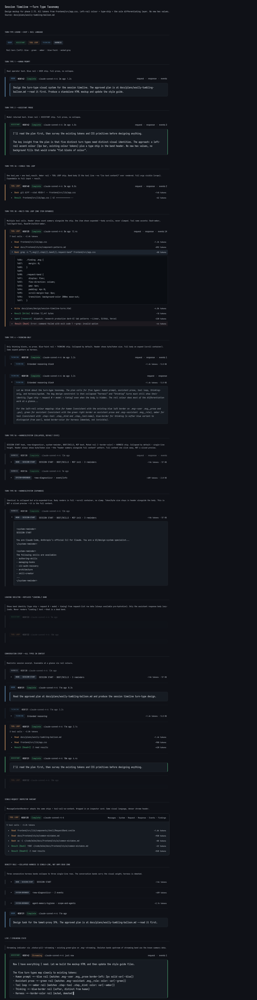
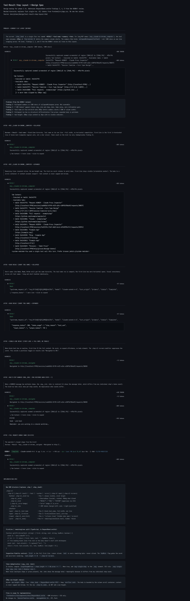
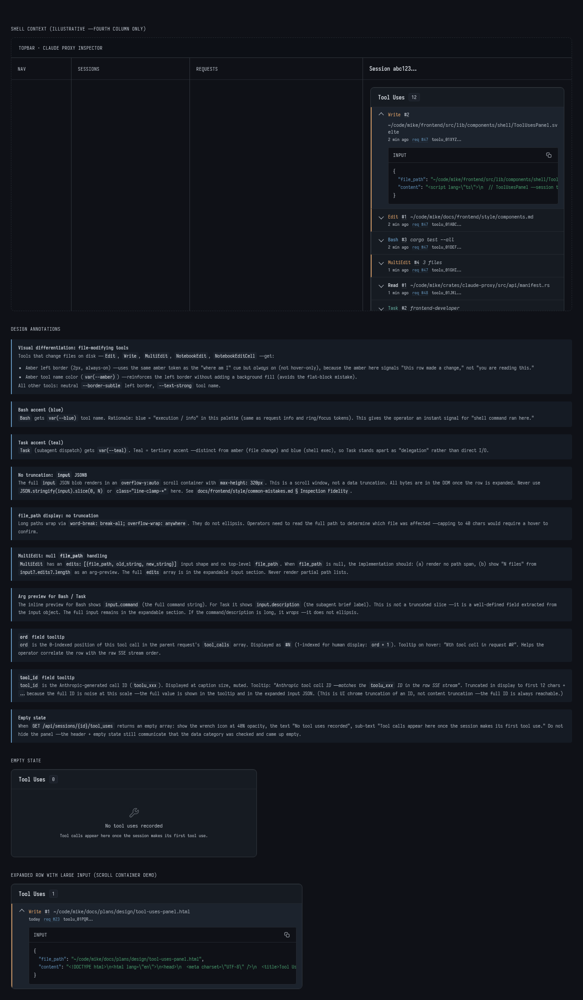

# Design mock-ups

HTML mock-ups drawn while designing panels of the web UI. Each one is shown below as
drawn in a browser, because GitHub shows HTML as source. The built components and their
Storybook stories are what the app uses now; these record the design intent and the
annotations behind it. After changing a mock-up, regenerate its picture with
`scripts/html-doc-render`.

## Session timeline: turn types

[`session-timeline-turns.html`](session-timeline-turns.html), built as `SessionTimeline.svelte`.

## Tool-result step layout

[`tool-result-step-layout.html`](tool-result-step-layout.html).

## Tool uses panel

[`tool-uses-panel.html`](tool-uses-panel.html), built as `ToolUsesPanel.svelte`.

