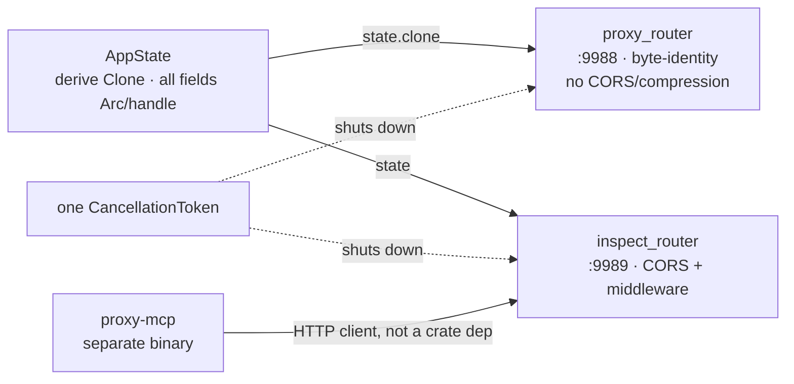

**Part I · Threads: source-of-truth, bound-it, deterministic-enforcement · Grounded by: —**

# 01. Workspace & crate boundaries

Structure is a response to *measured pressure*, not aesthetics. The cheapest place to be wrong about crate boundaries is on day one. Start as one crate of domain modules; keep the public surface deliberately small; split into a workspace only when a *named* force appears; decouple auxiliary processes over HTTP rather than crate dependencies; hold shared state in one cheap-clone root; and split incompatible middleware contracts at the *bind* level rather than bolting conditional layers onto one router.

---

## Lesson 1 — Start as one crate of domain modules; split into a workspace only on named pressure

**Do this.** Begin with a single crate. Organize the inside by **domain** — one module per concept (`proxy/`, `sse/`, `store/`, `filter/`, `config/`, `extract/`), with structs and their `impl` blocks as the unit of behaviour. Promote to a Cargo workspace only when a concrete trigger fires ([Fowler, *YAGNI*](https://martinfowler.com/bliki/Yagni.html)): incremental compile time crosses a threshold *you have written down*, you genuinely need a second binary (a sidecar/bridge/exporter), or stable library boundaries have emerged from real usage. Track further splits as roadmap items, not speculative work. `[thread: deterministic-enforcement]`

**Not this.** A premature five-crate split with tangled inter-crate dependencies. Or importing OOP layering — `services/`, `repositories/`, `controllers/`, `models/` — into Rust. Rust has no DI container, so technical-layer directories buy nothing and scatter one domain's logic across many folders, destroying locality.

**The compile threshold is a rule shape, not a magic number.** Measure your incremental compile time, pick a ceiling, write it down, split when you cross it. This corpus shows two defensible ceilings (>30s, >60s) and no canonical one — choose for *your* team and record the number so the next person knows the trigger was deliberate.

**Why.** Premature crate splitting freezes a public API across the split *before the design is stable*, and every later refactor then has to thread through that frozen boundary. A single crate with good module boundaries reorganizes for free; five coupled crates do not.

**Evidence.**
- `docs/ARCHITECTURE.md:411-419` — "Decision: Start Monolithic, Split Later," naming the split triggers (>30s incremental compile, need for a separate MCP server binary, clear boundaries from usage) and "Premature crate splitting creates coupling through public APIs before the design is stable."
- `docs/ARCHITECTURE.md:425-429` — "Organizing Code: Domain Modules, Not Layers... No services/, repositories/, controllers/ directories."
- `Cargo.toml:3` — `members = ["crates/claude-proxy", "crates/proxy-mcp"]`: two crates only, at ~96k LOC (`find crates -name '*.rs' | xargs wc -l` → 95877). The split bought a second binary, nothing else.
- Threshold divergence: `docs/ARCHITECTURE.md:415` (>30s) vs `artifacts/research/rust-developer-guide.md:159` (>60s) — same rule shape, different number.
- Both the monolithic decision and the two-bind decision are present in the **initial** commit `9cc42d1` — foundational, not retrofitted.

---

## Lesson 2 — Thin bin over fat lib, with constructor dependency injection

**Do this.** Put all business logic in `lib.rs` and its modules; the binary should be a shell that parses args, inits tracing, builds config, and calls into the lib. Integration tests in `tests/` and the binary *both* compile as external crates against your lib — so this split is precisely what makes your logic reachable by tests at all. Inject dependencies (HTTP client, store, clock, channels) through constructor arguments and struct fields — no DI framework. Keep pure extraction/transform functions in their own submodule with **no async and no shared state**, so they are trivially unit-testable. Define traits only at external boundaries (HTTP, DB, filesystem, clock), and wait for a *second* implementation before extracting one (the Rule of Two). `[thread: deterministic-enforcement]`

**Not this.** Business logic in `main.rs`. A single function doing HTTP parsing + TLS + forwarding + state mutation in a 500-line closure. Dependencies (TLS, channels, stores) hardcoded inside that closure, so nothing can be unit-tested in isolation. Premature traits with one implementation.

**Why.** This is the exact failure the predecessor proxy (`proxyclawd`) was audited as having: "Zero Testability" — no tests, `handle_connection` doing HTTP parsing + TLS + event forwarding + state mutation, all dependencies hardcoded, "proxy.rs has 500+ lines of business logic in a closure — impossible to unit test." The antidote here is `extract/request.rs`: a pure module with **zero** `async fn` and **zero** `State<` occurrences, so it tests with plain function calls.

**A caveat on "thin."** "Thin bin" governs *business logic*, not literal line count. This repo's `main.rs` is ~430 lines against a documented ~50-line target, because server-startup wiring (both binds, both `with_graceful_shutdown` calls, the signal task, `tokio::try_join!`) lives in `fn main` rather than a `run()` helper. The split is genuinely real where it matters — logic sits in modules — but if you want the shell *literally* thin, extract a `run()`/`serve()` helper from day one. A doc-table line count is not a substitute for the extraction.

**Evidence.**
- `artifacts/research/proxyclawd-audit.md:42-47` — "Zero Testability... handle_connection: HTTP parsing + TLS + event forwarding + state mutation... No dependency injection... proxy.rs has 500+ lines of business logic in a closure — impossible to unit test."
- `docs/ARCHITECTURE.md:458` — module-map table: "main.rs | CLI parse, tracing init, server start (~50 lines)" (documented *target*; live `main.rs` is ~430 lines because startup wiring lives in `fn main`).
- `artifacts/research/rust-developer-guide.md:122-136` — lib/bin split for testability ("Integration tests can only access lib.rs items").
- `artifacts/research/rust-developer-guide.md:402-420` and `:337-339` — constructor injection without a framework; the Two-Implementation Rule ("introduce generics/trait objects only when you have 2+ implementations").
- `grep -c "async fn" crates/claude-proxy/src/extract/request.rs` → 0; `grep -c "State<" ...` → 0 — the extraction module is pure.

---

## Lesson 3 — Default symbols to `pub(crate)`; widen to `pub` only the named entry points binaries/tests call

**Do this.** Adopt a visibility *ladder*. Reach for `pub mod` only when a module is reached by an external compilation unit — the binary via `my_crate::<name>`, or an integration test in `tests/` (each compiles as its own external binary). Keep the **symbols inside** those modules `pub(crate)` and widen only the specific functions the binary/tests actually call. Document each `pub mod` with a one-line note on *who* reaches it. Test-only seams sit behind a cfg/feature flag so they never compile into the release binary — that gate is owned by the test-strategy chapter, see [ch. 12 — Test strategy](./12-T10b-test-strategy.md). `[thread: deterministic-enforcement]`

**Not this.** Blanket `pub` "just in case," which leaks internals into the crate's API and lets glob re-exports leak implementation. Or the inverted mistake — `pub(crate) mod` containing `pub` symbols — which makes the *module itself* unreachable from `tests/`, so test seams cannot be wired no matter how public the symbols are.

**Why.** The ladder is forced by how Rust compiles integration tests: a crate in `tests/` is an *external* consumer, so you cannot hide a module behind `pub(crate) mod` and still call into it from a test — nor push test seams into a shared helper crate, which would itself need impossible `pub(crate)` access to your internal types. The shape is therefore `pub mod` (module visible) + `pub(crate)` symbols (surface intentional), *not* `pub(crate) mod` + `pub` symbols. Each `pub mod` earns its visibility with a named external caller — `db_listener` stays `pub` because `tests/db_listener_smoke.rs` calls `claude_proxy::db_listener::spawn_listener`; `messages_backfill` stays `pub` because the separate `backfill_messages` bin reaches `claude_proxy::messages_backfill::run`.

**Evidence.**
- `crates/claude-proxy/src/lib.rs:1-38` — the "W9 module visibility ladder" header. Its explicit "DEVIATION FROM HANDOFF SPEC" list names **four** modules kept `pub` (`db_listener`, `in_flight`, `startup`, `sweep`) — note `sweep` is now stale: there is no `pub mod sweep` in the current body.
- `crates/claude-proxy/src/lib.rs:39-89` — the live `pub(crate) mod` vs `pub mod` split, where each `pub mod` carries a per-module doc comment naming its external caller (`db_listener`, `in_flight`, `lesson_worker`, `memory_cap`, `messages_backfill`, `observability`, `startup`). This is the authoritative attribution, not the header.
- `artifacts/research/rust-developer-guide.md:144-153` — "Default to `pub(crate)`. Promote to `pub` only when another crate needs it."

**Pattern.**
```rust
// src/lib.rs — the ladder, in one screen
pub(crate) mod proxy;       // internal-only: no external consumer
/// Stays `pub` so `tests/db_listener_smoke.rs` can call `spawn_listener`.
/// Symbols inside default to `pub(crate)`.
pub mod db_listener;
```

---

## Lesson 4 — Pin shared dependency versions once in `[workspace.dependencies]`; keep single-consumer deps crate-local

**Do this.** In a workspace, hoist any dependency used by **more than one member** into `[workspace.dependencies]` so every crate resolves it identically, and inherit `edition` / `rust-version` via `[workspace.package]`. A dependency that only one crate uses (the server's web framework, the bridge's MCP runtime) stays in that crate's own manifest. Members reference shared deps with `{ workspace = true }`. Record the *reason* for an MSRV pin in a comment, so the constraint survives the person who set it. `[thread: source-of-truth]`

**Not this.** Each crate declaring its own version of a shared dependency, producing duplicate/incompatible transitive resolutions and silent version skew across members — the kind of skew that only surfaces as a baffling trait-mismatch error at a call site that touches both crates.

**Why.** A single pinned version is the one source of truth for "which `tokio` does this workspace mean"; per-crate versions are projections that drift. The split (shared → hoisted, single-consumer → local) keeps the workspace table honest: it lists exactly the deps with more than one consumer, and nothing else.

**Evidence.**
- `Cargo.toml:10-13` — "[workspace.dependencies] — Shared dep versions so both crates resolve identically. Crate-specific deps (axum, rmcp, etc.) stay in the individual crate manifests."
- `Cargo.toml:5-8` — `[workspace.package] edition = "2024"`, `rust-version = "1.85"` with the comment tying MSRV to edition-2024 stabilization.
- `crates/proxy-mcp/Cargo.toml:4-5,13-22` — `edition.workspace = true`, `rust-version.workspace = true`, anyhow/tokio/serde/reqwest via `{ workspace = true }`; `rmcp = "0.17"` pinned locally (line 12).
- `crates/claude-proxy/Cargo.toml:32` — `axum = { version = "0.8", ... }`: crate-local, deliberately not in the workspace table.

**Pattern.**
```toml
# workspace Cargo.toml
[workspace.package]
edition = "2024"
rust-version = "1.85"        # MSRV tied to edition-2024 stabilization
[workspace.dependencies]
tokio = { version = "1", features = ["full"] }   # shared -> pinned once
# axum, rmcp, etc. stay in the crate that uses them
```

> Supply-chain pinning (`cargo-deny`/`cargo-audit`/RUSTSEC) is the natural companion to dependency hygiene; the repo names it as a gap — see the playbook's [Appendix A](../appendix-a-adopt.md).

---

## Lesson 5 — Decouple an auxiliary process over HTTP, not by a crate dependency

**Do this.** When a second binary consumes your service (an MCP bridge, a CLI, an exporter), have it talk to the main process over its **existing network API** as a plain HTTP client, returning the service's JSON unchanged. The two then build, version, restart, and deploy independently, and an internal schema change in the server does not force a recompile of the client. If the client needs the server crate at all, confine that dependency to `[dev-dependencies]` for a parity/contract test — never production code. `[thread: source-of-truth]`

**Not this.** Linking the sidecar binary against the server crate's library, coupling their build/version/restart lifecycles and duplicating DTOs across the boundary. (The audited predecessor showed the in-process version of this failure: proxy and web tasks both reached into shared `Arc<Mutex<...>>` state, tightly coupling components that should have been independent.)

**Why.** Returning the upstream JSON verbatim means the client is a passthrough, not a second model of your DTOs — so there is exactly one definition of every response shape (the server's), and the client cannot drift from it. In this repo, `proxy-mcp` is a separate stdio binary that connects to the inspect bind as an HTTP client; its production manifest has **no** path-dependency on `claude-proxy`. The path-dep appears only under `[dev-dependencies]`, solely so a build-time parity test can read the route manifest.

**Evidence.**
- `crates/proxy-mcp/src/lib.rs:1-8` — "It does NOT run in-process with `claude-proxy` — it connects to the proxy's inspect bind... as an HTTP client. The decoupling means the proxy and the MCP server can be restarted, tested, and versioned independently."
- `crates/proxy-mcp/src/client.rs:1-8` — "proxy-mcp is a pure passthrough... it avoids duplicating the inspect API's DTOs across crate boundaries, and it means a schema change in `claude-proxy` doesn't force a change here."
- `crates/proxy-mcp/Cargo.toml:24-29` — `claude-proxy = { path = "../claude-proxy" }` under `[dev-dependencies]`, with the comment that production code does NOT depend on `claude-proxy` because the two binaries communicate over HTTP.
- `docs/ARCHITECTURE.md:421` — "The MCP bridge does not depend on the proxy crate — it talks HTTP to the inspect bind."

> The dev-only path-dep exists to power a build-time **manifest↔parity** contract that keeps the HTTP-decoupled client in sync with the server's routes without a production crate dep. That contract is owned by [ch. 12 — Test strategy](./12-T10b-test-strategy.md).

---

## Lesson 6 — Hold all shared state in one cheap-clone `AppState`, injected via the framework's `State` extractor

**Do this.** Give the service a single `AppState` struct that derives `Clone` and holds every shared handle — store, HTTP client, config `Arc`, broadcast sender, shutdown token, task tracker, persistence handle, metrics. Each field is an `Arc`/handle, so cloning `AppState` is a refcount bump, not a deep copy. Handlers receive it via the framework's `State<AppState>` extractor. This is the *one* dependency root: a single place to see and wire everything, with no globals. `[thread: source-of-truth]`

**Not this.** Scattering shared state across `lazy_static`/global statics, or threading a dozen separate `Arc` parameters through every function signature. (The predecessor's `Arc<Mutex<Option/Vec>>` header stores, read across proxy and web tasks, produced versioning races and WebSocket snapshot gaps — exactly the coupling a single typed `AppState` removes.)

**Why.** One typed root makes the set of shared dependencies *legible* and makes adding one a single-line struct change rather than a signature edit rippling through the call graph. Because every field is already an `Arc`/handle, the clone handed to each server future is essentially free.

**Evidence.**
- `crates/claude-proxy/src/config/mod.rs:510-511` — `#[derive(Clone)] pub struct AppState { ... }` holding `store: Arc<RwLock<RequestStore>>`, `client: reqwest::Client`, `event_tx: broadcast::Sender<…>`, `config: Arc<ProxyConfig>`, `shutdown: CancellationToken`, `tracker: TaskTracker`, `persist: Option<PersistHandle>`, plus `ArcSwap`-wrapped hot-reload configs.
- `docs/ARCHITECTURE.md:460-462` — "AppState: The Dependency Root — One AppState struct holds everything. Handlers extract it via axum's `State<AppState>`."
- `docs/ARCHITECTURE.md:16` — "no global state beyond `AppState`, which is constructed once at startup and shared by reference across both binds."
- `artifacts/research/proxyclawd-audit.md:49-57` — the shared-mutable-state failure mode `AppState` replaces.

> The `ArcSwap`-wrapped hot-reload fields inside `AppState` (filter config, composer, analyzer registry) are touched here only as struct members. The lock-free read/swap mechanic is owned by [ch. 7 — Async & concurrency](./07-T07-async-concurrency.md).

---

## Lesson 7 — Split incompatible middleware contracts into separate binds sharing one `AppState`

**Do this.** When two surfaces of the same process have conflicting middleware needs — a byte-identity passthrough vs a browser-facing API that needs CORS / compression / content negotiation — run **two server futures**, each with its own `Router` and middleware stack, over **one shared `AppState`**. Splitting at the *bind* level structurally prevents a middleware `Layer` added for one surface from accidentally wrapping the other. Share one `CancellationToken` across both so a single signal shuts the whole process down, and join the server futures so either's failure brings the process down cleanly. `[thread: bound-it, deterministic-enforcement]`

**Not this.** One router serving both the strict passthrough path and the feature-rich API path, where a *global* middleware layer (compression, CORS, body logging) silently corrupts the strict path's byte-identity contract. A conditional `if path.starts_with("/v1")` inside a shared layer is a runtime guard for what should be a compile-time structural separation — and one forgotten branch reintroduces the corruption.

**Why.** The proxy's `/v1/*` contract (no JSON reserialization, no response compression, exact header pass-through, no `accept-encoding` negotiation) is *incompatible* with the middleware a browser API needs. That byte-identity contract is the product's defining promise — see [ch. 2 — Hot-path passthrough](./02-T02-hot-path-passthrough.md). Enforcing the separation at the bind level makes "a CORS layer touches the passthrough path" not a bug you must remember to avoid, but a thing that cannot be expressed: the two routers are different objects with different stacks. `proxy_router` is a deliberately minimal single catch-all; `inspect_router` carries the full middleware stack; both are built from one `state.clone()`.

**Evidence.**
- `docs/ARCHITECTURE.md:389-407` — "Decision: Two Binds, One Process... the byte-identity contract on /v1/* ... is incompatible with the normal middleware stack a browser-facing API needs... Splitting them at the bind level prevents a tower::Layer added for /api/* from accidentally wrapping the proxy path. Both binds share one AppState clone and one CancellationToken."
- `crates/claude-proxy/src/app.rs:7-28` — `proxy_router` doc comment: "No CORS, no compression, no mutation... preserves byte-identity"; the minimal single `/v1/{*rest}` catch-all (lines 14-18) vs `inspect_router` delegating to the manifest with full middleware (lines 26-28).
- `crates/claude-proxy/src/main.rs:290-291,307-325` — two `axum::serve(...).with_graceful_shutdown(...)` calls over `proxy_router(state.clone())` / `inspect_router(state)`, joined via `tokio::try_join!`, each with its own clone of the shared `CancellationToken`.

**Pattern.**
```rust
let proxy_app   = proxy_router(state.clone());   // minimal, byte-identity
let inspect_app = inspect_router(state);         // CORS + full middleware
let proxy_serve   = axum::serve(proxy_l,   proxy_app)
    .with_graceful_shutdown(async move { proxy_shutdown.cancelled().await });
let inspect_serve = axum::serve(inspect_l, inspect_app)
    .with_graceful_shutdown(async move { inspect_shutdown.cancelled().await });
tokio::try_join!(proxy_serve, inspect_serve)?;   // one token shuts both down
```



---

## Further reading

- [The Rust Programming Language, ch. 12 — main/lib separation for testability](https://doc.rust-lang.org/book/ch12-03-improving-error-handling-and-modularity.html) — REINFORCES Lesson 2 almost verbatim: because `main` can't be tested directly, moving logic into `lib.rs` is what makes it reachable, leaving `main` to arg-parsing, config, and calling `run`.
- [The Rust Programming Language, ch. 7.3 — items private by default](https://doc.rust-lang.org/book/ch07-03-paths-for-referring-to-an-item-in-the-module-tree.html) — REINFORCES Lesson 3 at the language level: privacy is the default and `pub` the deliberate opt-in. (The `pub mod` + `pub(crate)`-symbols + test-seam *ladder* is an integration-test refinement the Book doesn't cover — that nuance is the chapter's own.)
- [Rust API Guidelines — public types are a stability commitment](https://rust-lang.github.io/api-guidelines/necessities.html) — REINFORCES Lesson 3's "not just in case": anything exposed (even via a `From` impl) becomes a public dependency that constrains future change, so blanket `pub` has a cost.
- [The Cargo Book — workspaces & dependency inheritance](https://doc.rust-lang.org/cargo/reference/workspaces.html) — REINFORCES Lesson 4's mechanism: `[workspace.dependencies]` hoisting + `cc.workspace = true` + `[workspace.package]` inheritance. (The *which* deps to hoist — shared vs single-consumer — is the chapter's discipline on top.)
- [Fowler, *YAGNI*](https://martinfowler.com/bliki/Yagni.html) — REINFORCES Lesson 1's timing: defer the workspace split until a real force requires it; a malleable single crate makes the later build cheap.
- [Fowler, *Refactoring* — the Rule of Three (attr. Don Roberts)](https://martinfowler.com/books/refactoring.html) — QUALIFIES Lesson 2's "Rule of Two": same don't-abstract-on-the-first-instance shape, but the chapter pulls the trigger one occurrence earlier, scoped to trait extraction at external boundaries rather than general duplication.
