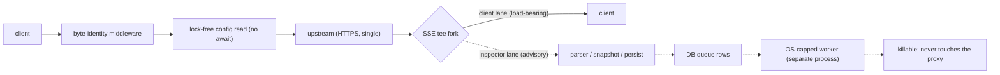

**Part I · Threads: bound-it, source-of-truth · Grounded by: [CS-3](../case-studies.md#cs-embeddings-oom)**

# 2. The hot path & passthrough discipline

A gateway, proxy, or any service with a fast inner loop has one job that must never degrade: move bytes through, fast and unchanged. Everything else — inspection, analysis, persistence, derived indexes, ML — is secondary and must never compromise that job. This chapter is two disciplines the project paid for in production. First, the **passthrough kernel**: when a layer's contract is "forward these bytes verbatim," preserve them to the byte, forward status and headers and errors untouched, and observe streams without buffering them. Second, **hot-path hygiene**: the per-request path does only the minimum, reads its config lock-free, never `.await`s a database, and exports every heavy or unbounded workload to a separate, restartable, OS-capped process. The most expensive incident behind this chapter ([CS-3](../case-studies.md#cs-embeddings-oom)) was a heavy workload placed on the request path — a placement error, not a tuning failure (Lesson 6).

---

## 1. Assert byte-identity on anything you forward verbatim — and skip the transform when the bytes are signed

`[thread: source-of-truth]`

**Do this.** When a layer's contract is "forward these bytes unchanged," make the *bytes* the assertion target, not their meaning: SHA-256 the body the client sent against the body the upstream received, using a payload with deliberately unusual formatting (extra whitespace, non-alphabetical field order). The unmodified-body fast path must forward the original buffer you already hold — never parse-then-reserialize. Keep a separate full-fidelity copy for inspection, and never let the inspection copy become the forwarded copy. If the payload can carry cryptographically signed sub-content, detect it and *skip or guard* any rewrite transform rather than risk re-emitting it.

**Not this.** Asserting on parsed/normalized values (`assert_eq!(parsed_a, parsed_b)`) — that passes even when the layer reordered fields, changed whitespace, or re-normalized Unicode. Deserializing-then-reserializing a whole body just to inspect or lightly edit it.

**Why.** A JSON serializer does not guarantee field order, whitespace, or Unicode normalization, so any parse→reserialize loses byte-identity. The HTTP spec already biases an intermediary toward preserve-don't-transform ([RFC 9110 — intermediaries](https://www.rfc-editor.org/rfc/rfc9110.html#name-intermediaries)); this lesson goes further, to byte-for-byte body identity, because the upstream cryptographically signs sub-content. (In temet-proxy: Anthropic signs `thinking` blocks; a reserialize makes the upstream reject the request with a 400. A prompt-filter review caught a rewrite path calling `serde_json::to_vec` on the *entire* parsed body, risking every signed request — the fix was a documented fast path for the unchanged case plus skipping the transform when signed content is present.) This is the forward face of the source-of-truth thread that [ch. 10 — Observability & inspection fidelity](./10-T09-observability-fidelity.md) carries into the inspection layer.

**Evidence.**
- `.claude/rules/testing.md:41-43` — Test 9: "SHA-256 of body received by upstream matches SHA-256 of body sent by client. No reserialization."
- `artifacts/research/claude-api-wire-protocol.md:157` — "do NOT reserialize JSON (breaks thinking block signatures)."
- `artifacts/reviews/feature-prompt-filter-remediation.md:378-415` — W1: a `to_vec(&value)` rewrite path risks signature mismatch → upstream 400; fix = document the tradeoff or skip the transform when a thinking block is present.
- `docs/ARCHITECTURE.md:70` — header masking applies only to the inspection projection; the headers forwarded upstream are unchanged.

**Pattern.**
```rust
// The body is the assertion target, not its meaning.
let sent = client.post("/v1/messages").body(weird_body.clone()).send().await?;
let upstream_got = upstream_capture.recv().await?;       // raw bytes the mock saw
assert_eq!(sha256(&weird_body), sha256(&upstream_got));  // byte identity, not value-eq
```

---

## 2. Forward upstream status, error bodies, and rate-limit headers verbatim — and never add your own retry

`[thread: bound-it]`

**Do this.** Pass error statuses (e.g. `429` / `529` / `5xx`) and their bodies through untouched — never remap them to a generic `502`/`500`. Forward every rate-limit, `retry-after`, and `request-id` header in both directions. Add **no** retry logic of your own on top of a client that already backs off — let the caller see the real status and decide. After a successful response opens a stream, a mid-stream `event: error` must reach the client, not be swallowed by closing the connection. Encode each as an explicit invariant test: one request in → exactly one request upstream.

**Not this.** Remapping `429`/`529` to a generic `5xx`; dropping rate-limit headers; double-retrying on top of an SDK that already retries; closing the connection on a mid-stream error; "helpfully" normalizing an error body.

**Why.** The client already implements backoff keyed off the real status and `retry-after`. A proxy that remaps or silently retries breaks that backoff and hides the rate-limit state the operator needs to reason about — and a retry layered on a client that already backs off amplifies load under failure rather than relieving it. (In temet-proxy these became mandatory tests precisely because they were production failure modes in the predecessor setups; the no-retry guarantee is enforced by the passthrough test, not by a `retry` symbol in the forwarding code — its *absence* is the design.)

**Evidence.**
- `.claude/rules/testing.md:17-19` — Test 3: all 12 `anthropic-ratelimit-*` headers + `retry-after` + `request-id` present with exact values.
- `.claude/rules/testing.md:21-23` — Test 4: "429 and 529 forwarded verbatim … status codes preserved (not 502/500) … proxy did NOT retry (wiremock received exactly 1 request per client request)."
- `.claude/rules/testing.md:25-27` — Test 5: mid-stream `event: error` then close; client receives all events including the error, stream completes normally.
- `artifacts/research/http-proxy-architecture.md:19-25` — header preserve/strip lists (drop hop-by-hop; preserve content-type/authorization/version/api-key/accept; rewrite host).

---

## 3. Choose a reverse proxy over MITM when you control the client's base URL

`[thread: bound-it]`

**Do this.** If the client can be pointed at your endpoint (an env var, a config field), build a *reverse* proxy that forwards over HTTPS to a single known upstream. This deletes an entire class of work — CA-cert install, per-domain TLS interception, CONNECT tunnels, cert caching, forward-proxy/TUI plumbing — and gives you clean access to bodies for inspection.

**Not this.** Reaching for a mitmproxy-style MITM when a one-line base-URL redirect suffices; or carrying that forward-proxy code (CONNECT handling, TUI) into a rewrite that no longer needs it.

**Why.** When the client respects a base-URL override, that override *is* the interception hook — no certificate dance required. (In temet-proxy: Claude Code respects `ANTHROPIC_BASE_URL`; the mitmproxy audit catalogued the trust-chain and streaming-disable machinery the reverse rewrite discards, and the architecture note frames "reverse proxy, not MITM" as a deliberate decision.)

**Evidence.**
- `CLAUDE.md:24` — "reverse proxy (not MITM)" listed as a key architectural choice.
- `docs/ARCHITECTURE.md:194` — "Decision: Reverse Proxy (not Forward/MITM)."
- `artifacts/research/mitmproxy-audit.md:8-12` (file structure: buffer-streams + CA cert + trust chain) and `:122-126` (the streaming-disable machinery the rewrite drops).

---

## 4. Inspect a stream by teeing it — the inspector is advisory and never gates the client

`[thread: bound-it]`

**Do this.** To observe a stream (SSE, chunked body, logs) without breaking real-time delivery, fan each chunk into two paths: the client-bound body and a side-channel for the analyzer/parser. Treat the parser as **advisory** — if its receiver drops, keep forwarding to the client; the response is never load-bearing on the inspector. The client never waits on the analyzer, and the analyzer never causes a dropped chunk that would strand a request mid-stream.

**Not this.** Disabling streaming to buffer the full body for the UI; `collect()`-ing the stream into a `Vec` before forwarding; coupling the client response to the inspector's progress.

**Why.** Buffering the whole stream to render it kills real-time delivery — unacceptable on a live request path. A tee preserves both fidelity and latency. (In temet-proxy the forwarder sends to a parser channel and the client channel, tolerates a dropped parser, and stops cleanly on client disconnect.)

The channel-tee *mechanics* — `Bytes::clone` as an O(1) refcount bump, bounded `mpsc` for backpressure, the forwarder task structure — are owned by [ch. 7 — Async & concurrency](./07-T07-async-concurrency.md). This chapter owns only the passthrough invariant: **observe by teeing, never by buffering; the inspection lane must not be able to degrade the client lane.**

**Evidence.**
- `crates/claude-proxy/src/sse/tee.rs:5-62` — `tee_sse_response`: parser send tolerated-on-drop, client send stops the forwarder on disconnect, "no chunk is ever silently dropped."
- `docs/ARCHITECTURE.md:64` — "bounded `mpsc` … two consumers … never drop events to keep the client fast."

---

## 5. On the request hot path, read a lock-free config snapshot and never `.await` IO

`[thread: bound-it]`

**Do this.** Read hot-reloadable config on the request path with a single lock-free atomic load of an immutable snapshot. In-flight requests keep their snapshot for their whole lifetime; a background watcher swaps in new config for the *next* request; a parse error keeps the previous config rather than crashing. For optional services, prefer an always-present, cheap-to-clone handle gated by an `is_available()` check over `Option<Service>` + per-request branching. The read site does **no** database `.await`.

**Not this.** Taking a write lock, or awaiting a DB/network call, inside the request handler to read mutable config; a `RwLock<Config>` that serializes every request; reloading config by restarting the process.

**Why.** A single misplaced `.await` on the hot path becomes every user's latency, and a lock taken per request serializes the inner loop. (In temet-proxy the filter config, analyzer registry, and lesson cache all sit behind a lock-free swappable snapshot; the request handler reads the live config with one atomic `load_full()` and the lesson-cache injection site is documented as doing no Postgres `.await`.)

The snapshot-swap *mechanic* (the `ArcSwap`/`Arc<ArcSwap<T>>` primitive, the watcher, atomic publish) is owned by [ch. 7 — Async & concurrency](./07-T07-async-concurrency.md). This chapter owns only the hot-path rule: **the request path reads, it does not lock and does not await.**

**Evidence.**
- `crates/claude-proxy/src/proxy/handler.rs:263` — `let filter_cfg = state.filter_config.load_full();` — the lock-free config read on the request path (no `.await`, no lock).
- `crates/claude-proxy/src/config/mod.rs:531,540,572,600-605` — analyzer registry, filter config, `is_available()`-gated embedding handle, lesson cache with "NO Postgres `.await` at the injection site."
- `docs/ARCHITECTURE.md:325` — hot reload: in-flight requests see the old config for their lifetime; parse errors keep the previous config; the proxy never crashes on a bad config file.

**Pattern.**
```rust
// Hot-path read: one atomic load, zero locks, zero await.
let filter_cfg = state.filter_config.load_full();          // immutable snapshot
if state.embedding_service().is_available() { /* … */ }    // cheap handle, not Option branch
```

---

## 6. Keep heavy, native, or unbounded compute off the request path — export it to a separate process

`[thread: bound-it]`

**Do this.** Anything CPU/RAM-heavy, fan-out-wide, or backed by a native (C/C++) allocator — embeddings, ML inference, media codecs, classification — must run **off** the request path, in a separate process the OS can cap (`ulimit -v` / cgroup `memory.max`) and restart independently. The request-serving process only enqueues work (a durable DB queue row is a good handoff). Keep a transparent fallback for when the worker is down. A runaway in that process must never be able to touch the process that serves traffic.

**Not this.** Calling a heavy library inline from the request handler, or via a per-request `spawn` "nudge," so that a cold backlog becoming eligible all at once saturates the runtime. Trusting `spawn_blocking` to *bound memory* — it relieves the async runtime but the native allocator still lives in your heap. Trusting a library's "bounded batch size" to bound *resident* memory — it bounds per-call work, not cumulative arena growth.

**Why.** A memory controller can only shed what it accounts for; a native arena it cannot see is unsheddable, so its only pressure response degrades the service's real job. This is the chapter's hot-path corollary of [CS-3](../case-studies.md#cs-embeddings-oom): in-process embeddings on the write path OOM-killed the proxy and it began dropping live capture — a *placement* failure, not a tuning one. Embeddings are now **OFF**; the decided-not-shipped direction is a standalone, OS-capped, restartable worker draining the existing DB queue.

The full incident (RSS numbers, plateau signature, fan-out width, unsheddable-arena root cause) and the worker design are owned by [ch. 8 — Memory & resource safety](./08-T06-memory-resource-safety.md) and [CS-3](../case-studies.md#cs-embeddings-oom). The out-of-process worker is *decided, not shipped* — not running code.

**Evidence.**
- `docs/ROADMAP.md:22-48` — CRITICAL FINDING: in-process embeddings drove RSS to the OOM kill and the proxy began dropping live request capture; embeddings reverted to OFF, out-of-process worker is the target.
- commit `b71a1f6` — "docs(roadmap): record in-process embeddings OOM incident + worker direction."

---

## 7. Serve traffic before you warm — backfills are on-demand, never on the boot critical path

`[thread: bound-it]`

**Do this.** Bind the listener and accept traffic first. Keep cache-warming and backfill routines callable as a CLI subcommand, a scheduled job, or a test harness — but do not auto-spawn them at startup, and populate derived state lazily on the live path with a transparent fallback for cold history.

**Not this.** Spawning full-table backfills at boot, so a warm database blows up resident memory or blocks the listener from binding. Assuming a "bounded batch size" bounds cumulative memory while a writer queue churns — it does not.

**Why.** A boot-time backfill that walks history and pulls large per-row payloads into transient allocations is a multi-GB startup spike and a delayed listener bind. (In temet-proxy three boot-time backfills were disabled and demoted to on-demand jobs after exactly this; the resident-memory mechanics are detailed in [ch. 8 — Memory & resource safety](./08-T06-memory-resource-safety.md).)

**Evidence.**
- `crates/claude-proxy/src/main.rs:125-158` — boot-time backfills disabled: "the source of the multi-GB startup memory spike … bounded batch size didn't account for cumulative resident memory while the writer queue churned … keep as a CLI subcommand."

---

## 8. Audit the hot and startup paths for avoidable round-trips, N+1 loops, and per-call allocations

`[thread: bound-it]`

**Do this.** Treat a separate DB round-trip whose only consumer is a log field as pure waste — compute it from data already in hand, or drop it. Collapse loops that fan out one round-trip per item (N+1) into a single bulk query (`WHERE col = ANY($1)`), especially on startup and eviction paths the operator notices. Pre-compute per-call allocations (lowercased needles, literal tags) at construction time rather than on every request.

**Not this.** A per-request DB round-trip feeding only a `debug!` field; an N+1 rehydration loop that does `1 + N` round-trips before accepting traffic; allocating inside a matcher invoked per rule per block per request.

**Why.** Each of these scales with traffic or table size and lands on the path the operator is timing. (In temet-proxy a DB performance audit found a round-trip before every terminal snapshot whose result drove only a debug field; a startup rehydration that did 101 round-trips before accepting traffic, fixable with one `ANY($1)` bulk SELECT; and a filter matcher re-lowercasing both haystack and needle on every call.) Note: enforce hygiene with lints where you can, but be honest about what is actually wired — a Makefile-invoked clippy gate is not the same as a `[workspace.lints]` Cargo policy, and only the former exists here.

**Evidence.**
- `artifacts/reviews/db-performance-audit-2026-04-30.md:92-115` — C2: a useless DB round-trip on every terminal snapshot; "the comment ITSELF says the round-trip is avoidable."
- `artifacts/reviews/db-performance-audit-2026-04-30.md:232-271` — C5: rehydrate-on-startup is N+1, "1 + 100 = 101 SQL round-trips before the proxy accepts traffic"; fix is one bulk `WHERE … = ANY` SELECT.
- `crates/claude-proxy/src/filter/matcher.rs:39` — `haystack.to_lowercase().contains(&needle.to_lowercase())` allocates two lowercased strings per call.

---

## 9. Bound the untrusted inputs the hot path walks on every call

`[thread: bound-it]`

Length caps, rule-count caps, matched-span caps, and the accepted-risk discipline for deferring a bound are owned by [ch. 9 — Error-handling architecture](./09-T08-error-handling.md). The T02-unique facet — that the same untrusted-input review also required guarding the byte-identity-breaking transform on signed content — already lives in Lesson 1 of this chapter. The transferable kernel: **any input the inner loop touches per request (length, count, span) needs an upper bound, and a consciously deferred bound is recorded as an accepted risk with a rationale trail, never a silent gap.**

---

## Further reading

- [RFC 9110 — intermediaries](https://www.rfc-editor.org/rfc/rfc9110.html#name-intermediaries) — "A proxy MUST forward unrecognized header fields unless … specifically configured to block, or otherwise transform, such fields"; the spec's preserve-don't-transform default REINFORCES Lesson 1, which goes further to byte-for-byte body identity because the upstream signs sub-content.
- [RFC 9110 §10.2.3 — Retry-After](https://www.rfc-editor.org/rfc/rfc9110.html#name-retry-after) — defines the response field a client's backoff keys off; REINFORCES Lesson 2's insistence that an intermediary forward it untouched rather than swallow or rewrite it.
- [Nygard, *Release It!* — stability anti-patterns (retry storm)](https://pragprog.com/titles/mnee2/release-it-second-edition/) — uncoordinated retries turn a blip into a cascade; REINFORCES Lesson 2's "one request in → exactly one request upstream" invariant as the guard against amplification.
- [MDN — Proxy servers and tunneling](https://developer.mozilla.org/en-US/docs/Web/HTTP/Guides/Proxy_servers_and_tunneling) — "forward proxies can hide the identities of clients whereas reverse proxies can hide the identities of servers"; REINFORCES Lesson 3 — a reverse proxy fronts a known upstream, so a base-URL redirect replaces the CA-cert/CONNECT machinery of a MITM.
- [*Use The Index, Luke!* — the N+1 problem](https://use-the-index-luke.com/sql/join/nested-loops-join-n1-problem) — names the per-row round-trip anti-pattern and its latency cost; REINFORCES Lesson 8's collapse of 101 startup round-trips into one `WHERE col = ANY($1)` bulk query.

---

## The two lanes

The discipline of this chapter is one picture: a fast lane that only moves bytes, and an off-path lane for everything else, forked at exactly one point (the tee) and isolated from the request's success.


