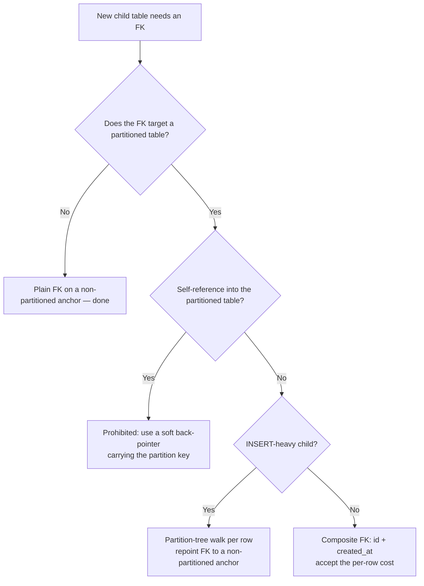

**Part II · Threads: source-of-truth · bound-it · deterministic-enforcement · Grounded by: [CS-4](../case-studies.md#cs-mvcc-cascade), [CS-1](../case-studies.md#cs-devdb-wipe), [CS-3](../case-studies.md#cs-embeddings-oom)**

# 03. Plan for the database from day one

The database is the one component you cannot cheaply retrofit. Almost every expensive correction in this project traces to the durable schema being treated as an afterthought: an in-memory store grew first, captured a rich object graph, and Postgres was later asked to mirror it as JSONB — which then had to be torn back into normalized tables under load. A request log was speculatively partitioned and is now being un-partitioned. A global id sequence was mistaken for a tenant boundary and leaked one project's files into another's aggregates. None were bugs in code; they were decisions deferred past the point where they were cheap. This chapter is the day-one checklist: design the durable shape first, pick keys and column types deliberately, set pool safety on the first deploy, and know which "optimizations" (partitioning, JSONB, denormalization, body-mirroring) cost more than they save. The recurring principle is **source-of-truth** — one canonical durable representation, everything else a rebuildable projection.

---

## 1. Design the durable schema first; make the in-memory store a disposable cache

**Do this** — Decide your persistent table shapes *before* the in-memory representation, and let the cache derive from the schema, not the other way round. The database holds the true, byte-faithful record; the in-process store is a bounded, restartable cache you can lose without losing data. Write each entity at its natural event point, not accumulated in memory and flushed in a terminal batch. `[thread: source-of-truth]`

**Not this** — Building the in-memory store first and bolting on a database later that mirrors its object graph as JSONB blobs. Once the schema is an afterthought, the in-memory store silently becomes the de-facto source of truth and dictates a denormalized, restart-fragile persistence shape. (In temet-proxy: the `requests` table was born with `tool_names`, `tool_calls`, `sse_events`, `diagnostics`, and `token_usage` all as JSONB/TEXT columns mirroring in-memory structs; Phase 11 was a single-cutover migration whose *entire purpose* was to retire that scheme and replace it with FK-shaped tables.)

**Why** — Getting the order wrong forces an atomic, backfill-heavy rewrite of a live table. The cache-as-source-of-truth failure mode also keeps the store *unbounded*, which is how a cold backlog becoming eligible at once produced an 18 GB RSS event ([CS-3](../case-studies.md#cs-embeddings-oom)). A schema-derived cache stays disposable because the durable record already exists.

**Evidence** — `crates/claude-proxy/src/store/persistence/migrations/20260419000001_initial.sql:71-110` (JSONB-mirror columns) · `…/20260505000001_normalised_tool_data_plane.sql:1-33` (Phase 11 cutover: retires the JSONB tool-data scheme for FK-shaped tables). The *write-at-event-point* discipline lives in [ch. 6 — The persistence boundary](./06-T05-persistence-boundary.md) and the FK-not-matcher design in [ch. 4 — Schema design](./04-T04a-schema-design.md); the day-one ordering — schema before cache — is the facet that belongs here.

---

## 2. Typed columns for the hot path; jsonb only for the genuinely schemaless tail

**Do this** — Promote any field you filter / sort / join / constrain to a typed column the moment access patterns stabilize. Reserve jsonb for truly schemaless per-row metadata (per-tool arguments) and append-only wire payloads (SSE event bodies). Rule of thumb: if you write `WHERE data->>'x' = …`, then `x` should be a column. Derive counts from `SELECT COUNT(*)` / JOIN over normalized tables or a read-side view; if measured aggregate latency hurts, materialize via a **trigger-fed cache table**, never a session-keyed recompute job. `[thread: source-of-truth]`

**Not this** — "Just put it in jsonb" for queried fields. And never rebuild denormalized aggregate columns (`tool_call_count`, `tools_used`, `files_touched`) by a periodic recompute job reading a JSONB blob — they drift whenever the recompute is missed, partial, or races. Other day-one traps: missing indexes on FK columns, and UUIDv4 primary keys that fragment B-trees on high-write tables (prefer `BIGINT GENERATED ALWAYS AS IDENTITY`).

**Why** — A derived aggregate read from a blob is a second source of truth that can disagree with the first. In temet-proxy, Phase 11 replaced exactly this JSONB-derived-aggregate scheme with normalized tables; the inspection-fidelity rules codify it — "the only honest place for `tool_call_count` is `SELECT COUNT(*) FROM tool_uses WHERE …`." The in-memory FK-matcher half of that anti-pattern is owned by [ch. 4 — Schema design](./04-T04a-schema-design.md).

**Evidence** — `.claude/rules/inspection-fidelity.md:83` (JSONB-as-storage / recompute-job drift) · `…:84` (in-memory matcher is restart-fragile; replaced by FK) · `artifacts/research/2026-04-25-rust-postgres-best-practices.md:78-96` (hybrid normalization), `…:276-288` (anti-pattern table: jsonb-for-queried-field, missing FK index, UUIDv4 PK, `SELECT *`). The "missing FK index → 10,000× delete slowdown" figure is sourced from that research spike's external reports, not a first-party incident here — treat it as best-practice guidance, not a local war story.

**Pattern**
```sql
-- Hot-path fields are typed columns next to the schemaless body.
CREATE TABLE requests (
    id          BIGINT GENERATED ALWAYS AS IDENTITY PRIMARY KEY, -- DB-minted; not UUIDv4
    session_id  TEXT        NOT NULL,   -- filtered/joined → typed column, indexed
    model       TEXT        NULL,
    status      TEXT        NOT NULL,
    created_at  TIMESTAMPTZ NOT NULL,
    params      JSONB       NOT NULL    -- truly schemaless tail stays jsonb
);
-- Aggregates come from COUNT/JOIN, never a column rebuilt from a blob:
--   SELECT COUNT(*) FROM tool_uses WHERE request_id BETWEEN $1 AND $2;
```

---

## 3. Let the database mint identity; never treat an app-allocated id as load-bearing

**Do this** — Make Postgres the source of surrogate identity: `BIGINT GENERATED ALWAYS AS IDENTITY` (or `BIGSERIAL`) and read the value back with `INSERT … RETURNING id`. One allocator, inside the one system that can guarantee uniqueness under concurrency. `ALWAYS` makes a forgotten explicit value a loud error rather than silent corruption — a user-supplied value is rejected unless the statement says `OVERRIDING SYSTEM VALUE` ([PostgreSQL docs — identity columns](https://www.postgresql.org/docs/current/ddl-identity-columns.html)). `[thread: source-of-truth]` `[thread: deterministic-enforcement]`

**Not this** — Allocating ids in the application (a `SequenceAllocator`, a counter, `OVERRIDING SYSTEM VALUE` on every insert) so two writers can race the same id space and the database can no longer enforce the invariant it owns. An app-side allocator is a second authority for a value the DB is built to mint; it survives only as long as the process and has no on-disk enforcement.

**Why** — Identity minted outside the database is identity the database cannot defend. In temet-proxy the `SequenceAllocator` / `OVERRIDING SYSTEM VALUE` path is a **defect now being retired** — the 2026-05-30 kickoff target is DB-minted identity via `RETURNING`. Decided, not yet shipped: the allocator is still in the tree as the thing being undone. Do not read the older `docs/SCHEMA.md` app-allocation notes as an endorsement — they are stale against the kickoff.

**Evidence** — Ship-state DECIDED-NOT-SHIPPED: the app-allocated shape is the live defect, the DB-minted shape is the 2026-05-30 kickoff target.

---

## 4. Partition only when measured volume justifies it — and know it taxes every key that touches the table

**Do this** — For an append-only log, start **unpartitioned** with a monotonic surrogate PK and a `created_at` index. Reach for `PARTITION BY RANGE(created_at)` only when measured volume (row count, index bloat, vacuum cost, query latency) justifies it — the Postgres rule of thumb is a table exceeding the server's physical memory. If you do partition, internalize the full tax up front: every UNIQUE/PK on a partitioned table must **include the partition key** ([PostgreSQL docs — table partitioning](https://www.postgresql.org/docs/current/ddl-partitioning.html)), so the surrogate PK becomes a composite `(id, created_at)` and *every* child FK must be composite too — `(request_id, request_created_at) REFERENCES requests(id, created_at)`. Ship a DEFAULT partition (a correctness-safe catch-all) plus a forward-partition creation job; a missing future partition silently loses pruning, never correctness. `[thread: bound-it]`

**Not this** — Speculatively partitioning a low-volume table because "it might grow": every child then carries an extra partition-key column *solely* to form the composite FK, and buys nothing until the volume arrives. The reverse is equally bad — leaving a genuinely unbounded log unpartitioned, then discovering there is no in-place `ALTER TABLE … PARTITION BY` in PG ≤ 17, so retrofitting forces a rename-create-copy-drop rewrite *and* rewrites every FK that targeted the old `(id)` PK.

**Why** — Partitioning is a volume optimization whose cost lands on keys, not just storage. In temet-proxy `requests` was retrofitted into a partitioned table — PK rewritten `(id)`→`(id, created_at)`, child FKs rebuilt composite, a DEFAULT partition and forward-partition cron flagged as a *new operational task* — and the current direction is to **de-partition** it: the measured volume never justified the tax every FK and child table was paying.

**Evidence** — `…/20260430000008_partition_requests.sql:16-66` (composite PK, rename-create-copy-drop, DEFAULT partition + forward-cron gap) · `…/20260505000001_normalised_tool_data_plane.sql:49-56,91-102` (`tool_uses`/`tool_results` carry `request_created_at` solely for the composite FK) · `docs/SCHEMA.md:54-56` (composite `(id, created_at)` — the partition key must be included). Ship-state: the partitioned shape is live; de-partitioning is the 2026-05-30 kickoff target (DECIDED-NOT-SHIPPED).

---

## 5. Don't point a hard FK at a partitioned parent — anchor it on a small unpartitioned table

**Do this** — Point child-table FKs at small **non-partitioned** anchor tables (e.g. `sessions`) instead of at the partitioned log. Where a hard FK genuinely cannot be anchored (self-references, or a back-pointer into the partitioned table itself), use a soft back-pointer that carries the partition key, maintained in application logic, and document it. `[thread: bound-it]`

**Not this** — Adding FKs that reference a partitioned parent. A partitioned table has no unique constraint on `id` alone, so `REFERENCES requests(id)` simply fails; self-referential FKs on a partitioned table are architecturally prohibited. Worse, an FK *to* the partitioned parent makes Postgres walk the partition routing tree on **every INSERT**.

**Why** — The FK-to-partitioned-parent insert cost is non-obvious and large. Three real post-partition corrections in temet-proxy: `1676fce` repointed `request_deltas → requests` to `request_deltas → sessions` because the FK to the monthly-partitioned `requests` table turned an 822-row `UNNEST` INSERT into a **1.7 s** operation — Postgres ran 7 FK checks per row (parent plus one per partition child); `f99bde5` dropped a self-referential FK that could no longer resolve against the composite PK; `75bd380` restored an `ON DELETE CASCADE` the partition rewrite had silently dropped, which had started failing the TTL sweep's `DELETE FROM sessions` with FK violations. The silent cascade-drop is itself an instance of "a structural change spans more than its obvious blast radius."

**Evidence** — commit `1676fce` (+ `20260528000004_request_deltas_session_fk.sql`): 1.7 s / 822-row / 7-FK-check quote · commit `f99bde5` (self-referential-FK-prohibited; soft back-pointer) · commit `75bd380` → `…/20260504000001_restore_requests_session_cascade.sql:1-40` (operator-confirmed cascade regression).



---

## 6. A global monotonic id range is not a tenant boundary — always filter the owning scope

**Do this** — When a globally-shared sequence (`request_id`, `event_id`) bounds a subquery with `id BETWEEN start AND end`, **always** add the owning-scope predicate (`session_id`, `tenant_id`) to the join. If the child table lacks that column, denormalize it onto the child at write time or join back through the parent that has it. Never rely on the id range alone to isolate a tenant. `[thread: source-of-truth]`

**Not this** — Treating a monotonic surrogate sequence as if it were per-tenant. Two concurrent tenants/sessions produce **overlapping** id ranges, so a range-only subquery silently pulls the other tenant's rows into your aggregates — a cross-tenant data-leak that no test on single-tenant data will catch.

**Why** — Surrogate identity orders rows; it does not partition ownership. In temet-proxy `operator_turn_aggregates_v` bounded all 8 of its subqueries by a `request_id` range alone, with no `session_id` filter, because the child tables carried no `session_id` column. A `temet-proxy` session's `files_touched` showed **ankh-morpork** Dockerfile and `cli.py` entries — contamination from a concurrent ankh-morpork session whose `request_id` range overlapped. The fix denormalized `session_id` onto the child tables and re-added the scope predicate. Like the cross-scope leakage that test isolation guards against ([CS-1](../case-studies.md#cs-devdb-wipe)), this defect is invisible until two scopes actually run concurrently.

**Evidence** — `artifacts/2026-05-28/incident-session-id-data-loss/05-bug-operator-turn-aggregates-session-contamination.md:9-53` (the bug, 8 affected columns, ankh-morpork-in-temet discovery; "request_id is a global monotonic sequence shared across all sessions") · `…:59-105` (fix: denormalize `session_id` vs join-through-requests; `recall_file_history` carried the same pattern at `mod.rs:2458`).

**Pattern**
```sql
-- WRONG: global sequence as the only bound → cross-tenant contamination
WHERE tu.request_id >= ot.start_request_id
  AND tu.request_id <= ot.end_request_id
-- RIGHT: add the owning-scope predicate (denormalised onto the child)
  AND tu.session_id = ot.session_id
```

---

## 7. Set connection-pool safety GUCs at pool construction, on day one

**Do this** — Configure `statement_timeout`, `lock_timeout`, `idle_in_transaction_session_timeout`, and `application_name` on every pooled connection from the first deploy, via `PgConnectOptions::options([...])` so each session inherits them at connect time with no extra `SET` round-trip. Make them operator-tunable, not magic numbers. This is ~10 lines that forecloses an entire class of production stalls. `[thread: bound-it]` `[thread: deterministic-enforcement]`

**Not this** — Relying on Postgres' defaults: all four are zero, i.e. disabled ([PostgreSQL docs — client connection defaults](https://www.postgresql.org/docs/current/runtime-config-client.html)). Without them a runaway query holds a pool slot forever (under load every slot blocks and the service stops accepting work), a leaked transaction blocks VACUUM and bloats tables indefinitely, and a stuck DDL blocks every writer.

**Why** — These four GUCs are the cheap backstop for the contention class that, uncapped, produces table-wide stalls ([CS-4](../case-studies.md#cs-mvcc-cascade)): an `idle_in_transaction_session_timeout` / `lock_timeout` would have bounded that blast radius even before the transaction was narrowed. In temet-proxy the DB performance audit's top finding (C1) was that the pool set only `max_connections` / `acquire_timeout` / `idle_timeout`; the GUCs were then implemented and are asserted by a test via `SHOW`. Choosing the *values* — and per-statement overrides for legitimately long work — is operational tuning owned by [ch. 15 — Ops & deploy safety](./15-T11b-ops-deploy-safety.md); *having them set from connection #1* is the day-one decision that belongs here.

**Evidence** — `artifacts/reviews/db-performance-audit-2026-04-30.md:53-88` (C1: missing GUCs; defaults are zero/disabled) · `crates/claude-proxy/src/store/persistence/pool.rs:55-60` (the GUCs applied) + `…:160-204` (`build_pool_applies_session_gucs` asserts each via `SHOW`). Genuinely shipped.

**Pattern**
```rust
let options = parsed.options([
    ("application_name", "claude-proxy"),           // pg_stat_activity legibility
    ("statement_timeout", "30s"),                   // hard cap on any single query
    ("idle_in_transaction_session_timeout", "60s"), // kills tx leaks that block VACUUM
    ("lock_timeout", "5s"),                         // bounds DDL contention
]);
PgPoolOptions::new().max_connections(8).connect_with(options).await?;
```

---

## 8. Content-address large repeated payloads; never mirror a full body onto every derived row

**Do this** — When consecutive records share near-identical large bodies (prompt prefixes, tool schemas), store the body **once** keyed by content hash and reference it from a bridge/delta table via FK. The correct full-fidelity read is one indexed JOIN back to the content-addressed row — that is *not* truncation, the full body is one JOIN away. If the content-addressed table is **not** partition-scoped, plan an orphan-sweep: dropping a parent partition cascades the bridge rows but leaves orphaned content rows behind. `[thread: source-of-truth]`

**Not this** — Inlining a full body copy onto every derived row "so a single SELECT shows what changed — no JOIN." It produces multiplicative storage blow-up on an up-front estimate that is almost always wildly low. The distinction that keeps this honest: content-address the *derived/delta* copies; keep the *source* record byte-faithful. Deduplicating a derived mirror and preserving the byte-identity source are consistent goals, not opposed ones.

**Why** — A mirrored body is a second copy of data that already has a canonical home; the multiplier is the storage cost of abandoning source-of-truth. In temet-proxy `request_deltas` mirrored a full `body JSONB` onto every delta row despite already carrying a `message_id` FK → `messages`. The migration header *estimated* ~10,500 rows / ~50 MB; reality was **1,267,105 rows**, ~26× mirror multiplicity, **5.3 GB total** — projected to collapse to ~600–700 MB once the FK join replaces the mirror. (Content-addressed message dedup measured 98.12% on the dev corpus; the inline `request_body` is *deliberately* kept byte-for-byte, the dedup store derived from it.)

**Evidence** — `artifacts/2026-05-29/cutover-investigation/db-findings.md:83-101` (§3 `request_deltas` 5.3 GB; body-mirror is the entire excess; 26× multiplicity; FK-join is the correct shape) · `…:113-118` (§5 orphan-sweep for non-partition-scoped `messages`) · `artifacts/proxy-memory-oom-mitigation/GAP-ANALYSIS.md:125` (98.12% dedup ratio). Ship-state: the 600–700 MB collapse is *projected* (body-drop cutover cancelled; `request_body` kept byte-faithful), not shipped.

---

## 9. Denormalize and choose `ON DELETE` deliberately, on measured evidence

**Do this** — Targeted denormalization is fine as a conscious read-path optimization (e.g. `project_id` copied onto `requests` to skip a join), but document *why* in the schema. Pick each FK's `ON DELETE` to express the domain: **CASCADE** where the child cannot exist without its anchor (a turn without its requests), **RESTRICT** where deleting the parent must not silently erase history (retiring an agent), **SET NULL** for best-effort audit pointers (an evidence reference that may age out). Before adding *or dropping* a denorm column / index, confirm with `pg_stat_user_indexes` whether it earns its keep, and re-evaluate after a structural change shifts the access pattern. `[thread: deterministic-enforcement]`

**Not this** — Denormalizing blindly, leaving every FK on the default delete behaviour regardless of meaning, or adding/dropping a column on a hunch. Don't churn for churn's sake — but equally, don't keep a denorm column you can't justify with scan statistics.

**Why** — `ON DELETE` is a domain decision the schema can enforce mechanically; leaving it default delegates a correctness question to chance. In temet-proxy `agent_dispatches.agent_id` is `ON DELETE RESTRICT` ("retiring an agent must not silently invalidate dispatch history") and the `operator_turns` evidence FK is `ON DELETE SET NULL` ("a best-effort audit pointer"). The M2 investigation resisted dropping `requests.project_id` on intuition: `pg_stat_user_indexes` showed `idx_requests_project_created_desc` at idx_scan=4130 actively used while two `projects` indexes sat at 0 scans in the same snapshot — verdict KEEP, with a "re-evaluate after partitioning ships" follow-up.

**Evidence** — `…/20260505000001_normalised_tool_data_plane.sql:129-136` (agent_id `ON DELETE RESTRICT` + comment) · `…:503-509` (operator_turns evidence FK `ON DELETE SET NULL`) · `20260419000001_initial.sql:69-76` (project_id denormalized "so project-scoped scans can skip the join") · `artifacts/reviews/m2-project-id-investigation.md:22-51` (KEEP verdict; idx_scan=4130 vs 0-scan indexes).

---

## Cross-references

- **Compile-checked sqlx + committed `.sqlx/` offline metadata** — owned by [ch. 13 — Tooling & quality gates](./13-T12-tooling-quality-gates.md). Day-one schema facet: re-run `cargo sqlx prepare` after *every* schema change so drift becomes a `cargo check` error, not a deploy-time surprise.
- **FK-not-matcher design & JSONB-drift cutover** — owned by [ch. 4 — Schema design](./04-T04a-schema-design.md); the day-one *ordering* (schema before cache) is Lesson 1 above.
- **The persistence boundary & write-at-event-point** — owned by [ch. 6 — The persistence boundary](./06-T05-persistence-boundary.md).
- **DB-backed test isolation** (per-test ephemeral DBs, the 2026-04-24 wipe origin, no unscoped `DELETE`) — owned by [ch. 11 — DB test isolation](./11-T10a-db-test-isolation.md), grounded by [CS-1](../case-studies.md#cs-devdb-wipe). Load-bearing here: the schema you design must be clonable into a migrated template per test.
- **Where heavy/native work runs** — workload placement (embeddings, ONNX out-of-process) is owned by [ch. 8 — Memory & resource safety](./08-T06-memory-resource-safety.md), grounded by [CS-3](../case-studies.md#cs-embeddings-oom). Schema facet: the DB stays the queue (`closed_at IS NOT NULL AND embedded_at IS NULL … FOR UPDATE SKIP LOCKED`) a separate OS-capped worker ticks — design that queue column on day one even though the worker is decided-not-shipped. `[thread: source-of-truth]`
- **Pool GUC *values* and per-statement overrides** — operational tuning owned by [ch. 15 — Ops & deploy safety](./15-T11b-ops-deploy-safety.md); Lesson 7 owns the day-one decision to set them from connection #1.

## Further reading

- [Kleppmann, *Designing Data-Intensive Applications* — "Data Models and Query Languages"](https://www.oreilly.com/library/view/designing-data-intensive-applications/9781491903063/) — treats the durable data model as the deepest, most load-bearing design choice; REINFORCES Lessons 1 and 3 (the schema is the contract, far costlier to retrofit than the cache that derives from it).
- [Karwin, *SQL Antipatterns* — "Jaywalking" / "Entity-Attribute-Value"](https://pragprog.com/titles/bksqla/sql-antipatterns/) — storing a queried collection inside an opaque blob is the canonical SQL anti-pattern, remedied by promoting queried attributes to real columns; REINFORCES Lesson 2 ("if you write `WHERE data->>'x'`, x should be a column") and the normalize-the-mirror argument in Lesson 8.
- [PostgreSQL docs — identity columns (`ALWAYS` vs `BY DEFAULT`)](https://www.postgresql.org/docs/current/ddl-identity-columns.html) — confirms verbatim that `GENERATED ALWAYS` rejects an explicit value unless `OVERRIDING SYSTEM VALUE` is given; REINFORCES Lesson 3 (a forgotten override is a loud error, not silent corruption).
- [PostgreSQL docs — table partitioning](https://www.postgresql.org/docs/current/ddl-partitioning.html) — states verbatim that every unique constraint must include the partition key, and that partitioning pays off "only when a table would otherwise be very large"; REINFORCES Lesson 4 (the composite-key tax and the volume gate) and grounds the structural prohibition in Lesson 5. QUALIFIES Lesson 5: the page does not document the per-INSERT tree-walk cost — the 1.7 s figure is a first-party measurement, not the docs' claim.
- [Markus Winand, *Use The Index, Luke* — "Concatenated Indexes"](https://use-the-index-luke.com/sql/where-clause/the-equals-operator/concatenated-keys) — column-ordering rules for composite indexes; REINFORCES Lesson 4's composite `(id, created_at)` key, where the leading column governs which lookups the index can serve.
- [PostgreSQL docs — client connection defaults](https://www.postgresql.org/docs/current/runtime-config-client.html) — confirms verbatim that `statement_timeout`, `lock_timeout`, and `idle_in_transaction_session_timeout` all default to zero (disabled); REINFORCES Lesson 7 (the defaults leave the contention class uncapped).
- [Nygard, *Release It!* — "Timeouts" stability pattern](https://pragprog.com/titles/mnee2/release-it-second-edition/) — every blocking resource call needs a timeout or one stuck call exhausts the pool and cascades; REINFORCES Lesson 7 — the four GUCs are the database-layer instance of this pattern.
- [PostgreSQL docs — `INSERT … ON CONFLICT`](https://www.postgresql.org/docs/current/sql-insert.html) — `ON CONFLICT DO NOTHING` raises no error, so a wrong default `ON DELETE` or unguarded conflict is a *silent* correctness loss; REINFORCES Lesson 9 (choose `ON DELETE` deliberately).
