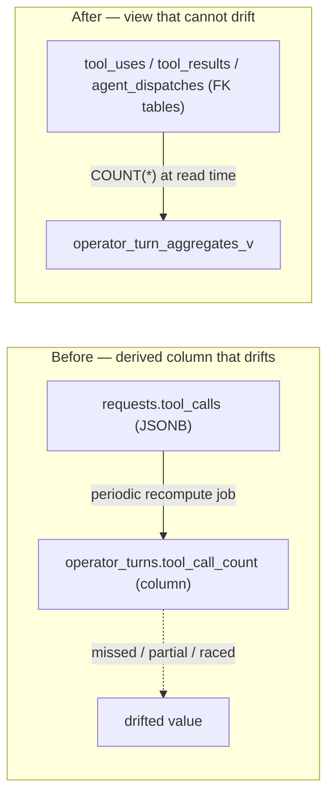
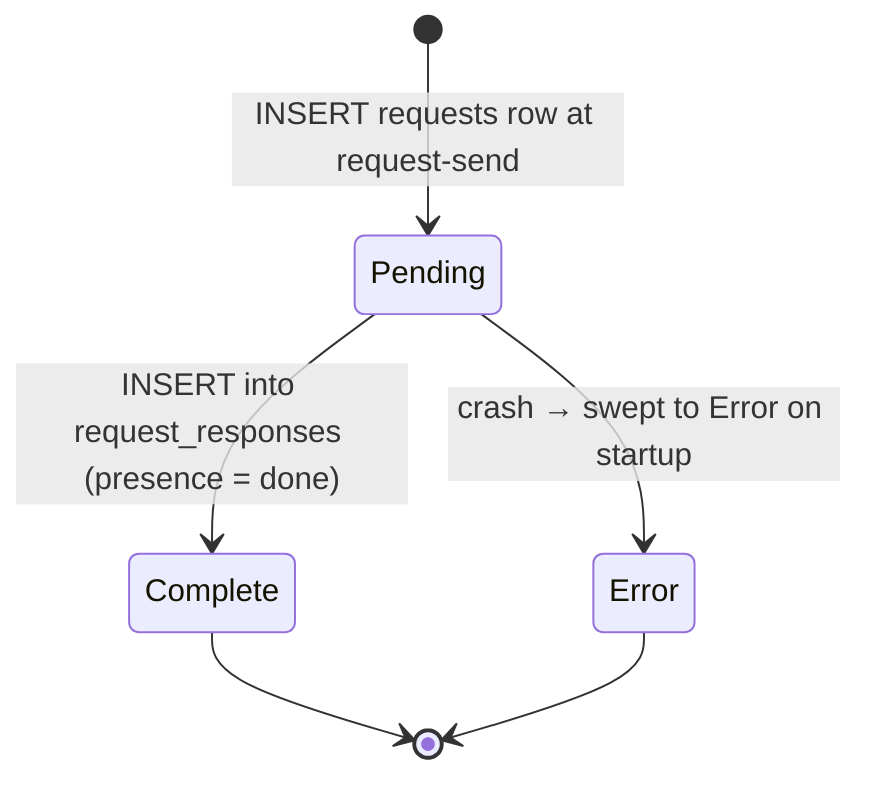

**Part II · Threads: source-of-truth, deterministic-enforcement · Grounded by: —**

# 04. Schema design & normalization

The shape you give a table before any data lands in it is the cheapest decision you will ever make and one of the most expensive to retrofit. Every shortcut — a JSONB blob "we'll query later," a `LEFT(body, 200)` preview column, an app-minted id, a `created_at` doubling as a tie-breaker — comes back as drifted aggregates, silently-dropped rows, or content a consumer can no longer recover. This chapter owns the table *shape*; migration *mechanics* (expand/contract, `NOT VALID`/`VALIDATE`, out-of-band backfills) live in [ch. 5 — Migrations mechanics](./05-T04b-migrations-mechanics.md), and the write-path discipline that feeds these tables in [ch. 6 — The persistence boundary](./06-T05-persistence-boundary.md).

---

## 1. Normalize relational data into FK-shaped tables; do not use JSONB as your storage layer

**Do this.** Store any collection you will later filter, join, count, or aggregate over as a normalized child table with a real foreign key. Compute aggregates with read-side views — `SELECT COUNT(*) FROM tool_uses WHERE request_id BETWEEN start AND end` is the only honest home for a "tool call count." Reserve JSONB for genuinely schemaless payloads (raw wire headers, opaque params) where you will never need the database to reason about the contents. `[thread: source-of-truth]`

**Not this.** Denormalized aggregate columns (a `tool_call_count`, a `tools_used` array, a `files_touched` list) rebuilt by a periodic, key-scoped recompute job that reads a JSONB blob. They drift from source the moment a recompute is missed, partial, or races a concurrent write. The same defect in its relational form: an in-memory `HashMap` used to link two persisted entities (a `tool_use_id → request_id` matcher) — it works only while the process runs, and any restart between the two writes silently drops the linkage because no on-disk FK enforces it.

**Why.** A derived column that is rebuilt on a schedule is a second source of truth that *can* disagree with the first, so eventually it does. A view cannot drift — it is recomputed from the FK tables on every read. (In temet-proxy: the 2026-05-05 "normalised tool data plane" cutover replaced exactly this shape — JSONB `requests.tool_calls`/`tool_results` blobs feeding session-keyed recompute — with `tool_uses`/`tool_results`/`agent_dispatches` tables and read-side aggregate views. Materialize a derived value into a column *only* as a trigger-fed cache when measured latency demands it, never as a JSONB blob rebuilt on a schedule.)

**Evidence.**
- `crates/claude-proxy/src/store/persistence/migrations/20260505000001_normalised_tool_data_plane.sql:1-32` (header: retires `requests.tool_calls`/`tool_results` JSONB for FK tables + `*_v` views), `:253-310` (`operator_turn_aggregates_v` computes counts via `COUNT(*)`/`array_agg`; comment: "materialise via trigger — do NOT re-introduce JSONB columns"), `:530-552` (§D `DROP` of the JSONB columns + the denormalised `operator_turns` aggregate columns).
- commit `9e409ee` "normalised tool data plane + operator_turns lifecycle" (the load-bearing cutover); commit `96e58c9` "normalize tool_names off JSONB" (a later follow-on extending the same discipline, not the cutover itself).
- `.claude/rules/inspection-fidelity.md:83-84` (anti-pattern table: "JSONB-as-storage for derived data" and "in-memory matcher index for FK-shaped relationships" both banned).

**Pattern.**
```sql
-- A read-side view replaces a denormalised, drift-prone column.
CREATE OR REPLACE VIEW operator_turn_aggregates_v AS
SELECT ot.turn_id,
  (SELECT COUNT(*) FROM tool_uses tu
     WHERE tu.request_id BETWEEN ot.start_request_id AND ot.end_request_id)
    AS tool_call_count
FROM operator_turns ot;
-- The view cannot drift from tool_uses; a recomputed column can.
```



The FK-vs-matcher choice has a write-side facet (restart-fragility of the in-memory index) owned by [ch. 6 — The persistence boundary](./06-T05-persistence-boundary.md); the day-one ordering facet (write the parent before the child FK fires) by [ch. 3 — Plan the database from day one](./03-T03-db-planning.md).

---

## 2. Never persist a column that is a slice of another column

**Do this.** Storage holds the full bytes; any shorter view is derived at read time. When you promote a value out of a JSONB blob for indexing, promote the *full* value. If a consumer needs less, give them pagination over full rows, not a pre-amputated column. `[thread: source-of-truth]`

**Not this.** A column whose name announces it is a slice — `*_preview`, `*_summary`, `*_short`, `*_first_n_chars` — or `LEFT(body, 200)` written at insert time. These cut the source-of-truth before any consumer sees it: the operator gets "the first 200 chars" with no path back to the rest, and a `LEFT(blocks->2->>'text', 200)` in a SQL projection severs it before Postgres even returns the result set.

**Why.** A column born truncated forces the recovery fight before the data is even queryable: the bytes the consumer needs were thrown away at insert, with no path back. Keep the schema honest at write time and the rest of the no-truncation discipline — which spans projection, MCP, and render and is owned by [ch. 10 — Observability & inspection fidelity](./10-T09-observability-fidelity.md) — becomes tractable. This lesson is only the schema-write-time sliver of that contract. `[thread: deterministic-enforcement]`

**Evidence.**
- `.claude/rules/inspection-fidelity.md:36-38` (schema rules: "Do not add columns whose names imply a slice"; "Do not store `LEFT(body, 200)`"; "promote the full value, not a slice"), `:74` (`LEFT(blocks->2->>'text', 200)` cuts source before Postgres returns).

---

## 3. Content-address repeated large payloads into a sha-keyed table

**Do this.** When the same large blob recurs across many rows — a 30 kB system prompt on every request, the full conversation tail re-sent every turn — store it once in a table keyed by the `sha256` of its *canonical* bytes and reference it by that sha. Canonicalize first (strip volatile fields, sort keys, strip whitespace) so logically-equal payloads collapse to one row. Store the canonical `byte_size` at write time so dedup-by-bytes is an indexed comparison, not a `pg_column_size(body)` recompute. `[thread: source-of-truth]`

**Not this.** Writing the same large recurring payload inline on every row. Conversation-shaped data makes this quadratic: a long session that re-writes the full tail each turn balloons to hundreds of MB for a few MB of unique signal (in temet-proxy: ~700 MB for ~7 MB of unique content).

**Why.** A sha-keyed table turns the recurrence into a single shared row plus cheap references, and the `sha256` *is* the join target — no surrogate id needed for the dedup table. Byte-identity is preserved because the original wire bytes still live in the request row (`request_body_sha256`); the dedup store is the *queryable* projection, not a lossy replacement. (In temet-proxy: `normalize_system_prompts` stores the main-agent's 30 kB block once keyed by `prompt_sha256`; the later `messages_dedup` store mirrors that shape per-message after measuring the redundancy.)

**Evidence.**
- `migrations/20260427000001_normalize_system_prompts.sql:28-35` (`system_prompts`: `prompt_sha256 TEXT PRIMARY KEY`, `blocks JSONB`; comment "Main-agent's 30kB blob stored once").
- `migrations/20260507000001_messages_dedup_tables.sql:1-26` (header: "~700 MB for ~7 MB of unique signal"; canonicalization = "cache_control strip + key sort + whitespace strip"), `:44-70` (`messages` keyed by `message_sha256`, `byte_size INTEGER NOT NULL`; comment "Stored at write time so dedup-by-bytes queries are an indexed scan").

**Pattern.**
```sql
CREATE TABLE messages (
    message_sha256  TEXT PRIMARY KEY,        -- sha256 of CANONICAL bytes (the join key)
    body            JSONB NOT NULL,          -- FULL canonical JSON, never a slice
    byte_size       INTEGER NOT NULL,        -- of the canonical bytes, recorded at write time
    role            TEXT NOT NULL,
    CONSTRAINT messages_sha256_is_64_hex CHECK (message_sha256 ~ '^[0-9a-f]{64}$'),
    CONSTRAINT messages_role_known       CHECK (role IN ('user','assistant')),
    CONSTRAINT messages_byte_size_nonneg CHECK (byte_size >= 0)
);
```

---

## 4. Constrain closed-set TEXT columns with CHECKs sourced from the app's actual enum variants

**Do this.** Any TEXT column holding a closed set (`status`, `method`, `kind`, `origin`, `role`) carries a `CHECK (col IN (...))` whose allowed values are copied from the application enum's wire form (its `Display`/serialization) — and the migration cites the source `file:line` so the two cannot drift unnoticed. Use a regex CHECK when one variant carries a free-form tail (e.g. `Error: <msg>`). Validate the enum at the DB boundary, not only in app code. `[thread: deterministic-enforcement]`

**Not this.** Bare `TEXT NOT NULL` for an enum set. A stray underscore in a future extractor (`subagent_` instead of `subagent`) lands silently and corrupts every grouping query that joins on it — the failure surfaces as wrong analytics, not an error.

**Why.** A CHECK is free at write time and converts a future extractor typo into an immediate, visible `INSERT` failure instead of a silent downstream grouping bug. The constraint is the deterministic backstop the prose convention ("only emit these variants") can only ask for. (In temet-proxy: audit finding H2 flagged `requests.method/status/turn_type/turn_origin` as stringly-typed despite the CHECK pattern already established on `filter_rules`; the follow-up migration extended it, citing each Rust enum's `file:line`, and chose a regex CHECK for `status` because of its free-form `Error: <msg>` tail.)

**Evidence.**
- `migrations/20260430000004_requests_check_constraints.sql:3-33` (CHECKs sourced from named Rust types with `src/...:line` citations, "do NOT invent values"), `:120` (regex CHECK `status ~ '^(Pending|Streaming|Complete|Error: .+)$'`), plus the `ADD CONSTRAINT ... NOT VALID` then `VALIDATE CONSTRAINT` safe-add discipline wrapped in a `duplicate_object`-swallowing `DO $$` block for idempotency.
- `migrations/20260507000001_messages_dedup_tables.sql:51-56` (`messages_role_known`, sha256 hex regex, `byte_size >= 0`).

**Pattern.**
```sql
-- turn_origin — variants copied from extract::request::TurnOrigin (src/extract/request.rs:303)
ALTER TABLE requests ADD CONSTRAINT requests_turn_origin_known
  CHECK (turn_origin IN ('primary','title_sidecar','subagent','advisor_sidecar','quota_probe'));
```

---

## 5. Let the database mint surrogate ids — never allocate them in the app

**Do this.** Give every table a DB-generated identity, `BIGINT GENERATED ALWAYS AS IDENTITY`, and read it back with `RETURNING`. `ALWAYS` forces any legitimate explicit-id INSERT to declare `OVERRIDING SYSTEM VALUE` ([PostgreSQL docs — identity columns](https://www.postgresql.org/docs/current/ddl-identity-columns.html)), so a forgotten override is a loud error rather than silent sequence corruption. If you genuinely need the id *before* the row exists (e.g. to emit it over a WebSocket at intercept), get it from an early `INSERT ... RETURNING id` that moves the first write onto the path — not from an app-side allocator. `[thread: source-of-truth]`

**Not this.** An app-side allocator (an `AtomicU64`, or a `SequenceAllocator` pre-pulling `nextval` batches into a `VecDeque<Mutex>`) that mints the id in the application and forces it past the IDENTITY guard with `OVERRIDING SYSTEM VALUE`. The id is then DB-*typed* as identity but app-*allocated*: its only anti-duplication guarantee is an in-memory mutex, not the database. A duplicate collides on the PK and one row is silently `ON CONFLICT DO NOTHING`-dropped.

**Why.** The database is the one process that can serialize id allocation against all writers and survive restarts; an in-process allocator's uniqueness guarantee evaporates the moment a second process, or a restart mid-batch, enters the picture. In temet-proxy this is a **live defect being retired, not a recommended pattern**: `requests.id` is declared `GENERATED ALWAYS AS IDENTITY`, yet the write path bypasses it with `SequenceAllocator` + `OVERRIDING SYSTEM VALUE` — candidate-(a) of the concurrent dropped-write analysis, which the 2026-05-30 schema kickoff marks NON-NEGOTIABLE to remove. (The shipped `BIGSERIAL → IDENTITY` migration that high-water-seeds the sequence past the old allocator's cache is sound migration practice, owned by [ch. 5 — Migrations mechanics](./05-T04b-migrations-mechanics.md).) A new repo skips the allocator entirely and never reaches this tension.

**Evidence.**
- `artifacts/2026-05-30/dropped-write-paths/identity-audit.md:61-84` (`SequenceAllocator` + `OVERRIDING SYSTEM VALUE` at `mod.rs:1419`; the "id over WS before the row exists" tension; prescribed fix = remove the override, use `RETURNING id`).
- `migrations/20260430000006_requests_id_identity.sql:1-78` (`BIGSERIAL → GENERATED ALWAYS AS IDENTITY`; "typo-style INSERTs that forget the override get a PostgreSQL error instead of silently corrupting the sequence"; `GREATEST(MAX(id), last_value)` high-water seed; `pg_get_serial_sequence`).
- `artifacts/2026-05-30/schema-identity-fk-migration-KICKOFF.md:12-20` ("Every table: `id BIGINT GENERATED ALWAYS AS IDENTITY` ... No app-side id allocation ... let the DB mint the id and `RETURNING` it").
- `docs/SCHEMA.md:57-58` still documents `SequenceAllocator` as the current path (last touched 2026-05-26, before the kickoff — stale; do not read it as endorsing app-allocation).

---

## 6. A timestamp must never participate in a primary key or uniqueness constraint

**Do this.** A row's identity is its surrogate id (plus, where a natural business key exists, a separate `UNIQUE` that *excludes* the timestamp). If rows of the same logical class can legitimately repeat, let the surrogate id be the only identity, or add a uniqueness key over the *discriminating* columns — never `created_at`. `[thread: source-of-truth]`

**Not this.** `created_at DEFAULT NOW()` used as a tie-breaker inside a composite PK or unique constraint. A timestamp is not an identity: two legitimately-distinct rows inserted in the same microsecond collide, and one is lost via `ON CONFLICT DO NOTHING`.

**Why.** Using an insert timestamp to disambiguate otherwise-equal rows assumes no two of them ever land in the same clock tick — an assumption that fails silently under any real write rate. (In temet-proxy: `request_diagnostics` had `PK = (request_id, request_created_at, analyzer, category, created_at)`, the trailing `created_at` disambiguating two same-`(analyzer, category)` findings on one request; two such findings in the same microsecond collide and one is silently dropped at the diagnostics insert. The audit calls it "an inspection-fidelity violation by construction" and prescribes — **not yet shipped** — an additive surrogate `diagnostic_id GENERATED ALWAYS AS IDENTITY` PK, dropping `created_at` from any uniqueness role.) The same fragility in its NOT-NULL-on-a-composite-key form produced the session-id data-loss incident ([CS-2](../case-studies.md#cs-sessionid-dataloss)), which is owned as a migration-discovery lesson by [ch. 5 — Migrations mechanics](./05-T04b-migrations-mechanics.md).

**Evidence.**
- `artifacts/2026-05-30/dropped-write-paths/identity-audit.md:86-108` (`request_diagnostics` `created_at`-in-PK failure; silent drop at `mod.rs:2203`; prescribed additive surrogate-PK fix).
- `artifacts/2026-05-30/schema-identity-fk-migration-KICKOFF.md:19` ("`created_at` is a timestamp, never an identity or uniqueness component — two distinct rows can share a microsecond").

---

## 7. Split mutable lifecycle phases into INSERT-only tables; let row presence encode state

**Do this.** When a row has a "pending" phase and then a "complete" phase, write the parent row early (so child FKs that fire mid-stream have a target) and put the completion data in a separate 1:1 table written *once* at the terminal event. Presence of the child row means "done"; its absence means "in flight." This buys narrower heap pages for list scans, an INSERT-only terminal write with no UPDATE-lock contention against readers, and a clean crash-recovery story (sweep orphan `Pending` parents on startup). `[thread: source-of-truth]`

**Not this.** Nullable `response_*` columns on the main row, filled by an in-place UPDATE at completion. The UPDATE contends with readers for the row lock, bloats every list-scan page with columns most queries don't need, and leaves "is this done?" ambiguous — a NULL could mean in-flight or genuinely absent.

**Why.** Encoding state as the *presence of a row* makes the terminal write append-only and the state query unambiguous, and it keeps the hot list-scan table narrow. (In temet-proxy: streaming-response completion data moved out of nullable `requests.response_*` columns into a dedicated `request_responses` table with explicit presence-is-complete semantics, paired with an early write so the `response_stream_chunks` FK always has a parent; the DEFERRABLE-FK workaround that the old "write parent at stream completion" design forced was retired.) The two-phase *write mechanism* and crash-recovery sweep are owned by [ch. 6 — The persistence boundary](./06-T05-persistence-boundary.md); this lesson owns only the schema shape that makes them possible. The completion signal can also be published with Postgres `LISTEN`/`NOTIFY` — a pattern owned by [ch. 10 — Observability & inspection fidelity](./10-T09-observability-fidelity.md).

**Evidence.**
- `migrations/20260517000001_request_responses_table.sql:1-13` ("presence-is-complete semantics (absent row = in flight, present row = done), narrower requests heap pages, INSERT-only terminal write (no lock contention)").
- `migrations/20260516000001_early_request_write.sql:1-33` (two-phase write; `requests` row written at request-send so the chunk FK always has a parent; crash-recovery closes orphan `Pending` rows).
- `docs/SCHEMA.md:61` ("Two-phase write semantics (added in migration 20260516000001)").



---

## 8. Name tables and columns for what they actually contain — and rename early when capture broadens

**Do this.** Name a table for what it holds. When its scope broadens past the original name, rename it *with* its migration plus every downstream consumer (REST routes, MCP tools, manifest entries, reconstruction queries) in one change. Add a discriminator column with a CHECK when one table starts holding several variants. `[thread: source-of-truth]`

**Not this.** A table whose name describes its original narrow purpose long after it broadened. (In temet-proxy: `request_text_deltas` kept that name after it began holding all response stream chunks — text, thinking, and partial tool JSON — which are response chunks, not request deltas, and collided semantically with the separate `request_deltas` for context-window diffs.) A misleading name forces every reader to carry a permanent mental correction.

**Why.** The name is the first thing every future reader and every join trusts; a stale one is a small tax paid on every query forever — cheap to fix the moment scope broadens, expensive once dozens of consumers have hard-coded the wrong mental model. The temet-proxy rename migration discharged exactly this debt, adding a `delta_type` CHECK to discriminate the three variants the broadened table now holds.

**Evidence.**
- `migrations/20260512000001_rename_response_stream_chunks.sql:1-37` (rename + `chunk_text → chunk_content` + `delta_type TEXT ... CHECK (delta_type IN ('text','thinking','input_json'))`).
- commit `1407810` "rename request_text_deltas → response_stream_chunks + broaden to all delta types".

---

## A note on partitioning and FK design

Partitioning a table is a *volume* decision owned by [ch. 3 — Plan the database from day one](./03-T03-db-planning.md), not a schema-shape decision — but it has a schema-shape *cost* that belongs here: the moment you partition a table, every PK and FK must carry the partition key, so a composite FK like `(request_id, request_created_at)` propagates into every child that points at the parent, and an FK pointing at a partitioned parent pays an insert-time partition-tree walk. Partition only when measured volume justifies it; a speculatively-partitioned low-volume table taxes every FK that references it. (In temet-proxy: the threaded `(request_id, request_created_at)` composite FKs exist *only* because `requests` was partitioned into an `(id, created_at)` PK — and the 2026-05-30 kickoff's de-partition target exists to turn that back into a clean single-column FK target. The de-partitioning is a target, not shipped.)

---

## Further reading

- [Karwin, *SQL Antipatterns* — "Entity-Attribute-Value" / metadata-in-a-blob](https://pragprog.com/titles/bksqla/sql-antipatterns/) — REINFORCES Lesson 1: its central anti-pattern is storing query-able structure as opaque values the DB can't reason about, with normalized child tables + real FKs as the remedy; also grounds the "store the repeated value once, reference it" move behind Lesson 3 (the sha256-as-join-key and the byte figures are first-party specifics).
- [Kleppmann, *Designing Data-Intensive Applications* — "Data Models and Query Languages" (Ch. 2)](https://www.oreilly.com/library/view/designing-data-intensive-applications/9781491903063/) — QUALIFIES Lesson 1: the canon does not say "JSONB bad," it says JSONB wins for self-contained, never-joined payloads — exactly the lesson's reserved case. Cite it to mark the boundary, not as anti-JSONB absolutism. Its "Unreliable Clocks" chapter (Ch. 8) and append-only event-log discussion (Ch. 11) likewise generalize Lesson 6 (a timestamp is not an identity) and Lesson 7 (presence-is-complete is the relational form of an append-only log).
- [PostgreSQL docs — CHECK constraints](https://www.postgresql.org/docs/current/ddl-constraints.html) — REINFORCES Lesson 4: a CHECK is enforced only at insert/update at near-zero cost, the deterministic write-time backstop the lesson wants. Caveat to honor: a CHECK is satisfied by NULL, so pair closed-set CHECKs with `NOT NULL` on mandatory columns.
- ["Parse, don't validate" (Alexis King)](https://lexi-lambda.github.io/blog/2019/11/05/parse-don-t-validate/) — REINFORCES Lesson 4: encode the closed set in the constraint so an illegal value is unrepresentable at the boundary rather than re-checked downstream. The CHECK is the DB-boundary instance of making illegal states unrepresentable.
- [PostgreSQL docs — identity columns (`GENERATED ALWAYS` requires `OVERRIDING SYSTEM VALUE`)](https://www.postgresql.org/docs/current/ddl-identity-columns.html) and [`INSERT … ON CONFLICT DO NOTHING`](https://www.postgresql.org/docs/current/sql-insert.html) — REINFORCE Lessons 5 and 6 jointly: `ALWAYS` "provides some more protection against accidentally inserting an explicit value," and `DO NOTHING` raises no error — so an app-minted duplicate id (Lesson 5) or a microsecond-collision on a `created_at`-bearing key (Lesson 6) is dropped *silently*, the exact failure both lessons warn of.
