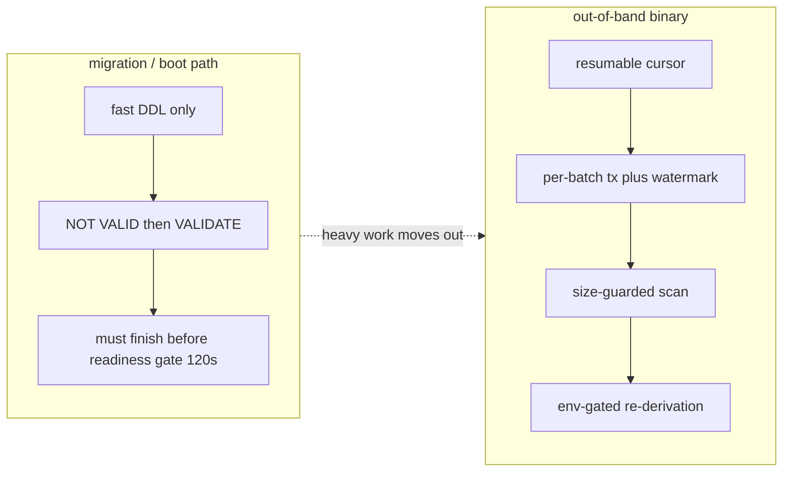
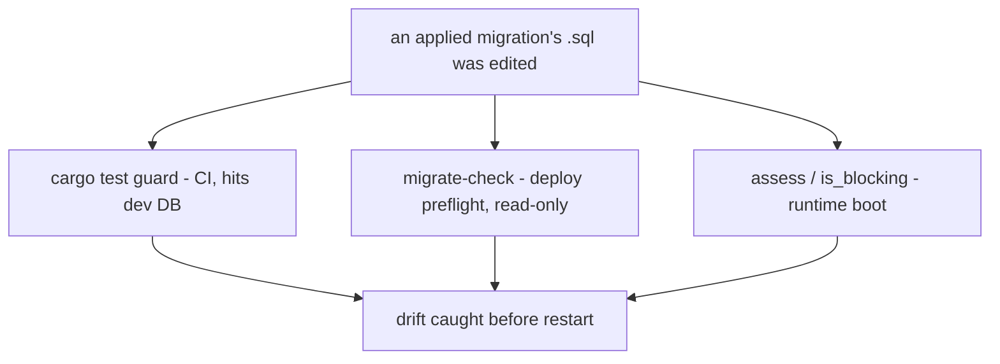

**Part II · Threads: deterministic-enforcement, evidence-over-attestation, source-of-truth · Grounded by: [CS-2](../case-studies.md#cs-sessionid-dataloss)**

# 5. Migrations: expand-only + discovery-before-scope

This chapter is about the *verb*, not the noun — how to evolve a Postgres schema under a running, embedded-migration Rust service without stranding a deploy or losing data. Schema *design* (identity, normalization, naming) lives in [ch. 4 — Schema design](./04-T04a-schema-design.md). Here: why "rollback" is a lie for destructive changes, why heavy backfills must leave the boot path, how to add constraints without a table-wide lock, how to gate a deploy on a read-only checksum check, how to discover *every* write site before you touch a column, and how to smoke-test what a migration *means* rather than that it ran. The chapter's most expensive lesson (Lesson 5) came from reading only the first of two grep hits — see [CS-2](../case-studies.md#cs-sessionid-dataloss).

---

## Lesson 1: Make migrations expand-only because binary rollback cannot undo a destructive change

**Do this.** Design every migration to be additive and backward-compatible: new tables, new nullable columns, new indexes, new views. For any risky reshape, use **expand-contract** — add the new shape, backfill it, switch reads to it, then drop the old shape in a *later, separate* migration. The invariant that makes a deploy safe is that both the *old* binary and the *new* binary can serve against the schema at every intermediate step — the same dual-readability that lets the two-phase write path in [ch. 6 — Persistence boundary](./06-T05-persistence-boundary.md) recover after a crash mid-write. Wire a read-only checksum preflight (Lesson 4) as the *first* deploy gate, before anything touches the database. `[thread: deterministic-enforcement]`

**Not this.** Trusting that a deploy script's rollback saves you. A fail-safe deploy smoke-tests the new binary against the **shared** database with migrations applied for real, and its rollback reverts only the *binary*. A successful-but-destructive migration (`DROP`/`RENAME COLUMN`, retype, `ADD COLUMN NOT NULL` without a default) has already mutated the shared schema — reverting the binary leaves no path back. There is no `down.sql` worth writing: reversible down-migrations are fiction for `NOT NULL`, `RENAME`, retype, or table-split. For those changes, `pg_dump` first or plan downtime.

**Why.** The fail-safe deploy script exists because the naive one killed the live proxy *before* the new binary ran its on-startup migrations and bound its ports — a migration or boot failure then left nothing running against a half-touched DB. The script's own header states the expand-only precondition and warns that its rollback "CANNOT save you" for destructive migrations. Deploy orchestration (alt-port smoke, cutover, auto-rollback) is owned by [ch. 15 — Operational safety & deploy](./15-T11b-ops-deploy-safety.md); the point *here* is only that the schema constraint is forced by what rollback structurally cannot do.

**Evidence.** `scripts/deploy-proxy.sh:25-36` (PRECONDITION — migrations must be EXPAND-ONLY) · `scripts/start-proxy.sh:14-15` (same precondition header) · commit `836f5fa` · memory `project_safe_deploy_cutover.md`.

**Pattern.**
```
# deploy-proxy.sh header (verbatim intent):
# PRECONDITION — migrations must be EXPAND-ONLY / backward-compatible.
# A *successful but destructive* migration (DROP/RENAME COLUMN, retype, add
# NOT NULL without default) cannot be undone by reverting the binary — this
# script's rollback CANNOT save you there.
```

---

## Lesson 2: Keep migrations DDL-only and move heavy backfills into an out-of-band resumable binary

**Do this.** Treat a migration as schema DDL that must complete *fast*, because it runs on the boot path and must finish before the readiness gate declares the service up. Move any large data movement — parse-and-rewrite, re-derivation, full-table backfill — into a standalone, **resumable** CLI binary: keyset/batch pagination, a single-row cursor table, one transaction per batch that advances its own watermark (so a crash leaves no half-written state), and a size-guarded scan that decides *which rows you parse* cheaply before doing expensive work. Gate destructive re-derivation behind an explicit operator env var; never auto-run it on boot. `[thread: bound-it]`

**Not this.** A migration that scans and decodes every row of a large table inline. It holds the boot path open, never commits inside the readiness window, crash-loops, and — because it never committed — is never recorded in the migration-tracking table, so it re-runs on every restart. Worse: scoping the backfill cheap by a *semantic attribute* (e.g. `model`) silently drops legitimate rows.

**Why.** (In temet-proxy:) a relabel migration ran `convert_from(request_body)::jsonb` across the whole `requests` table. A `position()` byte-prefilter matched any huge conversation that merely *mentioned* a marker string, so the expensive JSON parse ran on ~263 KiB bodies (~140 s per `UPDATE`) and overran the 120 s startup readiness gate into a crash loop. The fix was a **decode-free** `octet_length(request_body) < 131072` guard placed *before* the `position()` prefilter, cutting the parse set first: ~280 s → ~3.8 s, dropping zero real matches. Scoping cheap by a semantic attribute would have been worse — the mislabeled set was mostly one model, so a `model` filter would have dropped real rows. Scope *which rows you parse*, not *which rows match*.

**Evidence.** `crates/claude-proxy/src/store/persistence/migrations/20260528000007_relabel_opus_sidecars.sql:46-65,82,106` (octet_length size guard, decode-free, before `position()`) · memory `debugging_backfill_blocks_startup.md`.

**Pattern.**
```sql
-- decode-free length read evaluated BEFORE the byte-prefilter, so the huge
-- bodies never reach convert_from(); scopes WHICH rows are parsed.
AND octet_length(r.request_body) < 131072
AND position(convert_to('"quota"', 'UTF8') IN r.request_body) > 0
AND pg_input_is_valid(convert_from(r.request_body, 'UTF8'), 'jsonb')
```



---

## Lesson 3: Add constraints on populated tables with NOT VALID then VALIDATE, and bound every migration with lock and statement timeouts

**Do this.** On a populated table, never add a `NOT NULL` / `CHECK` / `FK` in one blocking step. Use `ADD CONSTRAINT … NOT VALID` (a brief catalog-only `ACCESS EXCLUSIVE` lock that does *not* scan existing rows), then `VALIDATE CONSTRAINT` in a separate statement (`SHARE UPDATE EXCLUSIVE`, which does not block writes) — the two-step split is exactly what the [PostgreSQL `ALTER TABLE` docs](https://www.postgresql.org/docs/current/sql-altertable.html) prescribe. Set per-migration `SET LOCAL statement_timeout` and `lock_timeout` so a slow migration fails fast instead of wedging the deploy behind a lock. Build indexes `CONCURRENTLY` only as a documented, single-statement-per-file exception (sqlx honours a leading `-- no-transaction` directive); when the table is small enough that a plain `SHARE`-lock build is acceptable, say so in the header instead of reaching for CONCURRENTLY. `[thread: deterministic-enforcement]`

**Not this.** `ADD COLUMN NOT NULL DEFAULT …` rewriting a huge table; a blocking `VALIDATE` taking `ACCESS EXCLUSIVE` over the whole table during a cutover the old binary still depends on; `CREATE INDEX` (non-concurrent) on a large hot table taking writes offline; or `CREATE INDEX CONCURRENTLY` inside the implicit migration transaction (Postgres rejects it) or left `INVALID` after a mid-build failure with no detection.

**Why.** (In temet-proxy:) a 2026-04-30 DB performance audit prescribed the `NOT VALID`/`VALIDATE` split; the check-constraints migration applies it for every closed-set column. The CONCURRENTLY discipline is documented in-repo — one migration records that sqlx 0.8 honours a leading `-- no-transaction` directive and that "CREATE INDEX CONCURRENTLY cannot run inside" the implicit tx; another deliberately chose a non-CONCURRENTLY BRIN build *because the table was small* and documented why. (One of those constraint targets is a partitioned parent table; `requests` is being de-partitioned — see [ch. 3 — DB planning](./03-T03-db-planning.md) for "partition only when measured volume justifies it." The mechanics below are independent of whether the table is partitioned.)

**Evidence.** `…/migrations/20260430000004_requests_check_constraints.sql:41-44,71-127` (NOT VALID → VALIDATE per constraint) · `…/migrations/20260505000001_normalised_tool_data_plane.sql:35-36` (`SET LOCAL statement_timeout='5min'; SET LOCAL lock_timeout='5s'`) · `…/migrations/20260429000001_requests_indexes_cleanup.sql:3-24` (`-- no-transaction` directive; one CONCURRENTLY stmt per file) · `…/migrations/20260430000001_brin_indexes.sql:35-41` (documented "Why no CONCURRENTLY").

**Pattern.**
```sql
SET LOCAL statement_timeout = '5min';
SET LOCAL lock_timeout       = '5s';
-- ...
ALTER TABLE claude_proxy.requests
    ADD CONSTRAINT requests_method_known CHECK (method IN (...)) NOT VALID;  -- catalog-only
ALTER TABLE claude_proxy.requests
    VALIDATE CONSTRAINT requests_method_known;  -- SHARE UPDATE EXCLUSIVE, no write block
```

---

## Lesson 4: Detect checksum drift three ways — a read-only preflight, a runtime assessment, and a CI guard

**Do this.** When your migrator embeds source checksums and refuses to start on a mismatch, that startup refusal is *too late* — it strands a deploy mid-cutover. Build three layers of the same check: (1) a **read-only `migrate-check` subcommand** that compares the binary's embedded migration checksums against the tracking table and exits non-zero on a blocking condition, touching nothing; (2) a runtime **assessment** type that classifies three states distinctly — `pending` (will apply, informational), `mismatched` (an applied migration's `.sql` was edited — BLOCKING), `missing_from_binary` (DB newer than this binary — BLOCKING); (3) a **`cargo test`** that runs the identical comparison so editing an applied migration fails loudly in CI before any restart. Wire `migrate-check` as the *first* deploy gate, before the smoke instance starts. `[thread: deterministic-enforcement] [thread: evidence-over-attestation]`

**Not this.** Editing an already-applied migration's `.sql` (changing its checksum) and discovering it only as an opaque "migrator refused" crash during a deploy. Or pointing the checksum-guard *test* at a fresh ephemeral DB — a freshly-migrated ephemeral always agrees with the on-disk files, so it can never catch the drift. That guard test is the one documented, legitimate exception to the project's "tests never touch the dev DB" rule (it must read the dev DB read-only); the isolation rule it bends is owned by [ch. 11 — DB-backed test isolation](./11-T10a-db-test-isolation.md).

**Why.** (In temet-proxy:) added in commit `836f5fa`, so a checksum mismatch surfaces as a precise preflight diagnostic instead of a generic boot crash mid-cutover. The `cargo test` layer is the same deterministic-gate-beats-prose discipline that governs the manifest↔parity contract in [ch. 13 — Tooling & quality gates](./13-T12-tooling-quality-gates.md).

**Evidence.** `crates/claude-proxy/src/config/subcommands.rs:104-172` (`migrate_check`: read-only assess, prints pending/mismatched/missing, `anyhow::bail!` on blockers) · `…/store/persistence/migrations.rs:62-85` (`MigrationAssessment` three states; `is_blocking()` at lines 82-84, true when `mismatched` or `missing_from_binary` non-empty) · `…/migrations.rs:105-186` (`assess()`: read-only, handles fresh DB via `to_regclass` NULL) · `crates/claude-proxy/tests/schema/migration_checksums.rs:22-24,63-106` (cargo-test guard; must point at dev DB, not ephemeral).

**Pattern.**
```rust
// assess() is pure reads. is_blocking() is the deploy gate.
pub(crate) fn is_blocking(&self) -> bool {
    !self.mismatched.is_empty() || !self.missing_from_binary.is_empty()
}
```



---

## Lesson 5: Before any schema change, discover every write site by grepping the table name in raw SQL

**Do this.** Before declaring which files a schema change touches, run *two complementary* searches: LSP find-references (catches typed struct callers) **and** a text/AST grep for the literal SQL (`grep -rn "INSERT INTO <schema>.<table>"`, `ast-grep 'sqlx::query($$$)'`). Read **every** hit and confirm the table name is in the query string before editing. Make the breaking step (flipping a column to `NOT NULL`) last, after every write site is fixed in one pass. The two search axes are complementary; neither alone is sufficient — `findReferences` is blind to SQL string literals, which have no struct caller to follow. `[thread: evidence-over-attestation] [thread: source-of-truth]`

**Not this.** Pre-declaring the file allowlist from mental-model navigation (struct → callers) before any discovery search — that is *agenda-driven scope*, and it misses inline-SQL write sites entirely. Equally fatal: running the right grep but reading only the *first* hit. Stopping at the first hit is the same failure as not searching.

**Why.** This rule is the direct lesson of the session-id NOT-NULL data loss ([CS-2](../case-studies.md#cs-sessionid-dataloss)): two INSERT sites for one table, only the first updated before the column was flipped `NOT NULL`. The critical grep *returned both lines; only the first was read*. The four root causes generalize cleanly: agenda-driven scope before discovery (RC1), grep output not fully consumed (RC2), the wrong search axis — struct instead of table name (RC3), and LSP blindness to SQL literals (RC4).

**Evidence.** `artifacts/2026-05-28/incident-session-id-data-loss/02-findings.md:1-69` (the two INSERT sites, the NOT NULL flip, RC1–RC4) · `~/.claude/rules/scope-and-agents.md:17-31` ("Schema Changes — Discovery-First Scope": grep `INSERT INTO` before the allowlist; "LSP `findReferences` cannot see raw SQL string literals — it finds struct callers only"; "Read ALL hits, not just the first") · memory `correction_signature_callers.md` (same principle for signatures: grep all callers, change last).

**Pattern.**
```bash
# The discovery that should have run BEFORE declaring scope.
# This grep would have returned BOTH write sites — read every line, not the first.
grep -rn "INSERT INTO claude_proxy.response_stream_chunks" crates/
```

---

## Lesson 6: Smoke-test a migration's semantics, not merely that it ran

**Do this.** A migration smoke test must assert what the migration *means*, against a real migrated ephemeral DB: for a JSONB-to-typed-table promotion, the inline backfill produces byte-identical rows for every column; every promised index actually exists (assert by name in `pg_indexes`); `ON DELETE CASCADE` FKs really cascade (insert parent + child, delete parent, assert child gone). For migrations that rely on engine semantics not spelled out in the SQL — e.g. `DROP COLUMN` implicitly dropping a dependent index — confirm with a post-deploy probe (`pg_attribute` / `pg_indexes`) against a freshly-migrated DB. Write migration headers that state what is destructive and what is preserved. `[thread: evidence-over-attestation]`

**Not this.** A migration test that only checks the migrator exited 0 — leaving backfill data loss, missing indexes, or wrong FK actions undetected. Trusting that an implicit cascade happened without probing for it.

**Why.** (In temet-proxy:) the smoke test was built for a JSONB→bridge-table promotion. The byte-identity-of-the-backfill facet is this chapter's; the *design* of that cutover (FK-not-matcher, normalization) is owned by [ch. 4 — Schema design](./04-T04a-schema-design.md). The 2026-04-30 audit praised the migration-header discipline ("Every migration carries a detailed header explaining why, what's destructive, and idempotency guarantees").

**Evidence.** `crates/claude-proxy/tests/integration/migrations_smoke.rs:1-52` (asserts backfill byte-identity across `category`/`analyzer`/`advice`/`matched_text`/`match_range`/`other_hits`/`created_at`; index presence by name in `pg_indexes`; `ON DELETE CASCADE`; per-test ephemeral DB) · migration headers `…/20260430000004_requests_check_constraints.sql:41-55` and `…/20260528000007_relabel_opus_sidecars.sql:46-65` (destructive/idempotency intent) · `artifacts/reviews/db-performance-audit-2026-04-30.md:762-766` (header-discipline praise) · `artifacts/reviews/m6-drop-cascade-verification.md` (a one-off cascade-probe verification; the specific probe list is directional, not a standing runbook).

---

## Further reading

- [Fowler — *ParallelChange* (expand-and-contract)](https://martinfowler.com/bliki/ParallelChange.html) — names the exact three-phase expand/migrate/contract pattern, reinforcing Lesson 1's "both old and new binary serve the schema at every step." It *qualifies* the kernel "never break userspace" rule cited elsewhere in Part II: a stable ABI can never contract, whereas a DB migration has `pg_dump` backups and a deferred contract phase an ABI structurally lacks — the transfer is the expand discipline only.
- [Fowler & Sadalage — *Evolutionary Database Design*](https://martinfowler.com/articles/evodb.html) — grounds Lessons 1, 2, and 4: schema change is versioned, incremental, automated; structural DDL is decoupled from bulk data migration; an applied migration is immutable, append-only history (the drift Lesson 4 detects).
- [PostgreSQL docs — `ALTER TABLE … NOT VALID` / `VALIDATE CONSTRAINT`](https://www.postgresql.org/docs/current/sql-altertable.html) — confirms Lesson 3 verbatim: `NOT VALID` skips the "potentially-lengthy scan" and commits immediately; `VALIDATE` "acquires only a SHARE UPDATE EXCLUSIVE lock" and does not block concurrent updates.
- [PostgreSQL docs — `CREATE INDEX CONCURRENTLY`](https://www.postgresql.org/docs/current/sql-createindex.html) — confirms all three CONCURRENTLY claims in Lesson 3: it cannot run inside a transaction block, it takes no locks that block writes, and a failed build leaves an INVALID index (the detection gap).
- [PostgreSQL docs — `statement_timeout` / `lock_timeout`](https://www.postgresql.org/docs/current/runtime-config-client.html) — grounds Lesson 2's boundary (an uncapped statement overruns the readiness window) and Lesson 3's per-migration `lock_timeout` that fails a wedged migration fast instead of stalling the deploy behind a lock.
- [Humble & Farley — *Continuous Delivery* (fail-fast deployment gates)](https://www.oreilly.com/library/view/continuous-delivery/9780321670250/) — reinforces Lesson 4's "first gate, before the smoke instance starts": fail the pipeline at the earliest, cheapest stage rather than mid-cutover.
- [Meszaros — *xUnit Test Patterns* (test state/behavior, not execution)](https://www.oreilly.com/library/view/xunit-test-patterns/9780131495050/) — reinforces Lesson 6: a test must assert the outcome (backfill byte-identity, index presence, cascade behaviour) against real state, not merely that the migrator exited 0.
