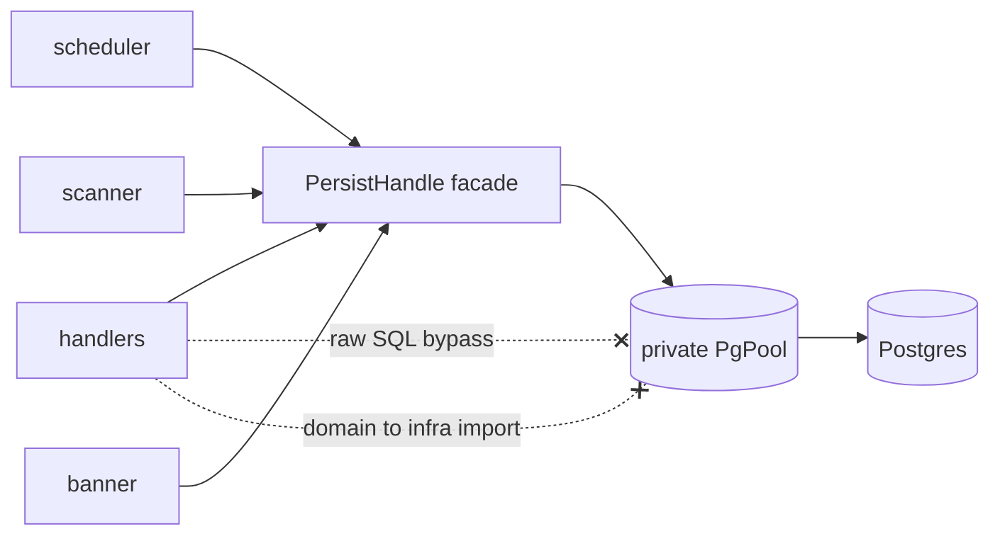
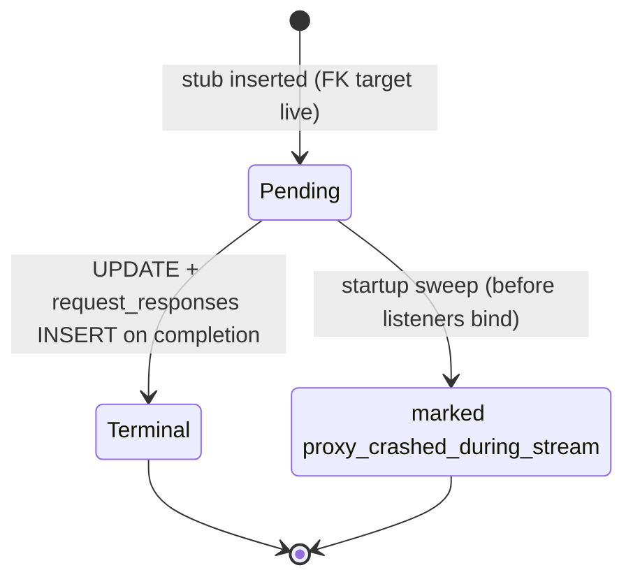

**Part II · Threads: source-of-truth · deterministic-enforcement · bound-it · Grounded by: [CS-4](../case-studies.md#cs-mvcc-cascade), [CS-2](../case-studies.md#cs-sessionid-dataloss)**

# 06. The persistence boundary & write discipline

This chapter is about *where* database code lives and *when* writes happen — the two questions that decide whether your durable layer is the source of truth or a lucky shadow of an in-memory cache. A service that mediates valuable traffic earns trust only if the data survives a restart, a crash mid-stream, and a concurrent writer hammering the same row. The lessons below are scar tissue from four incidents — a data-loss window from a second un-shared `INSERT` site ([CS-2](../case-studies.md#cs-sessionid-dataloss)), a terminal-flush bug where the only call carrying accumulated child data skipped every write, lock contention from one misplaced `UPDATE` inside a transaction ([CS-4](../case-studies.md#cs-mvcc-cascade)), and an in-memory matcher that silently dropped linkages on every restart. Each hardened one principle: confine SQL to one boundary, model relationships on disk, write events as they happen, and prove it survives a restart with two processes and one database.

---

## Lesson 1 — Funnel all SQL through one persistence handle; never let the raw pool escape `[thread: source-of-truth]`

**Do this.** Give the rest of the application exactly one type that owns the connection pool and exposes narrow, *intent-named* methods (`ensure_session_exists`, `snapshot_request`, `list_lessons`) rather than a query interface — this is Fowler's [Repository pattern](https://martinfowler.com/eaaCatalog/repository.html), a collection-like facade mediating between domain and data. Keep the pool private to the persistence module so no handler, scheduler, scanner, or background task can compose ad-hoc SQL against the schema. Organize the module by domain submodule, each holding its own SQL. The schema's blast radius is then one directory wide, and a column rename is a bounded edit instead of a multi-file scavenger hunt.

**Not this.** Passing a bare connection pool around and writing query string literals in handlers, updaters, and store code — scattering schema knowledge everywhere and making write sites invisible to schema-change scope analysis. Do **not** add a `pool()` escape hatch "just for this one feature": it becomes the abstraction-leak precedent the next feature copies, and feature modules then start importing infrastructure error types directly (a domain → infra inversion).

**Why.** Schema knowledge that leaks past one boundary cannot be audited as a unit; the boundary is what makes a column change a grep-able, bounded operation. (In temet-proxy: a single commit moved 9 inline SQL sites out of the API handlers, 5 count calls out of the observability banner, an inline `UNNEST` out of the agent scanner, and a TTL `DELETE` out of the sweep job into `store/persistence/*` submodules; the gutted free-function modules became re-export shims. A later remediation review flagged a proposed `PersistHandle::pool()` accessor as "an abstraction-leak precedent" and caught a domain module importing the infra `PersistError` type.)

**Evidence.** `crates/claude-proxy/src/store/persistence/mod.rs:1-8` (handle doc comment) · commit `0785842` ("enforce persistence layer boundary"; ~900-line `compose_prompt/store.rs` reduction to shims) · `artifacts/reviews/feature-prompt-filter-remediation.md` items W6/W7 · memory `convention_sql_in_persist_handle.md`.

**Pattern.**
```rust
//! `PersistHandle` is the single entry point: it owns the connection
//! pool and exposes narrow, intent-named methods. The raw `PgPool` is
//! NOT reachable from outside this module — callers never compose their
//! own SQL against the schema internals.
pub struct PersistHandle { pool: PgPool /* private */ }
impl PersistHandle {
    pub async fn ensure_session_exists(&self, id: &str) -> Result<(), PersistError> { /* … */ }
    pub async fn snapshot_request(&self, /* … */) -> Result<i64, PersistError> { /* … */ }
}
```



---

## Lesson 2 — One named method per mutation; no duplicated write SQL for the same table `[thread: deterministic-enforcement]`

**Do this.** Make every `INSERT`/`UPDATE`/`DELETE` against a given table live in exactly one named method, and make any SQL string shared by two code paths a single shared constant. Before writing SQL in a new place, check whether a method already exists; if not, create it first, then call it.

**Not this.** Two `INSERT` sites for one table with no shared constant — the precondition for an additive-`NOT NULL` migration updating one site and missing the other, which then fails every write silently for as long as nobody reads the dead rows.

**Why.** That is exactly the silent data loss in [CS-2](../case-studies.md#cs-sessionid-dataloss). A single shared SQL constant collapses the two sites into one truth — there is no second site left to forget. (In temet-proxy: the fix introduced a shared `RESPONSE_STREAM_CHUNKS_INSERT` constant so the streaming and non-streaming paths use one string.)

**Evidence.** memory `project_incident_session_id.md` (migration `20260526000002` `session_id TEXT NOT NULL`; `RESPONSE_STREAM_CHUNKS_INSERT` fix) · `artifacts/2026-05-28/incident-session-id-data-loss/` (full record).

**Pattern.** When a schema change touches a table, grep **all** write sites by table name in the raw SQL first — `findReferences` cannot see string literals, so combine it with `Grep "INSERT INTO <schema>.<table>"` and read *every* hit, not just the first. The discovery-before-scope mechanics are owned by [ch. 5 — Migration mechanics](./05-T04b-migrations-mechanics.md).

---

## Lesson 3 — Make the persistence boundary compile-checked against the live schema `[thread: deterministic-enforcement]`

**The facet this chapter owns:** because all SQL lives behind one handle (Lesson 1), it can all be compile-checked at that boundary. Use compile-verified query macros (`sqlx::query!` / `query_as!` with `FromRow`) so a renamed column is a build failure, not a 2am runtime error — and build *locally* with `DATABASE_URL` pointed at a real migrated schema, never `SQLX_OFFLINE=true`, so the macros re-verify against the live database rather than a possibly-drifted cache (evidence: memory `correction_signature_callers.md:22`). The full treatment — the macros as a deterministic quality gate, the committed offline cache, and the `sqlx prepare --check`-on-every-PR gate (prescribed, *not* a temet-proxy exemplar) — is owned by [ch. 13 — Tooling & quality gates](./13-T12-tooling-quality-gates.md). This is the same compile-checked guard as ["parse, don't validate"](https://lexi-lambda.github.io/blog/2019/11/05/parse-don-t-validate/): push the schema-mismatch check to the boundary instead of trusting it downstream.

---

## Lesson 4 — Model entity relationships with on-disk foreign keys, never an in-memory matcher `[thread: source-of-truth]`

**Do this.** If two persisted entities are related (a tool call and its later-arriving tool result), enforce the link with a foreign key in the database. FKs are restart-stable and enforced by the engine. Prefer normalized tables with FKs over JSONB blobs for anything you will need to query or join across.

**Not this.** A process-lifetime `HashMap` keyed on one entity's id, used to link it to another persisted entity. It only works while the process runs: a restart that lands *between* writing entity A and the arrival of related entity B silently drops the linkage — no constraint restores it, no on-disk back-pointer survives. A restored row joins; an in-memory-matched row goes missing, and nothing tells you.

**Why.** An in-memory matcher is correctness that evaporates on restart — the failure is invisible because the surviving rows still join, so the gap looks like normal sparsity. A foreign key moves the relationship into the layer that enforces it across restarts. (In temet-proxy: a single-migration cutover replaced JSONB tool blobs on `requests` plus a per-process `tool_use_id → request_id` matcher with normalized `tool_uses` / `tool_results` / `agent_dispatches` tables, where `tool_results.tool_use_id REFERENCES tool_uses(tool_id)`. As the architecture doc puts it: the matcher *is* the foreign key — restart-stable, enforced by Postgres, no in-memory state.)

**Evidence.** `docs/ARCHITECTURE.md:253-276` (Normalised Tool Data Plane) · `crates/claude-proxy/src/store/persistence/migrations/20260505000001_normalised_tool_data_plane.sql:86-104` (FK definition) · commit `9e409ee` · `.claude/rules/inspection-fidelity.md` anti-pattern row "in-memory matcher index for FK-shaped relationships".

**Pattern.**
```sql
-- The tool_use_id FK replaces the in-memory matcher: restart-stable,
-- enforced by Postgres, no process-lifetime HashMap.
CREATE TABLE IF NOT EXISTS claude_proxy.tool_results (
    -- …
    tool_use_id  TEXT  NOT NULL
        REFERENCES claude_proxy.tool_uses (tool_id),
    -- …
);
```

The *schema-shape* design rationale for this normalization (why FK-not-matcher, the table layout, the read-side views) is owned by [ch. 4 — Schema design](./04-T04a-schema-design.md). This chapter owns only the write-path facet: the matcher was a *write-time* linkage that the FK now enforces.

---

## Lesson 5 — Don't rebuild derived aggregates from a blob on a schedule; aggregate from rows, or materialize via trigger `[thread: source-of-truth]`

**Do this.** Compute aggregates (counts, "tools used", "files touched") with read-side SQL over the normalized rows — `SELECT COUNT(*) FROM tool_uses WHERE request_id BETWEEN …`. If a *measured* aggregate is too slow, materialize it into a cache table fed by a trigger — never by a periodic recompute job over a blob.

**Not this.** Promoting derived aggregates into denormalized columns rebuilt by a session-keyed recompute job over a JSONB blob. The columns drift from source whenever the recompute is missed, partial, or races a write — and a drifted aggregate is worse than a slow one, because it lies confidently.

**Why.** A derived value has exactly one honest home: a query over its source. Copy it into a schedule-maintained column and you have two answers with no way to tell which is right. A trigger-fed cache stays in lockstep with the write; a recompute job does not. (In temet-proxy: the same cutover that retired the matcher deleted 13 denormalized aggregate columns on `operator_turns` and their `recompute_for_session` job, replacing them with read-side views.)

**Evidence.** `docs/ARCHITECTURE.md:255-276` ("Aggregates are SQL, not columns"; deleted `recompute_for_session` + 13 columns; `operator_turn_aggregates_v`, `file_touches_v`) · `.claude/rules/inspection-fidelity.md` anti-pattern row "JSONB-as-storage for derived data".

---

## Lesson 6 — Persist each event when it happens, not in one terminal flush `[thread: source-of-truth · bound-it]`

**Do this.** Write captured data at its natural event point — a child row when its event fires, a chunk row on each stream delta — rather than accumulating everything in memory and flushing once in the terminal handler. Write-as-you-go keeps the in-memory working set small (a bounding concern), makes data visible *during* streaming, and spreads failure risk instead of concentrating it at one call.

**Not this.** Buffering all of a request's child records in memory and inserting them only in the final terminal call — a single point of total, silent failure where one conflict or early-return drops everything.

**Why.** In temet-proxy a pre-existing bug had `insert_request_initial` early-return on `ON CONFLICT`, so the terminal call — the *only* call carrying the accumulated tool data — skipped every data-plane write; `tool_uses` / `tool_results` were never persisted for real handler traffic. The conflict path was changed to resolve the row id deterministically and still run the idempotent writes, and follow-on work moved tool-use writes to fire immediately at their event point.

**Evidence.** commit `96e58c9` (insert_request_initial early-returned on ON CONFLICT; tool_uses/tool_results/request_tools never persisted; introduced by `db533f4`) · commit `fab61ea` ("write tool_uses immediately on ToolUseEnd (write-as-you-go C2)") · commit `7f6cbb6` (write-as-you-go finalization) · memory `convention_write_as_you_go.md`.

---

## Lesson 7 — A multi-row logical event is ONE transaction owned by ONE method — kept as narrow as atomicity requires `[thread: source-of-truth · deterministic-enforcement]`

**Do this.** When a single domain event must write several tables (upsert-parent, bootstrap-session, insert-children), wrap exactly the writes that must commit together in one transaction, and put that orchestration in exactly one method. Keep the transaction **narrow**: co-locate only the writes that are genuinely atomic. Best-effort / denormalized rows (summary roll-ups, last-seen, project rollups) are *not* atomic with the core record — update them *outside* the transaction (the last statement before commit, or after commit with warn-and-continue), so their row lock is not held for the whole transaction's duration.

**Not this.** Two failures, one root. (a) A multi-statement write with no transaction: each `.execute(&pool)` grabs a *different* pooled connection, so a "DELETE then INSERT" can half-apply across two connections. (b) A best-effort row `UPDATE` held *inside* a long transaction: the row lock is held for the transaction's entire duration, and every concurrent operation on that row queues behind it.

**Why.** Transaction width is a lock-window decision: a too-wide tx turns a best-effort write into a serialization point. In [CS-4](../case-studies.md#cs-mvcc-cascade) a best-effort `sessions` UPDATE rode inside a wide snapshot transaction, held its row lock until commit, and one concurrent TTL-sweep `DELETE` queued behind it — one lock holder radiating into three apparently-unrelated slow operations. The correct atoms for that transaction are the request-status update, the response/diagnostics inserts, and the turn lifecycle — nothing else; the `sessions` roll-up belongs outside it. *This is prescribed.* Do not assert that the live code already moves the UPDATE outside the transaction — the memory framing the fix is point-in-time and flags it as planned; re-verify against the current `snapshot_request` before claiming it as shipped. (In temet-proxy: one review traced request rows stuck at `sessions.request_count = 0` to a split non-transactional path and proposed a single `BEGIN / upsert / INSERT / COMMIT` method; another found `upsert_filter_rule_by_id` doing `DELETE + INSERT` on the pool while its sibling `insert_filter_rule` was already a transaction.)

**Evidence.** `artifacts/reviews/persistence-population-gaps-2026-04-25.md:127-156` (split non-transactional path → request_count = 0; proposed BEGIN…COMMIT) · `artifacts/reviews/db-performance-audit-2026-04-30.md:137-139` (`upsert_filter_rule_by_id` DELETE+INSERT outside a tx at `filter_rules.rs:99-134`) · memory `warning_snapshot_request_tx.md` (correct tx atoms — *origin-incident framing, not a current-code-state claim*).

The diagnostic *method* for finding the single lock holder (uncontended `EXPLAIN` proving wait-not-work) is owned by [ch. 9 — Error handling](./09-T08-error-handling.md); the ops backstop (`lock_timeout` / `idle_in_transaction_session_timeout`) by [ch. 15 — Ops & deploy safety](./15-T11b-ops-deploy-safety.md).

---

## Lesson 8 — Two-phase write for streaming work: idempotent stub up front, terminal UPDATE, plus startup crash recovery `[thread: source-of-truth · deterministic-enforcement]`

**Do this.** When child rows (stream chunks) need a parent FK but the parent's terminal fields are only known at stream end, write a `Pending` stub row immediately — before forwarding upstream — so the FK target exists; make the stub idempotent with `ON CONFLICT (...) DO NOTHING`; then `UPDATE` it to its terminal state when the response completes (presence-is-complete semantics). On the next startup — *before the listeners bind* — sweep any still-`Pending` rows to an explicit error status, so a crash mid-stream never leaves a row that looks in-flight forever.

**Not this.** Writing the parent row once at stream completion (you lose all children and the body on a mid-stream crash), or relying on an in-memory matcher to link parent/child rows (vanishes on restart — Lesson 4).

**Why.** Streaming has a chicken-and-egg: chunk rows need a parent to FK against, but the parent's status / stop-reason / token usage are only known at the end. A `Pending` stub written first resolves it without a deferred FK; the idempotent conflict clause makes a retry safe; and the startup sweep is the deterministic guard that turns "silently in-flight forever after a crash" into an explicit, queryable error state. (In temet-proxy: the two-phase write was introduced with the `request_responses` table; `recover_stale_pending_rows()` runs at startup via `run_crash_recovery`, ordered before the listeners bind.)

**Evidence.** `docs/ARCHITECTURE.md:278-289` (two-phase write; `ON CONFLICT (session_id, created_at) DO NOTHING`; `recover_stale_pending_rows`) · `crates/claude-proxy/src/proxy/handler.rs:739` (stub-before-chunks comment) · crash recovery at `crates/claude-proxy/src/startup.rs:183-190` (`run_crash_recovery`) → `crates/claude-proxy/src/store/persistence/mod.rs:1908` (`recover_stale_pending_rows`), "before listeners bind" ordering confirmed in startup.rs · commit `bb7fa03` (add `request_responses` table) · migration `20260516000001`.

**Pattern.** Phase 1 (`insert_request_initial`) inserts the `Pending` requests row + aux rows with `ON CONFLICT (session_id, created_at) DO NOTHING` (FK target now live); Phase 2 (`snapshot_request`) UPDATEs it and inserts `request_responses` on completion (presence = complete); the startup sweep, before listeners bind, marks any leftover `Pending` row `proxy_crashed_during_stream`.



The change-notification mechanism that lets the inspect layer react to these writes (LISTEN/NOTIFY) is owned by [ch. 10 — Observability & fidelity](./10-T09-observability-fidelity.md).

---

## Lesson 9 — Design the persist write path AND the rehydrate read path as first-class peers of the in-memory model `[thread: source-of-truth]`

**Do this.** When a service has both a live in-memory store and a durable database, treat the persist *write* path and the rehydrate *read* path as first-class peers of the in-memory model from day one. Audit both sides: a write fix is worthless if the rehydrate `SELECT` never asks for the column.

**Not this.** INSERT-only persistence that treats a summary row as write-once and never rolls its fields forward, with a rehydrate path "read-symmetric to the broken write path" — the `SELECT`s omit the column, so even good data would not read back, and in-memory correctness masks the whole gap until a restart.

**Why.** The in-memory store is easy to get right and it *lies to you*: it surfaces correct derived fields — counts, last-seen, resolved identifiers — while the persist layer silently drops or freezes them, so the system looks healthy until a restart reveals the gap. (In temet-proxy: a persistence-gap review found `sessions.request_count` frozen at 0 for every row despite real request traffic, `req.project` extracted correctly in memory but discarded at persist time, and `diagnostics` hardcoded `[]` on read because the rehydrate path mirrored the broken write path.) The fail-fast counterpart — persistence is a *required* subsystem here, not an optional one defaulted off — is owned by [ch. 14 — Config architecture](./14-T11a-config-architecture.md): default optional subsystems off, but make load-bearing ones fail fast on missing config.

**Evidence.** `artifacts/reviews/persistence-population-gaps-2026-04-25.md:77` (B1: request_count frozen at 0) · same review `:92` (in-memory `RequestStore` correct while durable layer broken) · same review `:58-60` (diagnostics/sse_events/upstream_id hardcoded or NULL on read — read-side symmetry to the broken write).

---

## Further reading

- [Fowler — *Repository* (PoEAA catalog)](https://martinfowler.com/eaaCatalog/repository.html) — the collection-like facade "mediating between the domain and data mapping layers"; the `PersistHandle` with intent-named methods *is* a Repository, and the no-`pool()`-escape-hatch rule is its encapsulation boundary stated as a guard (reinforces Lesson 1).
- [Fowler & Sadalage — *Evolutionary Database Design*](https://martinfowler.com/articles/evodb.html) — independently names "isolate database access code from application logic" as a core practice; this is the single-boundary discipline that makes a column rename a bounded edit (reinforces Lesson 1).
- [Alexis King — "Parse, don't validate"](https://lexi-lambda.github.io/blog/2019/11/05/parse-don-t-validate/) — push a check to the boundary so the illegal state is a build failure, not a runtime surprise; the conceptual grounding for a compile-checked query, though the sqlx mechanics belong to [ch. 13 — Tooling & quality gates](./13-T12-tooling-quality-gates.md) (reinforces Lesson 3).
- [PostgreSQL docs — foreign key constraints](https://www.postgresql.org/docs/current/ddl-constraints.html) — the FK is engine-enforced and restart-stable by construction; "the matcher *is* the foreign key" as a Postgres guarantee rather than an in-process hope (reinforces Lesson 4).
- [Karwin — *SQL Antipatterns*](https://pragprog.com/titles/bksqla/sql-antipatterns/) — a derived value copied into an out-of-band-maintained column is a second source of truth that drifts; *qualifies* Lesson 5 in that it endorses trigger-fed denormalization as a *measured* trade-off, exactly the lesson's own escape hatch — not a flat "never denormalize."
- [PostgreSQL docs — explicit locking (row-level locks held to transaction end)](https://www.postgresql.org/docs/current/explicit-locking.html) — "Row-level locks are released at transaction end" and block only same-row writers; the verbatim mechanism behind why a too-wide transaction serializes concurrent writers in [CS-4](../case-studies.md#cs-mvcc-cascade), and why a multi-statement write with no explicit tx half-applies across pooled connections (reinforces Lesson 7).
- [PostgreSQL docs — `INSERT … ON CONFLICT DO NOTHING`](https://www.postgresql.org/docs/current/sql-insert.html) — "no error is raised" on conflict; the exact idempotency the `Pending` stub relies on so a retried first-phase write is safe (reinforces Lesson 8).
- [Meszaros — *xUnit Test Patterns*](https://www.oreilly.com/library/view/xunit-test-patterns/9780131495050/) — test the actual collaborator across a real process boundary, not a stand-in; the rationale for the two-process-one-DB restart test over an in-memory assertion (reinforces the executable proof below).

---

## The executable proof for this whole chapter

Every claim above reduces to one question: *does the durable layer hold the data when the process that wrote it is gone?* The only honest test is a restart with two processes and one database — boot instance 1, write, graceful shutdown, boot instance 2 against the **same** ephemeral database, assert identical ids and bodies read back. That is the difference between "persisted" and "still in the cache of the process I never killed." (In temet-proxy: `tests/e2e/persistence_restart_smoke.rs`.) The DB-test isolation that makes such a test safe to run — its own ephemeral database, never the dev cluster (see [CS-1](../case-studies.md#cs-devdb-wipe)) — is owned by [ch. 11 — DB-test isolation](./11-T10a-db-test-isolation.md).
