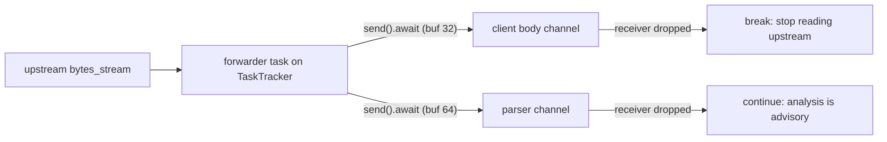
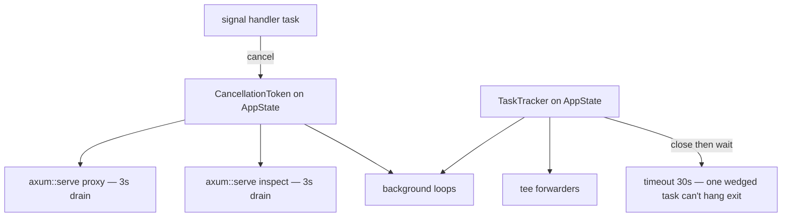
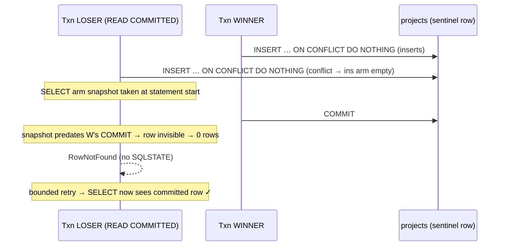

**Part III · Threads: bound-it · deterministic-enforcement · source-of-truth · Grounded by: [CS-1](../case-studies.md#cs-devdb-wipe)**

# 07. Async & concurrency discipline

A long-lived streaming service lives or dies on a handful of async-runtime decisions: inspect a stream without stalling the client, read hot-path state without a lock, guarantee cleanup across every error path, shut down without orphaning tasks, and survive the one Postgres concurrency trap that drops a write *silently* with no error code to grep for. All are cheap on day one and expensive to retrofit under real traffic. This chapter is the runtime mechanics; policy lives next door — memory/resource safety in [ch. 8 — Memory & resource safety](./08-T06-memory-resource-safety.md), error-handling discipline in [ch. 9 — Error handling](./09-T08-error-handling.md).

---

## 1. Tee a byte stream through bounded mpsc channels; make the client path load-bearing and analysis advisory

**Do this.** When you must both forward a streaming response *and* inspect it, fan the upstream byte stream into two **bounded** mpsc channels — one for the client body, one for the parser/analysis side — from a single forwarder task. Clone each chunk with a refcounted buffer type (`Bytes::clone` is an O(1) Arc bump, not a copy). Make the two channels asymmetric in failure semantics: if the **parser** receiver drops, keep forwarding to the client (analysis is advisory); if the **client** receiver drops, stop reading upstream and exit (the client is load-bearing). Let backpressure on the parser channel propagate to the upstream read — `send().await`, not a lossy `try_send`-and-discard — because a dropped chunk corrupts the parsed event stream and leaves a request stuck "Streaming" forever ([tokio docs](https://docs.rs/tokio/latest/tokio/sync/mpsc/index.html): a full bounded channel rejects the send and wakes the task when capacity frees, i.e. it *is* the backpressure signal). `[thread: bound-it]`

**Not this.** Buffering the whole response before forwarding (kills streaming latency), or coupling the client's bytes to the analyzer so a slow or failed analyzer stalls or drops the client's stream.

**Why.** The predecessor (a mitmproxy setup) disabled streaming entirely to inspect — every response buffered, so the operator paid full latency for observability. The channel-tee replaces that: the O(1) clone makes the inspection copy nearly free, and the asymmetric drop semantics keep the client unaffected by anything on the analysis side. The forwarder's own doc comment records the trade: dropping a chunk would break completion emission and strand the request, so "correctness wins over the tiny latency cost."

**Evidence.** `crates/claude-proxy/src/sse/tee.rs:23-70` — `tee_sse_response` returns `(axum::body::Body, mpsc::Receiver<Bytes>)`; body channel buffer 32, parser channel buffer 64 (`tee.rs:27-28`); the `parser_alive` flag (`tee.rs:35,41-44`) keeps client forwarding alive after a parser drop; `body_tx.send(...).is_err()` → `break` on client disconnect (`tee.rs:47-50`); an upstream read error becomes a terminal `BrokenPipe` item to the client (`tee.rs:52-61`). Design record: `docs/ARCHITECTURE.md:215-235` — "Bounded mpsc channel (32–64 items) … `Bytes::clone()` is O(1) (Arc refcount bump); no data copy on the tee."

```rust
let (body_tx, body_rx) = mpsc::channel::<Result<Bytes, std::io::Error>>(32);
let (parser_tx, parser_rx) = mpsc::channel::<Bytes>(64);
// per chunk, inside the forwarder task:
if parser_alive && parser_tx.send(chunk.clone()).await.is_err() {
    parser_alive = false;          // parser advisory: keep going
}
if body_tx.send(Ok(chunk)).await.is_err() {
    break;                         // client load-bearing: stop reading upstream
}
```



> The bounded-accumulator family splits three ways across this playbook — channel backpressure here, in-memory store eviction in [ch. 8 — Memory & resource safety](./08-T06-memory-resource-safety.md), config-value caps in [ch. 14 — Config architecture](./14-T11a-config-architecture.md). One principle (every buffer has a budget), three different problems; don't merge them.

---

## 2. Read rarely-mutated hot-path state through ArcSwap; do not stand up a second one

**Do this.** For state that is read on *every* request but mutated *rarely* — filter rules, an analyzer registry, a compiled config view — wrap it in `arc_swap::ArcSwap`. The hot path calls `load_full()` to snapshot an `Arc` with no lock and no contention; a mutation builds a fresh value and `store()`s it, and in-flight readers keep their consistent snapshot for the life of the request. When you later need another rarely-mutated field, hang it off the *existing* shared state object rather than introducing a parallel `ArcSwap` for a subset the first one already covers. `[thread: bound-it]` `[thread: source-of-truth]`

**Not this.** Reaching for a `RwLock`/`Mutex` on a value read on every request (writer starvation, reader contention, and a lock held across the hot path). Or adding a *second* `ArcSwap` for a slice of already-shared state — more swap points to keep mutually consistent, no benefit.

**Why.** A Phase-3 design review weighed exactly this and landed on "the existing shape wins — do not add a second ArcSwap." `load_full()` returning a consistent per-request snapshot is the property that lets the read path stay lock-free *and* coherent; a second swap point would create a window where two reads of "the same" state disagree.

**Evidence.** `crates/claude-proxy/src/config/mod.rs:540` — `filter_config: Arc<ArcSwap<crate::filter::FilterConfig>>` (analyzer registry at `:531`). Hot-path read: `crates/claude-proxy/src/proxy/handler.rs:263` — `let filter_cfg = state.filter_config.load_full();`. Mutation: `config/mod.rs:965` — `filter_config.store(Arc::new(config.filter.clone()));`. Verdict: `artifacts/reviews/phase3-design-2026-04-23.md:12` — "The existing shape wins — do not add a second ArcSwap."

> The config-reconcile facet of ArcSwap (one resolver, projections are views) is owned by [ch. 14 — Config architecture](./14-T11a-config-architecture.md); this lesson is the runtime mechanic only.
>
> *Citation hygiene:* the original review cited this read site as `handler.rs:143`; it has since drifted to `:263`. Re-resolve every `path:line` against current HEAD before citing — a number copied from an old review points readers at the wrong code.

---

## 3. Put a write-coordination lock on the state struct, not in a free static

**Do this.** When you need to serialize a rare write action (e.g. a config rewrite racing a file watcher), put the coordination lock — a `tokio::sync::Mutex<()>` — *on the AppState struct*. Each unit of work (each request, each test) constructs its own state with its own fixtures, so the lock scopes to that instance and nothing more. `[thread: deterministic-enforcement]`

**Not this.** A `OnceCell`/`lazy_static` free static holding the lock. A process-global lock silently serializes everything in the process — including every integration test in the binary — which both throttles throughput and *hides* isolation bugs by masking shared-state contention behind the lock.

**Why.** A free static lock is, at the type level, indistinguishable from real isolation; it serializes symptoms instead of removing the shared state. The dev-DB wipe ([CS-1](../case-studies.md#cs-devdb-wipe)) is exactly this confusion: a `Mutex<()>` "serialized DB-backed tests," but serialization only guards *intra-suite concurrency* — it did nothing to stop a single test from deleting shared data, because the data was shared to begin with.

**Evidence.** `artifacts/reviews/phase3-design-2026-04-23.md:84-86` — "Use `tokio::sync::Mutex<()>` on `AppState`, not a `OnceCell` free static, so integration tests can run in parallel with separate tempdirs."

> The test-isolation rule this protects (no mutex to paper over a shared DB; give every DB-backed test its own ephemeral database) is owned in full by [ch. 11 — DB test isolation](./11-T10a-db-test-isolation.md).

---

## 4. Give every spawned task an owner and a cancellation path; cancel upstream when the client drops

**Do this.** Practice structured concurrency: every `spawn` has a clear owner, and long-lived or background tasks go through a shared `TaskTracker` rather than a raw, detached `tokio::spawn`, so they share one lifecycle and honour shutdown. When a client disconnects, the response-body future drops — detect the body sender's close and abort the upstream request so the connection doesn't leak. Inside a `select!`, remember `mpsc::send().await` is **not** cancel-safe: prefer `try_send` (mapping `Full` to backpressure/429) or move the send into its own task. `[thread: bound-it]` `[thread: deterministic-enforcement]`

**Not this.** A bare `tokio::spawn` with no stored handle and no tracker (it leaks resources and ignores shutdown); leaving the upstream request running after the client hangs up (connection leak); putting `send().await` directly in a `select!` arm (a cancellation mid-send can drop the item).

**Why.** Both failure modes carried over from predecessor-proxy audits: "abrupt task abort on exit interrupts graceful shutdown — may drop in-flight requests," and "when the client disconnects, the response body future is dropped; ensure the upstream read task detects sender close and aborts upstream." A `TaskTracker` on the shared state makes "every task has an owner" enforceable rather than aspirational — one place to spawn, one place to drain. This is the structured-concurrency rule that fire-and-forget spawning breaks: every split in control flow should join back up.

**Evidence.** `artifacts/research/http-proxy-architecture.md:107` — "When client disconnects, response body future is dropped. Ensure upstream read task detects sender close and aborts upstream request." `artifacts/research/rust-best-practices.md` §4 — "MPSC `send` is NOT cancel-safe — prefer `try_send` or spawn the send." `artifacts/research/proxyclawd-audit.md:59` — "Abrupt task abort on exit interrupts graceful shutdown." Concrete offender flagged: `artifacts/reviews/phase3-design-2026-04-23.md:153` — the file watcher used raw `tokio::spawn`; the fix is `state.tracker().spawn(...)`. In-tree application: `crates/claude-proxy/src/sse/tee.rs:30` — the forwarder is `tracker.spawn(...)`, not bare `tokio::spawn`.

> If a write task should be *woken* by a cross-process event rather than polled, the LISTEN/NOTIFY pattern in [ch. 10 — Observability & fidelity](./10-T09-observability-fidelity.md) is the wake mechanism — pair it with task ownership here.

---

## 5. Use an RAII guard to guarantee cleanup across every early-return, error, and panic path

**Do this.** For a per-request registration that must be torn down no matter how the handler exits — upstream connect failure, mid-stream read error, client drop, panic — bind an **RAII guard** whose `Drop` runs the cleanup, *immediately after* you register and *before* any `?`-returning call. On the success path, call `.forget()` to disarm the guard only *after* the explicit terminal action, so the normal removal path stays the single source of truth. Bound the registry with a hard capacity and map saturation to an explicit `503` + `Retry-After`. `[thread: bound-it]` `[thread: deterministic-enforcement]`

**Not this.** Calling cleanup manually at the bottom of the handler — every early `?` return or panic above it skips the cleanup and leaks the registration. Unbounded registries that grow without a saturation response.

**Why.** A handler with multiple `?`-returning upstream calls has many exit points; a bottom-of-function cleanup is structurally wrong because most of them never reach it. Moving cleanup into `Drop` makes *all* paths converge on one teardown — the compiler runs it on every unwind. (Because `Drop` is sync, an async store-flip inside it is spawned as a short task; no lock is held across an `.await`.) The capacity bound turns "the registry grew unboundedly under a burst" from an OOM into an honest backpressure response.

**Evidence.** `crates/claude-proxy/src/proxy/handler.rs:770-780` — "bind the RAII guard NOW so every subsequent `?` return … runs the registry-remove via Drop. The success paths call `.forget()` AFTER the terminal snapshot." `crates/claude-proxy/src/in_flight.rs:233-265` — `struct InFlightGuard { …, armed: bool }`, `fn forget(mut self)` at `:262`, `impl Drop` at `:267`. `in_flight.rs:164-180` — `register` returns `Result<(), CapacityError>`; `handler.rs:768` maps it to a 503 with `Retry-After: 1`; default `max_in_flight = 500` at `config/mod.rs:274`.

```rust
// immediately after register() succeeds — armed by default:
let guard = InFlightGuard::new(state.in_flight.clone(), state.store.clone(), request_id);
// ... handler body with many `?` early returns ...
// on the success path, AFTER the terminal snapshot ran:
guard.forget();   // disarm Drop; normal removal path owns cleanup
```

> The general "explicit teardown beats relying on `Drop` for async resources" principle is owned by [ch. 8 — Memory & resource safety](./08-T06-memory-resource-safety.md); this lesson is the inverse case — `Drop` is exactly right *because* the cleanup is synchronous and must cover unwind paths.

---

## 6. Drive graceful shutdown from one CancellationToken plus one TaskTracker, with bounded drains

**Do this.** Flip shutdown from a single shared `CancellationToken`, set by one signal-handler task (SIGINT/SIGTERM). Hand every `axum::serve` future and every background loop a clone. Give open connections a short drain window (e.g. 3s) before force-close so an in-flight stream doesn't block exit forever. Spawn every background and forwarder task through the shared `TaskTracker`; at shutdown, `close()` it and `wait()`. Bound *every* wait with a timeout so one wedged task cannot hang the whole exit. `[thread: bound-it]` `[thread: deterministic-enforcement]`

**Not this.** Ad-hoc shutdown with detached `tokio::spawn` tasks and no join — either an active stream blocks exit indefinitely, or background tasks get killed mid-write with no chance to finish a durable operation.

**Why.** Long upstream responses stream for minutes; without the drain window an active stream blocks shutdown, and without a per-wait timeout a stuck task hangs exit forever. Co-locating the `CancellationToken` and `TaskTracker` on the shared state means every spawn site draws from one shutdown source — there is no orphan that didn't get the memo.

**Evidence.** `crates/claude-proxy/src/main.rs:301` — `tokio::spawn(install_signal_handler(shutdown_token.clone()))`; each `axum::serve(...).with_graceful_shutdown(...)` with a 3s drain at `:307-315`. `main.rs:340-341` — `tokio::time::timeout(Duration::from_secs(30), task_tracker.wait())` after `close()`. `crates/claude-proxy/src/config/mod.rs:516-517` — `shutdown: CancellationToken` and `tracker: TaskTracker` on `AppState`, with accessors at `:620,:625`.



---

## 7. Test long-lived streams against partial failure, not just the happy path

**Do this.** Keep a fixed roster of streaming failure-mode tests you never let rot: (a) mid-stream error event then upstream close; (b) upstream TCP drop mid-stream; (c) client disconnect mid-stream; (d) very long upstream delay; (e) N concurrent streams with no cross-contamination. Assert the stream **terminates** (never hangs), the process neither panics nor leaks, and the *next* request still succeeds. A high-level HTTP mock cannot produce a partial/aborted stream — drop to a raw `TcpListener` that writes a partial response then `drop(socket)`. Use `tokio::time::pause()` / `#[tokio::test(start_paused = true)]` so a 12-minute-delay test resolves instantly. `[thread: deterministic-enforcement]`

**Not this.** Testing streams only with complete, well-formed responses. Disconnect, hang, and panic regressions then ship and surface in production as stalls or memory spikes — the exact failures these tests were carved from.

**Why.** Each case maps to a real production failure in a predecessor proxy; the happy path never exercises the termination, cancellation, and no-leak guarantees that matter under load. Bound the test's own wait too: the tee's drop test asserts the tracked forwarder exits within 5s, so a regression that fails to terminate fails fast instead of hanging CI.

**Evidence.** `.claude/rules/testing.md:25-35` — Tests 5/6/7: "stream completes normally, proxy still healthy" / "stream terminates (doesn't hang), no panic" / "no panic, no memory spike … upstream connection cancelled." `testing.md:65-83` — the raw-`TcpListener` mock pattern (the gloss "wiremock can't do partial SSE" appears at `testing.md:27`). `testing.md:37-39,85-87` — Test 8 under `start_paused`. `crates/claude-proxy/src/sse/tee.rs:156-173` — `tee_client_drop_terminates_forwarder` drops the body and asserts the tracked task exits within 5s.

> The broader test taxonomy (unit/integration/e2e/proxy categories, mocking hierarchy, parity) is owned by [ch. 12 — Test strategy](./12-T10b-test-strategy.md). The `start_paused` boundary: paused time for internal timers, a real short delay for any timeout crossing a real socket — the proxy timeout tests are the source of truth, not the one-line rule summary.

---

## 8. A `DO NOTHING … RETURNING` get-or-create can return ZERO rows under READ COMMITTED — retry; do not re-add the lock

**Do this.** A get-or-create written as `INSERT … ON CONFLICT DO NOTHING RETURNING id` `UNION ALL SELECT id … WHERE key=$1 LIMIT 1`, called with `.fetch_one()`, can return **zero rows** under concurrency. A loser's `DO NOTHING` empties the INSERT arm; the `SELECT` arm reads a READ COMMITTED snapshot taken at *statement start*, which can predate the winner's `COMMIT` — so the just-conflicted row is invisible and both arms come back empty ([Postgres docs](https://www.postgresql.org/docs/current/transaction-iso.html): under READ COMMITTED a `SELECT` "sees a snapshot as of the start of the current statement"). The client sees `sqlx::Error::RowNotFound` with **no SQLSTATE** — not `23505`, not `40001`, not `40P01`, nothing to match on. Fix it with a **bounded retry on `RowNotFound`** (the row is guaranteed present once the winner commits) or a committed get-or-create pre-step. And **propagate the error** at the call site — if a fire-and-forget early-write swallows it, the symptom is a `2xx` response with no persisted row. `[thread: source-of-truth]` `[thread: deterministic-enforcement]`

*Ship-state: the mechanism is verified by reproduction; the retry/pre-step fix is **prescribed, not yet committed** — there is no retry helper in the tree. Teach the trap and the remedy; do not write "the proxy retries on `RowNotFound`" as current behaviour.*

**Not this.** Assuming `DO NOTHING + UNION ALL SELECT` always returns the row. And — the costlier mistake — "fixing" the zero-row race by reverting to `ON CONFLICT DO UPDATE SET key = EXCLUDED.key RETURNING`. The `DO UPDATE` form always yields a row, but it re-introduces the per-row write lock the `DO NOTHING` was added to *remove* — that lock previously serialized all same-key concurrent requests and caused 1s+ stalls under parallel traffic. You would trade a rare dropped write for a guaranteed throughput regression.

**Why.** A reproduction fired concurrent same-session writes that raced on one shared `"(no project)"` sentinel row in a `projects` upsert CTE: a write was dropped, yet every request returned `2xx`. Allocator-duplicate-id, `23505`, and `40P01`/`40001` lock/serialization were all ruled out — no SQLSTATE ever fired, and every DB call finished well under `lock_timeout`. This is the cleanest worked example of *reproduce before you mask*: the absence of an error code is the diagnosis, and the naive "always returns a row" fix would have re-created a worse, measured problem.

**Evidence.** `artifacts/2026-05-30/concurrent-settle-dropped-write-rootcause.md:6-43` — client-side `RowNotFound`/no SQLSTATE, the exact CTE, the snapshot-skew mechanism, the swallowed fire-and-forget path; "Status: mechanism confirmed … instrumentation reverted (tree clean)" (`:4`). `crates/claude-proxy/src/store/persistence/mod.rs:1344-1356` — inline rationale: "DO NOTHING + fallback SELECT avoids holding a row lock … The previous DO UPDATE … serialised all concurrent sub-agent requests on the same lock … causing 1s+ stalls"; the CTE string begins at `:1353`. Memory record `debugging_projects_cte_snapshot_skew.md` — the DO-UPDATE anti-fix warning verbatim and the 4-of-5 figure.

```sql
WITH ins AS (
    INSERT INTO projects (project_path, display_name, first_seen, last_seen)
    VALUES ($1, $1, $2, $2)
    ON CONFLICT (project_path) DO NOTHING
    RETURNING project_id
)
SELECT project_id FROM ins
UNION ALL
SELECT project_id FROM projects WHERE project_path = $1
LIMIT 1
-- .fetch_one() ⇒ RowNotFound under concurrency. Wrap in a bounded retry on RowNotFound;
-- do NOT "fix" by switching to ON CONFLICT DO UPDATE … RETURNING (re-adds the per-row lock).
```



> The don't-swallow-the-early-write-error discipline (propagate, with a named recovery path) is owned by [ch. 9 — Error handling](./09-T08-error-handling.md); this lesson supplies the concurrency mechanism that makes the swallow load-bearing. The sibling "keep transactions narrow" trap — the MVCC cascade — is [CS-4](../case-studies.md#cs-mvcc-cascade), diagnosed in [ch. 9 — Error handling](./09-T08-error-handling.md) and fixed in [ch. 6 — Persistence boundary](./06-T05-persistence-boundary.md).

---

## Further reading

- [tokio — bounded `mpsc` backpressure](https://docs.rs/tokio/latest/tokio/sync/mpsc/index.html) — a full bounded channel rejects the send and wakes the task when capacity frees; REINFORCES Lesson 1's `send().await` over a lossy `try_send`-and-discard. The asymmetric tee (advisory parser lane can't stall the load-bearing client lane) is a bulkhead in Nygard's [*Release It!*](https://pragprog.com/titles/mnee2/release-it-second-edition/) sense — isolate the secondary consumer so its failure can't degrade the primary path.
- [Linux kernel — *What is RCU?*](https://www.kernel.org/doc/html/latest/RCU/whatisRCU.html) — the canonical read-mostly lock-free pattern; QUALIFIES Lesson 2. RCU reclaims old versions through a *grace period* with precisely zero read-side overhead; ArcSwap reclaims via `Arc` refcounting, so `load_full()` pays a small atomic — a `fetch_add` clone / `fetch_sub` drop, the primitive named in Bos, [*Rust Atomics and Locks* Ch. 6](https://marabos.nl/atomics/building-arc.html). The consistent-snapshot property holds in both; the reclamation mechanism does not.
- [Smith, "Notes on structured concurrency (Go statement considered harmful)"](https://vorpus.org/blog/notes-on-structured-concurrency-or-go-statement-considered-harmful/) — fire-and-forget spawning leaks tasks; every split in control flow must join back up; REINFORCES Lesson 4's routing of every spawn through a shared `TaskTracker`. Relatedly, [tokio's `select!` cancellation-safety docs](https://docs.rs/tokio/latest/tokio/macro.select.html) confirm Lesson 4's warning that `mpsc::send().await` in a `select!` arm can drop the item on a cancelled branch.
- [The Rust Programming Language — Ch. 15.3, the `Drop` trait](https://doc.rust-lang.org/book/ch15-03-drop.html) — `Drop` runs automatically on every scope exit including unwind; REINFORCES Lesson 5's "bind the guard, let `Drop` cover every `?`-return and panic."
- [tokio — Graceful Shutdown](https://tokio.rs/tokio/topics/shutdown) — the broadcast `CancellationToken` plus `TaskTracker::wait()` (resolves only after close *and* all tasks finish); REINFORCES Lesson 6, which adds the one thing the topic omits: bound every `wait()` with a timeout. The companion [`time::pause` / `start_paused`](https://docs.rs/tokio/latest/tokio/time/fn.pause.html) clock REINFORCES Lesson 7's "a 12-minute-delay test resolves instantly."
- [PostgreSQL docs — Transaction Isolation (READ COMMITTED)](https://www.postgresql.org/docs/current/transaction-iso.html) — a `SELECT` sees a snapshot as of statement start; REINFORCES Lesson 8 exactly — the loser's `SELECT` arm reads a snapshot that can predate the winner's `COMMIT`, so both CTE arms come back empty. The [`ON CONFLICT` row-locking docs](https://www.postgresql.org/docs/current/sql-insert.html) ("all rows will be locked when the `ON CONFLICT DO UPDATE` action is taken") REINFORCE the anti-fix warning: `DO UPDATE … RETURNING` re-introduces the per-row write lock the `DO NOTHING` form removed.
