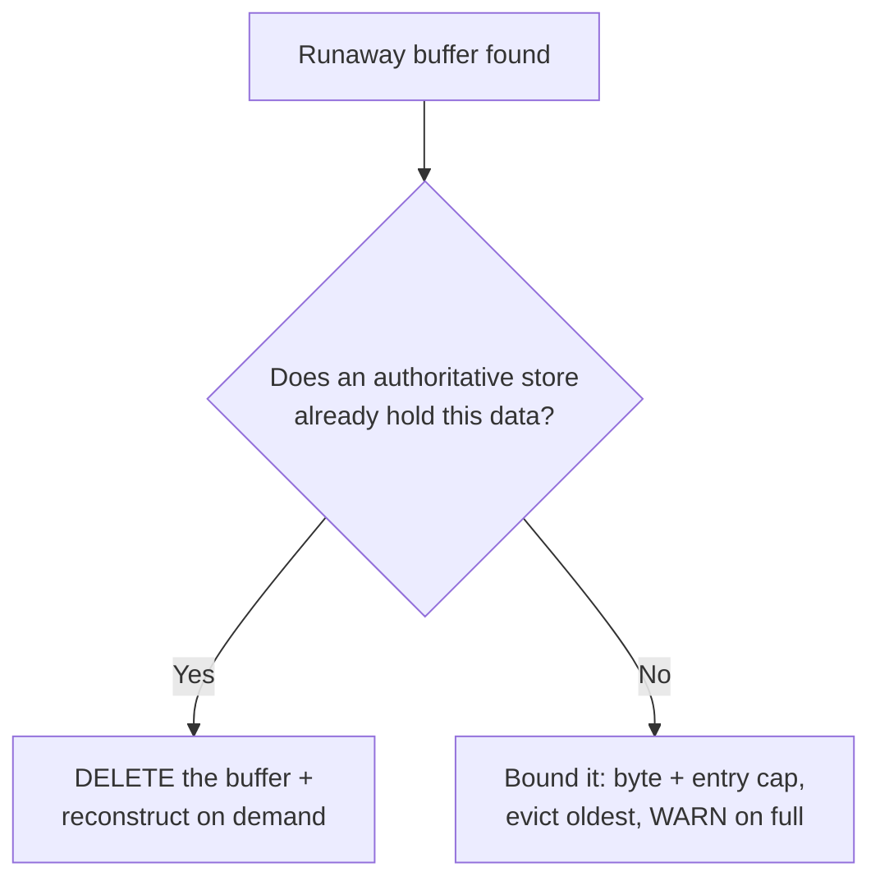
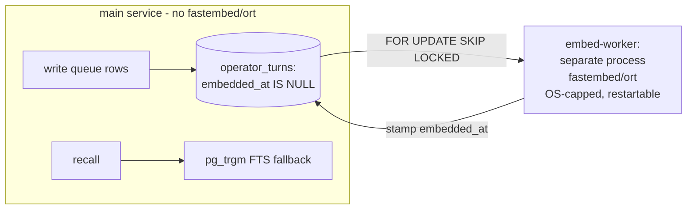

**Part III · Threads: bound-it, source-of-truth · Grounded by: [CS-3](../case-studies.md#cs-embeddings-oom)**

# 8. Memory & resource safety (+ heavy compute off-process)

A long-lived service that buffers traffic, accumulates streaming deltas, runs subprocesses, and (fatally) calls into a native ML library has a dozen growth paths, each one "locally reasonable." Stacked, they eat the machine. The rule: give every growth path a budget at *design* time, and keep the allocator you cannot control out of the process you cannot afford to lose. This chapter owns the memory facet of bounded accumulators, the delete-don't-cap decision, the in-flight-is-unsheddable trap, the limits of an in-process memory controller, the case for running heavy native/ML work out-of-process, and the general principle that explicit async teardown beats `Drop`. The companion incident — an in-process embedding model that drove RSS to ~18 GB and made the service start dropping live capture to relieve pressure it physically could not touch — is told once in [CS-3](../case-studies.md#cs-embeddings-oom); this chapter carries the lessons, citing signature numbers only where one turns on them.

---

## 1. Bound every accumulator, buffer, cache, and task pool from day one — with a byte budget, not just an entry count `[thread: bound-it]`

**Do this.** Give every in-memory growth path a named, enforced budget at design time: a byte cap, an entry cap, and an eviction policy. Cap by aggregate **bytes**, not only entry count — a 1000-entry cap means nothing when entries run to hundreds of MB. Cap spawned-task concurrency with a semaphore and a structured task set that aborts its children on drop, never unbounded bare spawns. Returning 429/503 on a full queue is correct backpressure, not an error to hide.

**Not this.** An unbounded `Vec<_>` that grows for the life of the process; one `Mutex` serializing all state with an O(n) scan on every event; capping by entry count while bytes run away.

**Why.** Entry counts and byte footprints diverge whenever entries share large, near-duplicate payloads. In temet-proxy the predecessor `proxyclawd` stored requests in an unbounded `Vec` behind a `Mutex` with an O(n) scan per event — flagged pre-rewrite as "will OOM." The rewrite still had to *retrofit* a bytes-aware budget onto its existing 1000-entry cap: consecutive primary-turn request bodies share hundreds of KB of prefix, so a long session wrote a near-redundant body per turn — N²-shaped growth the count cap never saw.

**Evidence.** `artifacts/research/proxyclawd-audit.md:20-26` (unbounded `Vec`, Mutex O(n) scan; fix = `RwLock` + HashMap-by-id + bounded capacity); `artifacts/proxy-memory-oom-mitigation/GAP-ANALYSIS.md:16-17` (~99% body redundancy, N²-shaped growth); commit `da35b09` "Phase 2 — bytes-aware store budget" (`max_store_bytes` default 3 GiB, eviction at insert + terminal + prune).

The *channel* backpressure mechanic (bounded `mpsc` + 429 on `Full`, JoinSet, semaphore-as-concurrency-cap) is owned by [ch. 7 — Async & concurrency](./07-T07-async-concurrency.md); the *config-driven cap default* by [ch. 14 — Configuration architecture](./14-T11a-config-architecture.md). This lesson owns the byte-vs-entry budgeting rule for in-memory stores.

**Pattern.**
```rust
// Cap by BYTES, not just entries — near-duplicate payloads make count caps lie.
struct StoreBudget { max_entries: usize, max_bytes: u64 }
// On insert/terminal/prune: evict oldest until BOTH caps hold.
// When nothing evictable remains, emit a WARN (back-pressure signal) — never silently drop.
```

---

## 2. Treat in-memory state as a bounded, evictable cache the durable store owns — never "load all history into RAM at boot" `[thread: source-of-truth, bound-it]`

**Do this.** Decide the durable schema before you lean on RAM, and make the durable store the source of truth for terminal data so every read endpoint queries it directly. Keep the in-memory structure as a bounded *live-staging* cache (`HashMap<Id, _>` for O(1) lookup + an order index + a fixed max capacity), guarded by a `RwLock` so reads don't serialize behind writes. Never ship a path that rehydrates all historical rows into memory at startup.

**Not this.** An in-memory store that treats RAM as the source of truth and reloads the whole corpus at boot. RSS then scales with corpus size and spikes multi-GB the moment a populated database starts.

**Why.** A boot-time rehydrate is a RAM bomb proportional to history, and the right fix is usually deletion, not a flag. In temet-proxy the rehydrate walk was the sole source of a multi-gigabyte boot-time spike on populated databases. It was first gated behind a default-off flag, then **deleted outright** once Postgres + BYTEA body columns became the source of truth — a cutover that was overwhelmingly removal (deletions outnumbering insertions ~10:1).

**Evidence.** `docs/ARCHITECTURE.md:237-251` "Bounded State with Eviction" (default 1000 cap, `RwLock` not `Mutex`, "Postgres + the BYTEA body columns became the source of truth", "boot-time rehydrate was deleted outright"); commit `76aa0a2` "Phase D — drop response_preview, store_size, delete rehydrate".

Where heavy work *should* live relative to the durable store is owned by [ch. 3 — Plan for the database from day one](./03-T03-db-planning.md); this lesson owns the "RAM is a cache, the DB is the truth, never rehydrate" rule.

---

## 3. When a buffer serves no purpose, DELETE it — don't cap it `[thread: source-of-truth, bound-it]`

**Do this.** Before adding a cap to a runaway buffer, ask whether the buffer should exist at all. If an authoritative store already holds the data and can reconstruct the derived view, the in-memory accumulator is pure risk — remove the field and reconstruct on demand. For the one path that genuinely lacks a backing store, write a single durable row so the *same* reconstruction path works everywhere, with no special-case in-memory branch.

**Not this.** Slapping an arbitrary cap ("cap it at 64 KB") onto a crash-causing accumulator while the authoritative copy of the same data already lives elsewhere. The cap papers over the redundancy and the wrong design survives.

**Why.** A cap on a buffer that duplicates a durable store leaves two problems: the redundant buffer and the fact that nobody asked why it existed. In temet-proxy a machine crash traced to unbounded in-memory `accumulated_text` growth for in-flight streaming requests. The proposed fix was a 64 KB cap; the operator rejected it as a bandaid. The real fix removed both the in-memory `accumulated_text`/`accumulated_thinking` fields *and* the DB columns — they served no purpose, because `response_stream_chunks` is the authoritative store with `string_agg` reconstruction. Non-streaming requests now write one chunk row at snapshot time so the fetch path is uniform.

**Evidence.** `artifacts/proxy-memory-oom-mitigation/SESSION-2026-05-13-review-and-cleanup.md:14-40` — C1 crash root cause (the pre-removal `accumulated_text.push_str` was unbounded for in-flight requests while the byte evictor only reclaimed terminal entries), and "Design Decision: Full Removal, Not Capping" ("Operator correctly rejected 'cap accumulated_text at 64KB' as a bandaid").

**Pattern.** Decision node, applied before reaching for a cap:


---

## 4. In-flight state is the dangerous case — an evictor that only reclaims completed work cannot relieve live pressure `[thread: bound-it]`

**Do this.** When you design an eviction policy, ask explicitly: what happens when the pressure comes from in-flight work, not completed work? If your evictor can only reclaim terminal/completed entries, bound the in-flight working set itself — cap simultaneous streams and backpressure new ones — rather than relying on post-completion eviction to save you.

**Not this.** A byte-budget evictor that walks oldest-first but skips non-terminal entries, so a handful of concurrent large in-flight operations blow past the budget with nothing evictable.

**Why.** Eviction that fires only after completion is blind to exactly the load that OOMs you — many large operations running *now*. In temet-proxy the crash in Lesson 3 was this shape: the byte evictor reclaimed only terminal entries, so concurrent Claude sessions each streaming large turns blew the budget with nothing evictable. The same shape recurred at embedding scale ([CS-3](../case-studies.md#cs-embeddings-oom)): the controller could shed only the in-memory store, so the concurrent embedding working set was unsheddable and the service degraded to dropping capture.

**Evidence.** `artifacts/proxy-memory-oom-mitigation/SESSION-2026-05-13-review-and-cleanup.md:14-17` (in-flight cannot be evicted; concurrent large turns OOM); commit `da35b09` body ("when every remaining entry is non-terminal or pinned, the store stays over budget and emits a WARN log line — back-pressure signal, not silent destruction").

---

## 5. A memory-pressure controller can only shed what it accounts for — keep the unsheddable allocator out of the process `[thread: bound-it]`

**Do this.** A controller that polls process RSS (`getrusage`) and, above a high watermark, sheds memory in priority order — with a per-implementor timeout and hysteresis to damp oscillation — is worth having. Designate the ingest/capture path **Critical — never shed**; relieve pressure by admission-throttling (503 + `Retry-After`) *new* work, never by corrupting in-flight work. Define a priority variant only when a real implementor constructs it (no dead enum variants). Crucially, the controller is necessary but **not sufficient** — it can only reclaim memory it allocated and tracks.

**Not this.** Trusting a controller that accounts only for its own allocations to protect you from a native-library arena (ONNX/C++) it cannot see. It will log `bytes_freed=0` while RSS stays pinned, then escalate to shedding live work it should never touch.

**Why.** The controller's blind spot — not its existence — is the headline. In temet-proxy the RSS cap manager ships a `Sheddable` trait, priority buckets, and capture-path admission throttling, and during the embedding OOM it did exactly what it was built to do. It still wasn't enough: it accounts and sheds only the in-memory `RequestStore`, while the ONNX-side C++ arena is invisible to it. It logged `bytes_freed=0`, throttled admission, and began forwarding without capture — relieving pressure it physically could not touch. A flat RSS ceiling, not a rising curve, is the signature of a bounded-but-huge native working set the controller cannot reach.

**Evidence.** Commit `b0ca4ab` "W1.22 — global RSS cap manager + Sheddable trait"; `crates/claude-proxy/src/memory_cap/sheddable.rs:11-22` (priority table: `RequestStore`=High/evict-terminal, `ComposeService`=Medium/refuse-new, pagination governors=Low, Capture=Critical "NEVER shed"); `crates/claude-proxy/src/proxy/handler.rs:541-546` (`is_capture_admission_throttled()` → "memory pressure — forwarding without capture"); `crates/claude-proxy/src/config/mod.rs:595` and `:785-796` (`capture_admission_throttled: Arc<AtomicBool>`); `docs/ROADMAP.md:35` (accounts/sheds only the in-memory `RequestStore`; ONNX-side C++ memory unaccounted); `crates/claude-proxy/src/memory_cap/sheddable.rs:42-49` (`ShedPriority` ships only the `Medium` variant — the High/Low/Critical rows in the doc table are enforced via other mechanisms, not constructed variants; the "no dead enum variants" discipline makes that intentional, not unfinished).

The full account of *what the controller was blind to* and *why it surfaced as `bytes_freed=0`* is owned by [ch. 10 — Observability & inspection fidelity](./10-T09-observability-fidelity.md): turn the per-field memory-attribution surface on *before* enabling a heavy allocator, so you can split RSS into tracked Rust working-set vs. untracked native arena. This lesson owns the controller's priority/shedding design and its accounting boundary.

**Pattern.**
```rust
// Critical paths are never shed — they admission-throttle NEW work instead.
if state.is_capture_admission_throttled() {
    // forward upstream WITHOUT capture: inspection degrades, the call to Anthropic does not.
    // A partial-body forward would violate byte-identity, so in-flight is left untouched.
}
```

---

## 6. `spawn_blocking` relieves the runtime but does NOT isolate memory — run heavy native/ML work in a separate OS-capped, restartable process `[thread: bound-it, source-of-truth]`

> **DECIDED — NOT shipped.** The incident is real and the direction (an out-of-process worker) is the decided target, validated by the OOM; it is **not running code**. Embeddings are reverted to OFF and the in-process drivers are slated for removal at the worker cutover. An in-process entry point (`store::operator_turns::embed_closed_pending`) and the queue-contract test exist; what is **not** shipped is the *separate, OS-capped, restartable process*. The SKIP-LOCKED queue SQL is the *target contract* — pinned by `tests/integration/embed_worker.rs` (closed-only / idempotent-via-`embedded_at` / SKIP-LOCKED), not yet a deployed component.

**Do this.** Run unbounded native/ML workloads (ONNX, fastembed, image/video codecs) out-of-process: a standalone worker the main service drives over a DB queue, single-flight, OS-memory-capped (`ulimit -v` / cgroup), independently restartable — if it bloats, killing it never touches the main service. Make the database the queue (`... WHERE done_at IS NULL ... FOR UPDATE SKIP LOCKED`) so the worker is idempotent and multi-process-safe, and keep a cheap fallback (pg_trgm FTS for recall) so the service degrades gracefully when the worker is down.

**Not this.** Assuming `spawn_blocking` (or "just don't do it on the hot path") makes a memory-hungry native library safe. A blocking task still shares the process heap; a library with no arena-release knob can pin or grow RSS for the life of the process even when it never touches the request path. Driving it from the request hot path with N-wide fan-out over a cold backlog turns this into an instant OOM.

**Why.** `spawn_blocking` moves work off the async reactor's threads — it changes *where the CPU runs*, not *whose heap the allocation lives in* (the [tokio docs](https://docs.rs/tokio/latest/tokio/task/fn.spawn_blocking.html) describe it purely as running a closure "on a thread where blocking is acceptable" and make no memory-isolation claim). In temet-proxy ([CS-3](../case-studies.md#cs-embeddings-oom)) enabling `[embedding] enabled = true` drove RSS to ~18 GB. Embeddings ran in-process via fastembed → ONNX, *already using `spawn_blocking`*, driven from a write-path "embed nudge"; a large cold backlog became eligible at once, RSS pinned flat, and the reclaim path was dropping the model or killing the process. (ONNX Runtime's C++ engine does expose an opt-in per-`Run()` arena-shrink, but fastembed's Rust binding surfaces none of those controls — from the proxy's vantage there is no knob.) The decided direction is an out-of-process worker ticking the existing DB queue, single-flight, OS-capped, restartable, with the pg_trgm recall fallback kept.

**Evidence.** `docs/ROADMAP.md:23-43` "CRITICAL FINDING — In-process embeddings OOM'd the proxy (2026-05-30)" (marked 🔴 UNRESOLVED, embeddings DISABLED, out-of-process worker direction); `crates/claude-proxy/src/analysis/embeddings.rs:270,276` (inference via `spawn_blocking`; `ensure_model` caches `Arc<TextEmbedding>` for process life); `crates/claude-proxy/src/config/mod.rs:922` (`embedding_permits = available_parallelism()`); `crates/claude-proxy/src/store/mod.rs:735-744` (write-path embed nudge, semaphore-bounded); `artifacts/2026-05-30/embedding-safe-design.md:1-59` (out-of-process worker design, SKIP-LOCKED queue contract, OS cap, FTS fallback); `crates/claude-proxy/tests/integration/embed_worker.rs` (the committed test pinning the queue SELECT contract); memory `warning_embeddings_oom_inprocess.md`; commit `b71a1f6` "docs(roadmap): record in-process embeddings OOM incident + worker direction".

The placement decision — *which side of the durable store* heavy work belongs on — is owned by [ch. 3 — Plan for the database from day one](./03-T03-db-planning.md); the hot-path-purity contract this violated is owned by [ch. 2 — The hot path & passthrough discipline](./02-T02-hot-path-passthrough.md). This lesson owns the `spawn_blocking`-is-not-memory-isolation rule and the out-of-process-worker target shape.



**Pattern (target contract — the queue, not shipped code).**
```sql
-- The DB IS the queue. Idempotent (embedded_at), multi-process-safe (SKIP LOCKED).
SELECT t.turn_id /* ... */ FROM claude_proxy.operator_turns t
 WHERE t.closed_at IS NOT NULL AND t.embedded_at IS NULL
 ORDER BY t.closed_at ASC LIMIT $1
 FOR UPDATE OF t SKIP LOCKED;
-- The worker (separate process; fastembed/ort live HERE, OS-capped) claims, embeds, stamps embedded_at.
-- The main service: writes queue rows, holds NO fastembed/ort, recall falls back to pg_trgm FTS.
```

---

## 7. Prefer explicit async teardown; treat `Drop` as a best-effort panic-path net only `[thread: source-of-truth]`

**Do this.** Resource teardown that can fail — dropping a database, closing a pool, flushing a buffer — should be an explicit async `cleanup()` that the happy path calls, so errors surface through `Result` rather than a swallowed `tracing::warn!`. Make it idempotent (a `cleaned_up` flag) so the explicit call and a fallback `Drop` don't double-fire. Keep a `Drop` impl only as a panic-path safety net — and for async resources it must spin a fresh single-thread runtime on a *new* OS thread, because the caller's runtime may be mid-shutdown when `Drop` fires (`Handle::current()` is unsafe there).

**Not this.** Relying solely on `Drop` for async resource teardown. It silently cancels under a mid-shutdown runtime, hides failures behind a log line, and cannot propagate errors to the caller who could have retried or failed loudly.

**Why.** `Drop` runs in a context you don't control — possibly during runtime teardown — and its signature has nowhere to return an error; the teardown that *must* succeed cannot live only there. In temet-proxy the per-test ephemeral-DB handle models the discipline, but the rule is general to any async resource: `cleanup()` is the explicit path callers prefer, and `Drop` is documented as a best-effort panic-path net that spins a dedicated runtime on a background OS thread. The testing rules codify it: "Explicit cleanup preferred… the `Drop` impl is a best-effort safety net for panic paths… cannot propagate errors."

**Evidence.** `crates/claude-proxy/src/store/persistence/test_support.rs:170-181` (`cleanup()` explicit, idempotent via `cleaned_up`); `:193-208` (`Drop` spins a fresh single-thread runtime on a new OS thread; documents that the caller's runtime may be mid-shutdown); `:37-43` (module docs: cleanup preferred, neither path panics); `.claude/rules/testing.md:149` (rule 7 — explicit cleanup preferred over `Drop`).

[ch. 11 — DB-backed test isolation](./11-T10a-db-test-isolation.md) points here for the general principle and applies it to the per-test database instance; this chapter owns the general "explicit async teardown > `Drop`" rule.

**Pattern.**
```rust
pub async fn cleanup(mut self) -> anyhow::Result<()> {
    if self.cleaned_up { return Ok(()); }              // idempotent
    drop_database(&self.admin_url, &self.db_name).await?;  // errors surface
    self.cleaned_up = true; Ok(())
}
impl Drop for ResourceHandle {                         // panic-path net only
    fn drop(&mut self) { if self.cleaned_up { return; } /* fresh runtime on new OS thread */ }
}
```

---

## Further reading

- [Nygard, *Release It!* — Back Pressure / Shed Load / Steady State / Bulkhead / Fail Fast](https://pragprog.com/titles/mnee2/release-it-second-edition/) — the stability-pattern vocabulary behind most of this chapter: every queue/buffer needs a bound and must reject work past it (REINFORCES Lesson 1's 429/503-on-full); a long-lived process must run without accumulating unbounded state (Steady State REINFORCES Lesson 2's no-rehydrate rule); partitioning a fixed working set (Bulkhead REINFORCES Lesson 4); admission-throttling new work instead of corrupting in-flight (Fail Fast REINFORCES Lesson 5).
- [Linux kernel — cgroup v2 memory control (`memory.high`, `memory.max`, OOM)](https://www.kernel.org/doc/html/latest/admin-guide/cgroup-v2.html) — the OS analogue and the honest indictment: `memory.high` throttle-under-reclaim REINFORCES Lesson 1's bound-and-pressure, but QUALIFIES Lesson 5 — `memory.max` accounts for *all* memory in the cgroup including the native C++ arena the in-process controller logged as `bytes_freed=0`, so an OS cap was always the correct enforcement layer for memory the process doesn't allocate (which is exactly Lesson 6's worker).
- [Linux kernel — Memory Management concepts (OOM killer)](https://www.kernel.org/doc/html/latest/admin-guide/mm/concepts.html) — when nothing is reclaimable the kernel kills a task; REINFORCES Lesson 4/5's flat-RSS-ceiling signature, the reason graceful shedding could not save the process.
- [tokio docs — `task::spawn_blocking`](https://docs.rs/tokio/latest/tokio/task/fn.spawn_blocking.html) — makes no heap/memory-isolation claim, only a thread-placement one; the *absence* of an isolation claim is the evidence for Lesson 6.
- [ONNX Runtime docs — memory arena behaviour](https://onnxruntime.ai/docs/get-started/with-c.html) — "memory arenas do not shrink… once allocated it always remains allocated" REINFORCES Lesson 6's reclaim-only-by-killing-the-process; QUALIFIES the wording — ORT *does* expose an opt-in per-`Run()` arena-shrink, so the precise claim is that *fastembed's binding* exposes no knob, not that ONNX has none.
- [The Rust Programming Language — Running Code on Cleanup with the `Drop` Trait](https://doc.rust-lang.org/book/ch15-03-drop.html) — QUALIFIES Lesson 7: confirms `drop` runs automatically when a value leaves scope and its `fn drop(&mut self)` signature returns nothing (no error channel), which is *why* the chapter routes fallible async teardown through an explicit `cleanup() -> Result`; the Book itself does not discuss async or fallibility — that operational conclusion is the chapter's own.
