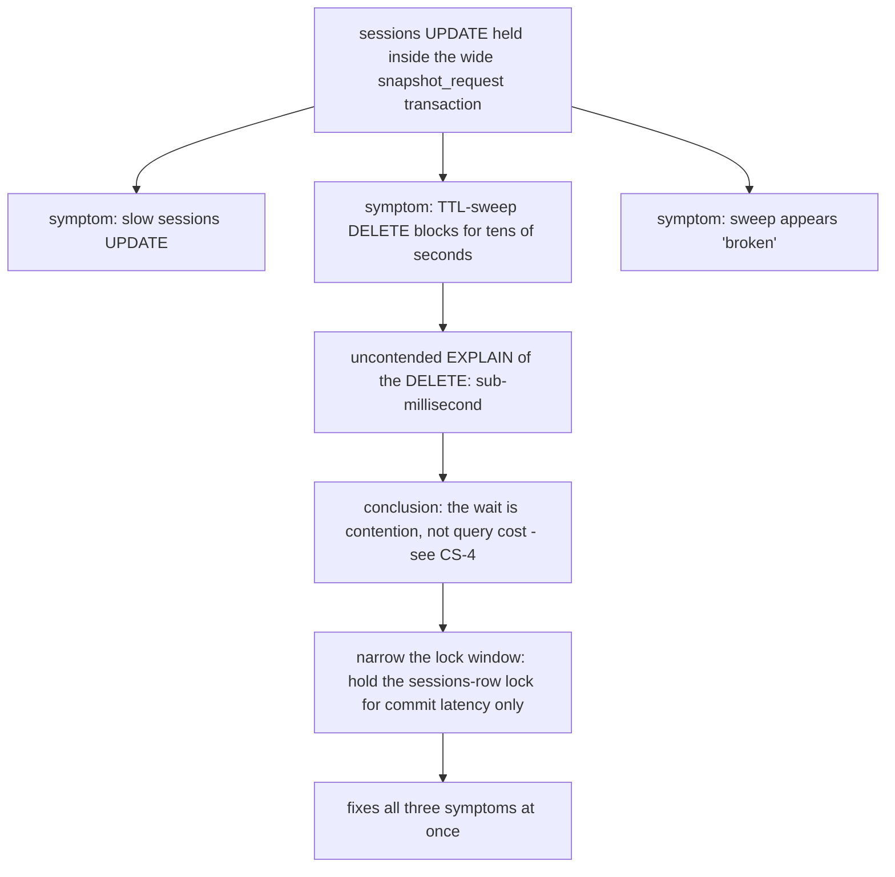

**Part III · Threads: deterministic-enforcement, bound-it, source-of-truth · Grounded by: [CS-4](../case-studies.md#cs-mvcc-cascade)**

# 9. Error-handling architecture

Most Rust error-handling advice stops at "use `Result`, use `?`" — table stakes. The lessons that cost a service its uptime and its data live one layer down: a `unwrap()` on a malformed header panics the process; a `warn!`-ed-and-dropped error on a fire-and-forget write turns a failed insert into a `200 OK` with no row; and when several operations on one table go slow together, optimizing each query in isolation chases shadows while one upstream lock holder stalls everything. This chapter makes failures **loud, typed, and impossible to swallow** — enforced by the compiler and the schema where possible, by discipline only where it must be — and teaches the habit of finding the *one* cause before patching its many symptoms.

What this chapter does *not* re-narrate: the persistence-layer *fix* for the MVCC cascade (narrowing the transaction) belongs to [ch. 6 — Persistence boundary](./06-T05-persistence-boundary.md); the snapshot-skew `RowNotFound` *mechanism* to [ch. 7 — Async & concurrency](./07-T07-async-concurrency.md); the *proof* technique (uncontended `EXPLAIN` to separate wait from work) to [ch. 10 — Observability fidelity](./10-T09-observability-fidelity.md); the Postgres timeout *backstop* to [ch. 15 — Ops & deploy safety](./15-T11b-ops-deploy-safety.md). This chapter owns the **diagnostic method** and the **error-handling discipline** on top of all four.

---

## 1. Ban `unwrap`/`expect` and blocking-in-async with a deny-lint, not vigilance `[thread: deterministic-enforcement]`

**Do this.** Make `unwrap()`/`expect()` in production code a *compile error* via a workspace-wide deny-lint, so the panic path is unwriteable without a named, reasoned escape. Keep async hygiene in the same posture: forbid `std::sync::Mutex`/`std::fs` in async code and never hold a lock guard across `.await`. Reserve `expect` for genuine boot invariants you *want* to crash on, never for hot-path values like header parsing — and when you use it, make the allow explicit and self-documenting with a `reason`.

**Not this.** Trusting code review to catch `response_builder.header(...).unwrap()` or `expect("Failed to generate CA")`. Vigilance does not scale — the 200th PR reintroduces the unwrap, and one malformed inbound header then panics the entire service in production.

**Why.** The predecessor project (`proxyclawd`) shipped exactly these; the audit flagged them verbatim as "These would crash in production." The structural response was to make them un-writable — every escape carries a `reason`, which is the proof the deny is load-bearing rather than aspirational. This is the deterministic-enforcement thread in its purest form: a compile error, not a review comment.

**Evidence.** Workspace toolchain config line 5 — `rustflags = ["-D", "clippy::unwrap_used", "-D", "clippy::expect_used"]`; a live named escape at `crates/claude-proxy/src/filter/mod.rs:560-563`. Origin: `artifacts/research/proxyclawd-audit.md:28-34`. Strictness lives in the workspace toolchain config `rustflags` (and the Makefile clippy invocation), **not** a `[workspace.lints]` Cargo section — there is none.

**Pattern.**
```toml
# Workspace toolchain config — workspace-wide deny; escapes must be named with a reason
[target.'cfg(all())']
rustflags = ["-D", "clippy::unwrap_used", "-D", "clippy::expect_used"]
```

## 2. Split error types by layer: `thiserror` for typed domains, `anyhow` for binaries, `IntoResponse` for HTTP `[thread: deterministic-enforcement]`

**Do this.** Split by *whether a caller matches* on the failure, not by crate. Use `thiserror` enums wherever a caller matches — the domain/persistence layer and the HTTP handlers that map failures to status codes; `#[from]` so `?` propagates from `sqlx`/`serde` sites, `#[source]` to preserve the causal chain. Implement `IntoResponse` once on the handler-facing error. Keep the hot-path error type *separate* from the persistence error type so the fast path never pattern-matches on DB variants it can't act on. In binaries and internal plumbing, use `anyhow` with `.context()` at every boundary.

**Not this.** One app-wide mega-enum, `Box<dyn Error>` as the universal return, or stringly-typed errors — and losing the failing operation because no `.context()` was attached to the `?`.

**Why.** The `proxyclawd` audit named `.context()` discipline as one of the few things that *worked* ("errors don't get lost"). This repo splits the hot-path error (owns the HTTP mapping) from the persistence error, "deliberately kept separate … so that the hot proxy path never sees persistence-layer variants" — which is what lets the fast path stay a small, exhaustive match.

**Evidence.** `crates/claude-proxy/src/error.rs:6-28` — `ProxyError` enum + `IntoResponse` mapping variants to 502/400/500, `#[source]` on the reqwest error. `crates/claude-proxy/src/store/persistence/error.rs:1-68` — `PersistError` with `#[from]` for `sqlx::Error`/`MigrateError`/`serde_json::Error`; the module doc states the deliberate separation. Origin: `artifacts/research/proxyclawd-audit.md:16`.

**Pattern.**
```rust
#[derive(Debug, thiserror::Error)]
pub(crate) enum ProxyError {
    #[error("upstream connection failed: {0}")]
    UpstreamConnect(#[source] reqwest::Error),
    #[error("internal: {0}")]
    Internal(String),
}
impl IntoResponse for ProxyError {
    fn into_response(self) -> Response {
        let (status, msg) = match &self {
            ProxyError::UpstreamConnect(_) => (StatusCode::BAD_GATEWAY, "upstream unreachable"),
            ProxyError::Internal(_)        => (StatusCode::INTERNAL_SERVER_ERROR, "internal error"),
        };
        tracing::error!(error = %self, "proxy error");
        (status, Json(json!({ "error": msg }))).into_response()
    }
}
```

## 3. Never swallow a fire-and-forget write error — a swallowed write is a 2xx with no row `[thread: source-of-truth]`

**Do this.** For every `if let Err(e) = op().await { warn!(...); }`, apply one test: *if this swallow AND its recovery path both fail, does the operator get any observable signal?* If "no," do not swallow — propagate, retry the known-transient classes, or surface a counter. When a swallow is justified, name the recovery path in a comment so the next reader can verify it still exists. This matters most on **early-write / fire-and-forget** paths where the HTTP response is produced independently of persistence: a dropped DB error there yields a successful-looking 2xx with no persisted record — silent data loss no client and no log line will ever flag.

**Not this.** `warn!`-and-return on a write failure in a path whose success the client has already observed. Both early-write sites in this repo did exactly that; a transient skew on one id handed the client a 2xx with no `requests` row.

**Why.** The concurrent-settle incident — five concurrent same-session POSTs, four of five `requests` rows committed, all returning 2xx — dropped a `RowNotFound` on the projects upsert at both fire-and-forget sites. The `RowNotFound` *mechanism* (READ COMMITTED snapshot skew) belongs to [ch. 7 — Async & concurrency](./07-T07-async-concurrency.md); the discipline — *don't swallow the write error in the first place* — is owned here. No shared `with_retry` helper exists in-repo; the bounded-retry fix is **prescribed, not yet committed**, so treat the retry as a greenfield primitive to design, not a transplant.

**Evidence.** `artifacts/2026-05-30/concurrent-settle-dropped-write-rootcause.md:32-36` — error "swallowed at BOTH fire-and-forget early-write sites … → 2xx with no persisted `requests` row." Memory: `warning_error_swallow.md` (the double-failure test, justified-vs-unjustified table) and `debugging_projects_cte_snapshot_skew.md` (swallowed → fix = retry on `RowNotFound` + stop swallowing).

**Pattern.**
```rust
// A justified swallow MUST name its recovery in a comment:
// OK to drop here: the terminal write path re-attempts this insert (see Phase 11 loop);
// a double failure there increments the dropped-write counter, so the operator has a signal.
// If you cannot name a recovery that surfaces a signal on double-failure, do NOT swallow.
```

## 4. Reproduce the exact mechanism before changing write logic — never mask a dropped write with a wider `ON CONFLICT` or a longer timeout `[thread: deterministic-enforcement]`

**Do this.** In data-loss-critical paths, confirm the *precise* mechanism with structural evidence before touching write logic — the exact SQLSTATE (or its absence), which statement, the timing signature. Distinguish separable causes that present identically: an allocator id collision, a transient serialization abort, and a snapshot-visibility race all look like "a missing row," and ruling each in or out *is* the work. Only then choose a fix that addresses the confirmed cause.

**Not this.** Reaching for the convenient mask. A wider `ON CONFLICT DO UPDATE`, a longer `lock_timeout`, or a bigger test timeout hides the symptom while the silent drop persists — and can trade one bug for a worse one.

**Why.** This is the cleanest worked example of "reproduce before you mask." The investigation first suspected allocator collision and lock-wait; instrumented runs ruled both out (ids all distinct, every DB call 86–285 ms, no timeout firing) and isolated a `RowNotFound` snapshot skew with **no SQLSTATE at all** — a `.fetch_one()` returning zero rows from an `INSERT … ON CONFLICT DO NOTHING … RETURNING` plus a same-statement `SELECT` under READ COMMITTED. The trap: widening the `ON CONFLICT` to `DO UPDATE … RETURNING` would have made the symptom vanish *by re-introducing the per-request projects-row lock the `DO NOTHING` change had just removed* — masking the drop while re-creating the 1 s+ stalls of the very contention bug Lesson 5 is about.

**Evidence.** `artifacts/2026-05-30/concurrent-settle-dropped-write-rootcause.md:8-43` — "SQLSTATE: none … client-side `sqlx::Error::RowNotFound`"; "Do not chase `lock_timeout`: every observed DB call was 86–285ms." Same file `:56-69` — "Allocator collision (a): RULED OUT. All ids distinct every run." Memory `debugging_projects_cte_snapshot_skew.md` — "Do NOT 'fix' it with `ON CONFLICT DO UPDATE … RETURNING` — that re-introduces the per-request projects-row lock the DO NOTHING removed."

## 5. A cluster of slow ops on one table = one lock holder — find it before optimizing any query `[thread: deterministic-enforcement]`

**Do this.** When several *different* operations on one table go slow at once — a slow `UPDATE` on session X, a slow `DELETE` on the sweep, a slow `SELECT … FOR UPDATE` on session Y — stop and look for a *single* long-running transaction holding row locks. The diagnostic tell is a cluster of failures (slow statements, lock waits, even dropped writes) that share one mechanism. Prove it is contention, not cost, by running the slow statement *uncontended*: if `EXPLAIN ANALYZE` completes fast in isolation, the production slowness was **wait, not work**, and tuning the query is wasted effort.

**Not this.** Treating slow-`UPDATE`, lock-timeout, and "broken sweep" as three separate bugs and band-aiding each. Stacked band-aids multiply fragility and never touch the cause — and a reactively-tuned query that was never slow on its own is pure motion.

**Why.** [CS-4](../case-studies.md#cs-mvcc-cascade). One `sessions` UPDATE held inside a wide snapshot transaction produced three distinct symptoms at once — a slow `UPDATE`, a sweep `DELETE` that blocked for tens of seconds, and an apparently "broken" sweep — yet that same `DELETE` ran sub-millisecond uncontended. That one contrast (tens of seconds contended vs sub-millisecond alone) is the whole diagnosis: the wait was contention, not query cost. The diagnostic method is owned here; the *fix* (narrow the lock window — move the `sessions` UPDATE to immediately before `commit`) belongs to [ch. 6 — Persistence boundary](./06-T05-persistence-boundary.md), the uncontended-`EXPLAIN` proof technique to [ch. 10 — Observability fidelity](./10-T09-observability-fidelity.md), and the `lock_timeout` / `idle_in_transaction_session_timeout` backstop that bounds the blast radius to [ch. 15 — Ops & deploy safety](./15-T11b-ops-deploy-safety.md).

**Evidence.** Memory `project_mvcc_cascade.md` — "ONE architectural mistake … produces MULTIPLE distinct symptoms … find the lock holder" (the 1.117 s / 30.098 s signature lives in [CS-4](../case-studies.md#cs-mvcc-cascade)). The shipped narrowing is at `crates/claude-proxy/src/store/persistence/mod.rs:1781-1797`. Memory `warning_snapshot_request_tx.md` — "its scope is already too wide; do not add more writes."



## 6. Encode correctness in the type system — enums as state machines, newtypes, exhaustive match `[thread: deterministic-enforcement]`

**Do this.** Model closed sets of states as enums, so the compiler forces every site to handle each variant *and breaks the build when you add one*. Wrap primitive IDs in newtypes so a `RequestId` and a `UserId` cannot be transposed at a call site. Keep struct fields private behind constructors. Prefer making invalid states unrepresentable over validating them at runtime — that *deletes* the test rather than passing it. Start concrete; add generics or trait objects only at the second real use.

**Not this.** A struct with `event_type: String` plus a pile of `Option` fields requiring runtime validation; bare `u64` IDs swappable at call sites; generic-parameter explosion for unproven flexibility.

**Why.** The closed Claude SSE event taxonomy (eight types, `message_start` … `error`) is the canonical "this should be an enum" example: with an enum, adding a ninth type produces compile errors at every match site, so no handler can silently miss it; with `event_type: String` it slips through and fails at runtime on production traffic. Making illegal states unrepresentable is, as the project's developer guide puts it, the most powerful testing technique — the test you delete is one you can never forget to run ([King — "Parse, don't validate"](https://lexi-lambda.github.io/blog/2019/11/05/parse-don-t-validate/)). The same deterministic-enforcement instinct moves down a layer in the schema: a `CHECK` constraint or an `FK` is "make illegal states unrepresentable" expressed in DDL — see [ch. 4 — Schema design](./04-T04a-schema-design.md).

**Evidence.** `artifacts/research/rust-developer-guide.md:240-252` — "Enums as State Machines," the `SseEvent` enum, the "adding a variant produces compile errors" note, and the `event_type: String` + `Option` anti-pattern. Same file `:497-499` — "making illegal states unrepresentable is the most powerful testing technique." `artifacts/research/claude-api-wire-protocol.md:36-80` — the closed 8-event SSE taxonomy.

## 7. Bound hot-path and untrusted inputs — or record the accepted-risk rationale in the review `[thread: bound-it]`

**Do this.** Any input the request hot path walks on *every* call (filter-rule length, rule count, matched-text span) needs an upper bound — one oversized value or runaway count degrades every proxied request, not just the offending one. If a team consciously defers a bound, record it as an *accepted risk with rationale* in the review, so the next reviewer sees a decision rather than re-discovering a gap. Separately, validate untrusted text for control/bidi/NUL codepoints (log-spoofing and `pg_dump` hazards) and validate structural inputs (e.g. that an XML tag name is a legal element name) so a malformed rule fails *loudly* instead of silently never matching. This is where security lands in this chapter — bounding untrusted hot-path inputs; see [ch. 2 — Hot path & passthrough](./02-T02-hot-path-passthrough.md) for the byte-identity facet, and [ch. 8 — Memory & resource safety](./08-T06-memory-resource-safety.md) for the same bound-it instinct applied to buffers and accumulators.

**Not this.** Unbounded hot-path inputs; silently skipping a bound with no recorded rationale; accepting NUL/bidi codepoints into stored text; case-sensitive `UNIQUE` on identity keys, so two near-identical identities render as the same row.

**Why.** The prompt-filter remediation review and the DB performance audit both surfaced these. The bounds were *deliberately* deferred — and the review preserved the rationale trail rather than dropping the finding, which is the behaviour to copy: a deferred bound is acceptable only when it is a visible, signed-off decision, never an accident.

**Evidence.** `artifacts/reviews/feature-prompt-filter-remediation.md:32-33` (W2/W3 "No upper bound … *accepted risk, log-only*") and `:460-525` (the rationale trail kept for the next reviewer); S4/S5 at `:1072`/`:1082` (NUL/bidi codepoints in `value`; XML value not validated as an element name). `artifacts/reviews/db-performance-audit-2026-04-30.md` §M5 `:669-688` — case-sensitive `UNIQUE` on `agents.name` renders two identities the same (framed as a recommended fix, not shipped).

## 8. Don't swallow errors in test helpers either — dead cleanup masks the very regression the test exists to catch `[thread: source-of-truth]`

**Do this.** With per-test ephemeral databases (see [ch. 11 — DB-backed test isolation](./11-T10a-db-test-isolation.md)), post-test cleanup that walks the API and `DELETE`s rows is dead work — delete it, and leave a header note so it is not reintroduced. Tighten loose assertions while there: after a "non-empty" assert, assert the *exact* expected count rather than indexing `[0]` and hoping.

**Not this.** A cleanup helper that catches failures with `eprintln!`-and-continue. This is Lesson 3's defect relocated into the test layer, where it is worse: when the PR under review *adds* a DELETE endpoint, the swallow disarms the exact test meant to catch a DELETE regression.

**Why.** The prompt-filter remediation review (W14/W15): `cleanup_test_rules()` GETs and per-id DELETEs, swallowing failures with `eprintln!` — dead on ephemeral DBs and hiding a DELETE regression. The fix deleted the helper, its 19 call sites, and added a header note.

**Evidence.** `artifacts/reviews/feature-prompt-filter-remediation.md:888-922` — W14 "`cleanup_test_rules()` is dead + swallows errors; a regression in DELETE is silently masked by the `eprintln!` catch." Same file `:45` — W15 "Only `received[0]` checked after non-empty assert."

## Further reading

- [The Rust Programming Language — "To `panic!` or Not to `panic!`"](https://doc.rust-lang.org/book/ch09-03-to-panic-or-not-to-panic.html) — reinforces Lesson 1: the Book confines `unwrap`/`expect` to cases where a panic is genuinely warranted; the deny-lint is that editorial rule turned into a compile error rather than reviewer judgment.
- [dtolnay/anyhow — "Comparison to thiserror"](https://github.com/dtolnay/anyhow#comparison-to-thiserror) — reinforces Lesson 2 (with a finer cut): the README's lib-vs-app split is the same instinct, but this chapter splits by *whether a caller matches*, applying the rule per-layer inside one binary rather than per-crate.
- [docs.rs/anyhow — `Context` trait](https://docs.rs/anyhow/latest/anyhow/trait.Context.html) — reinforces Lesson 2's "`.context()` at every boundary": the documented mechanism for attaching where-it-went-wrong context to a propagated error.
- [Linux kernel — coding-style: centralized exiting of functions](https://www.kernel.org/doc/html/latest/process/coding-style.html#centralized-exiting-of-functions) — qualifies Lessons 1–2 by divergence: the kernel's `goto cleanup` + negative-`errno` convention is the *manual* reconstruction of what Rust's `Result`/`?`/RAII give for free, because C has none of them. It is the negative space this chapter's typed-error discipline fills, not agreement.
- [PostgreSQL docs — Explicit Locking (row-level locks)](https://www.postgresql.org/docs/current/explicit-locking.html) — reinforces Lesson 5's *mechanism*: "other transactions that attempt UPDATE, DELETE, SELECT FOR UPDATE … will be blocked until the current transaction ends," which is exactly why one wide transaction's row lock makes several different statements on that table go slow at once. The uncontended-`EXPLAIN` diagnostic method is the chapter's own.
- [King — "Parse, don't validate"](https://lexi-lambda.github.io/blog/2019/11/05/parse-don-t-validate/) — reinforces Lesson 6, strongly: the canonical argument that making illegal states unrepresentable *deletes* the runtime check ("its result is actually necessary for the program to proceed"), grounding the SSE-enum-vs-`String` example.
- [Boucher & Anderson — "Trojan Source: Invisible Vulnerabilities" (CVE-2021-42574)](https://trojansource.codes/) — reinforces the validation half of Lesson 7 with a venue transfer: Trojan Source is bidi/control codepoints in *source code* read by a compiler; this lesson bounds the same threat class (text whose rendered form lies about its bytes) in *stored and logged data* (log-spoofing, `pg_dump` hazards).
- [Nygard — *Release It!* — Bulkheads / bound your resources](https://pragprog.com/titles/mnee2/release-it-second-edition/) — reinforces the bounding half of Lesson 7: an unbounded hot-path input is a shared failure domain, degrading every request rather than just the offender — the bulkhead instinct expressed as input bounds.
