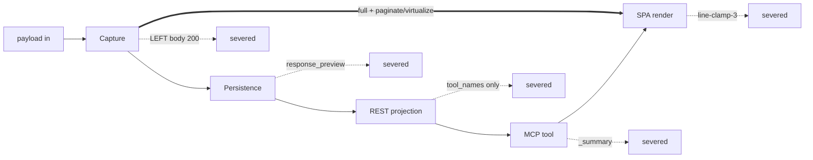

**Part IV · Threads: source-of-truth, bound-it, deterministic-enforcement, evidence-over-attestation · Grounded by: [CS-4](../case-studies.md#cs-mvcc-cascade), [CS-3](../case-studies.md#cs-embeddings-oom), [CS-5](../case-studies.md#cs-agent-forensics)**

# 10. Observability & inspection fidelity

A system whose job is to *see things* — a proxy, an audit log, a debugger, an orchestration-capture layer — has one non-negotiable contract: **full fidelity is the default and silence is a bug.** Truncation, missing drill-downs, capture paths that fire only on a special case, and silent resource caps each look locally reasonable, and each individually destroys the one byte the analysis later needed. Stacked across capture → persistence → REST → MCP → UI, they make data the system already holds unrecoverable. Observability is not a dashboard you bolt on at the end; it is a set of structural choices — full payloads, drillable counters, day-one instrumentation, observe-don't-mutate — cheap on day one and unrecoverable in a post-mortem.



---

## 1. Make full fidelity the default; truncation is an explicit, paginatable opt-in with a same-call-site escape hatch `[thread: source-of-truth]`

**Do this.** On any inspection/debug/analysis surface, render and return the *full* payload by default. If you must bound output, bound it through honest pagination (`offset`/`limit`/`cursor`/`since_id`) where each returned record is *complete* — the slice is honest because it says "rows N..M," not "all rows but each one shorter." Virtualization is fine: the data structure stays full and only the visible window mounts. A hard cap on a genuinely unbounded stream is allowed only when it (a) surfaces a structured `*_truncated: bool` flag, (b) keeps the full bytes in persistent storage, and (c) exposes a full-content retrieval path reachable from the *same call site*.

**Not this.** Each layer independently adding a "locally reasonable" cap — a 200-char prompt preview, a `response_preview` column that slices the full text, `LEFT(body, 200)` at write time, a silent multi-MiB stream cap, a 200-char cap on a diagnostic span, `line-clamp-3` / `.slice(0, n)` in the UI. None is individually unreasonable; stacked, they make analysis impossible and the operator fights every layer to recover content the system already captured.

**Why.** Prose intent could not carry the discipline: truncation was re-introduced repeatedly across PRs, including an agent that shipped a fresh `line-clamp-3` *while tasked to fix inspection-fidelity violations* ([CS-5](../case-studies.md#cs-agent-forensics)). The fix was to promote the rule from aspiration to a **mechanical, paste-the-output self-check** — a `git diff | grep -E` for the forbidden patterns — because an attestation without captured output is verification theater.

**Evidence.** `.claude/rules/inspection-fidelity.md:13,17-30,67-84,86-106` (default=full; pagination/virtualization exceptions; anti-pattern catalogue; executable self-check). Commit `76aa0a2` "Phase D" dropped the sliced `response_preview` projection end-to-end. Commit `ad40213` replaced the bounded in-memory SSE accumulator with per-chunk delta rows so the full body is always retrievable. `artifacts/session-evaluation/03-forensics-962a6f68.md:5` (truncation shipped while tasked to remove it).

**Pattern** — the deterministic gate, run before claiming "done":

```bash
git diff -- '*.svelte' '*.ts' '*.rs' '*.sql' \
  | grep -nE '(\b(line-clamp|truncate|text-ellipsis)\b|\.slice\(0,|\.substring\(0,|…|\[truncated\]|_preview\b|_summary\b)' \
  || echo CLEAN
# Output != CLEAN  ⇒  the turn is "Blocked: <hits>", not "Done."
```

> Schema sliver (no `*_preview` / `*_summary` / `LEFT(col, n)` columns at write time): owned by [ch. 4 — Schema design & normalization](./04-T04a-schema-design.md).

---

## 2. Every count or summary field must ship a path to the underlying items `[thread: source-of-truth, deterministic-enforcement]`

**Do this.** A list row contains either full short fields OR IDs only — never a pre-truncated copy of a full field. For every `*_summary` / `*_preview` accessor you add, ship a full-content counterpart at the *same call site, in the same change*, and present the full version as the default (a `get_request` beside a `get_request_summary`; a `get_request_body` beside a row projection). Any count must be drillable to the items it counts.

**Not this.** A `tool_names: Vec<String>` projected from full tool-call data at write time with no path back to the arguments (the consumer cannot answer "what arguments did this tool get?"). An `event_count` with no way to retrieve the events. Both are the same defect: **a counter without drill-down is gaslighting** — it asserts coverage while withholding the substance.

**Why.** Enforce this *structurally*, not by review habit. Here a manifest-parity test makes every inspect route map to a tool entry or a justified exemption, and fails the build if a "summary" route ships without its full-body sibling — adding a route forces the manifest entry, the tool definition, and the parity test to agree. Prose ("remember to add the full path") is a probabilistic lever; a failing test is a wall.

**Evidence.** `.claude/rules/inspection-fidelity.md:42,46-50,81-82` (list rows = full short fields or ids; preview tools need a full-body counterpart in the same PR; `tool_names`/`event_count` = gaslighting). `CLAUDE.md:19-20` (manifest parity, `api/manifest.rs` ↔ `proxy-mcp/tests/manifest_coverage.rs`).

> The parity-test *mechanism* (how the route↔tool contract is enforced and tested) is owned by [ch. 12 — Test strategy: taxonomy, mocking, regression, parity](./12-T10b-test-strategy.md). This lesson owns *why* every counter needs the drill-down.

---

## 3. A capture path that fires only on a special case is silently blind for the common case — classify on EVERY event, off the hot path `[thread: source-of-truth, bound-it]`

**Do this.** When you derive a queryable/normalized record (a content hash, a classification, a system-prompt breakdown), compute and persist it for *every* event, not only on a privileged branch. Do the derivation **off the hot forward path** — in the snapshot/persistence task, not in the request handler — and keep the raw record as the safety net so any missed normalization is recoverable later. A capture-only stamp must not mutate forwarded bytes (no classify, no rewrite of the live payload), which is exactly what makes it safe to run on every event.

**Not this.** Gating normalization on a narrow branch — one request type, one code path — and trusting a counter to imply coverage. Here the system-prompt classifier ran only when `turn_origin == PrimaryFirst`, so the normalized store held **<1%** of requests; every other request took a `prompt_sha256: None` branch and persisted no system blocks. The raw `system` was already extracted on every request but only used for persona detection, never persisted — so the inspection layer was blind for the rest of traffic while a counter implied coverage.

**Why.** The fix did *not* build new machinery. It ran the *existing* volatile-stripping classifier on every request, off the hot path, never altering forwarded bytes for non-`PrimaryFirst` requests — a capture-only stamp. The contract test that pins it is a *noise-eligibility* assertion: prove that quota-probe / count-tokens requests now flow through capture yet do **not** populate anomaly fields. Coverage must be universal *and* must not contaminate the signal.

**Evidence.** Memory `debugging_system_prompt_capture_gap.md` (~204/~27,000; gate at `handler.rs:~384` on `turn_origin == PrimaryFirst`; raw `system` extracted every request at `extract/request.rs:103`, used only for persona detection, never persisted). Commit `bb22471` "persist system-prompt identity on every request" — capture-only `observe_prompt_identity()` stamps the volatile-stripped `prompt_sha256` on non-`PrimaryFirst` requests, "Upstream bytes untouched (no classify, no compose, no body rewrite)," plus the new noise-eligibility e2e test.

---

## 4. When one table is slow across different operations, find the single lock holder — an uncontended `EXPLAIN` proves it's wait, not work `[thread: evidence-over-attestation]`

**Do this.** If UPDATE, DELETE, and SELECT on the *same table* are all intermittently slow, suspect one long-running transaction holding row locks — not three independent performance bugs. **Confirm by running the suspect statement uncontended** (`EXPLAIN ANALYZE` in isolation): if it is fast alone, the production slowness is wait time, not plan cost, and tuning the query is wasted effort. A blocked DELETE that re-evaluates its predicate *after* the lock holder commits — and then matches zero rows — looks like a broken feature but is the same root cause wearing a different mask.

**Not this.** Profiling and tuning each slow query in isolation when they share one root-cause lock holder. The remedy is to remove the lock holder, which eliminates *all* the symptoms at once; per-query tuning addresses none of them.

**Why.** See [CS-4](../case-studies.md#cs-mvcc-cascade): one `sessions` UPDATE inside a wide transaction held a row lock that radiated into three distinct-looking symptoms. The decisive move was the uncontended `EXPLAIN` — the same statement ran in **~0.986 ms** in isolation versus **~30.098 s** in production, *proof* the cost was contention, not the plan. One architectural mistake produces multiple symptoms; chase the lock holder, not the leaves.

**Evidence.** Memory `project_mvcc_cascade.md` (the uncontended-`EXPLAIN` proof signature; "ONE architectural mistake produces MULTIPLE distinct symptoms… find the lock holder"); the full incident number set lives in [CS-4]. `main.rs:208-212` (startup-sweep comment: "Replaces the prior continuous sweep loop whose timer firings produced lock cascades with snapshot_request").

> This lesson owns the **proof technique** (uncontended `EXPLAIN` = wait-not-cost). The *diagnostic discipline* of bounding/attributing the symptom is [ch. 9 — Error-handling architecture](./09-T08-error-handling.md); the *fix* (narrow the transaction, move the best-effort write outside it — prescribed, verify against live `snapshot_request` before claiming shipped) is [ch. 6 — The persistence boundary & write discipline](./06-T05-persistence-boundary.md).

---

## 5. Every resource cap must fire an observable, attributing event — and a controller may only shed memory it actually accounts for `[thread: bound-it, evidence-over-attestation]`

**Do this.** When a cap fires, emit a structured event naming the path, the bytes, and the reason (`memory.shed { path, bytes, reason }`) — a silent cap turns a partial result into an *undetectable* one. Separate **observability** (account for everything, including native allocations the runtime can't see, via an RSS-minus-tracked subtraction) from **control** (shed only what you own). Turn the per-field memory ticker on *before* you trust the controller, so the subtraction that splits the bounded working-set from a grow-only native arena is actually present in the logs.

**Not this.** A memory controller that accounts and sheds only the bytes it can see (the in-process Rust store) while the dominant consumer is invisible to it (a native ONNX/C++ arena). Under the embeddings OOM it logged `bytes_freed=0` every tick while shedding nothing, and its only available pressure response — dropping live request capture — degraded the proxy's actual job *without reclaiming anything*. Worse, the per-field memory ticker was off, so the decisive RSS-minus-tracked subtraction could not be reconstructed from the captured data at all.

**Why.** See [CS-3](../case-studies.md#cs-embeddings-oom); this lesson owns only its *observability* facet. A controller is only as honest as its accounting: native allocations it cannot measure are native allocations it cannot shed, so its "pressure response" attacks the wrong thing. The remediation principle came straight out of the post-mortem — *honest pressure: every cap fires an observable `memory.shed` event naming path, bytes, reason.*

**Evidence.** `artifacts/2026-05-30/embedding-safe-design.md:17,20-21,31` (RSS pinned at 9,290,924,032 flat 4+ min, `bytes_freed=0`, `admission_throttled=true`, `forwarding without capture`; the honest gap that the per-field ticker produced zero lines so the subtraction is impossible; the cap manager cannot see or shed ONNX memory, so its pressure response only degrades the real job). `artifacts/proxy-memory-oom-mitigation/GAP-ANALYSIS.md:21` ("D2 — Honest pressure"). Memory `warning_embeddings_oom_inprocess.md`.

> The full incident — heavy native/ML work belongs in a separate OS-capped restartable process, off the hot path, never trusted to `spawn_blocking` for memory safety — is owned by [ch. 8 — Memory & resource safety](./08-T06-memory-resource-safety.md). This lesson owns only the *cap-manager-blind-spot / honest-accounting* facet.

---

## 6. Drive cross-process live updates from one LISTEN/NOTIFY channel with a discriminated payload — not polling, not frame-counting `[thread: source-of-truth, bound-it]`

**Do this.** When multiple consumers (a SPA, other processes) must react to row changes, emit them from the database on **one** NOTIFY channel whose JSON payload carries a `table` discriminator (plus `id`, `op`, and any routing key like `session_id`). One `LISTEN` in the backend covers every consumer; each consumer refetches only for the table it cares about. Use `COALESCE(NEW.id, OLD.id)` so DELETE rows still carry an identifier. Carry the id, not the row — NOTIFY payloads are capped at 8000 bytes ([Postgres docs — NOTIFY](https://www.postgresql.org/docs/current/sql-notify.html)). Skip a trigger on a child table whose INSERT already shares the parent's transaction — the parent notification covers it. Declare trigger functions explicitly `SECURITY INVOKER` so a later migration cannot quietly flip them to `DEFINER`.

**Not this.** UI stores that refetch on *every* inbound websocket frame — a 100-frame `TextDelta` burst amplifies into a storm of redundant queries. And do **not** reach for per-column `UPDATE OF <cols>` triggers as a "fire only on consumer-visible changes" optimization: adding a new consumer-visible column later **silently slips past** the notification. `AFTER UPDATE` with no column list is the safe default — the consumer ignores duplicate frames anyway. (This repo added the `UPDATE OF` lists, then had to reverse the optimization once the slip-past risk was understood.)

**Why.** Driving refetch from actual row changes rather than inbound frames collapses the amplification — the `TextDelta` burst now triggers zero session-list refetches, a real `RowChanged{sessions}` exactly one. It also recovers from proxy-restart-mid-stream where the SPA missed a terminal SSE frame: the row change still fires.

**Evidence.** `crates/.../migrations/20260503000001_row_change_notify.sql:13-58,91-109` (single channel `proxy.row_changed`, `table` discriminator, `COALESCE(NEW.id, OLD.id)`, `request_diagnostics` deliberately untriggered because its INSERT shares the parent txn). `20260505000001_normalised_tool_data_plane.sql:307-334` (explicit `SECURITY INVOKER`; drop of `UPDATE OF` so any UPDATE fires). Commit `2768c3b` "Phase B — LISTEN/NOTIFY for cross-session live updates."

**Pattern:**

```sql
PERFORM pg_notify('proxy.row_changed', json_build_object(
    'table', 'requests',
    'id',    COALESCE(NEW.id, OLD.id)::text,   -- DELETE still carries an id
    'op',    TG_OP
)::text);
-- AFTER UPDATE (no `UPDATE OF` list): a new consumer-visible column can't slip past.
```

> The write-path that produces these row changes is [ch. 6 — The persistence boundary & write discipline](./06-T05-persistence-boundary.md); the task-ownership/consumer side of live updates is [ch. 7 — Async & concurrency discipline](./07-T07-async-concurrency.md). Both point here for the notification mechanism.

---

## 7. Instrument the data layer from day one — latency histograms, pool gauges, transaction counters `[thread: evidence-over-attestation]`

**Do this.** Add per-method latency histograms (`#[tracing::instrument(skip(self))]` + a `metrics::histogram!("db_query_duration_ms", method, outcome)`), a connection-pool gauge (size / idle / acquire-wait, polled cheaply every couple of seconds), and transaction begin/commit/rollback counters — from the start. This is the data-layer corollary of Lesson 2: never surface an aggregate without a path to the rows behind it.

**Not this.** Warn-on-failure logging as the *only* DB observability. It cannot answer "what is our p95 snapshot latency," "which query class exhausted the pool," or "how many compose patches rolled back" — a rollback path that logs at `warn!` with no counter can never be graphed, so a recurring rollback stays invisible until it becomes an incident.

**Why.** A DB-performance audit found zero histograms/counters around DB latency, error class, transaction time, or pool acquire-wait, and flagged the un-tracked rollback in the composition-patch path specifically. The audit cross-cited the same "counters without drill-down = gaslighting" principle as its governing rule — the data layer is just another surface where a number with no substance behind it is a lie.

**Evidence.** `artifacts/reviews/db-performance-audit-2026-04-30.md:34-36,594-625,750-753` (no DB-side observability; cannot answer p50/p95/p99; fix = `#[tracing::instrument(skip(self))]` per method + `metrics::histogram!("db_query_duration_ms", …)` + pool acquire-wait via pool size/idle; the `patch_composition` rollback logs at `warn!` and emits no counter).

---

## 8. Stand up tracing + Prometheus + a startup banner from the first boot, all config-gated, with a request_id span from the first line of `main` `[thread: evidence-over-attestation]`

**Do this.** Register the tracing subscriber in `main()` **before any async work**; instrument async fns with `#[instrument(skip(...))]` and attach a `request_id` to the top-level span so child spans inherit it. Prefer structured fields (`request_id = %id`, `status = %status`) over string interpolation; JSON logs in prod, pretty in dev, optional OTLP export. Emit a one-shot **startup banner before any background task spawns**, so it reflects the *configured* shape (byte budgets, pool dimensions, row counts) honestly rather than post-spawn state. Render Prometheus on demand from an endpoint so nothing scrapes unless asked. Keep all of it behind config so a bare run stays quiet but production is fully observable.

**Not this.** String-interpolated log lines that can't be queried; a `Span::enter()` guard held across an `.await` in async code (use `.instrument()` / `in_scope()`); "only tracing logs, no structured events" with no latency/throughput/error-rate metrics; bolting on observability after the fact; a banner printed *after* spawn that lies about what this run was configured to do.

**Why.** The reference implementation this project learned from had "only tracing logs, no structured events… no latency histogram, request throughput, error rates" — precisely the gap these choices close. Banner-before-spawn and config-gating are how this repo boots: the first log line already carries the request span, and the banner is an honest statement of configured intent, not accidental post-spawn state.

**Evidence.** `main.rs` (subscriber registry built in `main` before async work; optional OTLP layer; optional general daily-rotated file-log appender gated on `config.log_dir`, carrying the full main log at `config.log_level`). `main.rs:214-218` (banner comment: "Runs before any background task spawns so the banner reflects the configured-but-not-yet-running shape honestly"). `main.rs:242,248,257,271` (`spawn_store_gauge_updater`, `spawn_db_pool_gauge_updater`, `spawn_memory_ticker`, `spawn_cap_manager`, all sharing the shutdown token; `/api/metrics` rendered on demand). `artifacts/research/rust-best-practices.md:74-79` (subscriber in main; request_id span; never `Span::enter()` in async). `artifacts/research/proxyclawd-audit.md:70-76` (the no-metrics gap).

---

## 9. Default to observe-and-report; make any mutation of the observed stream an out-of-band, opt-in step `[thread: bound-it]`

**Do this.** When you build analysis on top of a data stream, attach diagnostic **reports to the artifact being analyzed** — rendered alongside the record, side-effect-free, extensible. Promote to active in-band mutation only deliberately, behind a flag, after reporting has *proven* insufficient. This is why the temet-proxy is a reverse proxy that *reports*, not a MITM that *injects*.

**Not this.** Mutating the system prompt or payload in-band to "correct" detected patterns. In-band injection is **detectable** by the system being observed (it can reason the correction away), **accumulates unbounded** (prompt bloat when a pattern repeats), **fires at the wrong time** (post-hoc on the *next* record, not the one that violated), and **couples state fragilely** across hook boundaries.

**Why.** This was a direct port-decision from auditing a predecessor "weasel-detector" whose four flaws above drove the rule "start diagnostic-only; injection is opt-in later." The payoff showed up in forensics: a per-request `diagnostics` array caught a work-avoidance finding (`matched_text: "natural next step"`) in real time, observation alone, without ever touching the stream.

**Evidence.** `artifacts/research/mitmproxy-audit.md` ("Critical Flaws" table + "Diagnostic Reporting, Not Injection": timing lag, detectable, bloat, stateful coupling; recommendation diagnostic-only first). `artifacts/session-evaluation/03-forensics-962a6f68.md:63-76` (per-request diagnostics array flagged work-avoidance language in real time at req #3316). `CLAUDE.md:25` ("diagnostic reporting (not injection)").

---

## 10. Capture the development process itself, byte-identically, so failures are forensically diagnosable `[thread: evidence-over-attestation]`

**Do this.** If agents or humans build the system through a capturable channel (an API, a proxy), capture *that channel* with the same full-fidelity discipline you apply to production traffic — full prompts, every sub-agent dispatch, per-turn diagnostics. This is what makes post-hoc forensics possible: pinning the exact request where an instruction stopped being followed, measuring a filter rule's blast radius from raw byte counts, catching work-avoidance language as it happens.

**Not this.** Running agent workflows with no durable, full-fidelity capture of prompts/dispatches/outcomes. The same orchestration failure then recurs invisibly and cannot be diagnosed from memory or vibes — and the truncated byte is always the one the analysis needed.

**Why.** See [CS-5](../case-studies.md#cs-agent-forensics). A team-of-agents evaluation across thousands of captured requests was possible *only because* every request was captured byte-identically — it pinned a drift-into-validation-theatre pivot to one exact request and proved a filter rule's blast radius from the raw byte diff, a reduction visible only because capture was full-fidelity. This is the substrate Lesson 1's full-fidelity rule buys you: the capture layer that makes the rest of this playbook's agent lessons provable rather than anecdotal.

**Evidence.** `artifacts/session-evaluation/00-EXECUTIVE-SUMMARY.md:5` (24 sessions, 5,358 captured requests; forensics traced traffic back to prompts/agents/CLAUDE.md). `artifacts/session-evaluation/02-forensics-4a9b4f5c.md:14,53,98-99` (pivot pinned to req #4747; client 30,628 vs proxy→upstream 138 byte blast-radius proof).

> This capture substrate is what made the agent-behaviour forensics in [ch. 16 — Agent-assisted dev: scope & delegation](./16-T13a-agent-scope-delegation.md) and [ch. 17 — Completion integrity & the lean main turn](./17-T13b-lean-main-turn.md) possible — they consume the byte-identical record this lesson tells you to keep.

---

## Further reading

- [Google SRE — Monitoring Distributed Systems (golden signals)](https://sre.google/sre-book/monitoring-distributed-systems/) — separates the latency of *successful* requests from failed ones and warns "a slow error is even worse than a fast error"; REINFORCES Lesson 4 (slow-but-correct wait time is a distinct axis from broken, so measure them apart before tuning) and Lesson 7 (latency/traffic/errors/saturation as the day-one floor, with percentiles not means).
- [Brendan Gregg — The USE Method](https://www.brendangregg.com/usemethod.html) — Utilization/Saturation/Errors per resource; REINFORCES Lesson 7's pool gauge (size/idle/acquire-wait = utilization + saturation) and transaction counters, and its "known unknowns" framing restates "a counter you can't drill into is a blind spot."
- [PostgreSQL docs — NOTIFY](https://www.postgresql.org/docs/current/sql-notify.html) — confirms the statement-trigger pattern and commit-time delivery contract; REINFORCES Lesson 6 but QUALIFIES it with a hard limit (payloads are capped at 8000 bytes, so carry the id and let the consumer refetch — which the lesson already does).
- [tracing crate docs](https://docs.rs/tracing/latest/tracing/) — spans carry structured fields and `#[instrument]` records args automatically; REINFORCES Lesson 8 verbatim, stating that holding a `Span::enter` drop-guard across an `.await` "may produce incorrect traces" and to use `.instrument()` instead.
- [Google, *Site Reliability Engineering* — black-box vs white-box monitoring](https://sre.google/sre-book/monitoring-distributed-systems/) — SRE's preference for observation that does not perturb the system; REINFORCES Lesson 9's "report, don't inject" at the concept level (observe without side effects).
