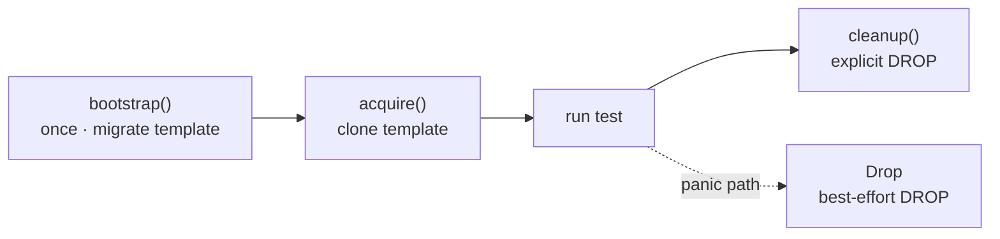

**Part IV · Threads: deterministic-enforcement, source-of-truth · Grounded by: [CS-1](../case-studies.md#cs-devdb-wipe)**

# 11. DB-backed test isolation

A database-touching test must never be able to harm any database other than its own throwaway one — the whole chapter in one sentence, paid for by a real incident ([CS-1](../case-studies.md#cs-devdb-wipe)). Every lesson below is a corollary of one move: instead of asking developers to be careful, make the dangerous state *impossible to construct*. In a new Rust + Postgres repo this is an afternoon of plumbing on day one; retrofitting it after a wipe costs a hard-reset of your persistence and a lasting distrust of `cargo test`.

---

## Lesson 1 — Give every DB-backed test its own ephemeral database cloned from a migrated template

`[thread: deterministic-enforcement] [thread: source-of-truth]`

**Do this.** Provision a fresh, uniquely-named database *per test* by cloning a pre-migrated template: `CREATE DATABASE <uuid_name> TEMPLATE <migrated_template>`. Migrate the template exactly once per test process (cache it behind a `OnceCell`/`OnceLock`); each test then clones it in a single DDL statement. A template clone is O(seconds) — far cheaper than re-running your full migration set per test — and hands each test exclusive ownership of every row it can see, so contamination is eliminated by construction. One caveat the bootstrap must respect: Postgres refuses to clone a template that has any live session connected to it ([PostgreSQL docs — template databases](https://www.postgresql.org/docs/current/manage-ag-templatedbs.html)), so the migration pool must be dropped before the first test clones — which is exactly the serialization point a `OnceCell` bootstrap already provides.

**Not this.** One shared test database that every test writes to, "reset" between tests with a global preflight wipe. Tests collide on whatever is keyed by a constant — sentinel rows, config rows, anything with a fixed primary key — and the reset statement is the exact unscoped `DELETE` that caused the production wipe.

**Why.** The structural fix for [CS-1](../case-studies.md#cs-devdb-wipe) was "stop sharing a database." A migrated-template-plus-per-test-clone is what makes "stop sharing" cheap enough to be the default rather than an aspiration.

**Evidence.** (in temet-proxy:) `crates/claude-proxy/src/store/persistence/test_support.rs:106-118` (`bootstrap` migrates the template once behind a `BOOTSTRAP: OnceCell`) · `test_support.rs:123-133` (`acquire` mints `claude_proxy_test_<uuid>` via TEMPLATE clone) · `test_support.rs:260-287` (`prepare_template_db` runs the `MIGRATOR` once; `create_database_from_template` clones) · `.claude/rules/testing.md:144` (rule 2) · `artifacts/research/2026-04-25-rust-postgres-best-practices.md:234-235` (TEMPLATE clones are O(seconds); per-test DBs eliminate contamination by construction).

**Pattern.**
```rust
// bootstrap(): once per process — create + migrate the template
static MIGRATOR: Migrator = sqlx::migrate!("migrations");
const TEMPLATE_DB_NAME: &str = "myapp_test_template";
// CREATE DATABASE <template> if absent, then MIGRATOR.run(&template_pool).await?

// acquire(): per test — clone the template, no migrations re-run
let db_name = format!("myapp_test_{}", Uuid::new_v4().simple());
let stmt = format!("CREATE DATABASE \"{db_name}\" TEMPLATE \"{TEMPLATE_DB_NAME}\"");
admin_pool.execute(stmt.as_str()).await?;
```

---

## Lesson 2 — Make it structurally impossible for a test to connect to the dev/prod database

`[thread: deterministic-enforcement]`

**Do this.** Point your test *admin* connection at an admin-only database (e.g. `.../postgres`) used solely to `CREATE`/`DROP` the per-test clones. Then have the one bootstrap helper that every DB test funnels through hard-error if the admin URL's database component equals your dev/prod database name. The refusal is a few lines on the single code path — a string comparison against an outage.

**Not this.** Trusting a developer or CI to point the admin env var at the right database. A single misconfigured env var silently aims destructive DDL at live data — precisely what happened in [CS-1](../case-studies.md#cs-devdb-wipe).

**Why.** The incident's root cause was "the admin URL resolved to the dev DB." A guard makes that unrepresentable: if the URL names the protected DB, bootstrap refuses before any connection is used.

**Evidence.** (in temet-proxy:) `test_support.rs:249-258` (`guard_against_dev_db` bails when the DB component equals `"claude_proxy"`) · `test_support.rs:406-422` (unit tests assert the guard rejects the dev DB and accepts the admin DB) · `.claude/rules/testing.md:143` (rule 1) · `artifacts/reviews/db-performance-audit-2026-04-30.md:767-772` (review notes test isolation is "rock-solid … guard_against_dev_db enforcement").

**Pattern.**
```rust
const PROTECTED_DB: &str = "myapp"; // your dev/prod DB name
fn guard_against_protected_db(admin_url: &str) -> anyhow::Result<()> {
    if extract_db_name(admin_url)? == PROTECTED_DB {
        anyhow::bail!(
            "TEST_ADMIN_URL points at the protected database. \
             Point it at 'postgres' (the admin DB) instead."
        );
    }
    Ok(())
}
```

---

## Lesson 3 — A mutex serializing DB tests is a symptom of broken isolation, not a fix

`[thread: deterministic-enforcement]`

**Do this.** When you feel the urge to wrap DB tests in a process-wide `Mutex<()>` (or run with `--test-threads=1`) because they contaminate each other, treat that urge as a diagnostic: your isolation is wrong at the data layer. Fix it with per-test databases (Lesson 1) and delete the lock — leaving a tombstone comment so nobody reintroduces it.

**Not this.** Bolting a global test mutex onto a shared-DB suite to paper over contamination. It serializes only intra-process concurrency; it does nothing against the real failure — destructive DDL aimed at shared or live state. In [CS-1](../case-studies.md#cs-devdb-wipe) the suite *was* serialized by a mutex, and the mutex did nothing to stop the wipe.

**Why.** Serialization and isolation solve different problems. A mutex prevents two tests from interleaving; it cannot prevent one test from deleting rows another test (or production) relies on. Once per-test ephemeral DBs land, the serializing lock is provably redundant.

**Important nuance — do not over-claim "no mutex anywhere."** A mutex is still legitimate when it guards *process-global state that is genuinely shared regardless of DB isolation* — the canonical case being `std::env::set_var`, since the process environment is one object no matter how many ephemeral databases exist. The precise rule is: **no mutex to serialize *DB* tests; a mutex around process-global env mutation is a different, valid concern.** (in temet-proxy: `tests/e2e/filter_rules_api.rs:55-77` keeps an `env_lock()` mutex — but it serializes `MIKE_CONFIG_DIR` env mutation, not the database.)

**Evidence.** (in temet-proxy:) `.claude/rules/testing.md:145-146` (rules 3–4: no Mutex; serialization didn't prevent the wipe) · `crates/claude-proxy/src/store/persistence/mod.rs:33-38` (tombstone: `persistence_test_lock()` removed once tests moved to per-test DBs) · `tests/e2e/persistence_restart_smoke.rs:14-16` ("No `DELETE` or mutex is required because no other test can see this DB") · `tests/e2e/api_db_fallback.rs:13-20` (the incident test's own header, narrating the old mutex+DELETE design) · `tests/e2e/filter_rules_api.rs:55-77` (the legitimate env-mutation mutex).

---

## Lesson 4 — `#[ignore]` is not isolation and not a safety feature

`[thread: deterministic-enforcement]`

**Do this.** Make destructive or expensive tests safe *by construction* — a per-test ephemeral DB. Once a test is safe by construction, dropping any `#[ignore]` gate it carried is mandatory: the gate's original justification is gone, and leaving it on merely hides the test from the default run, eroding coverage silently.

**Not this.** Marking a DB-destructive test `#[ignore]` and calling it "guarded." CI runs `--ignored`; agents run `--ignored`; a tired developer runs `--ignored`. The footgun stays loaded for whoever runs the full suite. `#[ignore]` controls *whether a test runs by default* — it has never controlled *what a test is allowed to touch*.

**Why.** This is the corollary of Lesson 2: safety must come from structural impossibility, not from a flag any runner can override. Reviews on this repo later caught residual `#[ignore]`-gated `src/` tests that bypassed the ephemeral-DB helper and connected to the admin URL directly — flagged precisely because `#[ignore]` was being misused as a destruction guard. (Those tests were since migrated to the ephemeral helper and the gate dropped, re-verified against code during this playbook's build.)

**Evidence.** (in temet-proxy:) `.claude/rules/testing.md:148` (rule 6: `#[ignore]` is not a safety feature) · `.claude/rules/testing.md:150` (rule 8: dropping `#[ignore]` is MANDATORY once a test uses ephemeral DBs) · `artifacts/reviews/feature-prompt-filter-remediation.md:761,776,794` (W11: `#[ignore]` `src/` tests bypass the ephemeral helper; mandate to migrate and drop `#[ignore]`) · `artifacts/reviews/db-performance-audit-2026-04-30.md:768` ("no `#[ignore]`-mask destructive tests").

---

## Lesson 5 — Ban unscoped `DELETE FROM`; every reset is `WHERE`-scoped to the test's own rows

`[thread: deterministic-enforcement] [thread: source-of-truth]`

**Do this.** With per-test ephemeral DBs you rarely need to delete at all. When a test genuinely must reset state mid-run, scope the delete to its own keyed rows (`DELETE FROM <table> WHERE id = $1`). Forbid the naked shape outright so it cannot recur even if isolation is somehow weakened later — defence in depth behind Lesson 1.

**Not this.** `DELETE FROM <table>` with no `WHERE`. That statement is the literal fingerprint of shared-DB test design — and the exact statement behind [CS-1](../case-studies.md#cs-devdb-wipe).

**Why.** A `WHERE`-scoped delete cannot exceed the test's own data even by accident; an unscoped one is unbounded by construction. The shape itself is the tell.

**Evidence.** (in temet-proxy:) `.claude/rules/testing.md:147` (rule 5: no unscoped DELETE) · `tests/integration/migrations_smoke.rs:454` (`DELETE FROM claude_proxy.requests WHERE id = $1 AND created_at = $2` — scoped) · `tests/integration/agent_instances.rs:771,827` and `request_deltas_api.rs:759,974` (every DELETE carries a `WHERE`; verified suite-wide by grep — every `DELETE FROM` hit in `tests/` is either `WHERE`-scoped or a module-doc comment forbidding the unscoped form) · `test_support.rs:11-19` (the original unscoped `DELETE FROM claude_proxy.sessions` named as the cause).

**A note on enforcement.** This rule is currently enforced by humans (the written rule plus code review), not by a build step. (in temet-proxy: a grep grader — `scripts/db-code-graders/g5_sql_patterns.sh` — does carry a blocking unscoped-`DELETE` check, but it is not run in CI and is scoped to *production* persistence code; it excludes `tests/`, so it does not cover this test-file rule.) A new repo should wire a **test-scoped** grep gate into CI so the discipline doesn't depend on a reviewer remembering — the shape is trivial to match mechanically (`DELETE FROM` with no `WHERE|USING` inside the statement window). That makes this lesson deterministic rather than prose-only.

---

## Lesson 6 — Prefer explicit async cleanup over `Drop`; skip cleanly when infra is absent

`[thread: deterministic-enforcement]`

**Do this.** Give the per-test DB handle an explicit `async cleanup()` that `DROP`s the database and returns a `Result`, and call it on the happy path so a failed teardown surfaces instead of vanishing. Keep a `Drop` impl only as a best-effort safety net for the panic path — and make it never panic. Separately, have `bootstrap()` return `Ok(None)` when the provisioning env var is unset, so the suite *skips* DB tests on a no-infra machine (a teammate's laptop, a light CI lane) rather than failing them.

**Not this.** Relying solely on `Drop` for teardown — it cannot propagate errors, and a `#[tokio::test]` runtime may already be mid-shutdown when `Drop` fires, silently cancelling a spawned drop task — or making DB tests *panic* when Postgres is absent, forcing every contributor to stand up infra before `cargo test` passes.

**Why.** Async cleanup in `Drop` is a known tokio footgun: `Drop` is synchronous, so dropping an async resource has to either block or spawn, and at end-of-test the runtime that would run the spawned task may be tearing down. The honest design makes teardown explicit on the success path and treats `Drop` as a last-ditch guard for panics only. The general principle — *explicit async teardown beats relying on `Drop`* — is owned by [ch. 8 — Memory & resource safety](./08-T06-memory-resource-safety.md); this chapter keeps only its test-database instance. (in temet-proxy: the `Drop` impl spins a fresh single-thread runtime on a *new OS thread* specifically to drop the DB without touching the test's dying runtime — its comment documents why.)

**Evidence.** (in temet-proxy:) `test_support.rs:170-182` (`cleanup` — explicit, idempotent async teardown) · `test_support.rs:193-247` (`Drop` — best-effort, spawns a fresh single-thread runtime on a new OS thread, never panics) · `test_support.rs:106-118` (`bootstrap` returns `Ok(None)` when `MIKE_TEST_ADMIN_URL` is unset) · `tests/e2e/persistence_restart_smoke.rs:120-121` (eprintln skip + `return Ok(())` when the env var is unset) · `.claude/rules/testing.md:149` (rule 7: explicit cleanup preferred).

---

## The shape of the fix

```mermaid
flowchart LR
    subgraph admin["admin connection — .../postgres"]
        A["CREATE DATABASE … TEMPLATE<br/>DROP DATABASE"]
    end
    A -->|clone| C1["myapp_test_uuid-1<br/>(test A owns)"]
    A -->|clone| C2["myapp_test_uuid-2<br/>(test B owns)"]
    A -->|clone| C3["myapp_test_uuid-3<br/>(test C owns)"]
    A -. guard_against_dev_db&#40;&#41; refuses .-x DEV["dev DB: myapp<br/>(unreachable from tests)"]
```



One admin connection mints and drops UUID-named clones; each clone is owned by exactly one test; the guard makes the protected dev DB unreachable from the test path entirely. The pre-incident shape — one shared DB, N tests, a serializing mutex, and an unscoped `DELETE` arrow that also reached the dev DB — made the wipe *possible*; the shape above makes it *unrepresentable*.

The per-test lifecycle:



---

## Cross-references

- The `test-seams` cargo feature is what makes this ephemeral-DB helper compile into integration test binaries *without* shipping it in the release binary (in temet-proxy: the helper is gated `#[cfg(any(test, feature = "test-seams"))]`). The isolation story leans on that gating, but the feature-gate lesson is owned by [ch. 12 — Test strategy](./12-T10b-test-strategy.md).
- The explicit-async-teardown-over-`Drop` principle is owned by [ch. 8 — Memory & resource safety](./08-T06-memory-resource-safety.md); Lesson 6 keeps only the test-DB-handle instance.
- This chapter grounds and owns [CS-1](../case-studies.md#cs-devdb-wipe). The same incident is referenced from [ch. 3 — DB planning](./03-T03-db-planning.md), [ch. 6 — Persistence boundary](./06-T05-persistence-boundary.md), and [ch. 7 — Async & concurrency](./07-T07-async-concurrency.md) for the day-one-ordering, persistence-write, and async facets.
- **Open gap:** the unscoped-`DELETE` and no-DB-mutex rules are enforced by written rule plus review, with no test-scoped CI gate (Lesson 5). Wiring a test-scoped grep into a merge-blocking CI step is the cheap upgrade from prose to deterministic enforcement.

## Further reading

- [PostgreSQL docs — template databases](https://www.postgresql.org/docs/current/manage-ag-templatedbs.html) — `CREATE DATABASE … TEMPLATE` clone semantics; reinforces Lesson 1 (what makes one-migrated-template-clone-per-test cheap) and qualifies it (the source template must hold zero live connections during a clone, so drop the migration pool first).
- [Meszaros, *xUnit Test Patterns* — Fresh Fixture](https://www.oreilly.com/library/view/xunit-test-patterns/9780131495050/) — each test builds its own pristine fixture rather than sharing persistent state; the canonical name for Lesson 1's per-test database.
- [Meszaros, *xUnit Test Patterns* — Shared Fixture / Interacting Tests](https://www.oreilly.com/library/view/xunit-test-patterns/9780131495050/) — names the contamination (Shared Fixture / Interacting Tests) that a serializing mutex papers over; reinforces Lesson 3, whose prescription is Fresh Fixture, not serialization.
- [Meszaros, *xUnit Test Patterns* — Fixture Teardown](https://www.oreilly.com/library/view/xunit-test-patterns/9780131495050/) — argues for reliable explicit teardown over implicit cleanup; reinforces Lesson 6, with the Rust-specific divergence (`Drop` is synchronous, so async teardown must block or spawn into a possibly-dying runtime) being the playbook's own contribution.
