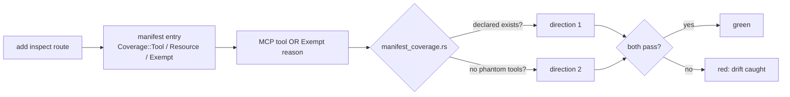

**Part IV · Threads: deterministic-enforcement, evidence-over-attestation, source-of-truth · Grounded by: [CS-2](../case-studies.md#cs-sessionid-dataloss)**

# 12. Test strategy: taxonomy, mocking, regression, parity

A test suite is only as useful as the questions a reader can answer from it: *what does this test depend on, what production failure does it prevent, and does a green run actually prove the thing works?* This chapter wires those answers into the suite's structure — a taxonomy readable off a file path, a numbered regression ledger, mock fidelity matched to the failure mode, the exact boundary where a paused clock stops helping, a build-time parity test, and the hardest lesson: what "done" means when a green check structurally cannot exercise the code you changed. DB-backed test isolation (ephemeral per-test databases, no serializing mutex) is the sibling concern, owned by [ch. 11 — DB-backed test isolation](./11-T10a-db-test-isolation.md); this chapter points there once and does not restate it.

---

## Lesson 1: Classify tests by their real dependency surface and make the categories physically separate

**Do this.** Define a small fixed taxonomy where each category answers, in one line, "does this touch the DB? the network?" — **Unit** (in-module `#[cfg(test)]`, no DB/net), **Component** (HTTP behaviour via a mock upstream, no DB), **Integration** (the DB *is* the assertion target, no full system), **E2E** (HTTP in through the whole system + DB). Mirror the taxonomy in the directory layout, give each test file its own `[[test]]` entry, and state plainly which categories run with no DB so the fast subset works offline. A reader should infer a test's infra needs and blast radius from its path alone.

**Not this.** An undifferentiated `tests/` folder where any file might or might not hit the DB. Contributors can't reason about infra, can't carve out a fast offline subset, and copy-pasted setup drifts file to file.

**Why.** The promise "the proxy-behaviour tests do not require Postgres to pass" only holds because that category is physically separated from the DB-backed ones — separation is what makes the claim *checkable*. The offline subset is real only because DB-dependent tests skip (return `Ok(None)`) when their admin URL is unset, a mechanism owned by [ch. 11 — DB-backed test isolation](./11-T10a-db-test-isolation.md). `[thread: deterministic-enforcement]`

**Evidence.** (in temet-proxy) `.claude/rules/testing.md:97-105` (category table with Location + DB-access columns), `:107-124` (target directory layout + the "all 65 files moved into `proxy/ e2e/ integration/ schema/`" note) · `crates/claude-proxy/tests/` on disk: `common/ e2e/ integration/ proxy/ schema/` · `grep -c '\[\[test\]\]' crates/claude-proxy/Cargo.toml` → 69 · audit `artifacts/2026-05-15/test-architecture-findings.md`.

---

## Lesson 2: Encode every observed production failure as a permanent, enumerated regression test

**Do this.** Keep a small, *named and numbered* set of mandatory tests, each tracing to a real production failure, that every PR must keep green. New failure modes become new numbered entries. The suite is institutional memory of *what broke*, not a coverage-percentage target — so each entry's value is the specific past outage it pins, and you never delete one without retiring the risk it guards.

**Not this.** Fixing an incident with a one-off patch and no test, so the same failure mode silently returns in a later refactor; or treating tests as a coverage metric, so nothing pins the specific fix.

**Why.** When a system's entire value is fidelity, a regression in passthrough or capture is invisible until an operator hits it in production — the only early-warning is a test that reproduces the original break. The canonical ten each pin a signature outage from prior proxy generations: request-body byte-identity (SHA-256 in == out); error-status passthrough where 429/529 forward verbatim and the proxy did **not** retry — the mock saw *exactly one* request; 20 concurrent streams with no cross-contamination. The discipline is that the enumeration is closed and named, not that the count is ten. `[thread: deterministic-enforcement]`

**Evidence.** (in temet-proxy) `.claude/rules/testing.md:7` ("correspond to production failures observed in proxyclawd and the mitmproxy setup"), `:9-47` (Tests 1-10 enumerated) · `crates/claude-proxy/tests/proxy/roundtrip.rs:217-273` (`test_request_body_byte_identical`, `Sha256::new()` over the raw body) · `crates/claude-proxy/tests/proxy/concurrency.rs:72,90` (`num_concurrent = 20`, "no cross-contamination").

---

## Lesson 3: Pick mock fidelity to the failure mode — high-level mock for the happy path, raw TCP for adversarial wire behaviour

**Do this.** Use a high-level HTTP mock (wiremock) for well-formed request/response cycles and complete event streams. Reach for a raw `TcpListener` when you need wire-level pathologies the high-level mock cannot express: partial writes, mid-stream connection drops, abrupt socket close, per-event delays. Build the raw mock once as a reusable helper parameterised by `events` + `drop_after: Option<usize>`, so each adversarial test is a few lines.

**Not this.** Bending a high-level HTTP mock to emit half-streams or abrupt drops, then declaring the failure mode "untestable." The mid-stream-error, upstream-drop, and client-disconnect tests literally cannot be written against a request/response mock — it has no API for "send three events, then `drop(socket)`."

**Why.** The fidelity of the mock has to match the fidelity of the bug. A high-level mock proves the happy path; only a raw socket can reproduce a connection that dies *mid-stream*, which is exactly where a streaming proxy's worst bugs live (hangs, leaked tasks, panics on a half-written response). Choosing the mock to the failure mode is the difference between a test that asserts coverage and a test that asserts the actual hazard. `[thread: deterministic-enforcement]`

**Evidence.** (in temet-proxy) `crates/claude-proxy/tests/common/raw_sse_mock.rs:34-79` (`raw_sse_mock(events, drop_after)`; abrupt `drop(sock)` at the drop index) · `.claude/rules/testing.md:27` (Test 5: "Use raw TcpListener (wiremock can't do partial SSE)"), `:65-83` (raw-TCP mock as a first-class pattern).

**Pattern.**
```rust
// one helper covers "normal close" AND "mid-stream TCP drop":
for (i, event) in events.iter().enumerate() {
    if let Some(drop_at) = drop_after {
        if i >= drop_at { drop(sock); return; } // abrupt close — a request/response mock cannot do this
    }
    if event.delay > Duration::ZERO { tokio::time::sleep(event.delay).await; }
    if sock.write_all(line.as_bytes()).await.is_err() { return; }
}
```

---

## Lesson 4: Know the boundary of tokio's paused clock — it does not control real socket I/O

**Do this.** Use `tokio::time::pause()` / `#[tokio::test(start_paused = true)]` for *internal* timers — TTL sweeps, retry backoff — where the only thing that must advance is `tokio::time::sleep`. But for any timeout test that crosses a **real socket** (a `reqwest`/`hyper` client driving its own I/O timers), use a real, short delay (e.g. a 2 s upstream delay against a 30 s client timeout). Document the boundary at the test site so the next person doesn't reach for `start_paused` where it silently has no effect.

**Not this.** Assuming a paused clock fast-forwards *everything*, then writing a "timeout" test that passes instantly because it never actually exercised the socket path. A test that proves nothing is worse than no test — it advertises coverage it doesn't have.

**Why.** Paused tokio time only advances `tokio::time::sleep`; the I/O timers inside a real HTTP client are not on that clock. A rules-doc one-liner saying "use `start_paused` for timeout tests" is wrong at exactly this boundary — the test file that crosses the socket uses a real delay and is the source of truth. When a rule and a working test disagree, the test wins; fix the rule. `[thread: evidence-over-attestation]`

**Evidence.** (in temet-proxy) `crates/claude-proxy/tests/proxy/timeouts.rs:8-17` (explicit NOTE that paused tokio time only affects `tokio::time::sleep`, not socket I/O — **source of truth**), `:31-38` (real 2 s delay + 30 s client timeout) · `.claude/rules/testing.md:85-87` (the over-simplified "Use `start_paused`" pattern the test file corrects).

---

## Lesson 5: Use property-based tests for passthrough / identity invariants

**Do this.** For "X survives the round trip unchanged" invariants — arbitrary headers forwarded intact, request body byte-identical (SHA-256 in == out, no reserialization), stream roundtrip — use property tests over generated inputs; they catch the malformed-but-valid edge cases that enumerated examples miss. Keep case counts low in CI (e.g. 50) and high in nightly (e.g. 500). Convert fallible setup into a `TestCaseError::fail(...)`, never a `panic!`, so shrinking still reports a minimised failing case cleanly.

**Not this.** Verifying passthrough with one or two hand-picked examples (which a naive reserializer happens to survive), or letting infra setup `panic!` inside a proptest closure so a shrink run reports a panic instead of the minimised input.

**Why.** Identity invariants are exactly where property testing pays — the failures are valid-but-adversarial inputs (an odd header casing, RFC 7230 optional whitespace, a byte order a reserializer would "helpfully" normalize) that you would never think to hand-write. Generated strategies encode the adversarial space; an `as_fail` helper keeps infrastructure failures inside proptest's shrink machinery instead of crashing out of it. These are the executable counterpart to the byte-identity passthrough contract argued in [ch. 2 — The hot path & passthrough discipline](./02-T02-hot-path-passthrough.md). `[thread: source-of-truth]`

**Evidence.** (in temet-proxy) `crates/claude-proxy/tests/proxy/property_tests.rs:16-19` (`as_fail` → `TestCaseError::fail`), `:22` (RFC 7230 OWS-trimming strategy), `:34-35` (`ProptestConfig::with_cases(50)`) · `.claude/rules/testing.md:89-91` (proptest for header passthrough / body identity / stream roundtrip; 50 CI, 500 nightly).

---

## Lesson 6: Centralize test setup in shared helpers, and include niche helpers per-binary via `#[path]`

**Do this.** Put all cross-cutting setup — start the system under test, build a mock upstream, return the bind URLs — in a shared `common/` module, never copy-pasted per file. A single `start_system()` that returns the live URLs (plus a `…_with_shutdown` variant returning the `CancellationToken` for graceful-shutdown tests) means a setup change lands in one place. Because each Rust integration test compiles to its own binary, pull *niche* helpers (raw-TCP mock, DB support) into only the binaries that need them via a `#[path] mod` declaration, and prefer returning tuples over named-field structs where partial use would otherwise trip `-D warnings` dead-code lints.

**Not this.** Each test file re-implementing system/DB/mock bring-up — a setup change then touches dozens of files and they drift; or declaring every helper in one shared `mod` imported everywhere and then drowning in per-binary dead-code warnings or reaching for a blanket `allow(dead_code)`.

**Why.** A per-binary `#[path]` include keeps the dead-code lint *honest* — a helper compiles only in the binaries that reference it, so an unused helper in one binary is a real signal, not noise you've learned to silence. Returning a tuple lets a test that needs only one URL discard the other with `_` rather than triggering a named-field dead-code warning. The lint stays meaningful, which is the point of running it under `-D warnings`. `[thread: deterministic-enforcement]`

**Evidence.** (in temet-proxy) `crates/claude-proxy/tests/common/mod.rs:1-20` (per-binary `#[path]` rationale + tuple-return rationale), `:34-37` (`start_proxy` → `(proxy_url, inspect_url)`) · `crates/claude-proxy/tests/common/raw_sse_mock.rs:1-3` ("Included via `#[path]` so only binaries that need it compile it") · `.claude/rules/testing.md:131` (rule 4: shared `common/` helpers, no copy-paste).

---

## Lesson 7: Gate test-only entry points behind a cargo feature so they never ship in release binaries

**Do this.** When integration tests need to construct internal types or call private seams that production must not expose, put those seams behind a `test-seams` feature gated with `#[cfg(any(test, feature = "test-seams"))]`, default it **off**, and enable it for tests via a path self-dependency in `[dev-dependencies]`. The release binary's symbol table then stays free of test scaffolding (`nm target/release/<bin>` shows none), and you never need a feature flag on the test command line.

**Not this.** Exposing test constructors/seams as plain `pub` functions that leak into the production API and ship in the release binary.

**Why.** A test seam is a deliberate hole in your encapsulation; gating it off-by-default means the hole exists only when the test profile asks for it. The `[dev-dependencies]` self-dep flips the gate automatically for the whole test run, so there's no human step to forget and no risk a release build silently carries the seam. `[thread: deterministic-enforcement]`

**Evidence.** (in temet-proxy) `crates/claude-proxy/Cargo.toml:18-26` (`default = []`; `test-seams = []` with the "must NOT ship in production binaries" / "free of test-seam symbols by default" comments), `:84-88` (dev-dep self-dep enabling the gate with no CLI flag); the `#[cfg(any(test, feature = "test-seams"))]` form appears at `src/lib.rs:17,58`, `store/in_flight.rs:319`, `store/mod.rs:11`.

**Pattern.**
```toml
[features]
default = []
test-seams = []          # off in release; nm stays clean

[dev-dependencies]
claude-proxy = { path = ".", features = ["test-seams"] }  # tests get the seams, release doesn't
```

---

## Lesson 8: Enforce cross-surface capability parity with ONE manifest plus a build-time test

**Do this.** When two surfaces must stay in lockstep — a REST API and a tooling/MCP bridge that mirrors it — make a single manifest the source of truth that both the router *and* a parity test consume. Each route declares its coverage as *data*: `Tool(name)`, `AggregatedInto(name)`, `Resource(uri)`, or `Exempt { reason }` with a one-line justification. The parity test enforces both directions: every declared tool/resource must actually exist, and every tool must back to a manifest entry (no phantom tools). Adding a route then *mechanically* forces three coordinated edits — route + manifest entry + tool-or-exemption — or a test fails.

**Not this.** Keeping two mirrored surfaces in sync by convention and code review alone, so the bridge silently lags the API whenever someone forgets the matching tool. (The same discipline extends to full-fidelity: any new "summary" route must ship its full-body counterpart in the same change — see [ch. 10 — Observability & inspection fidelity](./10-T09-observability-fidelity.md).)

**Why.** Two mirrored surfaces drift the moment one is edited without the other, and the drift is invisible until a consumer hits the missing capability. A manifest that both the router and the test read turns "did you remember the matching tool?" from a review question into a test outcome — three edits land together or the suite goes red. Note the honest limit: this is deterministic enforcement *when the suite runs*. (In temet-proxy there is no CI gate forcing it to run — `.github/workflows/` carries only Storybook workflows, no Rust gate — so treat a merge-blocking CI pipeline running the suite as the missing piece, not as something this repo demonstrates; see [Appendix A](../appendix-a-adopt.md).) The parity test is still the right shape; pair it with a gate. `[thread: deterministic-enforcement]`

**Evidence.** (in temet-proxy) `crates/claude-proxy/src/api/manifest.rs:1-17` ("Single source of truth … Adding an inspect route therefore forces three coordinated edits"), `:44-62` (`Coverage` enum: `Tool` / `AggregatedInto` / `Resource` / `Exempt{reason}`) · `crates/proxy-mcp/tests/manifest_coverage.rs:48-60` (`every_inspect_route_has_mcp_coverage`, direction 1) + `:12,89` (direction 2: "No phantom tools" / `every_mcp_tool_has_a_backing_route`) · commit `96e58c9` (the paired endpoint `GET /api/requests/{id}/tool-calls`, the MCP tool `get_request_tool_calls`, and the manifest entry all land in one commit) · `.claude/rules/inspection-fidelity.md:50` (parity extended to summary↔full-body).



---

## Lesson 9: A green type-check or passing test is not proof the feature works — observe the running system

**Do this.** Know the structural blind spots of your green checks and treat "build passed / tests passed" as necessary, not sufficient. (a) *Type-checkers can skip the files you care about* — a Svelte type-checker does not type-check `*.test.ts`, and the test runner strips types at runtime, so "0 errors + green tests" does not prove the tests type-check; the authoritative check is `tsc --noEmit`. (b) *The compiler can't see inside raw SQL* — a wrong `sqlx::query()` bind-param count or a missing `NOT NULL` column compiles clean and fails only at runtime. (c) *Edit-tool uniqueness gives false safety* — an `old_string` that matches exactly one of two near-identical INSERT sites reports success while the second (different indentation) silently survives. For any user-visible behaviour, load it in the live system and observe it — persistence across reload, the rendered value, the actual wire response — before claiming done.

**Not this.** Declaring a behaviour done on the strength of a green check that *structurally cannot* exercise it. In the session-id data-loss incident, three cargo builds passed and were taken as completion confidence — but the compiler had nothing to check inside the raw SQL, the edit matched one of two INSERT sites, and the mandatory self-check grep was never run.

**Why.** The verification artifact has to exercise the affected path; a check that can't reach the change is theatre dressed as proof. This is the *mechanism* behind [CS-2](../case-studies.md#cs-sessionid-dataloss) — see the case study for the narrative (two write sites, the detection lag); the transferable point is that each green light (compiler, edit-tool, type-checker) had a blind spot precisely over the changed line, which is why "observe the running system" outranks "the build passed." This sharply qualifies the classic claim that a passing self-test suite means code is "free of substantial defects" ([Fowler — SelfTestingCode](https://martinfowler.com/bliki/SelfTestingCode.html)): the confidence holds only when a test actually *reaches* the changed line. `[thread: evidence-over-attestation]`

**Evidence.** (in temet-proxy) `artifacts/2026-05-28/incident-session-id-data-loss/02-findings.md:64-86` (RC5 edit-uniqueness false safety @71-75, RC6 compiler can't catch wrong param count @77-81, RC7 self-check never run @83-86, "three cargo builds passed" @80-81) · memory `debugging_svelte_check_excludes_tests.md` (the type-checker skips `*.test.ts`; use `tsc --noEmit`) · memory `project_request_number_frontend_todo.md` (a feature "NOT verified in the live SPA" — only Storybook + `tsc` checked).

---

## Lesson 10: "Done" means captured evidence or a committed-to-disk change — and a documented fix is not an applied fix

**Do this.** A change is done when it is on disk and committed, with one narrow check of what changed (the one test target, or the running path the change touches) run once. The commit hooks and the landing gate grade the rest. Report a failing check as failing.

**Not this.** Recording a fix in a notes doc, lesson or table that was never written to the file. Equally, not this: re-running passed checks, reading files back, pasting output dossiers or running full suites per change to prove what the gate already grades.

**Why.** A claim of completion and a completed change are different objects, and the gap between them is where data-loss incidents grow. Two in this codebase came straight from the documented-not-applied pattern: a stream-chunk INSERT consolidation marked done but never made (the same shape that grounds [CS-2](../case-studies.md#cs-sessionid-dataloss)), and `sweep_interval` / `default_ttl` values a lesson claimed were set "to stop data loss" that `git log` shows were never committed — so the slow sweep kept deleting week-old sessions for days after the "fix." An *executable* self-check (paste the grep output) closes the gap because the proof is the artifact, not a sentence about it. This same discipline, applied to an AI agent's own terminal turn, is the subject of [ch. 17 — Completion integrity & the lean main turn](./17-T13b-lean-main-turn.md). `[thread: evidence-over-attestation]`

**Evidence.** (in temet-proxy) `CLAUDE.md` "Verification before completion" (four acceptable proofs; names "verification theater") · `.claude/rules/inspection-fidelity.md` "Self-check before submitting" ("executable, not aspirational … run the command and PASTE the captured output") · memory `correction_verify_applied_in_file.md` (the stream-chunk INSERT consolidation + the `sweep_interval` / `default_ttl` never-committed incidents).


---

## Lesson 11: Pin logic that lives in two implementations against ONE shared golden-vector fixture

**Do this.** When the same algorithm exists in two implementations across a language boundary (a backend matcher in Rust, a frontend live-preview matcher in TS), they WILL drift — and worse, the test on the wrong side will codify the buggy behaviour as "passing." Either extract one shared module, or pin BOTH implementations against a shared golden-vector fixture (an array of input/expected JSON loaded by the Rust test and the JS test alike) so any divergence fails one suite. Where extraction is impossible, generate shared constants/enums from one side rather than hand-copying magic strings.

**Not this.** Two hand-maintained copies of one matching/validation algorithm, with a test on one side asserting that side's *bug* as correct.

**Why.** Duplicated logic doesn't just drift; the per-side test *certifies* the drift. (In temet-proxy the prompt-filter matcher drifted exactly this way: the frontend did case-sensitive `block.includes(value)` and skipped the `</tag>` close-tag check, while the backend was case-insensitive and required the close tag — and the frontend test asserted the wrong contract as passing. Three reviewers caught it independently.) A single fixture both suites load makes "the two agree" a test outcome instead of a hope. `[thread: source-of-truth, deterministic-enforcement]`

**Evidence.** (in temet-proxy) `artifacts/reviews/feature-prompt-filter-remediation.md:77-85` (case-sensitivity + close-tag drift; "Three reviewers caught this independently"; the JS test @84 asserts the wrong contract), `:127-130` (fix: shared golden-vector fixture) · `crates/claude-proxy/tests/fixtures/matcher/vectors.json` (loaded in Rust via `include_str!` at `src/filter/matcher.rs:174`, fn `vectors_match_shared_fixture` @177; imported by the JS test at `frontend/src/lib/components/filter/rule-matching.test.ts:21`).

---

## Lesson 12: Extract embedded pure functions and test state-machine invariants, not just happy paths

**Do this.** Pure functions buried in UI component scripts (prefill heuristics, matchers, length/boundary caps) become immediately unit-testable with no component harness once extracted to a sibling module — do that, then assert the boundary cases (empty input, the off-by-one cap, case sensitivity). For stateful stores, the regression-prone parts are the *invariants*, not the happy path: the hydration race (an `initialized` flag must be false during the in-flight fetch and true once it settles, success *or* error), idempotent-retry-must-not-double-count, transient-vs-persistent accumulation, and error paths that must leave state unchanged (a 4xx leaves the store as it was). Cover the `Err` path of every `Result`-returning function — it's a standing rule, not a nice-to-have.

**Not this.** Shipping a thousand-plus LOC of logic-dense stores and embedded pure functions with zero tests; never exercising the retry/idempotency invariant ("without it, a retry path turns into slow corruption") or the error-leaves-state-clean path.

**Why.** Logic hidden inside a component or a store is logic you've decided not to test, and the untested parts are reliably the invariants — the hydration race and the idempotent retry — not the happy path. (In temet-proxy a test review gave a hard FAIL for exactly this: six new files, zero tests, an untested hydration race and untested matcher/prefill boundaries; the recommendation was "extract functions to a sibling module" to test them without a component harness, and the persistence review named idempotent-retry-must-not-double-count "the critical regression guard.") `[thread: deterministic-enforcement]`

**Evidence.** (in temet-proxy) `artifacts/reviews/phase4-test-review.md:5` (Verdict FAIL), `:13-18` (zero-test table), `:41-46` (CRITICAL-1 hydration race: `initialized` false during fetch / true once settled) · `artifacts/reviews/persistence-population-gaps-2026-04-25.md:414-423` (idempotent retry "the critical regression guard") · `.claude/rules/testing.md:130` (rule 3: an `Err`-path test per `Result` fn).

---

## Further reading

- [Fowler — The Practical Test Pyramid](https://martinfowler.com/articles/practical-test-pyramid.html) — sorts tests by dependency surface and cost ("integrating slow parts like filesystems and databases tends to be much slower"); REINFORCES Lesson 1's Unit/Component/Integration/E2E split and the fast offline subset — the canon's reason for layering *is* the readable-blast-radius argument made here.
- [Fowler — TestPyramid](https://martinfowler.com/bliki/TestPyramid.html) — names the "ice-cream cone" anti-pattern and warns that teams conflate test levels; REINFORCES Lesson 4 — a test's *label* can misrepresent what it exercises, exactly the defect of a `start_paused` "timeout" test that never touches the socket.
- [proptest docs (docs.rs)](https://docs.rs/proptest/latest/proptest/) — "Hypothesis-like property-based testing and shrinking," generating random inputs and shrinking to a minimal failing case, naming QuickCheck/Hypothesis as its lineage; REINFORCES Lesson 5's "generate the adversarial space, keep infra failures inside the shrink machinery."
- [Fowler — SelfTestingCode](https://martinfowler.com/bliki/SelfTestingCode.html) — argues a passing self-test suite means code is "free of any substantial defects"; QUALIFIES Lesson 9 hard — that confidence holds *only* when the test reaches the changed line, and Lesson 9's blind-spot catalogue (type-checker skips `*.test.ts`, compiler can't see inside raw SQL, edit-tool matches one of two sites) is precisely where a green suite is *not* a bug detector.
