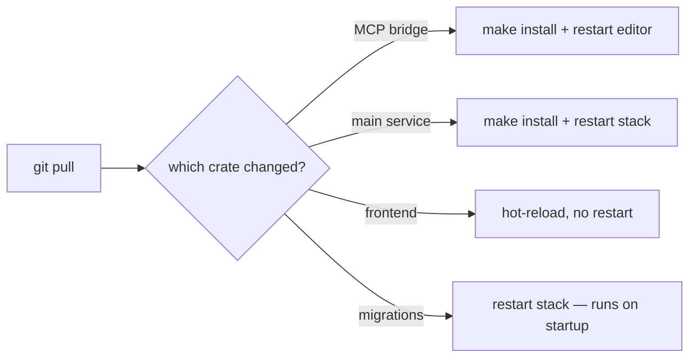

**Part IV · Threads: deterministic-enforcement, evidence-over-attestation, source-of-truth · Grounded by: —**

# 13. Tooling & quality gates

Most quality gates are one habit if adopted on day one and a multi-PR migration if deferred. This chapter is about the day-one decisions that keep a Rust repo cheap to keep honest: compile-checked SQL with a committed offline cache, one canonical task interface, lint-as-error and a fast test runner behind a single `check`, structural code-search over text grep, lean build profiles, and a documented rebuild workflow for binaries the editor spawns out of band. It closes with the discipline that makes every other gate real — a completion claim requires captured evidence, not an attestation.

---

## 1. Adopt a compile-time schema-drift gate on day one [thread: deterministic-enforcement, source-of-truth]

**Do this.** If you use sqlx, reach for the compile-time-checked macros (`query!` / `query_as!` / `query_scalar!`) from the first query, so a column rename fails the *build*, not the first production read after deploy. Whatever your stack, pick *some* mechanism that makes schema/code drift a compile error.

**Not this.** Writing every query as runtime `sqlx::query()` with no compile-time metadata and deferring the gate until the call-site count is large. `cargo check` has no idea what columns a *string* query touches, so CI cannot catch drift against runtime strings — the mismatch surfaces only when that row is first read in production.

**Why.** An audit of this repo found zero compile-checked queries across ~90 call sites and no offline cache — drift caught only at runtime. The retrofit was scoped as a multi-PR program, one file per PR, *explicitly not* a single sweep, because large mechanical sweeps are review-hostile. Doing it from query one would have been one habit; doing it late was a planned sprint. Schema *changes* must additionally enumerate every write site before scoping — see [ch. 5 — Migration mechanics](./05-T04b-migrations-mechanics.md) and [CS-2](../case-studies.md#cs-sessionid-dataloss).

**Evidence.** `artifacts/reviews/db-performance-audit-2026-04-30.md` §H1 (lines 285-316: "91 total… no directory exists… only surfaces at runtime") · `artifacts/reviews/h1-sqlx-macro-migration-plan.md:113` ("Do **not** do the whole sweep in one PR… review-hostile"), `:52` ("one file per PR"). The practice is now real — ~104 macro call sites with a populated cache (the audit's 91 and the plan's 105 are honest snapshots at different times; no lesson depends on the exact number).

## 2. Commit an offline query cache so the build is hermetic [thread: deterministic-enforcement, source-of-truth]

**Do this.** After adopting the macros, run `cargo sqlx prepare --workspace` to capture schema-validated query metadata into a git-tracked `.sqlx/`, and commit it *alongside every SQL/migration change*. The cache is the offline source-of-truth that lets compile-checked SQL build without a live database ([sqlx — offline mode](https://docs.rs/sqlx/latest/sqlx/macro.query.html)). Set `SQLX_OFFLINE=true` where Postgres is unavailable; a missing or stale cache then fails loudly ("no cached data for query"), never silently.

**Not this.** Macros that hit a live DB on every build (slow, non-hermetic CI). Committing a query or migration without regenerating the cache, breaking everyone else's build on "no cached data." Or dropping `--workspace` in a multi-crate repo, which *silently* skips sibling-crate macros — the most dangerous failure here, because it produces no error.

**Why.** `cargo sqlx prepare` replaces the live-DB build requirement with a checked-in cache, the only way to make the macros compatible with hermetic CI. `--workspace` is load-bearing in a multi-crate workspace: without it `prepare` inspects only the current crate.

**Evidence.** `docs/development/sqlx-prepare.md:55` ("The `--workspace` flag is essential… silently misses macros in sibling crates"), `:11-13` (cache is git-tracked, CI `--check`), `:91-93` ("the compile will fail with a clear 'no cached data' error — no silent fallback") · `Cargo.toml:27` (sqlx 0.8, `macros`+`migrate`). *(The doc still carries a stale "not yet" status header that predates the populated cache — the practice shipped, the doc lagged. A feature change spans docs, not just source; see [ch. 14 — Config architecture](./14-T11a-config-architecture.md).)*

**Pattern.** Migration and cache land in the same commit:

```sh
cargo run --bin <svc> -- migrate     # apply migration locally
cargo sqlx prepare --workspace       # regenerate the offline cache
git add migrations/<new>.sql .sqlx/  # commit migration + cache together
```

## 3. Never disable the compile-time SQL check to dodge a rebuild [thread: deterministic-enforcement]

**Do this.** When a checked query macro fails to compile, fix the query or the schema and rebuild with the DB reachable (`DATABASE_URL=… cargo build`). The macro firing *is* the gate working.

**Not this.** Reaching for `SQLX_OFFLINE=true` to make the compile error go away. `SQLX_OFFLINE` is for environments without a DB, not an "I don't want to deal with this" switch — bypassing the macros re-opens the exact runtime-failure window Lesson 1 closed.

**Why.** Captured as a standing project correction after the temptation surfaced in practice. It is the daily discipline that keeps Lesson 1's investment from leaking — an investment that is one bypass away from worthless.

**Evidence.** memory `correction_signature_callers.md:22` ("Never use `SQLX_OFFLINE=true` to bypass sqlx checks. `query!()` macros exist to catch column/type mismatches at compile time").

## 4. Make one task runner the canonical interface, wrapping the toolchain verbs once [thread: source-of-truth]

**Do this.** Expose every routine action — build, test, lint, fmt, install, single-crate and single-test runs — as a thin target in one task file (`Makefile`, `justfile`, or `cargo-xtask`). Contributors and CI both invoke `make test` / `make check`, never a memorized incantation. Source env-coupled values (DB URLs) from a single `.env`, not re-typed inline per command, so "what's the test command" cannot drift.

**Not this.** Each developer and CI re-typing raw `cargo` invocations with subtly different flags and hand-spelling connection strings on every command — verbose, typo-prone against live infrastructure, and guaranteed to drift from the canonical config.

**Why.** An operator called out the inline-env anti-pattern (`DATABASE_URL=… MIKE_TEST_ADMIN_URL=… cargo nextest …`) as "wasteful, error-prone, ignores the wrappers." The task file is a ~38-line shim; its value is that strictness and env-coupling are centralized exactly once.

**Evidence.** `Makefile` (targets `test`, `test-p`, `test-t`, `lint`, `fmt`, `install`, `check: fmt lint test`) · `CLAUDE.md:66-69` (Quick Reference documents the shortcuts as canonical) · memory `convention_use_make_targets.md` (".env already holds the URLs… inline env-var spelling on every invocation… ignores the wrappers").

**Pattern.**

```makefile
test:  cargo nextest run --all
lint:  cargo clippy --all-targets -- -D warnings
check: fmt lint test          # "is my change clean?" is one command
```

## 5. Treat warnings as errors and use a fast test runner from the start [thread: deterministic-enforcement]

**Do this.** Make `cargo clippy --all-targets -- -D warnings` the lint gate so lint debt never accrues into its own cleanup project, adopt `cargo nextest` for faster parallel test output, and wire both into the single `check` target. Centralize the strictness in a `[workspace.lints]` table in the workspace `Cargo.toml` ([Cargo Book — workspace lints](https://doc.rust-lang.org/cargo/reference/workspaces.html)), not only in the task runner, so a contributor running bare `cargo clippy` still gets errors.

**Not this.** Letting clippy warnings accumulate until the cleanup is a milestone, relying on `cargo test`'s slower output, and — the gap this repo actually has — enforcing `-D warnings` *only* in the task runner. A bare `cargo clippy` here gets warnings, not errors, because the strictness lives in the Makefile `lint` target and there is **no `[workspace.lints]` section**: the gate holds for anyone who runs `make` and silently weakens for anyone who doesn't.

**Why.** The repo carries `-D warnings` and `nextest` in both the Makefile and the Quick Reference, so "what's the lint command" never drifts — but task-runner-only strictness is a real weakness a new repo should avoid by lifting it into the manifest.

**Evidence.** `Makefile:32-33` (`lint: cargo clippy --all-targets -- -D warnings`), `:23-24` (`test: cargo nextest run --all`) · `CLAUDE.md:66` · `Cargo.toml` has **no** `[workspace.lints]` section — strictness is Makefile-only.

## 6. Use LSP / ast-grep for code symbols; reserve text grep for SQL strings, config, and prose [thread: deterministic-enforcement]

**Do this.** For navigating or auditing *code*, prefer structural tools — LSP `goToDefinition` / `findReferences` / `workspaceSymbol`, and ast-grep `--pattern`. ast-grep respects syntax (a pattern for `unwrap()` won't match a comment or a string literal), and LSP collapses a grep-then-read chain into one call ([ast-grep — structural vs text search](https://ast-grep.github.io/guide/introduction.html)). Put the "structural search first" trigger in the **always-loaded rules layer**, not a reactively-matched skill — a skill that fires only when its description matches sits unused.

**Not this.** Grepping for camelCase/snake_case/dotted symbols (matches comments, strings, test code). Trusting LSP `findReferences` *alone* for any change touching raw SQL — LSP sees struct callers only and is blind to table and column names inside string literals. For a schema change, run LSP `findReferences` *and* a text/ast-grep search over the raw SQL, because neither alone is sufficient. This is the exact discovery gap behind [CS-2](../case-studies.md#cs-sessionid-dataloss); the discovery-before-scope discipline is owned by [ch. 5 — Migration mechanics](./05-T04b-migrations-mechanics.md).

**Why.** A session-efficiency review found **0 LSP + 0 ast-grep calls vs 66 text-search calls across 277 requests** — the structural tools were loaded but never fired. Root cause: a *tool-choice* failure (the trigger lived in a description-matched skill at a ~37% activation floor), fixed by moving the directive into the always-loaded instructions layer.

**Evidence.** `artifacts/research/2026-04-19-session-efficiency-review.md:307-327` (Finding F: "LSP… loaded but unused… 0 structural-search calls… a **tool-choice** failure") · `artifacts/research/2026-04-19-lsp-astgrep-adoption-research.md:188-216` ("`Grep` on `unwrap()` matches string literals, comments, and test code"; ~37% activation floor at `:12`/`:103`/`:218`) · the schema-discipline complementarity rule lives in the **global** `~/.claude/rules/scope-and-agents.md:17-29` ("LSP `findReferences` cannot see raw SQL string literals… complementary; neither alone is sufficient").

## 7. Delete dead code and re-export shims in the cutover; don't let them accrete [thread: deterministic-enforcement, source-of-truth]

**Do this.** When you relocate logic, gut the old module to a re-export shim and delete the shim once callers migrate. When you replace a path, delete the replaced code in the *same* cutover. Adopt a "no dead code" rule: enum variants and helpers land only with their first call site, and the rare dormant-but-load-bearing exception is documented as such in a comment at the definition.

**Not this.** Leaving the old implementation beside its replacement, so two paths drift and orphaned helpers justify new call sites. A boot-time flag whose only consumer was just deleted, a getter only the dead path called, a `*_preview` field nothing reads — all become invisible liabilities. The `*_preview`/`line-clamp` family of dead-or-amputating fields is owned by [ch. 10 — Observability & fidelity](./10-T09-observability-fidelity.md); the irony that one was *added while the task was to remove truncation* is [CS-5](../case-studies.md#cs-agent-forensics) — proof that a "no dead code / full fidelity" rule survives only if structurally enforced, not merely written down.

**Why.** Three real cutovers show the discipline paying off: a "Phase D" sweep that deleted `rehydrate_on_startup`, the `use_memory_store` flag, and the `retention_max_entries` getter (verified via a grep gate that remaining references were docs-only); a later cutover that deleted `recompute_for_session`, `aggregate_turns`, `build_turn`, `classify_turns`, and the entire `analysis/outcomes.rs` module rather than leave a parallel JSONB-recompute path alive beside the normalized tables. Dead code is not neutral: it is a standing invitation to wire a new caller into the path you meant to retire.

**Evidence.** commit `76aa0a2` ("Phase D — drop response_preview, store_size, delete rehydrate"; `git show --stat` = 175 insertions / 1843 deletions) · commit `9e409ee` ("deleted: `recompute_for_session`, `aggregate_turns`… the entire `analysis/outcomes.rs` module") · commit `64806bf` (`ShedPath::StoreEventMpsc` "land with their first call site, per the 'no dead code' project rule") · commit `0785842` ("Old free-function 'store' modules gutted to re-export shims… removed pre-existing dead code").

## 8. Trim debug build artifacts with `debug = "line-tables-only"` [thread: deterministic-enforcement]

**Do this.** Set `debug = "line-tables-only"` on the `dev` and `test` profiles in the workspace `Cargo.toml`. You keep file/line numbers for backtraces while dropping full DWARF ([Cargo Book — profiles](https://doc.rust-lang.org/cargo/reference/profiles.html)) — a one-line change that pays off on every incremental build and CI cache restore.

**Not this.** Default full-DWARF debug builds bloating `target/` and CI artifact caches when line numbers are all a backtrace needs.

**Why.** A small, deliberate profile tweak with an inline rationale comment. Cheap to set on day one; an annoying retrofit-and-re-measure once `target/` sizes are baked into everyone's assumptions.

**Evidence.** `Cargo.toml:36-42` (`[profile.dev]` and `[profile.test]` both `debug = "line-tables-only"`; inline comment: "Cuts target/debug size by ~50-60% with negligible debug-usability loss").

## 9. Document the rebuild/reinstall/restart workflow for out-of-band binaries [thread: source-of-truth]

**Do this.** When a companion binary is spawned by *another* tool (an MCP stdio bridge launched by the editor, a sidecar launched by a supervisor), changes to it are **not** picked up by restarting the main service. Provide a `make install` that builds and copies the binary to a PATH location, and a per-change matrix telling contributors exactly what to rebuild/restart after pulling. The deploy-cutover safety story for the *main* service is [ch. 15 — Ops & deploy safety](./15-T11b-ops-deploy-safety.md); this lesson covers the editor-spawned sidecar that no service restart touches.

**Not this.** Editing an out-of-band binary and assuming a service restart picks it up, or leaving contributors to guess which layer needs a rebuild. The dependency is invisible — the binary that changed and the process that needs restarting are not the same — so it gets re-derived wrongly under pressure.

**Why.** This project's MCP bridge is spawned by the editor over stdio, so a proxy restart never reloads it — only `make install` + an editor restart does. The project encodes this in an explicit "After pulling changes" table so the non-obvious dependency is documented once.

**Evidence.** `Makefile:8-15` (`install`: release build of the bridge, copy to `~/.local/bin`, warn if not on PATH) · `CLAUDE.md:75-83` ("After pulling changes" table: bridge → `make install` → restart editor; main binary → install + restart stack; frontend → hot-reload; migrations → restart stack).



## 10. A completion claim requires captured evidence, not an attestation [thread: evidence-over-attestation, deterministic-enforcement]

**Do this.** "Done" means committed, after one narrow check of what changed; the hooks and the landing gate grade the rest, and a failing check is reported as failing. Do not stack per-rule self-checks, pasted-output rituals or full suites on top of the gate.

**Not this.** Claiming a check passed that was never run.

**Why.** Encoded as a non-negotiable operating rule after repeated false "done" claims, and reinforced by the agent-forensics review, whose recurring meta-finding was *diagnoses produced, fixes never shipped* — a diagnosis with no committed fix is worthless ([CS-5](../case-studies.md#cs-agent-forensics)). The inspection-fidelity self-check here is deliberately *executable, not aspirational*: it ships an exact grep command and demands the captured output, with `Blocked:` as the only honest alternative to `CLEAN`.

**Evidence.** `CLAUDE.md:50-58` ("A claim of completion REQUIRES one of… 'I ran the tests and they passed' without the captured output is **verification theater**") · `.claude/rules/inspection-fidelity.md:86-100` ("**executable, not aspirational**… PASTE the captured output… An attestation without captured output is verification theater") · `.claude/rules/scope-and-agents.md:25` ("requires a captured grep output, not an attestation").

---

> **A note on CI.** Every gate in this chapter — the sqlx `--check`, clippy `-D warnings`, nextest — assumes a CI workflow to *enforce* it on every push, yet this repo's `.github/workflows/` carried no Rust lint/test/sqlx gate at audit time (only Storybook workflows): the gates are wired in the task runner but have nowhere to land in CI. The literature is blunt about this exact gap — Fowler's bar is that a gate relying on people remembering is not a gate ([Fowler — *Continuous Integration*](https://martinfowler.com/articles/continuousIntegration.html)). So treat a minimal merge-blocking job running `make check` + `cargo sqlx prepare --workspace --check` as a **"do this from day one"**, not as something this repo models. It is the named gap; see Appendix A.

## Further reading

- [sqlx — `query!` macro: compile-time-checked SQL + offline cache](https://docs.rs/sqlx/latest/sqlx/macro.query.html) — REINFORCES Lessons 1 and 2: static SQL verification against the DB at build time is sqlx's stated design purpose, and the docs prescribe checking the generated `.sqlx/` into version control for hermetic builds.
- [The Cargo Book — `[workspace.lints]` inherited via `lints.workspace = true`](https://doc.rust-lang.org/cargo/reference/workspaces.html) — REINFORCES Lesson 5: deny-level strictness belongs in the workspace manifest (`[workspace.lints.rust]` + member `lints.workspace = true`), the precise fix for the "bare `cargo clippy` only warns" gap the lesson names.
- [The Cargo Book — profiles & `debug` levels](https://doc.rust-lang.org/cargo/reference/profiles.html) — REINFORCES Lesson 8: documents that `line-tables-only` keeps filename/line for backtraces while dropping variable/parameter info, the exact trade the lesson makes.
- [ast-grep — structural AST search vs imprecise text search](https://ast-grep.github.io/guide/introduction.html) — REINFORCES Lesson 6: AST patterns skip the comments and string literals a text grep would match, grounding *why structural beats grep* (the proxy's 0-structural/66-text finding has no external source).
- [Fowler — *Continuous Integration*](https://martinfowler.com/articles/continuousIntegration.html) — REINFORCES Lesson 10 and QUALIFIES the closing CI note: automation on every commit is the point, and "lapses in discipline, neglecting to update and build before a push" is exactly the manual-gate failure this chapter admits it still has.
