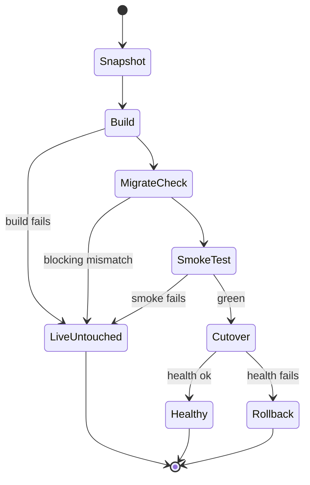
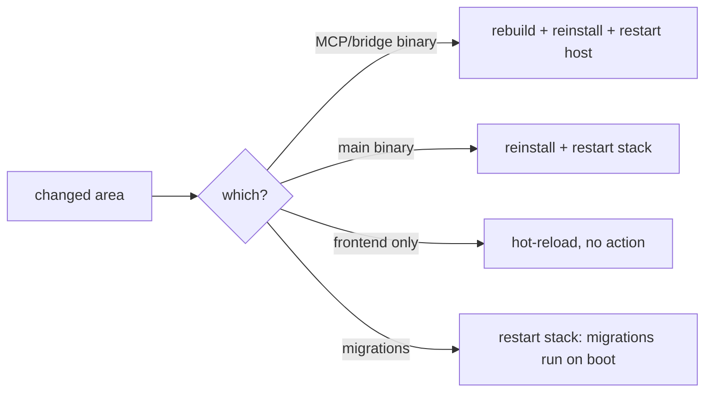

**Part IV · Threads: deterministic-enforcement, evidence-over-attestation, source-of-truth · Grounded by: [CS-4](../case-studies.md#cs-mvcc-cascade)**

# 15. Operational safety & deploy

This chapter covers the seam between "the code compiles" and "the code is serving production traffic without having destroyed anything." A deploy script, a port-freeing helper, a migration pre-flight, an operator-editable filter rule — each is a program with its own failure modes, and almost every failure mode here is the same shape: **act-then-hope** instead of **validate-then-act**. The safe version of any ops procedure proves the new state is good *before* it tears down the old one, names its blocking conditions precisely, touches only what it owns, and treats prose-only guardrails as a known gap to close with tooling. Config *architecture* — precedence chains, layering, introspection design — belongs to [ch. 14 — Configuration architecture](./14-T11a-config-architecture.md); this chapter touches config only where it is load-bearing for an ops script or operator control.

---

## 1. Deploy via validate-then-cutover: prove the new binary boots before killing the live one

**Do this.** Make redeploy a program that never touches the live service until a freshly-built binary has *proven* it can boot. Order the steps so the live process is killed on exactly one transition, and only after a green smoke test: (1) snapshot the current binary to a rollback copy; (2) build the new one — a build failure aborts before anything live is touched; (3) smoke-test the new binary on **alternate ports** against the *real* dependencies (run migrations, bootstrap any id allocator, bind, poll a real `GET /health`); (4) only on green, stop the old process and start the new one on the real ports behind a health gate; (5) auto-rollback to the snapshot binary if the new one fails its health check. A `--dry-run` does everything except the cutover. `[thread: evidence-over-attestation]`

**Not this.** Kill (free) the live process first and *then* run startup migrations + bind. A failed migration or a bad boot strands you with nothing serving against a possibly half-migrated DB — the hand-recovery scramble the whole script exists to delete.

**Why.** A naive start script killed the old process via a port-free step *before* the new binary ran its on-startup migrations; any boot failure left the service down. Inverting the order makes the live process untouched until the alt-port smoke test is green. Note the second-order constraint: because two instances run against one shared DB during the smoke test, id allocation must be concurrency-safe so the two take disjoint id batches — a reminder that "run a second copy to validate" silently assumes your write path tolerates concurrency.

**Evidence.** `scripts/deploy-proxy.sh:2-57` ("WHY THIS EXISTS" header + numbered steps); `:159-228` (snapshot/build/migrate-check/smoke-test); `:238-305` (cutover with `.prev` rollback); commit `836f5fa` "fail-safe deploy cutover + read-only migrate-check pre-flight"; memory `project_safe_deploy_cutover.md`.

**Pattern.**
```bash
# Smoke-test the NEW binary on alt ports against the real DB; live process untouched.
MIKE_LISTEN_ADDR="${ALT_PROXY_ADDR}" MIKE_INSPECT_ADDR="${ALT_INSPECT_ADDR}" \
    "${CLAUDE_PROXY_BIN}" >"${SMOKE_LOG}" 2>&1 &
SMOKE_PID=$!
if ! wait_healthy "${ALT_INSPECT_ADDR}" "${SMOKE_PID}" "smoke-test instance"; then
    tail -n 30 "${SMOKE_LOG}" >&2
    echo "==> The live process was NOT touched. Nothing to roll back." >&2
    exit 1                # trap reaps SMOKE_PID; live process never touched
fi
# ...only now stop the old process and cut over.
```



---

## 2. Add a read-only migrate-check pre-flight, and keep migrations expand-only so rollback is real

**Do this.** Before booting anything, run a **read-only** pre-flight that compares the binary's embedded migration checksums against the applied set in the DB's migration-tracking table. Flag two BLOCKING states with precise names: (a) an applied migration whose `.sql` was edited after apply (checksum mismatch — the migrator will refuse to run), and (b) a DB *ahead* of the binary (a version applied with no embedded counterpart — the binary is older than the schema). A fresh DB with no tracking table is "all pending, no blockers." Make this the *first* gate in both the dev start script and the deploy script, before any port is touched. `[thread: deterministic-enforcement]`

**Not this.** Let a checksum mismatch surface as a generic boot crash *after* you've already killed the live process. And do not treat validate-then-cutover (Lesson 1) as safe for *any* migration — it is safe only for **expand-only / backward-compatible** changes (new tables/columns/indexes, nullable adds, new views). A successful-but-destructive migration (`DROP`/`RENAME COLUMN`, retype, `ADD NOT NULL` without default) cannot be undone by reverting the binary; `CREATE INDEX CONCURRENTLY` is non-transactional and leaves an INVALID index needing manual drop on mid-build failure ([PostgreSQL docs — CREATE INDEX CONCURRENTLY](https://www.postgresql.org/docs/current/sql-createindex.html)). The rollback promise is void for those.

**Why.** Agents (and humans) edit already-applied `.sql` files; the sqlx migrator then refuses to migrate, and a boot-time crash is an opaque way to discover it. A `migrate-check` subcommand turns it into a one-line read-only diagnostic. The expand-only precondition matters because the smoke test applies migrations to the *shared* DB: the still-running old binary briefly serves against the new schema, and the rollback path runs the OLD binary against the already-migrated schema — both are safe only for additive changes. Expand-only migration mechanics are owned by [ch. 5 — Migrations](./05-T04b-migrations-mechanics.md); this chapter adds only the deploy-time consequence.

**Evidence.** `crates/claude-proxy/src/store/persistence/migrations.rs` (`assess()` / `MigrationAssessment{ mismatched, missing_from_binary, pending }` / `is_blocking()`, added in `836f5fa`); `crates/claude-proxy/src/config/subcommands.rs:1-16,36-40` (`migrate-check` doc + `MigrateCheck` variant); `scripts/deploy-proxy.sh:194-205` and `scripts/start-proxy.sh:167-176` (migrate-check as the first gate); `deploy-proxy.sh:25-36` (expand-only precondition).

**Pattern.**
```rust
pub(crate) struct MigrationAssessment {
    pub(crate) mismatched: Vec<MismatchedMigration>, // applied .sql edited after apply — BLOCKING
    pub(crate) missing_from_binary: Vec<i64>,        // DB ahead of binary — BLOCKING
    pub(crate) pending: Vec<i64>,                    // will apply next run — informational
}
impl MigrationAssessment {
    pub(crate) fn is_blocking(&self) -> bool {
        !self.mismatched.is_empty() || !self.missing_from_binary.is_empty()
    }
}
```

> **Gap worth closing in a new repo:** the expand-only precondition is enforced here only by *documentation*, not tooling. A migration lint that rejects `DROP` / `RENAME COLUMN` / `ADD ... NOT NULL`-without-default unless an explicit `--allow-destructive` flag is set would make the rollback promise structural instead of prose. Flagged as a stronger control, not a claim the repo implements it.

---

## 3. Write ops scripts in strict mode with idempotent port-freeing and a trap that touches only what the script started

**Do this.** Open every lifecycle script with `set -euo pipefail`. Provide an idempotent `free_port` helper that finds the listening pid by port, sends SIGTERM, polls a few times, then escalates to SIGKILL — a no-op when the port is already free. Track the PIDs the script started in an explicit array and install an `EXIT INT TERM` trap that tears down *only* those PIDs, so the operator's other background jobs survive. Critically, `wait` on the **primary** process — the one whose in-memory state is valuable — not an auxiliary one, so a crashing dev-server never drops the primary. `[thread: deterministic-enforcement]`

**Not this.** Unguarded scripts that `kill %1` blindly, leave orphaned listeners on re-run, or let an auxiliary process (a bundler dev server, a Storybook) tear down the primary and its state. If your primary holds valuable in-memory state, a `wait` keyed on the auxiliary loses that state when the auxiliary hiccups.

**Why.** When the primary process holds something expensive to rebuild (here, an in-memory captured request store), the start script `wait`s on the primary PID specifically and tracks its started PIDs so an auxiliary crash relaunches the auxiliary alone. The deploy script's trap goes one step further: on abort it *deliberately never frees the live ports*, so an aborted deploy leaves the live process exactly as it was — the trap is scoped to the smoke-test instance only.

**Evidence.** `scripts/start-proxy.sh:38` (`set -euo pipefail`); `:118-138` (`free_port`); `:231-253` (`PIDS=()` + `cleanup()` / `trap cleanup EXIT INT TERM`); `:328-333` (`wait "${MIKE_PID}"`, not the SPA); `scripts/deploy-proxy.sh:96-157` (matching `free_port`/`cleanup` that never frees the live ports).

**Pattern.**
```bash
free_port() {
    local port="$1" pid
    pid="$(lsof -ti ":${port}" -sTCP:LISTEN 2>/dev/null || true)"
    [[ -z "${pid}" ]] && return 0
    kill "${pid}" 2>/dev/null || true
    for _ in 1 2 3 4 5; do sleep 0.2; kill -0 "${pid}" 2>/dev/null || return 0; done
    kill -9 "${pid}" 2>/dev/null || true   # escalate only if SIGTERM was ignored
}
```

---

## 4. Prepend toolchain paths for non-login shells inside the script

**Do this.** At the top of every entry-point script, detect-and-prepend the standard toolchain location (e.g. `~/.cargo/bin` for Rust) when the tool is missing from PATH. Scripts run by agents, CI runners, or `sh -c` do not source the shell profile that rustup/pnpm rely on, so a tool can appear "missing" even when installed. One silent guard makes the same script work from a login terminal and a non-interactive context alike. `[thread: deterministic-enforcement]`

**Not this.** Assume an interactive-shell PATH. The script works for the author and fails for everyone running it under automation with `command not found: cargo` — the most confusing class of "works on my machine."

**Why.** This codebase is driven heavily by non-login shells (agents, CI, `sh -c`); both lifecycle scripts carry the identical guard with a comment naming the audience. The cost of the guard is two lines; the cost of omitting it is a deploy that fails only under the automation you most need it to work under.

**Evidence.** `scripts/start-proxy.sh:44-50` (PATH prepend with non-login-shell comment); `scripts/deploy-proxy.sh:65-69` (identical guard).

**Pattern.**
```bash
# Non-login shells (agents, CI, `sh -c`) don't source the rustup PATH line.
if ! command -v cargo >/dev/null 2>&1 && [[ -x "${HOME}/.cargo/bin/cargo" ]]; then
    export PATH="${HOME}/.cargo/bin:${PATH}"
fi
```

---

## 5. When a script needs resolved config, `eval` the binary — and know what it redacts

**Do this.** When an ops script needs config values (ports, bind addrs), have the application binary emit its *own fully-resolved* config as `KEY=VALUE` lines and `eval` that, rather than re-parsing the config file in bash. The binary resolves the defaults < file < env < CLI chain exactly once, so the script and the running process can never disagree; the script overrides only the values it needs (the bind addrs for an alt-port smoke test) and inherits everything else. **But know what the shell projection deliberately omits:** a `print-config --shell` mode that redacts secrets (the DB password, API keys) so they don't land in a sourced shell environment means the *script cannot reconstruct a full connection string from it* — the script must inherit the secret-bearing value from its own environment, not from the eval. `[thread: source-of-truth]`

**Not this.** `grep`/`sed`-parse the config file in bash — that silently ignores env-var and CLI overrides and drifts from what the process actually loaded. Equally wrong: assume the shell projection is a *complete* round-trip of config and try to rebuild a redacted secret from it.

**Why.** The "binary is the single source of resolved config" principle is owned in full by [ch. 14 — Configuration architecture](./14-T11a-config-architecture.md); the ops-specific qualifier is mine: the same `--shell` projection that prevents config drift also redacts the DB password, so an ops script that `eval`s it gets honest *non-secret* values and must source secrets separately. Treat the eval as "resolved public config," not "everything the process knows."

**Evidence.** `scripts/start-proxy.sh:63-82` (`eval "$("${CLAUDE_PROXY_BIN}" print-config --shell)"` — "no drift between two config reads"); `scripts/deploy-proxy.sh:180-185` (same eval to resolve the bind addrs before the smoke test); `crates/claude-proxy/src/config/subcommands.rs:42-47` (`PrintConfigArgs { shell }`).

---

## 6. Set the three Postgres timeouts and tune the pool to fail fast

**Do this.** All three Postgres timeouts default to **disabled (0)** ([PostgreSQL docs — client connection defaults](https://www.postgresql.org/docs/current/runtime-config-client.html)) — set them per-database as a production prerequisite: `statement_timeout` (aborts a runaway query), `idle_in_transaction_session_timeout` (the single biggest defence against a stuck `BEGIN` blocking VACUUM forever), and `lock_timeout` (stops one slow `ALTER TABLE` from blocking every reader). On the client, lower the pool `acquire_timeout` from its 30s default to ~5s so pool saturation surfaces as an *incident*, not a slow query; size `max_connections` against `(server max_connections / replica count)` with headroom; hold transactions for **milliseconds** and never `await` a network call mid-transaction. `[thread: bound-it]`

**Not this.** Leave the three timeouts at 0; let a 30s `acquire_timeout` mask saturation as "slow queries"; hold long transactions that `await` I/O and block VACUUM, bloating tables. The most insidious variant is co-locating a best-effort denormalized-table `UPDATE` *inside* a load-bearing request-snapshot transaction.

**Why.** This is the operational backstop to the MVCC cascade ([CS-4](../case-studies.md#cs-mvcc-cascade)): one `sessions` UPDATE held inside a wide transaction blocked a concurrent `DELETE` long enough to radiate across every operation on that table. The *diagnosis* (find the single lock holder) is owned by [ch. 9 — Error-handling architecture](./09-T08-error-handling.md), the *proof technique* (an uncontended `EXPLAIN` that runs fast proves the cost is wait, not work) by [ch. 10 — Observability & inspection fidelity](./10-T09-observability-fidelity.md), and the *fix* (narrow the transaction) by [ch. 6 — The persistence boundary](./06-T05-persistence-boundary.md). My facet is the ops backstop: `idle_in_transaction_session_timeout` would have *bounded the blast radius* even before the code fix landed — it turns a cascading stall into one aborted transaction with a log line. The day-one ordering for setting these GUCs is owned by [ch. 3 — Plan for the database from day one](./03-T03-db-planning.md); tuning them as an ops control is mine.

**Evidence.** `artifacts/research/2026-04-25-rust-postgres-best-practices.md:251-271` (three timeouts default 0; "Without this, a panicked tokio::spawn holding a BEGIN is forever"; saturation symptoms); same file `~45-74` (pool tuning, lower `acquire_timeout` to 5s, hold transactions for milliseconds); memory `project_mvcc_cascade.md`; memory `warning_snapshot_request_tx.md` (do not add more writes to that tx).

**Pattern.**
```sql
ALTER DATABASE app SET statement_timeout = '30s';
ALTER DATABASE app SET idle_in_transaction_session_timeout = '60s';  -- VACUUM protection
ALTER DATABASE app SET lock_timeout = '5s';
```
```rust
PgPoolOptions::new()
    .max_connections(20)                       // (server max_connections / replicas) - headroom
    .acquire_timeout(Duration::from_secs(5))   // fail fast; 30s masks saturation as slow queries
    .test_before_acquire(true);
```

---

## 7. Operator-editable controls need second-order-effect guards — a local fix can silently disable global behaviour

**Do this.** When you let operators install rules/filters/overrides that mutate shared behaviour, treat the **blast radius** as part of the control's contract. Prefer surgical `replace` over blunt whole-object `drop`. When a `drop` matches a substring but would remove far more than the operator targeted, surface the side effect: at save time, run the candidate rule against recent real inputs and show "this strips the entire block (N KB), not just your substring — consider `replace`." Make the side effect *visible*; don't silently block the save and don't silently apply it. `[thread: source-of-truth] [thread: evidence-over-attestation]`

**Not this.** Whole-block `drop` on a substring match with no signal of co-located content. The operator removes one line and silently deletes everything sharing that block — every tool, scope, and error-handling instruction with it.

**Why.** Forensics on captured traffic found two operator-installed `drop` filter rules — each targeting a single brevity sentence — that stripped the *entire* system block they lived in. The instruction the operator most wanted (be concise) was the one removed, and it took every co-located rule with it; the downstream agent then ran on effectively no system instruction. The corrective direction is two-part, and only the first part has shipped: the `drop → replace` rule swap is operator-editable and was applied/recommended; the pre-save co-location **warning is proposed future work** (scoped as a separate frontend effort, not yet shipped). Teach both, but do not present the warning as a delivered guard. This incident is part of the agent-forensics case study ([CS-5](../case-studies.md#cs-agent-forensics)), grounded in Part V; my facet is the *operator-control blast-radius* angle.

**Evidence.** `artifacts/session-evaluation/02-forensics-4a9b4f5c.md:76-101` (the whole-block drop — the byte-level blast radius is narrated in [CS-5]); `artifacts/session-evaluation/06-root-cause-audit.md:25-26,30` (the two rule UUIDs + values; `enabled:true, source:ui`; the `drop → replace` recommendation); `artifacts/session-evaluation/07-fix-plan.md:46,48,56-58` (`drop → replace` applied; pre-save warning filed under "Phase 5 — code work, proposed, not in this PR").

**Pattern.** At save time, run the candidate `drop` rule against the most-recent N captured inputs; if the would-be-removed unit is >1 KB or contains other non-trivial content, *warn* (don't block): *"This drop strips the whole block, not just the matched substring. Consider replace."* (Proposed control; shown as the target shape, not as shipped code.)

---

## 8. Removing a feature spans docs, config samples, and guides — not just the source module

**Do this.** Treat "delete the module" as the *start* of feature removal. Run one repo-wide grep for the removed symbol (excluding build dirs / `node_modules` / vendored migrations), then classify every hit as (a) live code/docs to fix, (b) a historical artifact that correctly preserves past state (keep), or (c) compatibility SQL where the symbol must stay. Audit the surfaces that *do not fail to compile when stale*: design docs, architecture/startup diagrams (prose **and** mermaid), roadmap, real **and** sample config, top-level agent/instruction files (`CLAUDE.md`/`AGENTS.md`), and user-facing help pages. `[thread: source-of-truth]`

**Not this.** Equate "the module is gone" with "the feature is removed," leaving docs/config/guides describing code that no longer exists. None of those stale references break the build, so they survive silently — and they are exactly what the next reader trusts.

**Why.** A sweep-feature removal initially updated only production source; the audit later found stale references in a frontend help guide, a startup-flow doc (both the diagram and the numbered list), and the architecture doc — none would compile-fail to surface the gap. This is a live instance: a stale `persist_enabled: false` line in the architecture doc lingered long after the code defaulted persistence to `true` (see [ch. 14 — Configuration architecture](./14-T11a-config-architecture.md)) — a doc relic that itself proves the rule.

**Evidence.** memory `correction_complete_removal_includes_docs.md` (8-surface audit list + the single grep pattern with build-dir exclusions; sweep.rs origin).

**Pattern.**
```bash
grep -rn '<removed_symbol>' "$REPO" 2>/dev/null \
  | grep -v '\.svelte-kit/\|build/\|node_modules/\|cargo-target\|migrations/' \
  | head -20
# then classify each hit: (a) live → fix, (b) historical artifact → keep, (c) compat SQL → keep
```

---

## 9. Codify quality gates in CI, not only in local `make` discipline

**Do this.** Stand up CI early to run the same gates your local `make check` runs — lint with warnings-as-errors, the full test suite, and `cargo sqlx prepare --workspace --check` to verify the committed `.sqlx/` query cache is in sync with the macros. Make these *block the merge*. A gate that only runs when a developer remembers to run it is not enforced; it is a suggestion. `[thread: deterministic-enforcement] [thread: evidence-over-attestation]`

**Not this.** Treat the Makefile as the enforcement layer and rely on developer memory. Drift — a lint regression, or a stale sqlx query cache after a schema change — then ships, caught (if at all) only at someone's next local compile. Committing a migration without regenerating `.sqlx/` is a latent compile break that the `--check` step exists to catch before merge.

**Why.** temet-proxy *itself has this gap*, and it is the honest example, not the exemplar: its CI (`.github/workflows/`) contains only Storybook workflows (`storybook.yml`, `storybook-coverage.yml`) — **no Rust lint/test/sqlx gate runs in CI at all**. The internal doc still asserts the directory is "empty"; that literal claim is now stale (two Storybook workflows exist), but the substance holds — no `cargo`/`clippy`/`nextest`/`sqlx` gate runs on merge. The lesson is to close this in a *new* repo from day one. Do not cite temet-proxy as a CI exemplar; cite it only as a project that *named the gap and still shipped without closing it.* (A concrete minimal workflow stub is in [Appendix A](../appendix-a-adopt.md).) The sqlx offline-cache mechanics this gate guards are owned by [ch. 13 — Tooling & quality gates](./13-T12-tooling-quality-gates.md).

**Evidence.** `docs/development/sqlx-prepare.md:95-97` (states "No CI workflow exists yet … `.github/workflows/` is empty … schema/macro drift is caught only at local-compile or manual prepare time" — quote resolves, but the literal "empty" is now stale); same file `:13,72,88-93` (the `--check` gate's intended role + `SQLX_OFFLINE` for hermetic builds); `.github/workflows/` contains only `storybook.yml` + `storybook-coverage.yml`, neither invoking any Rust gate (verified); `Makefile` defines `check`/`lint`/`test` but nothing in CI invokes them.

---

## 10. An installer should check prerequisites with named failures and upsert config without discarding edits

**Do this.** A one-shot installer should (1) verify each required tool up front and report *exactly which are missing* with a remediation hint, rather than failing midway; (2) probe optional capabilities (e.g. `docker compose`) and degrade gracefully with a warning when absent; (3) when writing config, **surgically upsert only the keys it manages** into an existing file — preserving operator comments and hand-edits — and show a diff before rewriting; (4) offer explicit storage modes (in-memory / docker-managed / external-you-supply-the-URL) so the bootstrap fits local, container, and managed setups alike. `[thread: source-of-truth]`

**Not this.** Installers that abort halfway on the first missing dependency (so you fix one, re-run, hit the next), or that clobber an existing config file wholesale and silently drop the operator's customizations.

**Why.** The pattern generalizes: an installer that *replaces* operator state is a deploy hazard wearing a setup-script costume. Treating the operator's existing config as authoritative — touching only managed keys, announcing the upsert, showing the diff — is the same source-of-truth discipline that governs the deploy and removal lessons above.

**Evidence.** `scripts/install.sh:1-27` (header: prereq checks, storage modes, surgical managed-key update with diff); `:188-198` (collect-all missing-tools report); `:208-216` (`docker compose` capability probe, warn-not-die); `:118` ("Upsert KEY in FILE" helper); `:248` (announces it will "upsert matching keys without discarding your edits"); `:288-307` (storage-mode menu). (Bundle line numbers drifted slightly; cited values confirmed against current source.)

---

## 11. Document the rebuild/reinstall/restart workflow for out-of-band binaries

**Do this.** When part of your system runs as a binary *outside* the main hot-reload loop (an MCP bridge spawned by another tool, a sidecar, a CLI installed into PATH), document an "after pulling changes" table mapping **what changed → what to re-run**: a bridge-binary change means rebuild-and-reinstall + restart the host; a main-binary change means reinstall + restart the stack; a frontend-only change hot-reloads. Resolve such binaries via PATH (where an install step places them), not a hardcoded absolute target path, so the config is portable across machines and checkouts. `[thread: source-of-truth]`

**Not this.** Leave operators guessing why a code change "didn't take" because the stale binary is still spawned. Or pin a binary to a machine-specific `/Users/.../target/release/...` path that breaks on every other checkout.

**Why.** An MCP bridge binary spawned from a config file is invisible to the proxy's hot-reload loop, so a tool-shape change does not take until the binary is rebuilt, reinstalled, and the host restarted — a failure mode with no error, just stale behaviour. The out-of-band binary's *rebuild mechanics* (the `make install` step) are owned by [ch. 13 — Tooling & quality gates](./13-T12-tooling-quality-gates.md); my facet is the *operational* one: write down the change→action map, and resolve the binary from PATH so it stays portable.

**Evidence.** `CLAUDE.md:74-83` ("After pulling changes" table: bridge → reinstall + restart; main binary → install + start; frontend → hot-reload; migrations → restart); commit `f3ceb9e` "resolve proxy-mcp via PATH instead of a hardcoded target path" ("portable across machines/checkouts").

**Pattern.**


---

## Further reading

- [Fowler — BlueGreenDeployment](https://martinfowler.com/bliki/BlueGreenDeployment.html) — two as-identical-as-possible environments, route to the new one only after it's validated, switch the router back to roll back; reinforces Lesson 1's alt-port-smoke-then-cutover ordering and Lesson 2's "refactor the schema to support both old and new version first" — the verbatim grounding for expand-only. (Divergence: Fowler assumes two *separate* environments and a router; the single-binary variant shares one DB, which is exactly why Lesson 2's expand-only precondition is load-bearing here and not in classic blue-green.)
- [Humble & Farley, *Continuous Delivery* — the deployment pipeline / commit-stage gates](https://www.oreilly.com/library/view/continuous-delivery/9780321670250/) — the book-length form of "build → migrate-check → smoke-test → cutover, abort early" (reinforces Lesson 1) and of "a gate that runs only when a developer remembers is a suggestion, not enforcement" (reinforces Lesson 9, where temet-proxy is the *negative* example CD is the standard for).
- [Forsgren, Humble & Kim, *Accelerate* — CI / deployment automation as a capability](https://www.oreilly.com/library/view/accelerate/9781457191435/) — the research finding that automated, merge-blocking CI correlates with delivery performance; reinforces Lesson 9's "stand up CI early."
- [PostgreSQL docs — ALTER TABLE](https://www.postgresql.org/docs/current/sql-altertable.html) — `ADD COLUMN` with a volatile default or `ADD ... NOT NULL` forces a full table rewrite under `ACCESS EXCLUSIVE` while the additive `NOT VALID` → `VALIDATE CONSTRAINT` path takes only `SHARE UPDATE EXCLUSIVE`, and ([CREATE INDEX CONCURRENTLY](https://www.postgresql.org/docs/current/sql-createindex.html)) cannot run in a transaction and leaves an invalid index on failure; together they define Lesson 2's safe expand-only set and its destructive exclusions.
- [PostgreSQL docs — client connection defaults](https://www.postgresql.org/docs/current/runtime-config-client.html) — `statement_timeout`, `lock_timeout`, and `idle_in_transaction_session_timeout` each default to 0 (disabled); reinforces Lesson 6's "set them per-database as a production prerequisite."
- [Google SRE — Addressing Cascading Failures](https://sre.google/sre-book/addressing-cascading-failures/) — resource exhaustion (threads, connections) cascades, and servers should fail-fast / shed load as overload approaches rather than do doomed work past deadline; reinforces Lesson 6's "lower `acquire_timeout` to 5s so saturation surfaces as an incident." (Nygard's *Release It!* "Timeouts" / "Circuit Breaker" patterns are the book-length companion of the same idea.)
- [Linux kernel docs — stable-api-nonsense](https://www.kernel.org/doc/html/latest/process/stable-api-nonsense.html) — the kernel's "stable userspace ABI, deliberately-unstable in-kernel API" *qualifies* Lesson 2 by inversion: it keeps a contract it can never roll back ("never break userspace"), so it cannot do expand-then-contract. Expand-only migrations rhyme with "never break the consumer," but a DB has an escape — revert the binary against an additively-changed schema — that a syscall ABI structurally lacks. The rule transfers only as the bound-the-consumer principle, not the rollback mechanism.
