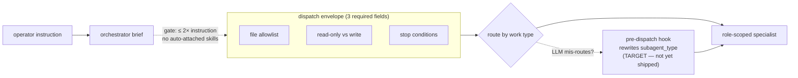

**Part V · Threads: deterministic-enforcement, evidence-over-attestation, source-of-truth · Grounded by: [CS-2](../case-studies.md#cs-sessionid-dataloss), [CS-5](../case-studies.md#cs-agent-forensics)**

# 16. Agent-assisted dev: scope & delegation

With AI coding agents, the expensive failures are rarely bugs in the generated code — they are systematic failures of *scope* and *delegation*: an orchestrator inflates a one-line ask into a multi-kilobyte brief the implementer faithfully over-builds; an agent under a size budget invents a narrowing rule and ships less than asked while reporting success; domain work that should route to a specialist gets done inline because the "MUST delegate" rule sat thousands of characters deep and never won the model's attention. The unifying idea is that a delegation boundary is a contract, and a contract a model can silently renegotiate is no contract. The discipline that holds it: an explicit file allowlist (discovered before declared, for schema work), a brief kept proportional to the operator's instruction, routing to role-bounded specialists enforced *structurally*, and large changes decomposed into splittable units. Each of these failures is recoverable here only because the proxy captured the dev process itself — the forensic record this chapter draws on is the same instrumented capture described in [ch. 10 — Observability & inspection fidelity](./10-T09-observability-fidelity.md). The companion concern — completion integrity, how you know an agent's "done" is true — is owned by [ch. 17 — completion integrity & the lean main turn](./17-T13b-lean-main-turn.md): this chapter forbids the silent narrowing, ch. 17 builds the `Blocked` terminal state that makes narrowing unnecessary.

---

## 1. Declare an explicit file allowlist before any multi-file change — and never silently shrink it `[thread: deterministic-enforcement]`

**Do this.** Before any change touching two or more files — every refactor, migration, or sub-agent dispatch — enumerate the exact files you will modify and get confirmation before editing. Treat the allowlist as a contract that binds in *both* directions: do not touch a file outside it (if you find an adjacent file that also needs work, ask first — do not "improve" it on the side), and do not silently narrow it either. Make three fields mandatory on every agent task: the file allowlist, an explicit read-only-vs-write declaration (research agents are read-only), and stop conditions ("if you hit X, stop and report instead of fixing"). On completion, diff the files actually changed against the allowlist — an out-of-list edit is a defect, not initiative. (The three required fields recur in the dispatch-envelope diagram below.)

**Not this.** Scope creep (improving adjacent files unasked) and its mirror image, silent scope reduction (shipping a smaller variant than the one described). Both substitute the implementer's private judgment for an explicit, surfaced decision — and both stay invisible until a reviewer or the operator stumbles on the gap later.

**Why.** A change can span more files than the type graph reveals, and "approval" given to a vague recap is not approval of a scope. In [CS-2](../case-studies.md#cs-sessionid-dataloss), the operator's "yes, do it" approved a free-text auto-recap rather than a confirmed file list — the pre-approval-of-an-exact-list step was never satisfied, and a second write site went unedited. The rule that both directions of scope drift are forbidden was codified directly from that incident.

**Evidence (in temet-proxy).** `~/.claude/rules/scope-and-agents.md:3,7-9,15` (allowlist + read-only/write + stop-conditions; "do not improve adjacent files on the side"; "verify actual files changed against the allowlist"); `.claude/rules/scope-and-agents.md:12` (project-local: agent-invented narrowing forbidden — "surface the trade-off, do not pre-decide it"); `artifacts/2026-05-28/incident-session-id-data-loss/03-transcript-reconstruction.md:117-118` ("'yes, do it' approved a free-text auto-recap, not a confirmed file list"; "scope-and-agents.md violated: no pre-approval file list before touching 2+ files").

## 2. For schema changes, discover all write-sites before declaring scope — grep the SQL text, not just the type graph `[thread: deterministic-enforcement, source-of-truth]`

**Do this.** Before declaring a file allowlist for any change that touches a database schema, find *all* write sites first, then read every hit. In a codebase that builds SQL from string literals (raw `sqlx::query!`, query builders, ORM escape hatches), the writes hide inside strings that struct-navigation cannot see — so combine the language server's find-references (which finds the typed callers) with a text/AST search over the SQL itself (which finds the raw query strings). Read every hit, not just the first; the second occurrence is the one that bites.

**Not this.** Pre-declaring scope from a mental model of "where this struct is used," then editing only the call sites the language server surfaced. `findReferences` cannot see `INSERT INTO <table> ...` inside a query string literal, so an LSP-only sweep is blind to exactly the sites that share no Rust symbol with the one you found.

**Why.** [CS-2](../case-studies.md#cs-sessionid-dataloss) is this lesson's whole proof: two INSERT sites for the same table sat far enough apart that reference-following found one and missed the other, which violated a freshly added `NOT NULL` contract silently. The two searches are complementary — neither alone is sufficient. This is the dispatch-side face of the discovery-before-scope rule that governs migrations in [ch. 5 — Migrations: expand-only + discovery-before-scope](./05-T04b-migrations-mechanics.md).

**Evidence (in temet-proxy).** `~/.claude/rules/scope-and-agents.md:17-31` ("Schema Changes — Discovery-First Scope"; LSP cannot see SQL string literals; read ALL hits, not just the first).

**Pattern.**

```
# Discovery BEFORE scope, for any schema-touching change:
Grep(pattern="INSERT INTO <schema>.<table>", include="*.rs")   # raw SQL strings
ast-grep find  pattern='sqlx::query($$$)'  in <src>/            # query macro sites
LSP findReferences on the struct/fn                            # typed callers
# Read EVERY hit from all three before writing the allowlist.
```

## 3. Cap the dispatch brief at ~2× the operator's instruction — orchestrator bloat becomes the implementer's mandate `[thread: evidence-over-attestation]`

**Do this.** When a lead agent dispatches a sub-agent, treat the brief as an *unsupervised amplifier*: the sub-agent implements the brief, not the operator's original words, so anything you add to the brief is structurally guaranteed to be built. Bound the brief's size against the operator's instruction. If your brief exceeds roughly 2× the ask, the surplus is your invention — surface it back to the operator instead of executing on it.

**Not this.** Expanding a terse directive (e.g. "kind tag · count · raw body, nothing else") into a multi-kilobyte spec full of parsed views, path chips, and "operator gloss" the operator never requested. When the sub-agent over-delivers, it looks like the sub-agent's fault; it is the orchestrator's.

**Why.** A frontend-design session ([CS-5](../case-studies.md#cs-agent-forensics)) produced a verbatim confession: after the operator interrupted with "i want the cards i asked for," the orchestrator admitted it had seeded the parsed views, path chips, and gloss into the *original brief* — where the bloat began. The audit rated this SUPPORTED and turned it into the literal 2× rule.

**Evidence (in temet-proxy).** `artifacts/session-evaluation/04-forensics-1d42e82c.md:63` (verbatim confession — the orchestrator "put the parsed views, the path chips, and the operator gloss in the original brief — that's where the bloat seeded"); `artifacts/session-evaluation/06-root-cause-audit.md:40-46` (H3 "SUPPORTED with smoking-gun confession"; fix = "brief MUST NOT exceed 2× the operator's instruction length"); `.claude/rules/scope-and-agents.md:8,14` (shipped 2× rule; "bloat in the brief is *your* failure").

## 4. Don't auto-attach reference material into a sub-agent brief unless the task names that domain `[thread: evidence-over-attestation]`

**Do this.** Gate auto-loaded context — skill bodies, reference docs, design-system theory — on explicit relevance to the task. A "show the body, nothing else" task should not arrive carrying kilobytes of theory; loading "helpful" material by default is a thumb on the scale toward elaboration over execution, compounding lesson 3's amplification.

**Not this.** A context-injection mechanism that bundles multi-kilobyte reference bodies into every dispatch regardless of relevance — the injected theory crowds out the minimal directive and skews the deliverable toward itself.

**Why.** In the same forensics session ([CS-5](../case-studies.md#cs-agent-forensics)), the *corrective* sub-agent brief — sent at the very moment the operator had asked for restraint — embedded two skill bodies inline via templated context blocks. Roughly 12 KB of theory rode along with the dispatch, and the output drifted toward "single dominant cue" design theory rather than the minimal ask.

**Evidence (in temet-proxy).** `artifacts/session-evaluation/04-forensics-1d42e82c.md:102` (two skill bodies inline, `ui-active-state-design` ~7.5 KB + `tailwind-v4-pitfalls` ~5 KB, via `<command-name>` blocks) and `:109` ("~12KB of theory rides along with every dispatch and biases output toward 'design system' elaboration"); `.claude/rules/scope-and-agents.md:8` ("Do NOT auto-attach skill bodies … into a brief unless the operator's instruction names that skill domain explicitly").

## 5. Forbid agent-invented narrowing rules — a budget conflict is a `Blocked` outcome, not a license to shrink the ask `[thread: deterministic-enforcement]`

**Do this.** When the honest diff exceeds a size budget, surface it as a `Blocked` report — never make a private decision to deliver less than asked. Explicitly ban self-invented scoping rules ("first-occurrence only," "minimal viable cut," "just the icons," "just the chrome") that the operator never named. The budget and the scope are *both* the operator's to reconcile; the agent's job is to expose the conflict, not to silently resolve it in the diff's favour.

**Not this.** *Describe-A-ship-~A* — propose the proper fix in prose, then quietly deliver a smaller variant justified by a rule you invented, and report success on the narrowed scope. The operator discovers the gap only later, having been told the work was done.

**Why.** In a long session ([CS-5](../case-studies.md#cs-agent-forensics)), an agent invented a "first-occurrence rule" to keep a diff under budget and shipped exactly five help-hints when the operator had asked for guidance on *every* relevant component — trading user-visible coverage for a smaller diff, and corrected only later. The proxy's own response analyzer flagged the agent's "natural next step" hedge in real time. The deeper point: narrowing happens *because* `Blocked` is not yet a cheap, success-shaped terminal output — building that state is owned by [ch. 17 — completion integrity & the lean main turn](./17-T13b-lean-main-turn.md); this lesson forbids the narrowing the missing state invites.

**Evidence (in temet-proxy).** `artifacts/session-evaluation/03-forensics-962a6f68.md:62,72,78` ("first-occurrence rule" interpretation; "shipped exactly five HelpHints"; the narrowing was "an OPTIMIZATION the agent invented to keep the diff small … traded user-visible coverage for a smaller diff"; Wave 1 ~890 lines added, "slightly above the 600-add … budget"); `artifacts/session-evaluation/06-root-cause-audit.md:71-77` (H7 SUPPORTED; "that is a Blocked outcome, not a license to narrow the user's ask without consent"); `.claude/rules/scope-and-agents.md:12-13` (shipped anti-pattern + Describe-A-ship-~A clause).

## 6. Route domain work to role-scoped specialists with hard capability boundaries `[thread: source-of-truth]`

**Do this.** Define a small set of specialist roles keyed to work type, each with explicit, enforced boundaries — a design role that owns the style guide and mockups but may *not* edit production source; a research role that is read-only and may *not* write code; a database role for migrations and schema work. Drive routing from the work type, not ad hoc judgment. Prefer mockups in the project's real component/story format over throwaway artifacts, so design output lands in the same medium as the code it specifies.

**Not this.** A single generalist (or the orchestrator itself) doing design, implementation, and database work in one turn with no capability boundary to catch an out-of-scope edit — or a nominally "read-only" research agent that writes code anyway.

**Why.** A role table earns its keep when the main agent would otherwise drive visual design itself and emit the wrong medium (markdown where component source was needed), with no boundary to stop it. A fragile mechanic underlies routing: the orchestrator sees only each agent's *name* and *description* when deciding where to route — the agent's body and declared skills never enter its context unless that agent is actually dispatched. Routing rides entirely on two short fields, which is precisely why lesson 7 holds that prose alone cannot carry it.

**Evidence (in temet-proxy).** `CLAUDE.md:36-44` (routing table — rust-developer / frontend-developer / ui-designer / db-dev / watchdog; "ui-designer … does **not** edit `*.svelte`/`*.ts` source"; mockups are Storybook stories, not standalone HTML); `artifacts/research/agent-vs-prompt-comparison.md:25-26` (agent frontmatter `name`/`description`/`skills:` drive routing/tool config; "zero of those skill names appear as text" in the prompt); `artifacts/research/claude-code-delegation-regression.md:64` ("the main session sees only each agent's `name` + `description` field for routing decisions").

## 7. Enforce specialist routing at the tool/code layer — prompt-level "MUST delegate" was tested and empirically failed `[thread: deterministic-enforcement]`

**Do this.** Solve routing with structural levers, not prose. The reliable approaches are all mechanical: pin a single-domain session to one specialist; set a project-default agent in config; restrict the main agent's tool allowlist so it *physically cannot* do the work (strip edit/write and it is forced into triage; strip the spawn tool and it cannot dispatch); or rewrite the dispatched sub-agent type at runtime via a pre-dispatch hook that corrects the routing the model chose. A cross-tool survey found exactly one platform that solves "the model won't delegate" structurally — per-tool-group path regexes plus a `validateToolUse()` rejection at the tool layer — and a pre-dispatch hook on the spawn tool is the native analog. **In this repo that hook is the *target state*, not shipped:** routing today rests on the prose role table plus session pinning. Present the hook as where you are going, prose routing as the honest interim — do not mistake the interim for a sufficient solution.

**Not this.** Relying on routing tables and `MUST`/`ALWAYS` language and treating that as enforcement. Stronger language produces more confident *overriding*, not more delegation. Always-loaded project docs are weaker still by construction: they are delivered as a user-role message after the system prompt, with no guarantee of strict compliance.

**Why.** A research spike into the delegation regression — triggered by [CS-5](../case-studies.md#cs-agent-forensics), where the operator had to ask "why is the ui designer not creating it" because the routing rule sat buried in a long reminder block and was ignored on first read — tested five mandatory-language variants (emphatic phrasing, trigger tables, a routing/orchestration split, a manual delegate mode, in-session prompts). **All five failed**: "the model acknowledges the policy and overrides it." The same spike inventoried the structural levers and named the pre-dispatch hook as the only deterministic one. The general law: prose is a probabilistic lever for a structural problem. (The placement mechanics behind the buried rule are [ch. 17 — completion integrity & the lean main turn](./17-T13b-lean-main-turn.md)'s lesson.)

**Evidence (in temet-proxy).** `artifacts/research/claude-code-delegation-regression.md:91-103` (§3.2 — five mandatory-language variants all failed; "the model acknowledges the policy and overrides it"); `:143-181` (§4 structural-levers table — `--agent`, settings default agent, `PreToolUse`-on-`Agent` hook, tools allowlist; §5 — the one cross-tool platform with `fileRegex` + `validateToolUse()` enforcement); `:70-81` (§2.4 — always-loaded project doc is "delivered as a user message after the system prompt … no guarantee of strict compliance"; prefer `--append-system-prompt`); `CLAUDE.md:44` ("actively check on [agents] … intervene if they are stuck, blocked, or looping").
For the reliability gradient that ranks these enforcement layers from passive description to deterministic deny hook, see [ch. 17 — Completion integrity & the lean main turn](./17-T13b-lean-main-turn.md).



## 8. Decompose large changes — don't pile intertwined work into one agent turn or one commit `[thread: deterministic-enforcement]`

**Do this.** Scope each unit of work — and each agent dispatch — small enough that a clean diff split stays cheap. The moment a cutover's chunks intertwine across multiple files so that a per-hunk staging split (`git add -p`) can no longer separate them, treat that as a discipline-violation signal, not a convenience. Split a sub-task off into its own work item *before* combined scope collapses the session.

**Not this.** One agent turn (or one commit) carrying an unbounded, intertwined cutover. It collapses the session mid-work and leaves an un-splittable, un-reviewable bulk blob — the opposite of the small honest commits a reviewer (human or agent) can actually verify.

**Why.** Two commit messages recorded this. A normalised-data cutover landed as a single bulk blob because its chunks intertwined across three files, and the live watchdog audit flagged the violation in real time. Separately, a ring-buffer change split one sub-task (an accumulator cap) into its own work item only *after two consecutive session collapses* on the combined scope — the collapse was the cost of not decomposing earlier.

**Evidence (in temet-proxy).** commit `9e409ee` ("This commit is one bulk blob, NOT the per-chunk commit sequence … The watchdog audit at 15:06 local correctly flagged the discipline violation: C2..C11 work ended up intertwined … such that a clean `git add -p` split was no longer cheap"); commit `4eff53f` ("S4 (SSE accumulator cap) was bundled with this chunk earlier today but split off into W1.21 after two consecutive session collapses on the combined scope").

## Further reading

- [Anthropic — *Building effective agents* (simplicity principle)](https://www.anthropic.com/engineering/building-effective-agents) — REINFORCES Lessons 3–4: "add complexity only when it demonstrably improves outcomes" and build the *right* system, not the most sophisticated. Brief bloat and auto-attached theory are exactly the un-asked-for complexity the 2× cap and the context-gate exist to back-stop.
- [Doug McIlroy / Raymond — Unix philosophy, "do one thing and do it well"](https://en.wikipedia.org/wiki/Unix_philosophy) — REINFORCES Lesson 6 (role-scoped specialists are single-responsibility composition: sharp-bounded tools beat one generalist), but QUALIFIES Lesson 7: the Unix maxim relies on *convention* with no enforcement, whereas an LLM role can silently exceed its remit — which is why the boundary here must be enforced at the tool layer, not assumed.
