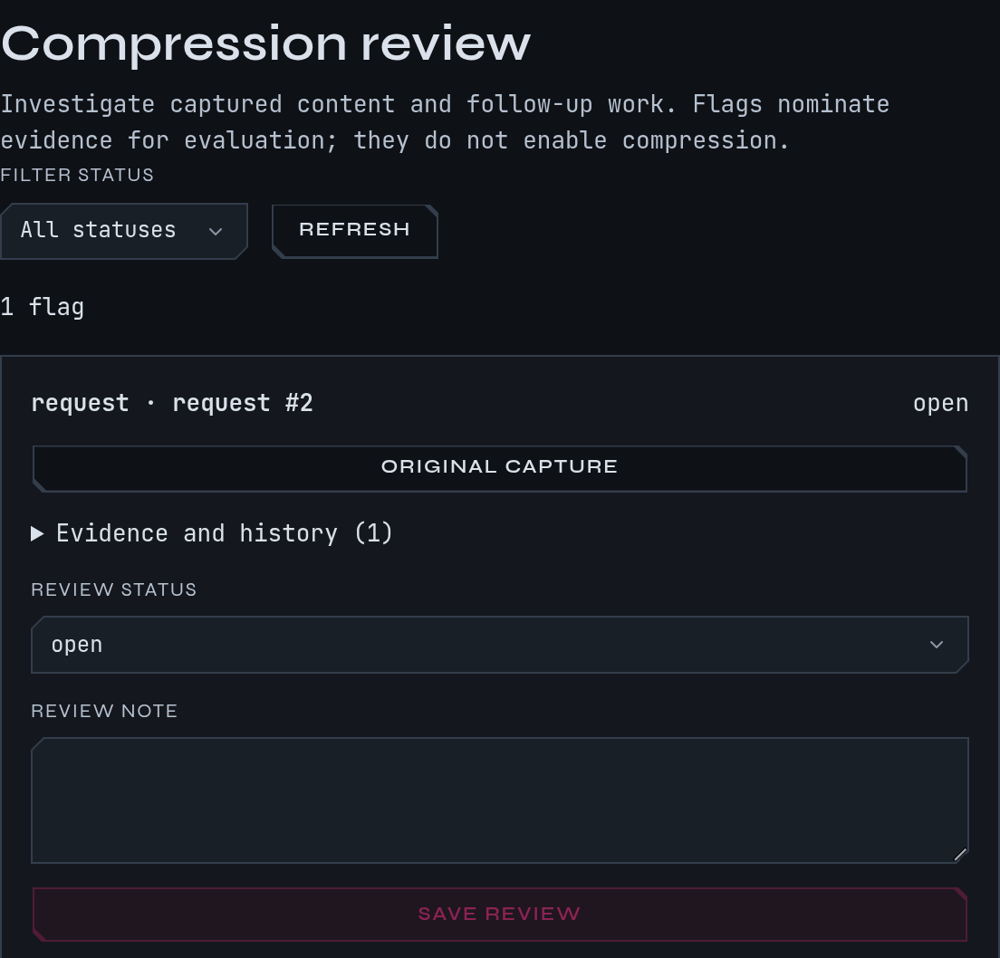

# Shorten what Claude re-reads

A long session can carry earlier file reads and command output in new requests.
Claude Code can also continue a server-held thread with only the new messages. mike can
shorten three kinds of content present in the request before it reaches Anthropic: large file reads, large shell output, and a file read a second time with
nothing changed. It always keeps the full original in its capture, so you can read what Claude
actually saw and what was sent.

Compression is off on a fresh install, and two of the three parts record what they would have
cut before they cut anything. This page says which does what, so you can turn on only what
you trust.

Open **Compression review** in the menu, or `/compression-review`, for the queue of requests
you flagged. The switches are in **Settings** at `/settings`.



This is a [fictional example](quickstart.md): the `docs` session in `~/projects/site`, with
one flagged build log.

## What cuts today

| Part | What it shortens | A fresh install | Sends changed requests when |
|---|---|---|---|
| File-read compression | A file Claude read earlier, in the history | Off | You turn it on **and** set its mode to `forward`, or give it a share above 0 |
| Shell-output compression | The output of a `Bash` call, as soon as it comes back | Off | The same two things |
| Rewrite duplicate reads | A `Read`, or `cat <file>`, of a file whose content Claude already has | Off | You turn it on |

"Shadow" is the default mode for the first two. With a switch on, the mode set to
`shadow` **and** the share set to 0, mike works out what it would cut, records it on each
request, and forwards the request unchanged. These are the defaults on a fresh configuration;
`shadow` with a saved nonzero share can still send shortened requests. That lets you see the saving before you accept it. A fourth mechanism in
the settings file, `[compress]`, only measures how much minifying JSON and squeezing blank
space could save. It never changes a request.

What never changes in any mode: your original capture, Claude's answers, the system prompt,
and the most recent results, which stay whole for a few answers (see below).

## Try it on the example session

The quickstart's one-file project has no build command. Use harmless invented output instead
of installing packages or repeatedly running a real build. These prompts still use your
normal Claude access and count towards its usage limits.

1. Open **Settings**, find **Shell-output compression** and note its current switch, **Mode**
   and **Share of sessions forwarded** so you can restore them later. Turn on the switch,
   explicitly set the mode to `shadow` and the share to 0. Do not assume an older saved
   configuration still has the defaults.
2. Start a new session in the sample folder. Ask Claude to run this exact command with its
   Bash tool, without changing files or installing anything:

   ```sh
   awk 'BEGIN { for (i = 1; i <= 200; i++) printf "Ankh-Morpork sample row %03d: paving stones inspected.\n", i }'
   ```

   It prints 200 fictional lines, comfortably above the default 1,500-byte minimum. Running
   it in an unrelated terminal will not create a captured Claude tool result.
3. Continue with a few short prompts, such as asking Claude to describe the sample in one
   sentence without tools. The default grace period keeps output whole for three assistant
   answers, and a result in the newest message stays protected. Inspect a later request's
   transformation manifest under `shell_output_compression`; check the target's reason if it was skipped.
4. When an eligible result appears, look for `computed only`, the candidate bytes saved and
   the statement that the request was forwarded unchanged. Compare **Original** and **Sent**
   for that output. This checkpoint tests shadow observation, not a saving on your bill.

Do not turn on forwarding just because the candidate is shorter. Review what was omitted,
including whether later answers needed it. The full captured original remains available;
compression markers in forwarded results include recovery arguments for `get_request_body`.
A smaller request is not by itself evidence of better answers, lower cost or faster work.

## Decide whether to forward shorter requests

Keep the experiment in shadow until you have representative evidence. In `shadow`, a share
above 0 forwards shortened output for that percentage of new sessions, selected by session
id; it is not a per-project limit, and a single new session is not guaranteed to be selected.
`forward` sends shortened output for every new session. Either choice can affect other work
started against the same mike instance. Check the arm recorded in each request's manifest.

To stop forwarding for future sessions, turn the switch off, or set the mode to `shadow` and
the share to 0. A session already running keeps its policy; start a new session to verify the
change. Restore the settings you noted before the experiment if that is your intended setup.

`mike features everything` enables the two compression toggles but does not reset saved mode
or share settings. On a fresh configuration those settings are `shadow` and 0; on an existing
one, enabling the toggles can immediately select forwarding for new sessions. The preset also
enables unrelated features, so it is not a shortcut for this experiment. `recommended` and
`watch-only` leave these toggles off. See [Setup](setup.md) for the preset boundaries.

## Continued threads: recognizing history is not rewriting it

In post-alpha.5 source containing [PR #387](https://github.com/temet-ai/mike/pull/387),
a shared earlier-turns reader follows the thread chain and makes captured streamed replies
available to the stages. That lets a new tool result be matched to a tool call from an
earlier request. File-read and shell-output compression can use that history to recognize
the result, but their replacement targets are still in the **current request body**.
They do not rewrite old captures or tool results held only in Anthropic's earlier thread.
Seeing an old Read in the chain therefore does not prove that its old result was shortened.

The reader is bounded and needs the predecessor requests and replies. If it cannot build
the chain, earlier turns are marked unavailable; a database restore may run in the
background, without delaying this request for the restored history. Stages can then see
only the current messages and miss candidates whose tool calls were earlier. Check the
request's transformation manifest and **Original** versus **Sent**, not just whether the
compression switch is on. `no_candidates` is not proof that the session has no compressible
output.

[Issue #352](https://github.com/temet-ai/mike/issues/352) tracks the wider continued-thread
work. This source change is not proof that all readers are fixed or that a live session
benefited. It also does not repair older stored per-turn change records; historical delta
correction is tracked separately in [issue #354](https://github.com/temet-ai/mike/issues/354).

## File reads

When Claude read a file earlier in the conversation and has since moved on, the old read is
rarely needed whole. File-read compression keeps the start and the end of that result and
replaces the middle with a note that says what was left out. When Claude later reads the
whole of the same file again, the earlier whole-file read is replaced by a note saying a
newer read superseded it, when that earlier result is present in the current request body.

| Setting under **File read compression** | Default |
|---|---|
| **Minimum bytes before reduction** | 1,500 |
| **Head lines retained** | 40 |
| **Tail lines retained** | 20 |
| **Answers before a read is shortened** | 3 |
| **Enabled tool producers** | `Read` |
| **Mode** | `shadow` |
| **Share of sessions forwarded** | 0 |

Files that carry instructions are never shortened. The default protected paths are
`**/CLAUDE.md`, `**/BRIEF*.md`, `**/.claude/**`, `**/docs/plans/**`, `**/artifacts/threads/**`
and `**/*.rules.md`. You can change the list in **Protected paths**.

## Shell output

Shell output is shortened as soon as it comes back, on the request that first carries it to
Claude, not later in the history. That way the full output is never written to Anthropic's
cache, and every later request carries the same short version, so the cache stays intact. It
keeps the first and last lines, the lines that look like errors or summaries with a few lines
around each, and replaces the rest with a marker such as
`output lines 41-380 omitted (340 lines)`. The shortened result says how to fetch the exact
original from mike if Claude needs the rest. Only output from commands such as builds, tests
and installs is shortened. Output from a command that prints part of a file (`sed -n`, `cat`,
`head`, `git show`) or lists and searches (`rg`, `ls`, `git status`) stays whole, because Claude
asked for exactly those lines or will pick from anywhere in the list. A result that Claude
reported as an error is never shortened, and a cut must save at least a quarter of the result to be worth making.

| Setting under **Shell-output compression** | Default |
|---|---|
| **Minimum bytes before reduction** | 1,500 |
| **Head lines kept** | 20 |
| **Tail lines kept** | 20 |
| **Lines kept after each error or summary line** | 3 |
| **Most error or summary lines kept** | 40 |
| **Mode** | `shadow` |
| **Share of sessions forwarded** | 0 |

## Duplicate reads

When Claude reads the same file twice and nothing has changed, the second result repeats the
first. With **Read dedup → Rewrite duplicate reads** on, mike replaces the repeat with a one-line
note that names the earlier read and says to read again after an edit. An `Edit`, `Write` or
notebook edit of that file makes the next read count as new. It looks at `Read` and plain
`cat <file>` commands only.

With the switch off, mike still counts duplicates and records what it could save, and forwards
the request unchanged.

The settings page shows **Rewrite duplicate reads** as on by default. In the code a fresh
install starts with it off, so nothing is rewritten until you turn it on. Check the switch.

## How mike avoids breaking Anthropic's cache

Anthropic caches the start of a conversation for five minutes, or an hour when the request
asks for it, and changing early text breaks that cache.

Shell output avoids this by being cut when it arrives, before it is ever cached, and cut the
same way on every later request.

File reads are shortened later in the history instead. While the cache is still warm, mike
keeps the reads it has already shortened shortened and leaves every other read as it was. New
cuts begin once the cache has gone cold, which is why a file-read cut can wait several minutes
instead of appearing on the very next request.

## Flag a capture for review

If a shortened result looks wrong, or a long one deserves shortening, flag it.

1. Open the request in the session, find the request body, response or tool result.
2. Choose **Flag for compression**. The dialog reads **Investigate compression**.
3. Fill in **Reason** (what could be shown more precisely) and **Evidence** (facts or later
   calls to keep), then **Save flag**.
4. The button reads **Flagged for review**, and **Review queue** opens `/compression-review`.

A flag does not turn compression on or change any request. It nominates evidence for you to
look at. On the review page each flag shows the request, an **Original capture** link, and
**Evidence and history**. Set **Review status** to `open`, `investigating`, `evaluated` or
`dismissed`, write a **Review note** and choose **Save review**. **Filter status** narrows
the list and **Refresh** reloads it.

## When there is nothing to see

| What you see | Why, and what to do |
|---|---|
| **No flags match this status.** | Nothing is flagged, or none has this status. Flag a request, or choose **All statuses** |
| **Review queue unavailable** | mike could not load the list. Use **Retry**, or run `mike doctor` |
| Switch on, no `computed only` note on requests | The request had no result large enough, or the session started before the switch. Start a new session |
| Cuts never reach Anthropic | Mode is `shadow` and the share is 0. That is the default; see above |
| The cuts you wanted did not happen | A protected path, an error result, a small result, or for file reads a recent read or a still-warm cache, each skips a cut. The manifest lists the reason for each skipped result |

## What leaves your machine

These parts shorten what is sent to Anthropic and send nothing anywhere else. Your capture
still holds the full original. See [Privacy](privacy.md) for everything mike stores and
sends, [Settings](settings.md) for every switch and its default, and [Filters](filters.md) for
changing the system prompt instead.
