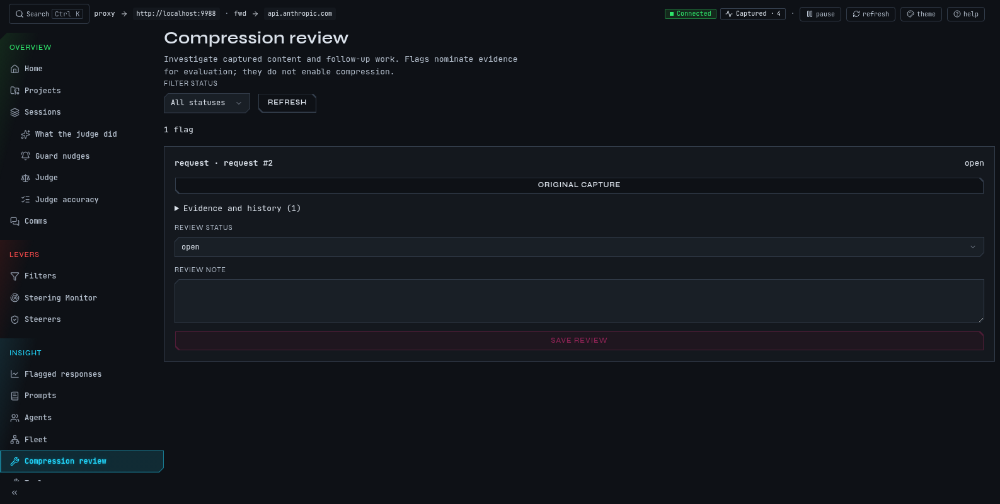

# Shorten what Claude re-reads

A long session carries every earlier file read and command output in each new request, and
you pay for them again on every turn. mike can shorten three kinds of that history before it
reaches Anthropic: large file reads, large shell output, and a file read a second time with
nothing changed. It always keeps the full original in its capture, so you can read what Claude
actually saw and what was sent.

Compression is off on a fresh install, and two of the three parts record what they would have
cut before they cut anything. This page says which does what, so you can turn on only what
you trust.

Open **Compression review** in the menu, or `/compression-review`, for the queue of requests
you flagged. The switches are in **Settings** at `/settings`.

This is a [fictional example](quickstart.md): the `docs` session in `~/projects/site`, with
one flagged build log.

## What cuts today

| Part | What it shortens | A fresh install | Sends changed requests when |
|---|---|---|---|
| File-read compression | A file Claude read earlier, in the history | Off | You turn it on **and** set its mode to `forward`, or give it a share above 0 |
| Shell-output compression | The output of an earlier `Bash` call | Off | The same two things |
| Rewrite duplicate reads | A `Read`, or `cat <file>`, of a file whose content Claude already has | Off | You turn it on |

"Shadow" is the default mode for the first two. With a switch on and the mode left at
`shadow`, the share of sessions that are sent shortened requests is 0, so nothing is
shortened: mike works out what it would cut, records it on each request, and forwards the
request unchanged. That lets you see the saving before you accept it. A fourth mechanism in
the settings file, `[compress]`, only measures how much minifying JSON and squeezing blank
space could save. It never changes a request.

What never changes in any mode: your original capture, Claude's answers, the system prompt,
and the most recent results, which stay whole for a few answers (see below).

## Try it on the example session

Continue the `docs` session. It has run `npm run build` four times and read the install page
twice, so each request carries long output. You want to see what a cut would save without
risking the session.

1. Open **Settings**, find **Shell-output compression** and turn on the switch. Leave **Mode**
   on `shadow` and **Share of sessions forwarded** at 0.
2. Start a new `docs` session. The change applies to sessions that start afterwards.
3. Run the build in it until the output is long, then open a request and read its
   transformation manifest. Under the **shell_output_compression** stage you should see
   `computed only`, how many results would be shortened and the bytes saved, and the request
   shown as forwarded unchanged.
4. If the cuts look safe, set **Share of sessions forwarded** to a small number such as 20,
   or set **Mode** to `forward` for every new session. Sessions started afterwards are sent the
   shortened requests; sessions that started earlier keep the arm they began with.

To go back, set the switch off, or set the mode to `shadow` and the share to 0. A session
already running keeps its policy until you start another.

`mike features everything` turns on the two compression switches, still in shadow with a
share of 0. `mike features recommended` and `watch-only` leave them off. See
[Setup](setup.md) for the presets.

## File reads

When Claude read a file earlier in the conversation and has since moved on, the old read is
rarely needed whole. File-read compression keeps the start and the end of that result and
replaces the middle with a note that says what was left out. When Claude later reads the
whole of the same file again, the earlier whole-file read is replaced by a note saying a
newer read superseded it.

| Setting under **File read compression** | Default |
|---|---|
| **Minimum bytes before reduction** | 1,500 |
| **Head lines retained** | 40 |
| **Tail lines retained** | 20 |
| **Answers before a read is shortened** | 3 |
| **Enabled tool producers** | `Read` |
| **Mode** | `shadow` |
| **Share of sessions forwarded** | 0 |

Files that carry instructions are never shortened. The default protected paths are
`**/CLAUDE.md`, `**/BRIEF*.md`, `**/.claude/**`, `**/docs/plans/**`, `**/artifacts/threads/**`
and `**/*.rules.md`. You can change the list in **Protected paths**.

## Shell output

The same idea for `Bash` results. It keeps the first and last lines, the lines that look like
errors or summaries with a few lines around each, and replaces the rest with a marker such as
`output lines 41-380 omitted (340 lines)`. A result that Claude reported as an error is never
shortened, and a cut must save at least a quarter of the result to be worth making.

| Setting under **Shell-output compression** | Default |
|---|---|
| **Minimum bytes before reduction** | 1,500 |
| **Head lines kept** | 20 |
| **Tail lines kept** | 20 |
| **Lines kept after each error or summary line** | 3 |
| **Most error or summary lines kept** | 40 |
| **Answers before output is shortened** | 3 |
| **Mode** | `shadow` |
| **Share of sessions forwarded** | 0 |

## Duplicate reads

When Claude reads the same file twice and nothing has changed, the second result repeats the
first. With **Read dedup → Rewrite duplicate reads** on, mike replaces the repeat with a one-line
note that names the earlier read and says to read again after an edit. An `Edit`, `Write` or
notebook edit of that file makes the next read count as new. It looks at `Read` and plain
`cat <file>` commands only.

With the switch off, mike still counts duplicates and records what it could save, and forwards
the request unchanged.

The settings page shows **Rewrite duplicate reads** as on by default. In the code a fresh
install starts with it off, so nothing is rewritten until you turn it on. Check the switch.

## How mike avoids breaking Anthropic's cache

Anthropic caches the start of a conversation for five minutes, or an hour when the request
asks for it, and changing early text breaks that cache. While the cache is still warm, mike
keeps the results it has already shortened shortened and leaves every other result as it was.
New cuts begin once the cache has gone cold. This is why a cut can wait several minutes
instead of appearing on the very next request.

## Flag a capture for review

If a shortened result looks wrong, or a long one deserves shortening, flag it.

1. Open the request in the session, find the request body, response or tool result.
2. Choose **Flag for compression**. The dialog reads **Investigate compression**.
3. Fill in **Reason** (what could be shown more precisely) and **Evidence** (facts or later
   calls to keep), then **Save flag**.
4. The button reads **Flagged for review**, and **Review queue** opens `/compression-review`.

A flag does not turn compression on or change any request. It nominates evidence for you to
look at. On the review page each flag shows the request, an **Original capture** link, and
**Evidence and history**. Set **Review status** to `open`, `investigating`, `evaluated` or
`dismissed`, write a **Review note** and choose **Save review**. **Filter status** narrows
the list and **Refresh** reloads it.

## When there is nothing to see

| What you see | Why, and what to do |
|---|---|
| **No flags match this status.** | Nothing is flagged, or none has this status. Flag a request, or choose **All statuses** |
| **Review queue unavailable** | mike could not load the list. Use **Retry**, or run `mike doctor` |
| Switch on, no `computed only` note on requests | The request had no result large enough, or the session started before the switch. Start a new session |
| Cuts never reach Anthropic | Mode is `shadow` and the share is 0. That is the default; see above |
| The cuts you wanted did not happen | A protected path, an error result, a recent result or a still-warm cache each skips a cut. The manifest lists the reason for each skipped result |

## What leaves your machine

These parts shorten what is sent to Anthropic and send nothing anywhere else. Your capture
still holds the full original. See [Privacy](privacy.md) for everything mike stores and
sends, [Settings](settings.md) for every switch and its default, and [Filters](filters.md) for
changing the system prompt instead.
