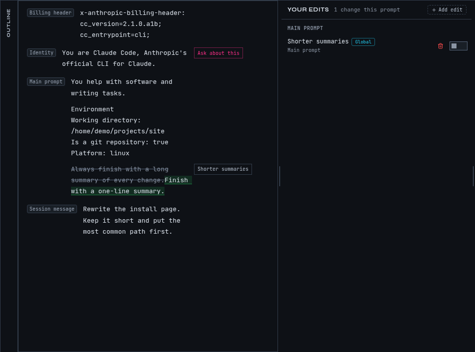

# Write a filter rule

A filter rule changes the instructions mike sends to Anthropic at the start of a session. It
can drop a paragraph you never want, replace a phrase, or add a standing instruction after a
block. A rule applies to every project or to one, and you can see its result before you turn
it on. Filter rules change the request that leaves your machine. They do not change the
original, which mike keeps as Claude Code sent it, and they never touch Claude's answers.

Open **Filters** in the menu, or go to `/filter/workbench` in the [web UI](web-ui.md). A fresh
install has no rules, so nothing is rewritten until you add one.

This is a [fictional example](quickstart.md): a session named `docs` in `~/projects/site`.
The screen shows the workbench holding one rule, written for that session.

## Add a rule to the example session

Continue the example from [Read a session](reading-sessions.md): halfway through the `docs`
session you told Claude "Put Homebrew first on the install page." You would like every future
session in this folder to start knowing that. A rule can append it to the system prompt.

1. Open the `docs` session, open one of its requests, and hover the system prompt block you
   want the instruction to follow. Choose **Filter this block**. The workbench opens with that
   request's system prompt on the left.
   To start without a request, choose **Filters** in the menu and then **Open in workbench**
   on a captured prompt.
2. Choose the project at the top of the page, `site`, so the rule applies only there. A rule
   made with no project chosen applies to every project.
3. Select the **Add edit manually** button (the plus in **Your edits**), or select text in the
   prompt and pick what to do with it.
4. In the form, give the rule a **Title** such as `Homebrew first`. Under **Match shape** keep
   `text_substring`, and type a short phrase from the block as the value. The **Paragraph**
   and **Line** presets narrow a long selection for you.
5. Under **Action** choose `append` and type `On the install page, list Homebrew first.` as
   the **Replacement or appended text**.
6. Select **Add rule**.

You should see the rule as a card in **Your edits**, with the title you gave it and a switch.

## Check the result before you rely on it

Above the prompt are three views:

| View | Shows |
|---|---|
| **As sent** | The system prompt exactly as Claude Code sent it |
| **With my edits** | The same prompt with your rules marked where they act |
| **Final** | What Anthropic receives |

Next to them, a count such as `18,400 → 18,460 chars` shows how much longer or shorter the
prompt becomes. These views are a dry run: mike applies your enabled rules to the captured
request and shows the result without sending anything. **Read only** hides the edit controls
while you read.

A rule that matches none of your recent prompts is listed under **Matches no recent prompt**.
Check the value you typed against **As sent**; matching is case-sensitive.

Your own assistant can do the same check from a session with the `dry_run_filter_rules` tool;
see [MCP](mcp.md).

## Turn a rule on, off or away

Each rule card has a switch labelled **Turn on** or **Turn off** followed by its title.
Use the switch while you investigate; a switched-off rule stays in the list and is skipped.
**Delete this rule** asks **Delete?** before it removes the card. Deleting from the workbench
or by the `delete_filter_rule` tool does not erase the row: it marks the rule disabled and
keeps it.

Rules apply in the order they are listed, and a later rule sees the text an earlier one
produced. Open a card to **Edit by hand**. **Make global** on a project's card makes it apply
everywhere, and the same place offers to limit a global rule to the project you picked.

## What a rule changes, and when

- A rule acts on text blocks in the system prompt and in the messages. It leaves tool calls,
  tool results and other block types alone, and it never changes a response.
- The part of the system prompt Anthropic caches across customers is protected: rules do not
  act on blocks before the last such boundary. Message text has no such protection.
- A session is rewritten once, on its first turn. Later turns of that session repeat the same
  rewrite, so the opening of the request stays byte-for-byte the same and Anthropic's prompt
  cache keeps working. Adding, editing or switching off a rule therefore changes sessions
  that start afterwards; a session already running keeps the rewrite it began with.
- A rule that fires on a request whose earlier messages hold extended-thinking blocks can make
  Anthropic reject the request. The workbench shows which rules would fire on a request;
  check it before you turn a rule on if you use extended thinking.

To see what happened on one request, open it from the session and read its transformation
manifest. The **filter** stage there reads **Applied** with the rules that fired, **Unchanged**
when nothing matched, or **Skipped** when the stage did not run. The request page's
**Original** and **Sent** bodies show the two versions side by side. This is how you confirm
the rule reached Anthropic.

In the example, the next `docs` session you start in `~/projects/site` shows **Applied** with
`Homebrew first`, and its sent prompt ends the block with your sentence.

## Other kinds of rule

The form offers four match shapes.

| Shape | What it matches | Use it for |
|---|---|---|
| `text_substring` | Exact text, anywhere in a block | A sentence or phrase |
| `xml_tag` | A wrapping tag such as `system-reminder`; enter the name without angle brackets | Dropping a whole reminder |
| `lazy_section` | A heading line and the section under it | Swapping a long section for a short stub until Claude asks for it |
| `inject_reminder` | A trigger marker in Claude's answer | Adding a reminder once per context window after Claude emits the marker |

The actions are `drop` (remove the match), `replace` (swap in your text) and `append` (add
your text after it). `inject_reminder` and `lazy_section` need the extra **Trigger token** or
**Trigger marker** fields the form shows.

## Compositions

A composition is a saved layout for a whole class of system prompt. Where a filter rule
edits text, a composition says which blocks the prompt is built from, and mike can then
rebuild matching prompts the same way. You find the captured prompts at `/prompts`, in the
catalogue described in [Prompts and agents](prompts-and-agents.md), and register a composition
from a captured request with **New composition**.

A composition has a mode: `observe` records only, `template` rewrites matching prompts, and
`replace` is accepted but not applied today. mike checks the incoming prompt against the
composition and passes the request through unchanged when it does not match.

Compositions are off on a fresh install. They need a restart to change: set
`composition_enabled = true` in your mike configuration file, set `MIKE_COMPOSITION_ENABLED=true`,
or start with `--composition-enabled true`. `/settings` has the same switch as **Composition →
Enable composition**. The settings page lists it as on by default, but a fresh install starts
with it off (`mike print-config` prints `composition_enabled = false`), so check what you have.

## When there is nothing to see

| What you see | Why, and what to do |
|---|---|
| **Couldn't load the prompt catalogue** | mike could not read its captured prompts. Check that it is running with `mike doctor`, then reload |
| **System prompt not captured for this request** | That request had no stored system prompt. Open another request |
| **No system prompt on this request** | The request carried none, so a rule has nothing to act on |
| **No edits yet** | Nothing has been added. Use **Add edit manually** |
| A rule shows no effect on a running session | Rules apply when a session starts. Start a new session |

## What leaves your machine

A rule changes what is sent to Anthropic: the system prompt and message text after your edits
are what Anthropic receives. The workbench also has a **Prompt assistant** pane; what it
sends, and to which model provider, is covered in [Privacy](privacy.md), with the provider
choices in [Settings](settings.md).

Next, read [Compression](compression.md) for the other ways mike shortens a request.
