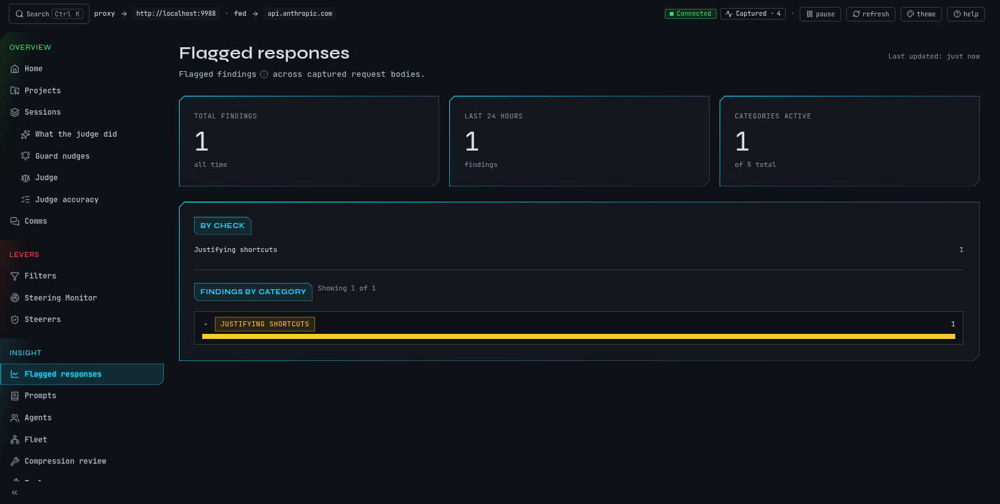

# Review flagged responses

mike reads every reply Claude sends back and flags the ones that sound like Claude is
overselling, excusing a shortcut, blaming something else, avoiding work or pretending to
understand. The **Flagged responses** page lists those findings so you can open the reply and
decide whether Claude really did the work. Flagging only marks and records; by itself it
changes nothing Claude sees. Two optional features can act on a finding, and both are off
until you turn them on: a reminder on the next request, and a live correction while the reply
streams.

Open **Flagged responses** in the menu, or go to `/analysis`. Turn categories and live
correction on or off at **Settings → Flagging** (`/settings/flagging`).

This is a [fictional example](quickstart.md). The finding below comes from the guide's `docs`
session, not from real work.

## Check a flagged reply

Continue the example. After you told `docs` to put Homebrew first, it answers "I've
rewritten the install page and everything works." You want to know whether it ran anything.

1. Open **Flagged responses**. Three cards summarise the count: **Total findings**, **Last 24
   hours** and **Categories active**.
2. Under **By check**, select a check to filter, for example the one that flagged this reply.
   Under **Findings by category**, select a category such as **Overselling** to expand it.
3. Expand the `docs` session, then the request. The finding shows the phrase that matched, how
   many further matches were folded into it, and the advice mike keeps with that category.
4. Select **Open full response** to read the whole reply in context, or **Open request** to see
   the request it answered. The session link opens the [timeline](reading-sessions.md).
5. Decide for yourself. A finding is a pointer to wording, not proof that the work is wrong.

You should end on the reply that made the claim, with the matched phrase marked.

## What the five categories mean

| Category | What it flags | Shown as |
|---|---|---|
| **Overselling** | Success claims without evidence: "done", "works", "all tests pass". | Muted |
| **Justifying shortcuts** | Explaining away a shortcut or partial fix instead of doing the proper change. | Warning |
| **Deflecting blame** | Blaming tools, the environment or you for a failure Claude should own. | Warning |
| **Avoiding work** | Deferring, skipping or hand-waving requested work. | Error |
| **Faking understanding** | Claiming to understand code or requirements without checking. | Muted |

The same behaviours are sometimes described as unbacked claims, blame-shifting and avoided
work. The colours only rank how serious mike treats the category; they do not measure harm.

Checks are pattern matching over the reply text. They miss things and they flag phrases
that were fine, so use the **False-positive filters** (below) to teach mike what to skip.

## Turn categories on and off

At **Settings → Flagging**:

1. **Response flagging** is the master switch. Off, no category runs.
2. Each category has its own switch and a **False-positive filters** list. A filter is a
   phrase or pattern; when a matching sentence also contains it, the finding is dropped.
   Leave the list empty to use no filters.
3. A change applies after mike restarts. The page says so next to the control.

Flagging is on in a fresh install, with every category on. The checks are pattern matching on
replies mike has already captured, run on this machine.

## React while Claude is answering

Two features can follow a flagged reply. Both are separate switches, and both are off in a
fresh install.

**Reminders.** When on, mike gives the session a short note listing what its last reply was
flagged for, with the advice for it, and asks Claude to restate with appropriate confidence or
say it is blocked. If the session is connected through Remote Control, mike pushes the note to
it; otherwise the note is added to the session's next request, which is text sent to
Anthropic. mike does not repeat a note a session already received. Turn it on
under **Settings** with the `reminders` feature, or by choosing the recommended preset in
[setup](setup.md); the recommended preset turns it on and watch-only does not.

**Live correction.** At **Settings → Flagging → Live correction**, you list **Flagged
phrases**. While a reply streams, mike watches for them. When one appears, mike cuts the reply
there and has Claude continue with a corrected answer in the same message. The correction
prompt is editable and replaces `{word}` with the phrase caught. Unlike the categories above,
this acts before you see the reply, and it makes an extra request to Anthropic.

The phrase list starts empty. The settings text says an empty list uses a built-in list, but
the code ships none: with no phrases, live correction does nothing. Add at least one phrase
before turning it on. A change applies to sessions that start afterwards.

What reminders and live correction send is described in [Privacy](privacy.md). The
broader mechanism for steering a session is [Steering](steering.md).

## When it is empty or off

| What you see | Why | What to do |
|---|---|---|
| **No diagnostics recorded yet** | Nothing has been captured. | Send a prompt through mike; see [Quickstart](quickstart.md). |
| "Every captured response was checked and nothing matched." | Checks ran and found nothing. | Nothing; new findings appear as replies arrive. |
| **No findings match the current filter** | A check, category or session filter is active. | Use the clear buttons beside the filters. |
| **Couldn't load diagnostics** | The inspect service or database is not reachable. | Run `mike doctor`; see [Troubleshooting](troubleshooting.md). |
| Findings stopped appearing | **Response flagging** or a category is off, or mike has not restarted since you changed it. | Check **Settings → Flagging**. |

A reply that was never captured, because the session did not go through mike, is never
checked.
