# Fleets: several sessions on one goal

A fleet splits one goal into tasks and gives each task to its own Claude Code session, all
working at the same time in one checkout. You state the goal and what would prove it is met.
mike opens the sessions, checks what they commit, judges each piece of work against what you
asked for, and tells you when the goal is met or when it needs you.

Use a fleet when the goal splits into at least two tasks that touch different files and can run
side by side, such as a backend change, the page that uses it, and the docs for both. For one
task a single session is faster; see [Sessions](../sessions.md). A session you start with
`mike spawn` on its own is not part of a fleet.

## The example in these pages

The guide's fictional example continues here. You keep a small website in `~/projects/site`,
and the session `docs` has been rewriting its install page. You now want three things done at
once:

| Task | What it does | Its file | Waits for |
|---|---|---|---|
| T1 | Rewrite the install page, Homebrew first | `install.md` | nothing |
| T2 | Rewrite the quickstart to match | `quickstart.md` | nothing |
| T3 | Add a check that every link in the docs works | `scripts/check-links` | T1 and T2 |

The correction "Put Homebrew first on the install page." from earlier pages becomes one of the
outcomes T1 must deliver, written into the fleet's definition so that the judge checks it.

## What happens, in short

1. You run `/fleet` with the goal in a Claude Code session. That session writes the fleet's
   definition: the outcomes that prove the goal is met, the tasks, which files each task owns,
   and the command that tells whether the project is sound. It marks the definition ready and
   stops.
2. mike opens one session per task, each told only its own task, and they work at the same
   time in your one checkout on one branch.
3. Each session commits only its own files and reports what it did. mike runs the checks, and a
   model call judges the work against the outcomes. A failed piece goes back to the same
   session with the one thing still needed.
4. When every task has passed, mike closes the sessions, records how the run went, and marks
   the fleet `done`.

You watch with `mike fleet status`, answer when a session needs you, and otherwise leave it
alone.

## Before you start

- A terminal that `mike spawn` can open panes in (see
  [Sessions](../sessions.md#choose-a-terminal-first)). A fleet's sessions are ordinary Claude
  Code sessions opened the same way.
- mike running, with its database.
- A repository with a command that tells whether the tree is sound, such as a type-check or a
  build. mike runs it on every commit the fleet makes.
- A model and key for the judge. The judge uses the model you set for steerers (see
  [Steering](../steering.md)). Without one, the sessions work and commit but their reports wait
  unjudged, and no task is accepted.

The sessions' traffic goes to Anthropic like any other session's, and the judge sends each
commit's diff and report to the model provider you chose; see [Privacy](../privacy.md). The
sessions commit and push to the one branch you name, in your checkout.

## The pages in this section

- [Run your first fleet](first-fleet.md): the example from `/fleet` to `done`, step by step.
- [Write a fleet definition](definition.md): the goal, the outcomes, the tasks and their files,
  and the checks, with a whole definition to copy.
- [How a fleet runs](how-a-fleet-runs.md): the sessions mike opens, in what order, and what each
  one does.
- [Share one checkout](shared-checkout.md): how several sessions edit one folder without
  getting in each other's way, and how commits and checks work.
- [How work is accepted](acceptance.md): the report, the checks mike runs, and the judge.
- [Watch a fleet and step in](watch-and-recover.md): the status screen, questions for you, what
  mike repairs on its own, and how to stop a fleet.
- [After a run](after-a-run.md): the record of the run, the retrospective, and lessons for the
  next fleet.
