# How work is accepted

A task is accepted when every outcome it serves has passed. A worker finishes a piece of its task
with a commit and a report, and mike decides on it in two steps: first it runs the checks the
task declared, then a model call, the judge, reads the commit against the outcomes. The worker
never decides that its own work is done.



## The report

A worker reports with the `fleet_report` tool. mike refuses a report with any of these missing,
and names the field:

| Field | What it holds |
|---|---|
| `sha` | The commit being reported |
| `criteria` | The outcomes this piece serves, such as `C1` |
| `exercised` | The command that showed the change working, its exit code, and where its output is |
| `tests_changed` | Every test, fixture or baseline the worker changed, or `none` |
| `unestablished` | What the worker could not show, or an empty list |

For T1 in the example the report says: commit `3f9c2a71d0`, criterion C1, exercised
`npm run build && grep -n "## " dist/install/index.html` with exit 0, tests changed `none`, and
nothing unestablished.

A compile alone is not proof that something works, so `exercised` asks for the command that ran
the changed behaviour.

## The floor

If the task says what proves it is finished (`done_when`, see
[Write a fleet definition](definition.md#saying-when-a-task-is-finished)), mike runs that at the
reported commit first. This is the floor: the checks any delivery must pass before anyone reads
it. When it fails, the worker gets a message with a code, and no model reads the report:

```
[mike floor] Task T3 failed its declared floor at 81be0c4 (no_test_added): no file was added under `tests/links/`; add a test there
Fix it, commit, and report again with fleet_report. No judge has read this report.
```

The codes are `check_failed`, `files_not_changed`, `no_test_added`, `exercise_failed` and
`floor_unrunnable`, the last for a floor that could not run at the commit. When the fault is in
the task's `done_when` itself, such as a check naming an operation that does not exist, the
worker is told that its work is not failed and that the definition needs correcting.

A task without `done_when` goes straight to the judge.

## The judge

The judge is one model call. It reads:

- the diff of the reported commit;
- the report's facts: the commit, the outcomes, the command run and its exit, the tests changed,
  and what was not established;
- the floor's result;
- the task's brief and the outcomes it serves, with their checks;
- any outstanding obligations for the task.

It does not read the worker's own summary of what it did. It decides from the diff, the command's
result and the outcome's check, so a confident summary cannot pass work that the diff does not
show.

It answers pass or fail for the outcomes the task serves. A fail names the one thing the worker
must do next. The worker gets the verdict as a message:

```
[mike judge] FAIL task T2 C2 at 5d01e7f3a2: the quickstart still shows the archive install before Homebrew
Needed before a pass: put the Homebrew command first in quickstart.md, as install.md does
```

If one fact is missing and a narrow look would settle it, the judge may ask the checker first.
The checker is another model call that is given one question, one file or command output, and
the observation expected, and answers whether the observation is there, quoting what it found.
The judge may do this once per report and must then pass or fail.

An outcome that several tasks serve is judged only on each task's own share of it, as its brief
states it.

## Rounds

A failed task goes back to the same worker, which fixes the one thing named before anything else,
commits and reports again. On the next report the judge asks whether that thing is now done and
whether anything that passed before has broken. It names something new only when the new commit
broke it, or when the outcome plainly asks for it and no earlier round saw it, and it says why.
A worker is not handed a new demand every round.

When an outcome fails three times, mike opens a problem for it, and the problem-solver decides
what to do; see [Watch a fleet and step in](watch-and-recover.md#problems-mike-decides).

## When a task is accepted

A task is accepted when every outcome it serves has a passing verdict and no report is waiting
for one. Tasks that were waiting for it start on mike's next round, within 20 seconds. When every
task is accepted, the fleet closes.

## What the judge needs

The judge, the checker and the problem-solver use the model and key you set for steerers on the
settings page (see [Steering](../steering.md) and [Settings](../settings.md)). They send the
diff, the report and the brief to that model's provider (see [Privacy](../privacy.md)). Without a
model and key, reports wait unjudged, each worker is told so once, and they are judged as soon
as the key is set.

A report that the judge fails to answer five times in a row is left waiting, and the worker is
told to report again.
