# How work is accepted

A task is accepted when every outcome it serves has passed. A worker reports its evidence;
for code changes, that includes a commit. mike runs any checks the task declared before
acceptance or the built-in judge considers the work. The worker never decides that its own
work is done. A recorded report is not a passing verdict.



## The report

For portability, report with the `fleet_report` tool and explicitly identify the fleet,
your own session, task and a nonempty descriptive slice. The following evidence fields are required; mike names any missing field:

| Field | What it holds |
|---|---|
| `criteria` | The outcomes this piece serves, such as `C1` |
| `exercised` | The command that showed the change working, its exit code, and where its output is |
| `tests_changed` | Every test, fixture or baseline the worker changed, or `none` |
| `unestablished` | What the worker could not show, or an empty list |

On source builds including [the optional commit field](https://github.com/temet-ai/mike/pull/316)
and [no-commit routing](https://github.com/temet-ai/mike/pull/317), `sha` is optional.
Leaving it out uses this task's newest `fleet_commit`, if one exists; it does not force
an existing commit to be ignored. `commit` is an alias for `sha`. An explicit commit must
be in the fleet's repository, on its branch, and contain the task's latest commit when
there is one. Never put a commit from another repository in this field.

These are post-`v0.1.0-alpha.5` source behaviors, not confirmation that your running service
and MCP companion include them. Check the installed tool schema and running build before
relying on the no-commit path.

For T1 in the example the report says: commit `3f9c2a71d0`, criterion C1, exercised
`npm run build && grep -n "## " dist/install/index.html` with exit 0, tests changed `none`, and
nothing unestablished.

A compile alone is not proof that something works, so `exercised` asks for the command that ran
the changed behaviour.

### Task and slice defaults on newer builds

Post-alpha.5 source `02cc1b15`, including [PR #438](https://github.com/temet-ai/mike/pull/438),
can fill an omitted or whitespace-only `task` from the reporting session's assignment,
**only when that session holds exactly one task**. It considers both task-session bindings
and the run's seated assignment. With zero or multiple tasks, the call is refused and asks
for an explicit task; it does not choose one for you. A missing session id is also refused.

A supplied nonblank task takes precedence over inference, but must still pass the ordinary
ownership and task checks. Independently, an omitted or whitespace-only `slice` becomes
`task <task-id>`, including when you supplied the task explicitly. A supplied nonblank
slice is kept. These defaults run before report validation; they do not waive required
evidence, ownership, criteria or acceptance checks. Prefer explicit task and slice labels
for meaningful reports and compatibility with older services and companions.

Keep `unestablished` as an array of strings, or `[]` when nothing remains unestablished.
The newer server normalizes object entries to text, but the MCP schema at `02cc1b15` still
advertises string-array items despite its description mentioning objects. Do not rely on
a client accepting values outside its schema. Check both installed builds and the actual
tool schema; merged source is not evidence of deployment.

### Use arrays for evidence paths

Pass `evidence` as an array even when there is only one path, for example
`"evidence": ["artifacts/install-check.txt"]`. This is a field fragment, not a complete
report; supply the required identity and evidence fields above too. `look_at` is a string
explaining what acceptance should inspect, not another evidence array.

At source `8b7fd0f2`, the server accepts a single evidence string after repair #338,
but the MCP tool still advertises an array. [Issue #336](https://github.com/temet-ai/mike/issues/336)
remains open. An array matches both interfaces and avoids depending on whether a client
accepts a value outside its advertised schema. Do not infer an installed fix from an
issue's status or a merged repair. On older servers, a single string can fail with
`evidence: invalid type: string`; correct the field shape rather than resubmitting the
same call. A parse error is not an acceptance verdict. At the later `02cc1b15` source, the MCP
schema also allows a single evidence string; an array remains compatible with both forms.

## Research or comment-only work

When the task never commits, leave out `sha`. Put the actual evidence locations in
`evidence` and tell acceptance what to inspect in `look_at`, including an artifact in
another repository when that is the deliverable. The required fields above still apply:
report the command you actually ran and its result, use `none` for unchanged tests, and
name anything not established. Do not invent a successful command or a commit just to
satisfy the form.

What happens when no task commit is available depends on the definition:

| Definition | What happens |
|---|---|
| The task declares `done_when` | mike records the report but asks the worker to commit with `fleet_commit` and report again. The floor needs a commit; it is not run at an empty SHA. |
| No `done_when`, with an acceptance seat | The report goes to acceptance to judge the evidence and inspection pointers. Delivery to acceptance is not a pass. |
| No `done_when`, without an acceptance seat | The report remains a note. It does not automatically pass the task or invoke the commit judge. |

Plan research tasks with an acceptance path that can assess their real deliverable. If
`done_when` mistakenly demands a code check for comment-only work, ask the coordinator
to correct the definition rather than bypassing the check or borrowing another repo's SHA.

## The floor

If the task says what proves it is finished (`done_when`, see
[Write a fleet definition](definition.md#saying-when-a-task-is-finished)), mike runs that at the
reported commit first. This is the floor: the checks any delivery must pass before anyone reads
it. When it fails, the worker gets a message with a code, and no model reads the report:

```
[mike floor] Task T3 failed its declared floor at 81be0c4 (no_test_added): no file was added under `tests/links/`; add a test there
Fix it, commit, and report again with fleet_report. No judge has read this report.
```

The codes are `check_failed`, `files_not_changed`, `no_test_added`, `exercise_failed` and
`floor_unrunnable`, the last for a floor that could not run at the commit. When the fault is in
the task's `done_when` itself, such as a check naming an operation that does not exist, the
worker is told that its work is not failed and that the definition needs correcting.

A task without `done_when` skips the floor. It goes to the acceptance seat when one is
present; otherwise the built-in judge handles reports with a commit. The no-commit case
is described above.

## The judge

Without an acceptance seat, the built-in judge handles commit-backed reports with one
model call. It reads:

- the diff of the reported commit;
- the report's facts: the commit, the outcomes, the command run and its exit, the tests changed,
  and what was not established;
- the floor's result;
- the task's brief and the outcomes it serves, with their checks;
- any outstanding obligations for the task.

It does not read the worker's own summary of what it did. It decides from the diff, the command's
result and the outcome's check, so a confident summary cannot pass work that the diff does not
show.

It answers pass or fail for the outcomes the task serves. A fail names the one thing the worker
must do next. The worker gets the verdict as a message:

```
[mike judge] FAIL task T2 C2 at 5d01e7f3a2: the quickstart still shows the archive install before Homebrew
Needed before a pass: put the Homebrew command first in quickstart.md, as install.md does
```

If one fact is missing and a narrow look would settle it, the judge may ask the checker first.
The checker is another model call that is given one question, one file or command output, and
the observation expected, and answers whether the observation is there, quoting what it found.
The judge may do this once per report and must then pass or fail.

An outcome that several tasks serve is judged only on each task's own share of it, as its brief
states it.

## Rounds

A failed task goes back to the same worker, which fixes the one thing named before anything else,
commits and reports again. On the next report the judge asks whether that thing is now done and
whether anything that passed before has broken. It names something new only when the new commit
broke it, or when the outcome plainly asks for it and no earlier round saw it, and it says why.
A worker is not handed a new demand every round.

When an outcome fails three times, mike opens a problem for it, and the problem-solver decides
what to do; see [Watch a fleet and step in](watch-and-recover.md#problems-mike-decides).

## When a task is accepted

A task is accepted when every outcome it serves has a passing verdict and no report is waiting
for one. Neither the `fleet_report` response nor `told_acceptance: true` is that verdict.
Check the task state and outcome verdicts with `get_fleet` or the fleet status view.
Tasks that were waiting for it start on mike's next round, within 20 seconds. When every
task is accepted, the fleet closes.

## What the judge needs

The judge, the checker and the problem-solver use the model and key you set for steerers on the
settings page (see [Steering](../steering.md) and [Settings](../settings.md)). They send the
diff, the report and the brief to that model's provider (see [Privacy](../privacy.md)). Without a
model and key, reports wait unjudged, each worker is told so once, and they are judged as soon
as the key is set.

A report that the judge fails to answer five times in a row is left waiting, and the worker is
told to report again.
