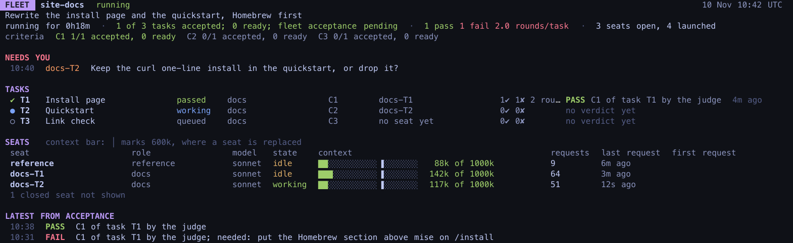

# Run your first fleet

This page walks through the example fleet from definition to completion: the install page, the quickstart and a
link check for the website in `~/projects/site`. It takes about as long as the slowest task,
plus a few minutes for mike to open the sessions. What each step does underneath is in
[How a fleet runs](how-a-fleet-runs.md).

## Before you start

This is a worked example for a website repository, not a ready-to-run sample repository.
The one-file folder from [Capture your first session](../quickstart.md) is not enough: the
fleet also needs a Git repository, a push destination and a working build or check. Use a
project where you intend to let sessions edit, commit and push.

Before sending the goal:

- Follow [the fleet prerequisites](README.md#before-you-start): a running mike with a
  database, a supported terminal and a configured judge model. Trial storage is not enough.
- Connect the [MCP companion](../mcp.md), so the author can use `define_fleet` and `get_fleet`.
- Choose the checkout and a development branch, and check where that branch pushes.
  The workers share one checkout and push their commits; this is not a read-only review.
- Identify the project's existing check and gate commands. Use its documented commands
  rather than copying `npm run build` from this example. mike runs the startup gate on a
  clean copy before opening workers.
- Review [Privacy](../privacy.md). Claude Code sends the sessions' traffic to Anthropic;
  the judge sends commit diffs and reports to its configured model provider.

Start with the preview below. It saves a definition without starting fleet workers. The
author may still prepare missing project instructions or specialist files; review those
changes too. A preview uses the author session, so it still consumes model usage.

## Preview the definition with /fleet

1. Open a Claude Code session in `~/projects/site` and run:

   ```
   /fleet --drill Rewrite the install page and the quickstart, Homebrew first, and add a link check
   ```

   `mike serve` writes this command to `~/.claude/commands/fleet.md` when no file of that name
   exists. A file you edited or linked there is left alone.

2. That session is the fleet's author. It reads the project's instructions, writes the
   definition with mike's `define_fleet` tool, and fixes what mike says is missing until
   nothing is. For the example it writes three outcomes:

   | Outcome | What you asked | How it is checked |
   |---|---|---|
   | C1 | Homebrew first on the install page | The Homebrew section is the first install method on the built `/install` page |
   | C2 | The quickstart matches the install page | Every install command in `quickstart.md` appears on the install page |
   | C3 | A link check | `scripts/check-links` exits 0 on the built site and 1 on a page with a broken link |

   It then writes the three tasks and the files each one owns, as in the table on
   [Fleets](README.md#the-example-in-these-pages).

3. With `--drill`, the author leaves the definition unready and reports what would start.
   Note the fleet's short name (its slug). The examples below use `site-docs`; substitute the
   actual slug in every command. No fleet workers should have started.

## Review, then start

Ask the author to show the saved definition with `get_fleet`. Before starting, check:

- the repository, branch and push destination are the ones you chose;
- the outcomes describe what you want, not extra work inferred from the goal;
- each task owns different files, and dependencies reflect work that really must wait;
- the check and gate commands fit this repository and do not modify files;
- the workers' models and judge provider are the ones you intend to use.

[Write a fleet definition](definition.md) explains these fields. Ask the author to correct
anything wrong while the definition is still unready. A complete definition is not proof
that the work has passed its checks.

When you are satisfied, tell the author to mark **that same fleet** ready using `define_fleet`.
You do not need a second definition. With **Start fleets on their own** (`fleet_auto_start`)
on, ready can start the fleet immediately. With it off, run:

```sh
mike fleet start site-docs
```

The author reports where to watch and stops; the fleet's workers do the implementation.
For later runs where you want the author to proceed directly, `/fleet` without `--drill`
writes the definition and marks it ready without this review pause.

## Watch it start

Run:

```sh
mike fleet list
```

Find the fleet by its slug. The row shows its state and how many items its definition still lacks.
Then follow it:

```sh
mike fleet status site-docs --watch 5
```



Within a minute or two the screen shows:

- the status pane and one `docs` template session, which reads the project and closes;
- the reference session, which stays open to answer the others' questions;
- a worker on T1 and a worker on T2, both working;
- T3 waiting, because it needs T1 and T2 to pass first.

A terminal pane opens for each session, so you can read along. You do not need to type in
them.

## While it works

Each worker edits its own file, commits it with `fleet_commit`, and files a report. mike runs
the project's check on each commit and the judge reads each report. You see the results on the
status screen as they arrive:

```
[mike judge] PASS task T1 C1 at 3f9c2a71d0: the Homebrew section is the first install method on /install
```

When T1 and T2 have both passed, T3's worker starts on mike's next round, within 20 seconds.

If a worker needs something only you can give, such as a decision about wording, the screen
shows it under NEEDS YOU. Run `mike fleet focus site-docs` to bring that session's pane to the
front and answer there. [Watch a fleet and step in](watch-and-recover.md) covers this and the
other flags.

## When it is done

When all three tasks have passed, mike closes the sessions and the status pane, and the fleet
reads `done` in `mike fleet list`. The commits are on your branch, already pushed. See how the
run went:

```sh
mike fleet record site-docs
```

It prints the time to done, the minutes lost to faults, the tokens spent per accepted task, and
how often you had to step in. [After a run](after-a-run.md) explains the numbers and what
happens next.

## If it does not start

- The definition is unready after `--drill`: that is the intended checkpoint. Review it and
  explicitly ask the author to mark the same fleet ready when you want workers to start.

- `mike fleet list` exits with `could not reach the inspect API`: mike is not running. Start it
  (see [Setup](../setup.md)).
- `/fleet` writes no definition and says the goal is one task: the goal does not split into two
  tasks on separate files. Do it in one session.
- The fleet reads `failed`: ask Claude for the fleet's state (`get_fleet`, see
  [MCP](../mcp.md)) and read its start report, fix the definition, and mark it ready again.
- The fleet waits in `ready`: you turned off **Start fleets on their own**
  (`fleet_auto_start`) in [Settings](../settings.md). Run `mike fleet start site-docs`.
