# How a fleet runs

This page follows a fleet from the moment it is marked ready until it closes: which sessions
mike opens, in what order, and what each one does. The pages after it go deeper into the shared
checkout, acceptance and recovery.

## The sessions in a fleet

A fleet is a set of ordinary Claude Code sessions that mike opens with `mike spawn` (see
[Sessions](../sessions.md)), each told what part it plays. Most of the coordinating is done by
mike itself, in a loop that runs every 20 seconds, and by three short model calls. No session
is in charge of the others.

| Session | How many | What it does |
|---|---|---|
| The author | One, before the run | The Claude Code session where you ran `/fleet`. It writes the definition, marks it ready, tells you where to watch, and stops. |
| A template | One per kind of work | Reads the fleet's rules, the reading list for its kind of work and the definition, then ends its turn. mike records it and closes its pane. It never works on a task. |
| A worker | One per task | Copied from its template's conversation, so it starts with that reading already done, plus its own brief. It changes only its task's files, commits them, and reports. |
| The reference session | One | Answers the other sessions' questions about the code with a file and a line. It never edits, builds or decides. |
| The retrospective | One, after the run | Reads how the run went and writes findings as notes. It changes no file unless the definition allows it. |

The three model calls are the judge, which decides whether a task's work meets its outcomes; the
checker, which answers one narrow question for the judge; and the problem-solver, which decides
what to do about a problem the loop cannot fix by restarting something. They are described in
[How work is accepted](acceptance.md) and [Watch a fleet and step in](watch-and-recover.md).

A worker runs as the project's own specialist for its area when the definition names one, with
mike's `fleet-worker` skill added. Every session in a fleet reads the same rules, and where a
message from another session disagrees with those rules, the rules win.

In the example, T1, T2 and T3 are all `docs` work, so there is one `docs` template, and all
three workers are copied from it.

## From ready to the first commit

When the fleet is marked ready (or you run `mike fleet start`), mike does these things in order:

1. If the definition has a gate command, mike runs it once on a clean copy of the branch. When
   that fails, no worker opens except a repair task the definition names, until it passes.
2. It opens the status pane, the terminal pane that `mike fleet status --watch` draws.
3. It opens one template per kind of work and waits for each to finish reading. A template that
   has not finished after 8 minutes is dropped, and the workers of that kind start without the
   reading done in advance.
4. It opens the reference session.
5. Every 20 seconds it starts a worker for each task that has none and whose waiting-for tasks
   have passed. T1 and T2 start at once. T3 starts within 20 seconds of the second of them
   passing.

Copying workers from a template saves time and tokens: the rules, the reading list and the
definition are read once per kind of work, not once per task.

No more than 16 panes are open at once by default (`launch_max_surfaces` in
[Settings](../settings.md)). A task that has no room waits for the next round.

## What a worker does

A worker's turn follows the same pattern for every task:

1. Read its brief and the files it names.
2. Change only the files its task owns.
3. Run the narrowest check that covers the change, or ask mike for the project's check result
   (`fleet_check`).
4. Commit with `fleet_commit`.
5. Report with `fleet_report`: the commit, the outcomes it serves, the command that shows the
   change working, and what it could not establish.
6. Wait for the verdict. A pass ends its task; a fail names the one thing to do next.

When it needs something it does not have, it asks another session, the session that owns a
file, or the reference session, and carries on with whatever it can do meanwhile.

## Goals

Each worker is started with a goal, a sentence saying when its task is done, taken from the
definition. The [fleet-comms mod](../mods.md#fleet-comms) in the worker's session hands it to
Claude Code's `/goal`, which keeps the session working until the goal holds. After 20 automatic
continuations the goal is cleared without accepting the task, so a worker that cannot finish
stops instead of running on. Set `seat_settings.env.MIKE_FLEET_GOAL_MAX_CONTINUATIONS` in the
definition to a number from 1 to 200 to change that limit.

## What a worker may not do

The fleet's rules keep the sessions from getting in each other's way and from doing things that
need you:

- It never adds a branch, a worktree or another checkout, and never runs `git add`,
  `git commit`, `git push`, `git stash` or `git reset`. See [Share one checkout](shared-checkout.md).
- It never deploys, restarts services, runs migrations on a live database or uses destructive
  git commands, unless the definition allows it.
- It never stops to ask you a question in its own pane, because the fleet would wait behind it.
  It writes a note for you instead, which the status screen shows under NEEDS YOU.
- It never opens your browser. mike blocks `open`, `xdg-open` and similar commands in the
  sessions it starts, and the worker gives you a link instead. Set
  `seat_settings.env.MIKE_FLEET_BROWSER_GUARD` to `"0"` in the definition to allow it.

## Adding work while it runs

A worker can add a task to a running fleet (`fleet_propose`) when every file it names exists or
is marked new and no open task owns any of them, or move part of its own task into a new one
(`fleet_split`). mike also proposes a task by itself for a change no task owns after 10
minutes. mike starts a worker for a new task on its next round.

## How it ends

When every task has passed, mike stops the fleet: it closes each worker's pane, records the run,
closes the status pane and the workspace it opened, and marks the fleet `done`. A fleet whose
sessions have all exited on their own ends the same way, and `mike fleet stop` ends it early.
The retrospective then reads the run; see [After a run](after-a-run.md).
