# Share one checkout

Every session in a fleet edits the same folder, on the one branch the definition names. There is
no separate copy per session. That lets a worker see the others' finished work as soon as it is
committed, and it means the fleet's rules about the folder are strict. This page explains those
rules, how commits are made, and how mike checks the project without seeing anyone's unfinished
edits.



## The rules for the folder

- A worker changes only the files its task owns. The T1 worker edits `install.md` and nothing
  T2 or T3 owns.
- A worker never adds a branch, a worktree or another checkout.
- A worker never runs `git add`, `git commit`, `git push`, `git stash`, `git reset` or a
  rebase, and never reverts, checks out or deletes work it did not write. To see an earlier
  state it reads `git show <commit>:<path>`.
- To see what other sessions changed, a worker asks mike (`what_changed`) instead of reading
  `git status`, which would show everyone's unfinished edits mixed together.

## Committing with fleet_commit

A worker commits with the `fleet_commit` tool, or `mike fleet commit -m "<message>"` in its
pane. It:

1. takes the changed files its task owns, leaving out files another task owns;
2. builds the commit in a private index, so nothing else staged in the folder gets into it;
3. runs the repository's `.git/hooks/pre-commit` against that index;
4. adds a `Fleet-Seat` line to the message naming the session that made the commit;
5. moves the branch only if nobody else committed in the meantime;
6. pushes, merging first if the remote has moved on.

It never refuses a commit on a judgement. A file outside the task, a check that fails on the
committed files, or a formatting problem comes back as a warning that the worker acts on.

When mike has no credentials for your remote, the push comes back with git's own words, and the
worker pushes from its own session. If the remote holds commits the folder does not, mike merges
them in first, and stops if the merge would touch a file another session has not committed yet.

## Who changed what

mike looks at the folder once a second and records every file that is added, changed or
deleted, with the time and the session that most likely changed it. A change outside the
session's own task is marked. If no task owns a change after 10 minutes, mike proposes a new
task for it.

When an uncommitted edit breaks the project for everyone, mike works out which session's edit did
it and tells that session. If it is still broken 10 minutes later, the reference session is told
as well. The status screen shows how many minutes the folder has been broken.

## Checks run by mike

The definition names the project's check (`check.command`, for example `npm run build`). mike
runs it on every new commit, in a clean copy of that commit kept under `.claude/worktrees/` in
your repository:

| Copy | Used for |
|---|---|
| `mike-check`, `mike-check-2` | The project's check. Two can run at the same time. |
| `mike-gate` | The gate command, on every pushed commit. |

Each copy keeps its own build cache between runs. A worker's unfinished edits are never part of
the result, because the copy holds only the commit. mike does not copy untracked files such as
`node_modules` or `.env` into it, so the check command has to install what it needs itself.

Workers do not run the full check themselves. They ask mike for a result with `fleet_check`,
which reuses a result already recorded for the same commit or joins a run that is already going.
A worker that runs the check's own command anyway is reminded once to ask mike.

When a check fails, mike reads the file names in its output and tells the sessions that own
those files. That tells mike whom to contact, not who caused the failure.

A worker can also ask mike to run a narrower command in the shared folder itself, with its
unfinished edits (`fleet_check` with a command). That result is about the folder at that moment,
not about a commit, and it does not count as proof that a commit passes.

## Declared operations

Some commands are slow, or cannot run twice at once, such as two builds sharing one cache. A
project declares them in `.claude/fleet/operations.json`, and mike then runs each one only when
what it needs is free, and reuses a result when nothing it reads has changed:

```json
{
  "schema_version": 1,
  "execution": {
    "operations": {
      "build": {
        "command": "npm run build",
        "purpose": "the site builds",
        "resources": ["site-build-cache"],
        "inputs": ["src", "install.md", "quickstart.md", "package.json", "package-lock.json"],
        "cache_key": "node-22-v1"
      }
    }
  }
}
```

A project that declares nothing gets no limits: every command runs when it is asked for. Keep
`check.command` exactly equal to a declared command to give the check the same limits and
reuse.
