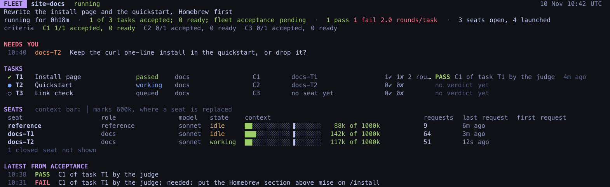
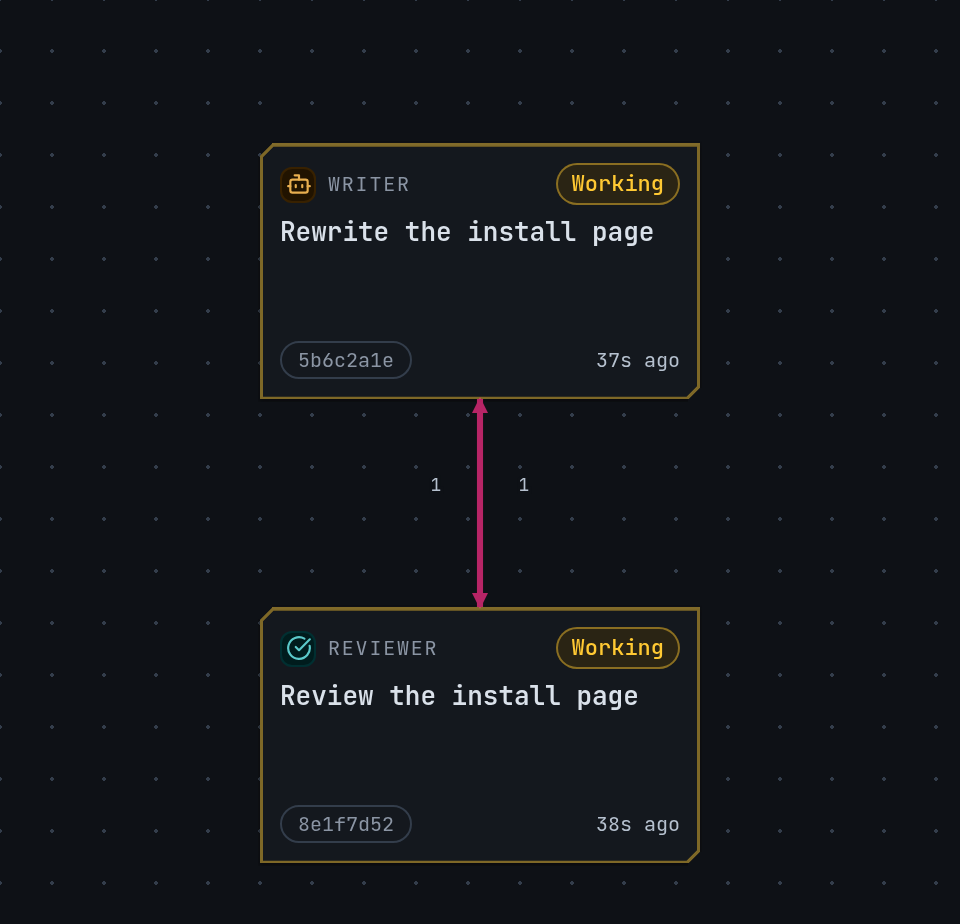

# Watch a fleet and step in

A running fleet needs you only when a session asks for something it cannot get elsewhere, or
when mike cannot fix a fault by itself. This page covers the status screen, how to answer a
session, what mike repairs on its own, and how to stop a fleet.

## The commands

| Command | Shows |
|---|---|
| `mike fleet list [--project <path>]` | Every fleet, newest first: slug, state, items missing, when it was created |
| `mike fleet status <fleet>` | One screen: what is missing, every task, every open session, the newest verdicts, what is blocked |
| `mike fleet status <fleet> --watch 5` | The same, redrawn every 5 seconds |
| `mike fleet summary` | One line for a status bar: the newest running fleet's progress |
| `mike fleet focus <fleet> [seat]` | Brings a session's pane to the front: the one you name, else the first blocked one, else the one with the newest failure. Add `--switch` to change workspace. |
| `mike fleet record <fleet>` | For a finished run: time to done, minutes lost to faults, tokens per accepted task. `--against <fleet>` compares two runs. |
| `mike fleet stop <fleet>` | Closes the fleet's sessions and ends the run |

`<fleet>` is the fleet's slug or its id. Add `--json` to `list`, `status` and `record` for
scripts. Every command takes `--config <FILE>`. The full list is in
[Command line](../command-line.md).

## The status screen

The screen lists every task with its state and the session working on it, every open session
with how much of its context it has used, and the newest verdicts. A fleet is in one of these
states: `draft`, `ready`, `starting`, `running`, `stopping`, `failed` or `done`.

Three flags appear straight under the header when they apply:

- NEEDS YOU lists what a session has asked of you, with its name.
- NOTHING IS MOVING means every open session has been idle for five minutes or more.
- PROBLEM shows something mike is working through, and whether it was passed to you.

Inside the fleet's own sessions, the [fleet-comms mod](../mods.md#fleet-comms) shows the same
state and the messages between sessions.

## Answer a session

A session never stops to ask you a question in its own pane, because the fleet would wait behind
it. It writes a note for you, titled with what it needs, and carries on with whatever else it
can do. The note appears under NEEDS YOU. To answer:

1. Run `mike fleet focus <fleet>` to bring that session's pane to the front.
2. Type your answer in the pane, as you would in any Claude Code session.

The session marks the note answered when it is settled.

Questions between sessions do not reach you. A worker that needs something from another session
asks it directly. A question from a blocked worker that is still open after 5 minutes goes to
the reference session.

## The Fleet page in the browser

Open **Fleet** in the menu, or <http://localhost:9990/fleet>. It shows the sessions of one
project, chosen at the top, over the last 24 hours, in three views: **Relationships** (a graph
of sessions linked by the messages between them), **Board** and **Notebook**. It lists any
captured sessions, fleet or not. It does not show a fleet's tasks or verdicts; use
`mike fleet status` for those. See [The web UI](../web-ui.md) and [Projects](../projects.md).

If there is nothing to show, the page says so:

- No projects captured yet: run Claude Code through mike and send a prompt.
- No sessions in this project's fleet: no session activity or messages for that project in the
  window.
- No active fleet activity in this window: the Board has only old sessions with no messages.
  **See all sessions** opens [Sessions](../reading-sessions.md).

## What mike repairs on its own

Every 20 seconds mike looks at each session in the fleet and does what you would otherwise do by
hand:

| What happens | What mike does |
|---|---|
| A worker sends nothing within 90 seconds of being opened | Closes it and opens it again, up to twice; then shows it under NEEDS YOU |
| A worker's process has ended | Records it closed and opens a new worker for the task |
| A worker has unread mail and has been silent for 5 minutes | Wakes it over Remote Control; if it is still silent 2 minutes later, replaces it |
| A check runs past its time limit | Stops it and queues it again once; a second time, it counts as a failure for the task |
| The reference session passes 600,000 tokens of context | Opens a new reference session to take over |
| A session will not close when the fleet stops | Tries three times, then records it closed and shows it under NEEDS YOU |

## Problems mike decides

Some faults need a decision rather than a restart. mike opens a problem for them and hands it to
the problem-solver, a model call that reads what happened and picks one action. A problem is
opened when, for example:

- the gate fails on a clean copy before any worker opens;
- a check fails in files no task owns;
- a worker disputes a fail, or asks a question nobody answers;
- an outcome fails three times;
- a session stalls, or every session is idle;
- something in the machine, not the work, is at fault.

The decision is one of: record the fault and carry on, message the workers, change the
definition (a brief, a task's files or order, a rule), add a one-file task, waive an obligation,
correct a task's `done_when`, accept other proof for a check that cannot run during the run,
drop a stuck check result, run a narrower check again, change a setting, or ask you.

A problem gets at most three decisions, and the third goes to you whatever it says. A run hands
at most 20 problems to the problem-solver. When the problem-solver asks you, the question says
what is needed, why only you can answer it, and what each answer would set in motion.

## Stop a fleet

- `mike fleet stop <fleet>` asks the fleet to shut down. It closes each open session's pane and
  prints, per session, whether the pane closed and whether its process has exited. The fleet
  reads `stopping` until they are gone, then `done`. A stopping fleet's definition cannot be
  edited.
- A failed start puts the fleet in `failed`. Ask Claude for its state (`get_fleet`, see
  [MCP](../mcp.md)) and read the start report, fix the definition and mark it ready again.
- A red baseline, where the gate fails before any session opens, lets only the named repair
  task run.
- At the pane limit no new pane opens, and a task whose session could not start is shown as not
  started with the reason. Close a finished pane or raise `launch_max_surfaces`.

To end one session only, run `mike spawn kill --session <id>`.

Every `mike fleet` command talks to the running mike. With mike stopped, `mike fleet list` exits
with `could not reach the inspect API`; start mike first (see [Setup](../setup.md)).
