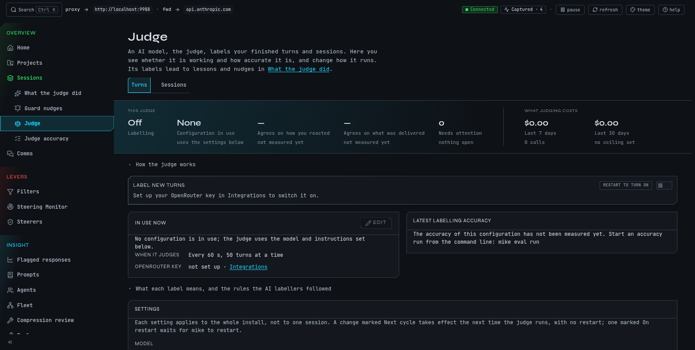

# See how the judge labels your turns

The judge is an AI model that reads your finished work and labels it. The turn judge reads
each finished turn and records two things: what Claude delivered, and how you reacted in your
next message. The session judge reads a session once it has gone quiet, labels how it ended and
writes the short summary at the top of the session page. The judge never changes a running
session. Its labels feed lessons and nudges that mike offers you, and you decide which to keep.
Judging sends your conversation text to a model provider, so it is off until you turn it on.

Open **Judge** in the menu, <http://localhost:9990/sessions/labelling>. It has two tabs,
**Turns** and **Sessions**, one for each judge. The pages that show what the labels led to are
**What the judge did** and **Guard nudges**, and **Judge accuracy** shows how often the judge
agrees with labels made beforehand.



This is a fictional example. The `docs` session in `~/projects/site` is a small
demonstration; nothing here comes from a real capture.

## Follow the example correction

Continue the example from [Quickstart](quickstart.md): in the `docs` session you wrote "Put
Homebrew first on the install page." because Claude had listed Homebrew second.

1. Open **Judge** and check the strip under the heading. **Labelling** should read **On**. If
   it reads **Off**, use the switch **Label new turns** (on the Turns tab) further down the
   page. It stays greyed until an OpenRouter key is set under Integrations in Settings.
2. Let the session carry on. A little later the turn judge reads the turn where Claude put
   Homebrew second, sees your correction in the next message and labels that turn as one you
   corrected.
3. Open **What the judge did**, <http://localhost:9990/sessions/improvement>. Under **Waiting
   for you**, the **Lessons** tab can offer a lesson drawn from your correction. Approve it and
   later sessions in the project can be given "Homebrew first on the install page" without you
   typing it. Rejecting it discards the candidate. See [Memory](memory.md) for what a lesson
   does next.
4. The same page has **What you keep saying**, things you have told Claude three or more times
   across a week or more or in more than one project, and **Is it getting better**, which
   compares correction counts before and after each change. The page itself notes that these
   are periods compared, not a controlled experiment.

Nudges and standing directives that the judge's labels drive are the other two tabs under
**Waiting for you**. They read **No nudges are waiting for your answer.** and **No standing
directives are waiting on you.** when there are none.

## Read the Judge page

The strip at the top shows, for the tab you are on:

- **Labelling**, on or off.
- **Configuration in use**, a number and its model, or **None** when the settings further down
  the page apply.
- **Agrees on…**, how often the judge's answer matched the label in the latest accuracy run,
  with a link to that run.
- **Needs attention**, the number of open alarms, with a link to them.
- **What judging costs**, for the last 7 days and the last 30 days.

**How the judge works** opens a short explanation. **What each label means** (Turns tab) lists
every label and the rules the labellers followed for mixed cases.

Below those are the switch, the configuration in use, a panel of agreement figures, any open
alarms, a note on labelling older turns again, the saved configurations, and the settings.

## Change how the judge runs

A configuration is a model, a prompt and an input format saved together and tested against the
accuracy set. To change what runs, choose a configuration on the page and confirm; the page
asks you to confirm before it changes anything. You can also edit the settings directly.

| Setting | Turn judge | Session judge |
|---|---|---|
| **Model** | `google/gemini-3.8-flash` | `google/gemini-3.5-flash-lite` |
| Work per round | **Turns per sweep**, 50 | **Sessions per poll**, 25 |
| How often | **Seconds between sweeps**, 60 | **Seconds between polls**, 120 |
| When a session is ready | | **Settled after (secs)**, 60 |
| How much text per call | | **Turns in the digest**, 40; **Max chars per turn**, 3000 |
| **Request timeout (secs)** | | 30 |

The model must support structured output. The session judge's page warns that Anthropic models
on OpenRouter reject that request with an error, so pick an OpenAI or Google model there.
Changing the session judge's model makes sessions it already scored eligible again. **System
prompt** holds the rubric; **Reset to default** restores the built-in one.

## Measure accuracy

**Judge accuracy**, <http://localhost:9990/sessions/labelling/accuracy>, lists accuracy runs
for **Turns** and **Sessions**. In a run the judge labels a fixed set of items that were
labelled beforehand, and each answer is compared with that label. Most of those labels were
made by AI too: two models labelled each turn separately and a third settled the differences;
the rest are labels you chose. A score is agreement with those labels, not proof the judge is
right.

Open a run and choose **Review labels** to go through the items where the judge and the label
differ and say which is right. Your answer becomes that item's label, so it counts in every run
that includes it. **Use this run's configuration** opens the change step on the Judge page,
where you confirm it.

Start a run from the command line:

```sh
mike eval run                      # turn judge
mike eval run --role session_judge
```

A run spends model calls. `--max-usd` caps it and defaults to 1; `--dry-run` shows what it
would do. Every option is in `mike eval run --help` and in [Command line](command-line.md).
With no runs the page reads **No accuracy runs yet** and shows the command to start one.

## What leaves your machine

- **Sent to Anthropic:** nothing. Labels are stored; they change a request only when you
  approve a lesson or directive, or turn on nudges.
- **Sent to another service:** yes. The turn judge sends each finished turn it labels; the
  session judge sends a digest of the session's turns. The model name decides where: a name
  that begins `claude/` runs the `claude` program on this machine, `codex/` runs the local
  Codex program, and others such as `google/…` or `openai/…` go to OpenRouter. The guard, lesson proposals and the steerer use the same
  providers; see [Steering](steering.md).
- **Cost controls:** the batch and timer settings above, **Turns per sweep** being the ceiling
  on one sweep's calls; daily call caps for labelling older turns again; `--max-usd` on
  accuracy runs; and the cost strip on the page.

See [Privacy](privacy.md).

## When nothing shows

| What you see | Why and what to do |
|---|---|
| **Labelling** is **Off** | Fresh installs have both judges off. Switch it on once a key is set. `mike features everything` turns it on with every other feature |
| The switch is greyed with **Set up your OpenRouter key in Integrations to switch it on.** | The page needs an OpenRouter key before it will switch on, whichever model is chosen. Add one under Integrations in Settings |
| **Configuration in use** reads **None** | Judging uses the settings further down the page |
| Agreement shows no figure | There is no accuracy run yet. Run `mike eval run` |
| **Some of this page could not be loaded** | A request failed. Reload; see [Troubleshooting](troubleshooting.md) |
| **No nudges are waiting for your answer.** | The guard has not sent a nudge that needs your verdict, or it is off. See [Steering](steering.md) |
