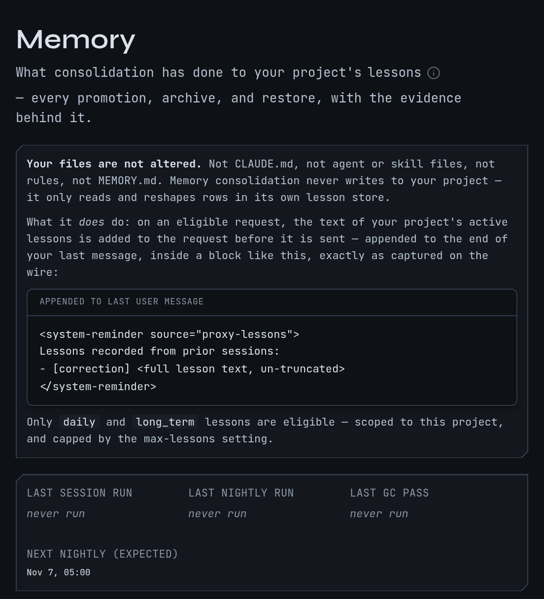

# Memory: make a correction stick

Memory keeps what you corrected in one session and puts it in front of the next one. A
correction becomes a **lesson**: a short standing rule for a project, such as "Put Homebrew
first on the install page." Later sessions in that project can be handed it, ask for it by
topic, or find it by search. mike also keeps a search over your project's notes, Claude Code
memory files and skills. Memory does not change your code, and it never writes a rule or a
skill into your project folder without your approval.

Some of this is on in a fresh install and some is off. The table under
[What is on in a fresh install](#what-is-on-in-a-fresh-install) says which, and what each
part sends to Anthropic or off your machine; [Privacy](privacy.md) has the full list.

Open <http://localhost:9990/memory> for the **Memory** page. **Skills** and **Proposals**
sit beside it in the menu, as the pages for lessons that become files in a project.

This is a fictional example: a project `~/projects/site`, a session named `docs`
and one correction. Nothing on the picture is a real prompt.

## Keep a correction as a lesson

Continue the example. Halfway through the session `docs` (goal "Rewrite the install page")
you tell Claude: "Put Homebrew first on the install page." You want the next session in
`~/projects/site` to start from that.

1. Ask Claude to keep it: "Record that as a lesson." Claude calls `record_lesson`, a tool
   from [mike's MCP companion](mcp.md), with a kind and the rule.
2. Or let Claude write the rule at the end of an answer as
   `<mem:update topic="install-page" kind="correction">Put Homebrew first on the install page.</mem:update>`.
   mike reads these tags out of finished turns and stores each as a lesson. A tag only
   counts in the turn's last reply, not in text written before a tool call. `kind` is
   `correction`, `convention`, `warning` or `preference`; a tag without one is stored as
   `convention`. This runs by default and makes no model call.
3. Check it was stored. Ask Claude for `list_lessons` for the project, or open
   [Find a lesson](#find-a-lesson-or-a-note) below. The lesson is listed with its kind and
   the session it came from.

A third way needs a model provider and is off by default: with the `judge_lessons` switch
on, mike drafts a lesson from a correction it noticed. The settings page shows this switch
under its raw name, `judge_lessons`, with no label or description, and it only runs while
the **Steerer** switch is also on. That sends the correction and the
turns around it to the provider you set up with `mike setup models`; see
[the judge](judge.md) for providers and what is sent.

A stored lesson does nothing to a session until it is delivered. A fresh install stores
lessons and delivers none.

## Get a lesson into the next session

There are three ways a lesson reaches a session. Each adds a block of text to the request
Claude Code sends to Anthropic, so each is a switch you choose.

| How | What happens | Switch |
|---|---|---|
| First-turn lessons | On a session's first turn, mike adds the project's lessons, up to 5 (the **Max lessons to inject** setting) | **Inject lessons** |
| Recall | When Claude writes `<mem:recall topic="install-page"/>` in an answer, mike adds the lessons for that topic to the next request, up to 3 per topic | **Recall from project memory** |
| Subagent lessons | On a subagent's turns, lessons scoped to that agent | **Agent lessons** |

For the example, turn on first-turn lessons and open a new session in `~/projects/site`.
Its first request now carries the Homebrew correction, as a `<system-reminder>` block
labelled as a lesson. Open the request page ([Read a session](reading-sessions.md)) to see
the block, and the **Lessons touching this session** panel on the session to see which
lessons it was shown and when. A session already running keeps the settings it started
with; the changes apply to new sessions.

`mike features recommended` turns these three on, plus diagnostic reminders (below).
`mike features watch-only` turns them off and `mike features everything` turns on every
switch in mike, including ones that send text to a model. With mike not running, the
command says so and saves the choice for the next start. Each preset is also a choice in
[setup](setup.md), and every switch is at <http://localhost:9990/settings>. See
[Settings](settings.md).

Delivery by Remote Control reaches an idle session as a message, so the request body is
unchanged. In every other case the stored copy of the request is the one Claude Code sent;
the forwarded one differs by the added block.

## Find a lesson or a note

Memory is also searchable. In a session, Claude can ask:

- `search_project_knowledge` finds lessons, session notes, earlier turns, mail between
  sessions, work threads, Markdown documents, Claude Code memory files and project skills
  in one query. It matches on text, and on meaning when embeddings are available.
- `read_project_knowledge` returns the full text behind a result.
- `list_project_locations` finds the project a query belongs to.
- `recall_project_context` returns the latest corrected turns and the active lessons in one
  call.

In the example, searching for "Homebrew" finds the lesson and the turn where you made the
correction.

mike indexes two sources by itself for each checkout registered to a project: Claude Code's
memory files for the project (every `.md` file except `MEMORY.md`) and the project's
skills in `.claude/skills/<skill>/SKILL.md`. Other Markdown, such as docs and design notes,
needs the `scripts/mike-knowledge` collector in a mike source checkout, which needs
Python 3 and PyYAML.

Searching sends nothing to Anthropic: results go back to the session that asked, as a tool
result, and that session's next request then contains them like any tool result. Nothing
leaves your machine, with one exception: embeddings are on by default but point at a
loopback address, and mike refuses any embedding address that is not on your machine unless
you turn on **Allow a remote embedding server**. If you do, the text being indexed or
searched goes to that server.

## Review what memory did

Open **Memory** in the menu. While mike is running, a background job consolidates the lessons of each project
nightly: it merges near-duplicates, retires stale lessons and archives them. The page
shows what it did, with the evidence behind each step:

- A strip of recent consolidation runs.
- Lessons it thinks are related, which you confirm or reject.
- Outcomes: whether corrections fell after a lesson was delivered.
- **Decisions**: every promotion, archive, evaluation and restore, newest first. Filter by
  **Project**, **Session**, **File** or **Action**, then **Apply**; **Clear** resets the
  filters. **Load more decisions** shows older ones.

To undo an archive, find it in **Decisions** and choose **Restore**. The lesson goes back
to the active set and is delivered again from the next session.

If the page says **No memory decisions recorded yet**, consolidation has not run or has
nothing to change. A new install shows this until a project has enough lessons. If a
project has no lessons, nothing here is wrong; record one as above.

To remove a lesson outright, ask Claude to call `delete_lesson` with its id from
`list_lessons`. There is no delete button on the page; deleting is permanent, unlike an
archive.

## Turn lessons into skills and rules

When a project has two or more accepted lessons on the same topic, mike can draft a Claude
Code skill from them. Open **Skills** in the menu, or <http://localhost:9990/skills>.

1. Choose a project on the left. Each shows how many skills have shipped out of its cap
   (12 by default, **Most learned skills per project**) and how many wait on you.
2. Under the project, choose how mike ships skills: **Ask me first** (the default) or
   **Ship when it passes review**.
3. Open a skill to read its text, the lessons behind it and its revisions. In a project set
   to ask first, choose **Approve** to write it into the project's `.claude/skills` folder
   or **Reject** to refuse it. **Restore** brings back one you rejected.

Some lessons suit a standing rule for certain files, or an instruction for one of your own
agents, rather than a skill. They appear on **Proposals**, <http://localhost:9990/proposals>,
with the file they would go in and the text they would add. Choose **Accept** or **Decline**.
mike never writes a proposal into a project on its own.

Both pages are empty until a project has lessons to draw on: **No learned skills yet** and
**No proposals yet**. Drafting skills is part of the same background pass as lesson
proposals. It calls a model provider, so it does nothing until one is set up and both the
`judge_lessons` and **Steerer** switches are on; see the table below.

## Diagnostic reminders

mike scans each response for 20 patterns in five groups: justifying shortcuts, deflecting
blame, avoiding work, faking understanding and overselling. Hits show on the request page
and on [flagged responses](flagged-responses.md) whether or not reminders are on. With the
**Project reminders** switch on, mike adds a reminder built from the previous request's hits to a
later request. The scan is local.

## Scheduled jobs on an installed mike

Besides that built-in job, mike runs scheduled jobs that are scripts. They are listed in the **Scheduled jobs** panel on the home page, with when each last ran and a **Run now** button. Which ones can run depends on how mike was installed.

An installed mike (Homebrew, mise or an archive) runs the four jobs whose scripts ship with it:

| Job | What it does |
|---|---|
| `learning_promote` | Turns accepted lessons into project memories and skills in your project folders, hourly overnight. |
| `learning_audit` | Reviews last week's sessions, lessons and tool use and publishes a report, weekly. |
| `compressor_loop` | Compares sessions with and without shortened file reads and adjusts the [compressor](compression.md)'s settings, daily. |
| `lesson_relations` | Finds lessons that repeat or contradict each other, daily, before consolidation. |

They need `python3` with PyYAML and `psql` on the PATH the background service uses. If a job fails, its row in the panel says what to check. `lessons_commit`, `memory_review` and `usage_audit` work on a mike source checkout. On an installed mike they show "needs a mike source checkout" and are not scheduled; that is expected, and nothing is wrong.

`mike doctor` has a `scheduled_jobs` line that says how many jobs can run here and names the ones that need a checkout. It warns, with a fix, if a job's script is missing, for example when mike was installed without its `share/mike/scripts` folder.

## What is on in a fresh install

These are the defaults before any preset is applied.

| Part | Default | Changes what Anthropic receives | Text leaves your machine |
|---|---|---|---|
| Storing lessons from `<mem:update>` tags (**Harvester**) | On | No | No |
| Nightly consolidation of lessons (**Lesson worker**) | On | No | No |
| Project knowledge search | On | No | No, unless you allow a remote embedding server |
| First-turn lessons (**Inject lessons**) | Off | Yes, adds a lesson block | No |
| Recall (**Recall from project memory**) | Off | Yes, adds a lesson block | No |
| Subagent lessons (**Agent lessons**) | Off | Yes, adds a lesson block | No |
| Diagnostic reminders (**Project reminders**) | Off | Yes, adds a reminder block | No |
| Lesson proposals and skill drafting (`judge_lessons`, needs **Steerer** on) | Off | No | Yes, to your model provider |

A model-backed part does nothing until you choose a provider with `mike setup models`, and
a part whose provider is not available does not fall back to another. See [the
judge](judge.md) for the providers.

## When memory is not working

| What you see | Why | What to do |
|---|---|---|
| Lessons are stored but a new session never mentions them | Delivery is off | Run `mike features recommended`, or switch on **Inject lessons** in settings, then start a new session |
| A running session ignores a change | Delivery settings apply to new sessions | Start a new session |
| Recall adds nothing | The topic written in the tag has no lessons | Check the topic with `list_lessons` and use the same words |
| A `<mem:update>` tag stores nothing | The tag was malformed or the harvester is off | Check the tag has `topic="…"` and a closing `</mem:update>`, and the **Harvester** switch |
| **No memory decisions recorded yet** | Consolidation has not changed anything | Nothing to do; it fills as lessons accumulate |
| Skills or Proposals page is empty | No project has enough lessons, or no provider | Record lessons, set up a provider, switch on `judge_lessons` and **Steerer** |

Next, see how a lesson is judged and steered in [steering](steering.md), or rewrite what is
sent with [filters](filters.md).
