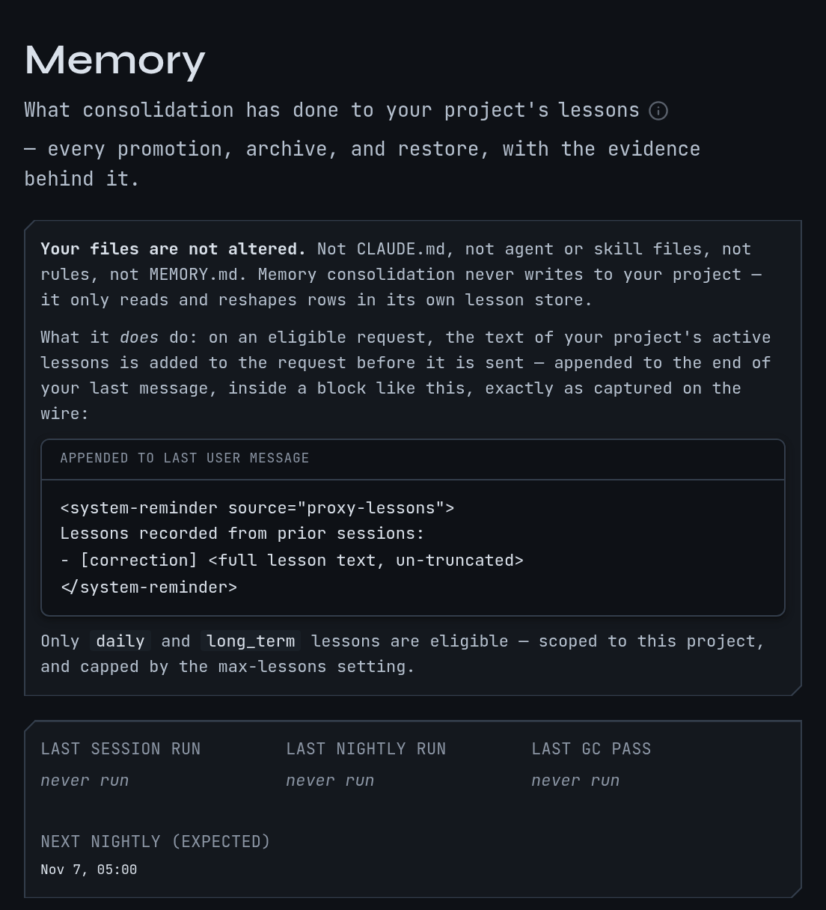

# Memory: make a correction stick

Memory keeps what you corrected in one session and puts it in front of the next one. A
correction becomes a **lesson**: a short standing rule for a project, such as "Put Homebrew
first on the install page." Later sessions in that project can be handed it, ask for it by
topic, or find it by search. mike also keeps a search over your project's notes, Claude Code
memory files and skills. Recording a lesson does not itself edit your project files, but
current builds can route standing lessons into `.claude/rules/mike-lessons.md` automatically.
Writing learned skills is a separate choice: the default asks you first, while **Ship when
it passes review** allows accepted skills to be written automatically for that project.

Some of this is on in a fresh install and some is off. The table under
[What is on in a fresh install](#what-is-on-in-a-fresh-install) says which, and what each
part sends to Anthropic or off your machine; [Privacy](privacy.md) has the full list.

Open <http://localhost:9990/memory> for the **Memory** page. **Skills** and **Proposals**
sit beside it in the menu, as the pages for lessons that become files in a project.

This is a fictional example: a project `~/projects/site`, a session named `docs`
and one correction. Nothing on the picture is a real prompt.

## Keep a correction as a lesson

Continue the example. Halfway through the session `docs` (goal "Rewrite the install page")
you tell Claude: "Put Homebrew first on the install page." You want the next session in
`~/projects/site` to start from that.

First connect [mike's MCP companion](mcp.md) and use a running mike with a database. You do
not need automatic lesson proposals, a judge model or embeddings to record this correction.

1. Ask Claude: "Record a correction lesson for this project: put Homebrew first when writing
   install pages. Use the topic install-page and scope it to the project, not an agent."
   Claude calls `record_lesson` with the actual project path, kind `correction` and the rule.
   A short rule with a clear situation is more useful than a recap of the whole session.
2. Or let Claude write the rule at the end of an answer as
   `<mem:update topic="install-page" kind="correction">Put Homebrew first on the install page.</mem:update>`.
   mike reads these tags out of finished turns and stores each as a lesson. A tag only
   counts in the turn's last reply, not in text written before a tool call. `kind` is
   `correction`, `convention`, `warning` or `preference`; a tag without one is stored as
   `convention`. This runs by default and makes no model call.
3. Check it was stored. Ask Claude to call `list_lessons` for the same project path and
   show the new lesson's id, text, kind and topic. Keep the id so you can distinguish it from
   an older similar rule. A promise to remember is not proof that the tool saved anything;
   check the tool result. A source session is recorded when one was supplied.

Keep the topic ordinary (`install-page`) for this example. A topic starting with `shared:`
explicitly shares an accepted rule across projects; use that only when you want that wider
scope. Setting `agent_name` instead restricts automatic delivery to that persona, rather
than the primary session.

A third way needs a model provider and is off by default: with the `judge_lessons` switch
on, mike drafts a lesson from a correction it noticed. The settings page shows this switch
under its raw name, `judge_lessons`, with no label or description, and it only runs while
the **Steerer** switch is also on. That sends the correction and the
turns around it to the provider you set up with `mike setup models`; see
[the judge](judge.md) for providers and what is sent.

A stored lesson does nothing to a session until it reaches its context. Direct lesson
injection starts off; on current builds, promotion can instead write a standing rules file
that Claude loads. Check the route below rather than treating the injection switch as a
guarantee that no learned rule enters a session.

## Get a lesson into the next session

There are three request-time automatic delivery paths. Each can add lesson text to what Anthropic
receives, so each is a switch you choose. You can also ask an MCP tool to read a lesson
without enabling automatic delivery. Standing rules loaded from a file are a separate
path; see [lesson routes](#check-which-route-a-lesson-takes).

| How | What happens | Switch |
|---|---|---|
| Session lessons | Selects relevant project and shared lessons for the current conversation, up to 5 per injection (the **Max lessons to inject** setting); recently delivered content is suppressed; current builds can resend it after 40 observed requests | **Inject lessons** |
| Recall | When Claude writes `<mem:recall topic="install-page"/>` in an answer, mike adds the lessons for that topic to the next request, up to 3 per topic | **Recall from project memory** |
| Subagent lessons | On a subagent's turns, lessons scoped to that agent | **Agent lessons** |

To check the example end to end:

1. Open <http://localhost:9990/settings> and turn on **Inject lessons**. This enables delivery,
   not the model-backed lesson proposer. A session already running keeps the delivery
   settings it started with, so open a new session in the same project folder.
2. Ask something relevant, such as "Review the order of installation methods in install.md."
   mike selects lessons against the conversation; a stored lesson is not guaranteed to
   appear on the first request or on an unrelated question.
3. Open that session's request ([Read a session](reading-sessions.md)). For proxy-delivered
   lessons, look for the correction in **Sent** and the lesson entry in **Transformations**;
   **Original** remains what Claude Code sent. The **Lessons touching this session** panel
   shows which lessons the session was shown and when.
4. Check the result separately: did Claude actually put Homebrew first? Delivery shows that
   it received the rule, not that it followed it.

If recall is also enabled, some lessons are offered as topics to recall rather than as full
text. If the mike mod is handling lesson delivery, the proxy can stand aside to avoid
adding the same lesson twice. A missing proxy transformation alone therefore does not prove
that no lesson was supplied. Check the captured context and the lesson-delivery panel before
changing settings; see [Mods](mods.md).

`mike features recommended` turns these three on, plus diagnostic reminders (below).
Newer post-alpha.5 builds also enable code recording, scans and proactive findings delivery;
read [the preset choices](settings.md#the-three-starting-points) before applying it.
`mike features watch-only` turns them off and `mike features everything` turns on every
switch in mike, including ones that send text to a model. With mike not running, the
command says so and saves the choice for the next start. Each preset is also a choice in
[setup](setup.md), and every switch is at <http://localhost:9990/settings>. See
[Settings](settings.md).

Proxy-delivered lessons and recall ride the request as context; they do not wake an idle
Remote Control session. Other features, such as a steerer or session mail, have different
delivery rules. For a proxy-added lesson, the stored original remains unchanged and the
forwarded request carries the additional block.

## Check which route a lesson takes

Current source builds after alpha.5 choose a route during `mike learning promote` on a
machine with an eligible project checkout. These routes and revision tags are not part of
alpha.5. Check your installed version and promotion report rather than assuming the latest
source is deployed on your machine.

| Route | Where the lesson belongs | What to check |
|---|---|---|
| `standing` | Generated `.claude/rules/mike-lessons.md` in the selected checkout | The file exists, contains the current wording, and Claude actually loaded it |
| `injection` | Request-time lesson selection | Delivery is enabled, the lesson is eligible and relevant, and the current revision is not already in the request |
| `covered` | Existing hand-written `CLAUDE.md`, `AGENTS.md` or rules text | The reported `covered_by` file really expresses the same rule and applies to this session |

A lesson without a route row defaults to injection. Standing and covered lessons are left
out of the primary-session proxy and mod injection selection; this is a routing decision,
not a verdict that the lesson was used. Standing selection is capped at 60 lessons, favors
newer eligible lessons, and excludes agent-specific and shared/verifier topics. Not every
accepted lesson becomes a standing rule, and a standing rule is not a generated skill.

Coverage is an embedding-based comparison, not proof that two instructions mean the same
thing. It needs an available embedding model and lesson vectors; the report explains when
coverage was skipped or failed. The hand-written instruction text is embedded at the
configured destination, subject to the remote-embedding permission. Review
[Privacy](privacy.md) before enabling that comparison. Without coverage results, the
promoter can still choose standing or injection routes.

Generated rule lines and lesson references carry tags such as `[lesson:123 rev:2]`.
The revision increases when stored lesson text changes. The primary-session proxy and mod
inspect the request for these tags: a matching revision suppresses another copy; an older
revision does not. Legacy `[lesson:123]` tags have no revision and still count as held for
that id. Do not add tags merely to mark a lesson as read: matching text anywhere in the
request can suppress delivery, even when it is only quoted. Held means present according
to this marker, not understood or followed. The request manifest can record
`session_lessons_already_present` instead of a new injection; inspect **Original** as well
as **Sent** before treating the absence of an added block as a failure.

On continued threads, the current request may contain only new messages, not the earlier
lesson tags. Post-alpha.5 source containing [PR #387](https://github.com/temet-ai/mike/pull/387)
lets the proxy's held-tag reader inspect the recovered earlier-turn chain as well as the
current body, including captured streamed replies. A tag missing from **Original** alone
therefore does not prove the lesson was absent from the conversation. This is recognition
of earlier context, not a rewrite of an old request or proof that the lesson was followed.

In the earlier PR #387 behavior, an unrecovered predecessor chain meant unavailable
earlier turns; an unseen earlier tag could not suppress another copy by itself.
Post-alpha.5 source containing [PR #440](https://github.com/temet-ai/mike/pull/440)
also retains partial history. When history is not whole, enabled stages that require
whole history, including session lessons, agent lessons, recall and memory keeper,
record `history_unknown` and skip that request. This is not evidence that a lesson is
already present or was injected. The request can continue while a database restore
runs in the background; that does not guarantee recovery on the same request.
Do not diagnose every repeated lesson as a new
learning event, or treat a merged reader fix as proof that your live chain is complete.
[Continued-thread limits](compression.md#continued-threads-recognizing-history-is-not-rewriting-it)
also explain why this does not repair older per-turn change records.

A route is not a file-write receipt. Routes are saved before generated files are reconciled,
and a manually edited or unowned generated file is preserved as a conflict. A missing or
stale standing file can therefore coexist with a standing route and suppressed injection.
Inspect the promotion report, preserve your edits, and reconcile the reported conflict
before relying on the rule. Preview with `mike learning promote --dry-run` before applying
promotion again. Dry-run prevents persistent promotion writes, but still computes routes
and can send hand-written instruction text to the configured embedding service for
coverage; it is not an offline preview. Do not delete a rule, clear its route or alter tags
just to silence the warning. Verify the resulting file and a new session's captured context separately.

## Separate storage, delivery and use

These are different checkpoints; do not count one as proof of the next:

| Checkpoint | What it proves | What it does not prove |
|---|---|---|
| Stored | The lesson exists in the project's records | A session received it |
| Supplied | The lesson was included in a particular request's context | Claude followed it or it helped |
| Judged | A model assessed that supplied item against the turn's evidence | The assessment is infallible |
| Used | The judge found the actions or reply followed or relied on it, without a correction on that point | Every later turn will follow it |

On builds after `v0.1.0-alpha.5`, `list_supplied_items` can inspect a request or session's
supplied lessons and work-thread cards, with verdicts when available. Its `used`,
`corrected_anyway` and `ignored` labels are model assessments; read the rationale and
captured turn. `ignored` means the judge found no sign of use, which can include irrelevant
context. **No verdict means unjudged, not ignored.** Alpha.5 does not have this supplied-item
ledger or verdict pass; use the captured request and actual result instead.

On current post-alpha.5 builds, the automatic verdict pass needs `judge_lessons`, a
configured model and database, and a running mike with no recent primary-session activity.
The default quiet window is 22:00–04:00 UTC, with five minutes of inactivity required.
There is also an idle catch-up outside that window when no previous run is known or the
last recorded run was at least 24 hours ago. At startup, mike seeds that record from the
newest saved supply verdict. Older post-alpha.5 builds without catch-up waited for the
quiet window; do not apply that limitation to current builds.

A switched-off machine runs neither path. Catch-up after it starts is not a promise that
all pending items will be judged immediately: turns must settle, work is batched, and
provider failures or a backlog can leave items unjudged. Check the worker's outcome,
settings, uptime and logs before interpreting missing verdicts as a failure to follow a
lesson. This pass sends the supplied text and turn evidence to its configured model provider.

### When the supplied lesson is a poor match

Alpha.5 allowed even a weak positive relevance match for a nonempty query. Current
post-alpha.5 builds instead require a score of at least 0.05 and at least half the best
candidate's score. These are ranking scores, not probabilities that a lesson will help.
The limit of five remains a ceiling, not a target or a quality guarantee; check the actual
supplied text. Current builds can also supply a lesson again after 40 observed requests,
rather than suppressing it for the entire session.

Check which project the session resolves to, especially when several checkouts share a
broad parent project. Alpha.5 had no machine-specific delivery filter. Current builds
exclude lessons assigned to another `machine_uuid`; unassigned lessons remain eligible
across machines within their project or shared scope. A machine name written only in the
lesson's text does not set that restriction.

### Replace a rule deliberately

Writing "the old rule is out of date" in a new lesson does not itself replace it. First
read the old lesson and confirm its id and scope. When you intend to replace it, ask Claude
to call `record_lesson` with the new rule and the old id in `supersedes`, then inspect the
returned lesson and any notes. This declares a confirmed relation from the new rule to the
old one. Both alpha.5 and current code exclude that relation's target from automatic
injection.

Current post-alpha.5 builds also retire the replaced rule and keep its replacement id and
reason. If the id you named already has one live replacement, the create path redirects to
that replacement and returns a note. If it has several live replacements, the note asks
you to identify which one you meant; do not assume the whole chain was replaced.
Model-adjudicated contradictions can also retire the older rule when the adjudicator
agrees. Merely proposing a relation, or writing a correction in prose, is not the same
operation. Check the recorded relation and retirement state, not just the new text.

Retirement is not archival. **Restore** in the archive view does not clear retirement or
remove a supersession relation. If a replacement was wrong, inspect the chain and record
a corrected replacement of the current rule rather than deleting history or assuming
archive Restore will undo it. Recheck delivery in a new request; previously captured
requests still contain what they originally received.

## Find a lesson or a note

Memory is also searchable. In a session, Claude can ask:

- `search_project_knowledge` finds lessons, session notes, earlier turns, mail between
  sessions, work threads, Markdown documents, Claude Code memory files and project skills
  in one query. It matches on text, and on meaning when embeddings are available.
- `read_project_knowledge` returns the full text behind a result.
- `list_project_locations` finds the project a query belongs to.
- `recall_project_context` returns the latest corrected turns and the active lessons in one
  call.

In the example, searching for "Homebrew" finds the lesson and the turn where you made the
correction.

Alpha.5 indexes the registered checkout's Claude memory files (except `MEMORY.md`) and
`.claude/skills/<skill>/SKILL.md`. Current post-alpha.5 source builds also index checkout
instructions from `CLAUDE.md`, `AGENTS.md`, `.claude/rules` and `.claude/agents`.

### Machine-wide Claude sources

In current source builds, a database-backed mike scans its Claude home automatically,
about every two minutes. It uses `CLAUDE_CONFIG_DIR` when set, otherwise `$HOME/.claude`.
The machine-wide sources are `agents`, `skills`, `rules` and `agent-memory`; the rules
source also includes the home-level `CLAUDE.md` when the rules directory exists. This is
not a recursive import of every file in your home directory. Generated instruction files
marked by mike are excluded from instruction scanning.

These sources belong to a machine, not to a pretend project checkout. **Machine ownership
is not a project privacy boundary:** project knowledge searches include machine-wide
sources in the same database, including sources from other machines. Check a result's
machine and source before treating it as instructions for the current project.

There is no dedicated scanner enable/disable switch in this implementation. Turning off
embeddings stops that optional semantic service, not local file indexing or text search.
A missing or unreadable source root keeps its earlier index, so renaming a directory or
changing Claude home is not a reliable way to erase already indexed text. Review
[Privacy](privacy.md#knowledge-sources-and-standing-lessons) before connecting a Claude
home containing material you do not want searchable. These are source-verified behaviors,
not confirmation that your installed release includes or has run this scanner.

For other Markdown sources, use the [project knowledge setup](projects.md).
For database-backed sources on newer builds, follow [Add a searchable knowledge source](settings.md#add-a-searchable-knowledge-source); preview its scope before enabling indexing.

Text search does not itself call Anthropic, but results returned to Claude Code become
tool results in its next request to Anthropic. Treat searching private history as bringing
that history into the current conversation.

Embedding starts disabled in a fresh configuration. Its default address is local, and it
needs an available embedding server before meaning-based search can work. mike refuses a
non-local embedding address unless you turn on **Allow a remote embedding server**; if you
do, text being indexed or searched goes to that server. On builds after alpha.5, if you separately enable reranking,
queries and candidate text go to the configured reranker. Review those destinations in
[Settings](settings.md) and [Privacy](privacy.md), rather than assuming every search stays
on the machine.

## Review what memory did

Open **Memory** in the menu. While mike is running, a background job consolidates the lessons of each project
nightly: it merges near-duplicates, retires stale lessons and archives them. The page
shows what it did, with the evidence behind each step:

- A strip of recent consolidation runs.
- Lessons it thinks are related, which you confirm or reject.
- Outcomes: whether corrections fell after a lesson was delivered.
- **Decisions**: every promotion, archive, evaluation and restore, newest first. Filter by
  **Project**, **Session**, **File** or **Action**, then **Apply**; **Clear** resets the
  filters. **Load more decisions** shows older ones.

To undo an archive, find it in **Decisions** and choose **Restore**. This returns the lesson
to the long-term stage and clears its archive and duplicate markers. It does not clear
retirement or supersession, and delivery still depends on scope, eligibility and relevance.
A restored lesson is not guaranteed to appear in the next session.

If the page says **No memory decisions recorded yet**, consolidation has not run or has
nothing to change. A new install shows this until a project has enough lessons. If a
project has no lessons, nothing here is wrong; record one as above.

To remove a lesson outright, ask Claude to call `delete_lesson` with its id from
`list_lessons`. There is no delete button on the page; deleting is permanent, unlike an
archive.

### Check search telemetry coverage before judging memory

Search-event use marks, search grades and ranking-tuner outcomes describe the events that
were recorded and eligible for processing, not every lookup a session performed. They are
separate from the supplied-lesson verdicts above. An outer `ask` tool call can perform zero,
one or several inner lookups; its call count is not an expected search-event count.

In source checked at `dfb064e2` on 19 November 2026:

- Conversation search and raw-text search record an event only when a caller value is
  supplied. Knowledge search and similar-turn recall can record without a caller, leaving
  session attribution absent. Recording is asynchronous and needs persistence; a successful
  search response does not itself prove its event was stored.
- The event recorder tries to associate a supplied session with a matching captured tool
  call from the last two minutes, otherwise its newest captured request. Later attribution
  considers existing sessionless events from the last 24 hours, matching the query and
  tool-name suffix to a captured call in the preceding 60 seconds. It cannot recreate an
  event that was never recorded, and an outer tool named `ask` is not automatically a
  matching inner search tool.
- Use marking needs both session and request attribution. The current search-grading query
  selects finalized `search_project_knowledge` events with a session/project, not every
  search type. Tuning then uses grades in its configured lookback window. These eligibility
  rules can make the measured population unrepresentative of everyday session use.

[Issue #420](https://github.com/temet-ai/mike/issues/420) reports missing caller-attributed
lookup telemetry behind `ask`. Its observed counts and proposed fix have not been
independently reproduced or verified as deployed for this guide. Do not conclude that
memory was unused, all searches were absent, or ranking is optimal from a low used share,
missing grades or a `no_change` tuning result alone.

For a specific investigation, compare the outer call with its actual lookup routes, query,
time and verified caller session, then inspect whether corresponding events have session
and request attribution before interpreting use or grade results. Do not invent a caller
UUID to fill a gap. Keep queries and returned content private when sharing diagnostics.

## Turn lessons into skills and rules

When a project has two or more accepted lessons on the same topic, mike can draft a Claude
Code skill from them. Open **Skills** in the menu, or <http://localhost:9990/skills>.

1. Choose a project on the left. Each shows how many skills have shipped out of its cap
   (12 by default, **Most learned skills per project**) and how many wait on you.
2. Under the project, choose how mike ships skills: **Ask me first** (the default) or
   **Ship when it passes review**.
3. Open a skill to read its text, the lessons behind it and its revisions. In a project set
   to ask first, choose **Approve** to write it into the project's `.claude/skills` folder
   or **Reject** to refuse it. **Restore** brings back one you rejected.

Some lessons suit a standing rule for certain files, or an instruction for one of your own
agents, rather than a skill. They appear on **Proposals**, <http://localhost:9990/proposals>,
with the file they would go in and the text they would add. Choose **Accept** or **Decline**.
mike never writes a proposal into a project on its own.

Both pages are empty until a project has lessons to draw on: **No learned skills yet** and
**No proposals yet**. Drafting skills is part of the same background pass as lesson
proposals. It calls a model provider, so it does nothing until one is set up and both the
`judge_lessons` and **Steerer** switches are on; see the table below.

## Diagnostic reminders

mike scans each response for 19 patterns in five groups: justifying shortcuts, deflecting
blame, avoiding work, faking understanding and overselling. Hits show on the request page
and on [flagged responses](flagged-responses.md) whether or not reminders are on. With the
**Project reminders** switch on, mike adds a reminder built from the previous request's hits to a
later request. The scan is local.

## Scheduled jobs on an installed mike

Besides that built-in job, mike runs scheduled jobs through scripts or built-in commands. They are listed in the **Scheduled jobs** panel on the home page, with when each last ran and a **Run now** button. Which ones can run depends on how mike was installed.

Current post-alpha.5 source builds support these five jobs on installed mike (Homebrew, mise or an archive). If the job’s script exists, it is used; otherwise the scheduler invokes the running mike executable with the corresponding subcommand:

| Job | What it does |
|---|---|
| `learning_promote` | Runs `mike learning promote` hourly overnight. It writes the lessons that should always apply to `.claude/rules/mike-lessons.md` in your project folder, each tagged `[lesson:<id> rev:<n>]`, and installs skills there. Embedding-based coverage can leave out a lesson already represented in your own `CLAUDE.md`, `AGENTS.md` or rules files; see [lesson routes](#check-which-route-a-lesson-takes). |
| `learning_audit` | Runs `mike learning-audit` weekly: reviews last week's sessions, lessons and tool use and writes a report under `artifacts/learning-audit`. |
| `compressor_loop` | Compares sessions with and without shortened file reads and adjusts the [compressor](compression.md)'s settings, daily. |
| `lesson_relations` | Finds lessons that repeat or contradict each other, daily, before consolidation. |
| `decisions_loop` | Runs `mike decisions loop` to score decision points and record findings. Its hourly check runs only when no run has finished in the last 24 hours. |

None of them needs Python or `psql`; they run mike's own commands. If a job fails, its row in the panel says what to check. `lessons_commit`, `memory_review` and `usage_audit` work on a mike source checkout. On an installed mike they show "needs a mike source checkout" and are not scheduled; that is expected, and nothing is wrong.

`mike doctor` has a `scheduled_jobs` line that says how many jobs can run here and names the ones that need a checkout. A missing wrapper does not prevent the scheduler from launching the five jobs above when their built-in fallback is available; the command can still fail its own prerequisites. Other script-only jobs still need their scripts and, where indicated, a source checkout.

### Promotion started, but did it finish?

The scheduler's built-in fallback only selects an executable; it does not prove promotion
succeeded. In current post-alpha.5 source, `mike learning promote` also needs a database,
machine identity and a discoverable Mike scripts root. It checks `MIKE_SCRIPTS_ROOT` first,
then working-directory and executable ancestors and package share folders, then checkouts
registered to this machine. Automatic discovery recognizes a root containing
`scripts/tool-reuse` or `scripts/learning-promote`. If discovery fails, point
`MIKE_SCRIPTS_ROOT` at the real folder containing `scripts/`, not at the scripts directory
itself. This helper root is separate from the project checkout receiving generated rules.

Inspect the run's output and exit code. On builds with the promotion alarm handling,
exit **3** means it finished with generated-file conflicts, not that every file was
successfully updated. The scheduler reports that as an alarm rather than an ordinary
failed command. Other nonzero exits remain failures. Preserve manual edits and inspect
`conflicts` in the JSON output; an applied run also saves its report to
`~/.local/state/mike-learning-promotion/latest.json`. A dry run does not update that saved
report. Match the report to the run rather than trusting an older file.

Resolve the reported conflict before applying promotion again, then verify the generated
file and the session's actual context. The run may have made other changes before raising
the alarm; do not assume exit 3 rolled everything back. See
[scheduled-job troubleshooting](troubleshooting.md#check-a-scheduled-job).

## What is on in a fresh install

These are the defaults before any preset is applied.

| Part | Default | Changes what Anthropic receives | Text leaves your machine |
|---|---|---|---|
| Storing lessons from `<mem:update>` tags (**Harvester**) | On | No | No |
| Nightly consolidation of lessons (**Lesson worker**) | On | No | No |
| Project knowledge text search | Available with the database | Results enter the requesting session's next request | Yes, when Claude Code sends those tool results to Anthropic |
| Embedding | Off in a fresh configuration | No | Text goes to the configured server when enabled; the default address is local |
| Session lessons (**Inject lessons**) | Off | Yes, adds lesson context | Yes, in the request to Anthropic |
| Recall (**Recall from project memory**) | Off | Yes, adds lesson context | Yes, in the request to Anthropic |
| Subagent lessons (**Agent lessons**) | Off | Yes, adds lesson context | Yes, in the request to Anthropic |
| Diagnostic reminders (**Project reminders**) | Off | Yes, adds a reminder block | Yes, in the request to Anthropic |
| Lesson proposals and skill drafting (`judge_lessons`, needs **Steerer** on) | Off | No | Yes, to your model provider |

A model-backed part does nothing until you choose a provider with `mike setup models`, and
a part whose provider is not available does not fall back to another. See [the
judge](judge.md) for the providers.

## When memory is not working

| What you see | Why | What to do |
|---|---|---|
| Lessons are stored but no delivery is visible | Delivery may be off, the project or persona scope may differ, or no eligible lesson matched | Check **Inject lessons**, the project path, the lesson's stage and scope, then use a relevant prompt in a new session; inspect delivery evidence rather than whether Claude mentions the rule |
| An old rule still appears in a lesson list but is not injected | It may be retired, superseded or not yet eligible for delivery | Inspect its metadata; storing and listing a rule does not guarantee automatic delivery |
| A running session ignores a delivery-setting change | Delivery settings apply to new sessions | Start a new session |
| Recall adds nothing | The topic written in the tag has no lessons | Check the topic with `list_lessons` and use the same words |
| A `<mem:update>` tag stores nothing | The tag was malformed or the harvester is off | Check the tag has `topic="…"` and a closing `</mem:update>`, and the **Harvester** switch |
| **No memory decisions recorded yet** | Consolidation has not changed anything | Nothing to do; it fills as lessons accumulate |
| Skills or Proposals page is empty | No project has enough lessons, or no provider | Record lessons, set up a provider, switch on `judge_lessons` and **Steerer** |

Next, see how a lesson is judged and steered in [steering](steering.md), or rewrite what is
sent with [filters](filters.md).
