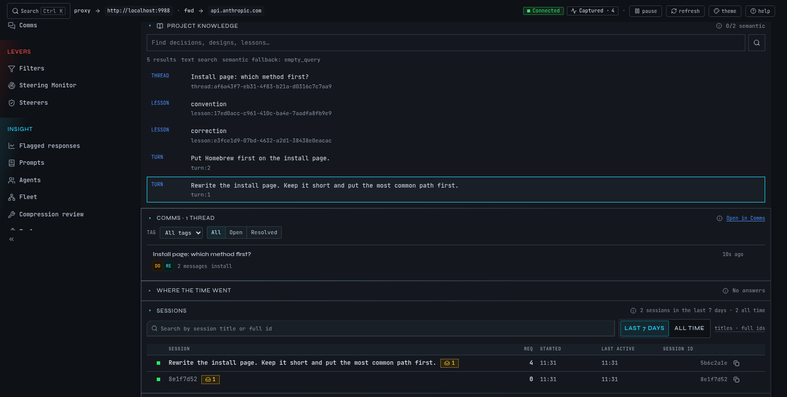

# Find your work by project

mike groups every captured session under the folder it ran in, and calls that folder a
project. Projects let you answer "what has Claude been doing in this codebase?" without
scrolling through every session. This page covers the project list, one project's page, the
map of its sessions, the Fleet canvas, and searching what mike has kept for a project. It
does not change anything Claude sends; those controls live under [Memory](memory.md),
[Steering](steering.md) and [Filters](filters.md).

Open **Projects** in the menu, or go to `/projects`. The Fleet canvas is **Fleet** in the
menu, or `/fleet`.

This is a [fictional example](quickstart.md). The `docs` session, its folder
`~/projects/site` and its correction come from the guide's example, not from real work.

## Follow the example project

Continue the example: a session named `docs` has been working in `~/projects/site` and you
corrected it with "Put Homebrew first on the install page." You want everything mike has
kept about that folder in one place.

1. Open **Projects**. Find `site` in the list. If you have many projects, type in **Search
   projects**; it matches a name or a path.
2. Select the row to expand it. The row shows its **Sessions** and **Session map** and any
   mail between its sessions. The row's **Edit project** button renames the project.
3. Select **Open the project** to leave the list and open the project's own page at
   `/projects/<path>`.
4. On the project page, type `Homebrew` in **Search project knowledge** and press Enter. The
   correction appears as a lesson, if you kept one, next to any project notes and earlier
   turns that mention it. Select a result to read the whole source in a drawer.

You should see the `docs` session listed under **Sessions** and, once its correction has been
kept, under **Project memory**.

## The project list

The list shows every project that has at least one captured session or request. A line under
the list says how many empty projects are hidden.

| What you see | What it means |
|---|---|
| Folder rows | Projects whose paths share a parent folder are grouped under that folder. Select a folder to collapse it. |
| **Pinned** | Projects you pinned. Drag one, or press the up and down arrow keys on its handle, to reorder them. Unpin a project from its row. |
| Unclassified | Projects whose path is a placeholder rather than a real folder. They sit apart from the folder tree. |
| **Edit project** | Rename the project, or say which project it belongs to. |

To merge two folders that are really one project, open **Edit project**, use **Belongs to**
and choose the other project. mike suggests likely matches and marks them **Suggested**. To
split one off, choose **Create a new project** and name it. To undo a merge, edit the
project again and choose **Its own project**.

The search is only about project names and paths. To search what was said inside sessions,
use the search on [Sessions](reading-sessions.md).

## One project's page

The project page collects what mike has for one folder:

| Section | What it shows |
|---|---|
| Vitals | Session and request counts, first and last seen, and whether it is pinned. |
| **Session map** | The project's sessions placed by how similar they are, around the project's centre. Select the open-graph button for a full-size map, and **Similar projects** to jump to neighbours. |
| **Project knowledge** | A search box over the project's kept documents, lessons, session notes and captured turns. |
| Comms | Mail sent between the project's sessions. |
| Time spent | How long sessions in the project have run. |
| **Sessions** | Its sessions. Shows the last 7 days by default; choose **All time** for older ones. The search matches a session title or a full session id, not what was said in it. |
| **Launches** | Every attempt to start a Claude Code session in this folder with `mike spawn`, with the outcome and the arguments used. See [Sessions](sessions.md). |
| **Project memory** | The lessons, recently corrected turns and recently shipped turns a fresh session in this project is given. **View in memory** opens [Memory](memory.md). |

The Session map needs embeddings. With none yet, it says **No session map available for this
project yet.** or **No embedded sessions for this project yet.** Embeddings are produced in
the background, so give a new project some time, and check **Embedding** under
[Settings](settings.md) if the map stays empty.

## Search what mike kept for a project

Project knowledge is search, not generation. It looks across what mike has retained for the
project: documents mike collected, lessons, notebook entries from sessions, and captured
turns. Type words or a phrase and press Enter. Matches by meaning and by wording both count,
and a result shown does not mean it is true or still current.

Select a result to read the full source. If an older revision of a document is shown, the
drawer says **historical revision**. If nothing matches, the panel says **No current project
knowledge matches this query.**

Searching only reads; nothing is sent to Anthropic by this panel. Whether a session is
*given* project knowledge, lessons or reminders is a separate setting, described on
[Memory](memory.md). What leaves your machine is on [Privacy](privacy.md).

## Watch a project's sessions on the Fleet canvas

The Fleet canvas draws one project's sessions as a graph: who is working, what they are
working on, and who has written to whom. It is most useful when several sessions work on one
goal; [Fleets](fleets.md) explains how to start and close a group of sessions on purpose.
A single session still appears here.

1. Open **Fleet**. Pick a project in **project**. If a project is already chosen, **View
   project page** takes you to its page.
2. Pick a **window**: 24h, 72h, 7d or 30d. Only sessions active in that window show.
3. Choose a view: **Relationships** draws sessions as a graph with lines for mail and
   dispatches; **Board** lists them as rows; **Notebook** shows the project's session notes
   with filters for role, kind, status, tag and text. Relationships needs at least two
   connected sessions; with fewer, mike shows the Board.
4. Select a session. The panel on the right shows its model, folder, what it is **Working on
   now**, **Recent activity**, **Quality**, **Files** and **Connections**.
5. Type in **find** to jump to a session by name.

The page refreshes by itself every twenty seconds and whenever a session changes.

If there is nothing to show, the page says why:

| Message | What to do |
|---|---|
| **No projects captured yet** | Run Claude Code through mike and send a prompt; see [Quickstart](quickstart.md). |
| **No sessions in this project's fleet** | Nothing happened in the chosen window. Widen it. |
| **No active fleet activity in this window** | The sessions have no declared role, no mail between them and have been quiet. They count as history. Open them from [Sessions](reading-sessions.md). |

## When something looks wrong

| What you see | What to do |
|---|---|
| **Couldn't load projects** | mike's inspect service is not reachable. Run `mike doctor`, and see [Troubleshooting](troubleshooting.md). |
| **Project not found** | The path was renamed, or its sessions aged out. Go back to **Projects**. |
| **No projects captured yet** | Nothing has been captured. Start a session through mike. |
| A project is missing from the list | Projects with no sessions or requests are hidden; the note under the list counts them. |
