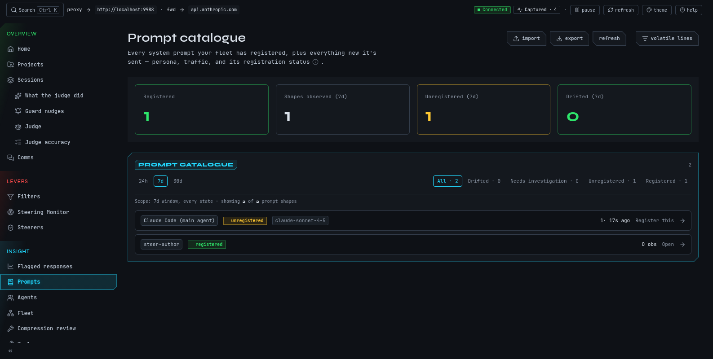

# See prompts, agents and tools

Claude Code starts every conversation with a long system prompt, hands work to named
subagents, and calls tools all day. mike records all three, and this page covers the screens
that show them: **Prompts**, **Agents**, **Tools**, **Agent dispatches** and the tool-error
list. Use them to see which prompt a session ran with, whether a prompt changed between
versions of Claude Code, which subagent was given a task, and which tool calls failed. They
only read what was captured; nothing here changes what is sent to Anthropic.

This is a [fictional example](quickstart.md). The prompts and agents shown come from the
guide's `docs` session, not from real traffic.

| Screen | Menu name | Route |
|---|---|---|
| Prompt catalogue | **Prompts** | `/prompts` |
| Agent registry | **Agents** | `/agents` |
| Tool calls and errors | **Tools** | `/tools` |
| Subagent dispatches | **Agent dispatches** | `/diagnostics/agent-dispatches` |

## Find out whether a prompt changed

Continue the example. You updated Claude Code and the `docs` session started behaving
differently. You want to know whether its system prompt changed.

1. Open **Prompts**. Every distinct system prompt mike has seen is a row, named for the agent
   it belongs to: **Claude Code (main agent)** or a subagent such as `frontend-developer`.
   Each row shows how often it was seen and when last.
2. Rows are ordered by what needs attention first: **Drifted**, **Needs investigation**,
   **Unregistered**, **Registered**. Use the chips above the list to show one group.
3. Select a drifted row (its action reads **Review drift**). The **Drift** tab shows the
   prompt you registered next to the one most recently seen, with altered blocks marked
   **altered**.
4. Read the difference. If the new wording is fine, register the new prompt; if not, you now
   know which Claude Code update changed what.

You should see two versions of the same agent's prompt, with the changed block highlighted.

## What registering means

A prompt is **unregistered** until you give it a label and say which agent it is. Registering
is bookkeeping: it lets mike tell you when that prompt changes. An unregistered prompt still
passes through untouched, and a registered one is not blocked or edited either.

To register one, select **Register this** on an unregistered row, name the composition, and
confirm. You can add the agent's file, such as `.claude/agents/<name>.md`, and a persona to
link it to an agent. The composition page lists the prompt's **Blocks**; a prompt whose
third block cannot be found shows a warning that traffic will not match until it is present.

The catalogue toolbar can **import** compositions from a JSON backup and **export** all
registered compositions as JSON. Refresh reloads the list without waiting for the
automatic refresh.

### Volatile lines

Some prompt lines change on every run, such as a working-directory line, and would make
every session look like a new prompt. **Volatile lines** (`/prompts/volatile-lines`) lists
patterns that mike strips out before it decides two prompts are the same. To add one, give it
a name, a regular expression matched line by line, and the block it applies to. The bytes sent
to Anthropic are not changed by this; only mike's comparison is.

## Browse the agents

**Agents** lists every agent identity mike has seen: subagents Claude dispatched, the prompt
versions captured for each, and its instances.

1. Open **Agents**. Search by name, alias or definition in **Find a name, alias or
   definition**.
2. Narrow by where the agent is defined with the source chips:
   - **observed**: seen in traffic; no definition on disk was confirmed.
   - **file-backed**: you confirmed it has a matching `.md` file.
   - **dynamic**: generated on the fly by Claude.
   - **builtin**: ships with Claude Code itself.
3. Select **Inspect agent**. The page shows its aliases (**Also known as**), its description
   and, below, its dispatches and the prompt versions captured for it.
4. Expand a dispatch to read the brief that was sent, or a prompt version to see its blocks.

On an agent's page you can edit its description and which file defines it, and change its
source. Deleting an agent keeps the captured evidence; only the link between them is cut.

With no agents yet, the page says **No agents registered yet**. Agents appear as named
subagents show up in captured traffic, or when you register one against a composition. **Open
prompts** takes you to the catalogue.

## See what each subagent was asked

**Agent dispatches** lists every time a session handed work to a subagent.

1. Open **Agent dispatches**. Leave **Project** and **Since** blank to see everything, or type
   an exact project path and a date such as `2026-11-01T00:00:00Z` and press **Apply**.
2. Each row shows when it happened and a short description. Expand one to read the full
   description. **View brief** opens the parent request, where the full brief is, because the
   page itself shows only the description.
3. **Clear** removes the filters.

The list is empty until a session dispatches a subagent: **Sub-agent spawns appear here once
a session dispatches a Task tool call.**

## Search tool calls and find failures

**Tools** is a feed of every tool call across all sessions.

1. Open **Tools**. Choose a **Project**, a **Tool name** and a **Time range** (any time, last
   hour, 24 hours, 7 days or 30 days), then **Apply**.
2. Switch on **Errors only** to see failed calls. The address then ends in `#errors`, and
   `/diagnostics/tool-errors` opens the same view.
3. Expand a call to read its full input and jump to the request it came from.
4. **Clear** resets the filters.

Calls are grouped by project, and calls from sessions with no project fall under
**Ungrouped**. With no calls, the page says **Tool calls appear here once sessions make
their first tool use.**

## When it is empty or something fails

| What you see | Why | What to do |
|---|---|---|
| **No prompt traffic captured yet** | No session has gone through mike. | Start one; see [Quickstart](quickstart.md). Nothing to configure first. |
| **Couldn't load the prompt catalogue**, **Couldn't load agents**, **Couldn't load agent dispatches** | mike's inspect service or database is unreachable. | Run `mike doctor`; see [Troubleshooting](troubleshooting.md). |
| A prompt shows **Needs investigation** | mike could not read the prompt's three blocks, for example the system field was a plain string or missing. | Open it for the reason mike recorded. |
| **This request was captured but has no system prompt to prefill from.** | You started a registration from a request without a system prompt. | Choose a different row. |
| No agent for a subagent you know ran | Agents appear only after a dispatch is captured. | Check **Agent dispatches**. |

## Where this goes next

To read one session's calls in order, open it from [Sessions](reading-sessions.md). To change
what a prompt contains before it is sent, see [Filters](filters.md). What mike keeps and
sends is on [Privacy](privacy.md), and the settings that gate each feature are in
[Settings](settings.md).
