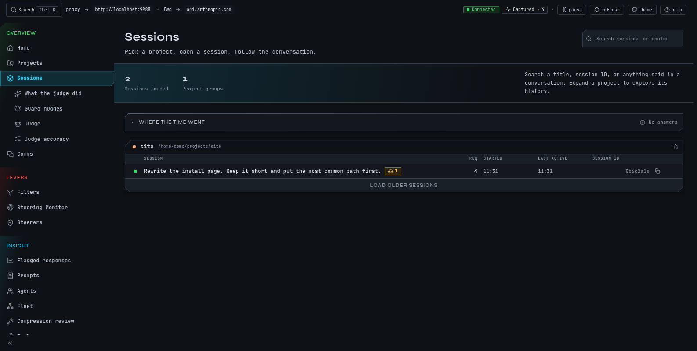
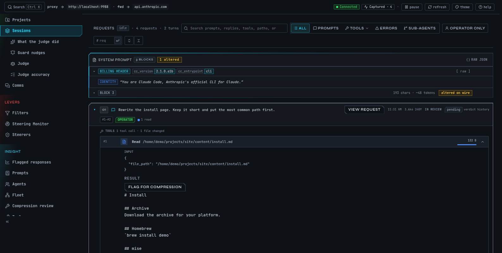
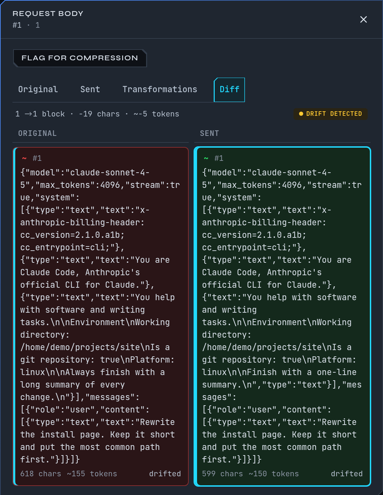
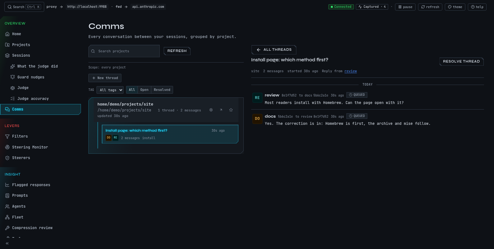

# Read what a session did

A session is one Claude Code conversation. mike keeps every request it sent and every answer
it got, and the Sessions page turns them back into something you can read: the turns you
typed, what Claude replied, which tools it ran, and which request carried each of them. Use
it to check what Claude was actually told, to find the moment you corrected it, and to see
what a long run did while you were away. It only reads; nothing on these pages changes a
request.

Open **Sessions** in the left-hand menu, or go to `http://localhost:9990/sessions`.

The examples on this page continue the fictional session from the [quickstart](quickstart.md):
a session named `docs` in `~/projects/site`, working on "Rewrite the install page". In it you
told Claude: "Put Homebrew first on the install page."

## Find your session

1. Open **Sessions**. Sessions are grouped by project, with a coloured chip per project.
2. Open the `~/projects/site` group if it is collapsed. Each row shows the session's title,
   its number of requests (**Req**), when it **Started**, when it was **Last active**, and its
   **Session id**.
3. Select the `docs` row. The session page opens, headed by the session's title and a short
   id you can copy with the copy button.

The pin beside a row pins the session. Pinned sessions are exempt from mike's time-based
clearing of old data. A session that is running now shows live. If a project has more
sessions than it lists, choose **Show N more sessions** at the foot of the group.

If the page shows **No sessions yet**, Claude Code has not sent a request through mike. Follow
the [quickstart](quickstart.md), then check [Troubleshooting](troubleshooting.md).

## Find something a session said

The search box on the Sessions page finds text across everything mike captured, not only titles.

1. Click **Search sessions or content** and type `Homebrew`. mike searches once you have typed
   four characters.
2. The list switches to the sessions that match, still grouped by project. The label beside the
   box says what was searched: titles, conversation and bodies.
3. Open the `docs` row. Each match shows where the words appeared.

The search covers the session's title and id, what you and Claude said, and the raw responses
(tool results, thinking and everything else captured). Raw responses are searched for the last
seven days only; the page says so when that limits the result. If nothing matches the page says
**No sessions or content match the search**. Choose **Clear search** to see every session again.

Typing a session id, or part of one, finds that session directly.

## Read the session page

The session page has four parts, top to bottom.

1. **The overview.** A short summary of what the session did, if the judge has written one
   ([Judge](judge.md)); the numbers for the session; the files Claude changed; and the agents
   it started. The numbers are **Requests**, **Tokens**, **Cache reuse**, **Span**, **Avg
   latency**, **Operator asks**, **Last request**, **Completion check**, **Outcomes** and
   **Models**. Hover a label for what it means.
2. **Session flow.** A board of the session over time, loaded when you scroll to it.
3. **Requests.** The timeline of turns, described below.
4. **Comms**, a speech-bubble link in the header, for the messages this session exchanged with
   others.

The first time you open a session that has no judge summary, the summary area stays empty. The
judge is off in a fresh install, so a missing summary does not mean anything went wrong.

## Follow the timeline

The **Requests** card is the session as a list of turns. A turn is something you asked, with
Claude's reply, the tools it used and any sub-agents it started. Open a turn with the arrow on
its left.

Above the list:

| Control | What it does |
|---|---|
| Search box | Finds text in prompts, replies, tool calls and file paths, or a request by `#` and its number |
| **All**, **Prompts**, **Tools**, **Errors**, **Sub-agents** | Filter turns by kind. **Prompts** collapses to your asks and the replies; **Tools** also lets you pick one tool |
| **Operator only** | Shows only what you typed. Turns that Claude Code generated itself (labels, hook feedback, messages between sessions) are hidden |
| **req** box | Jumps to a request by its number |
| Expand all / Collapse all | Opens or closes every turn |

To find your correction:

1. In the timeline search box type `Homebrew`.
2. The turn "Put Homebrew first on the install page." stays; others hide. Choose **Operator
   only** if replies also match and you want only your own words.
3. Open the turn. Beneath your prompt you see the reply Claude gave next, and the tools it
   called to make the change.

If a turn says **No reply captured yet**, the answer is still arriving or the request failed.
If the list says **No requests in this session yet** the session exists but nothing has been
captured for it. **No turns match the current filter** means your search or filter hid
everything: clear it.

## Look at one request

Every turn is made of one or more requests to Anthropic. To see exactly what was sent and what
came back, open a request from its turn.

1. In the open turn, choose **view request** beside your prompt, or **view response** beside
   Claude's reply. A panel opens over the timeline with **Request body**, **Response body**,
   **Findings** or the request's events. Its address carries `?drawer=`, so you can copy a
   link to it.
2. Read the request body under four tabs:

| Tab | What it shows |
|---|---|
| **Original** | The request exactly as Claude Code sent it to mike |
| **Sent** | The request as mike forwarded it to Anthropic |
| **Transformations** | What mike changed between the two, if anything |
| **Diff** | Original and sent side by side |

3. Below it, the response, with the accumulated text and any thinking.

On a fresh install **Sent** is the same as **Original** and **Transformations** is empty,
because mike changes nothing until you turn on a feature that does. Once a
[filter](filters.md), a [lesson reminder](memory.md) or a [steerer](steering.md) edits a
request, this is where you see it.

The same request also has its own page at `http://localhost:9990/sessions/<session id>/requests/<number>`,
which shows the session's timeline with that request selected. If it says **Couldn't load this
request**, the request has been removed by retention or mike is not reachable. Sessions you
have pinned keep their requests.

## Replay the session flow

The **Session flow** board shows the session as lanes over time, one per agent, with the
requests, tool calls and messages drawn where they happened.

1. Scroll to the board. It loads when it comes into view.
2. Use the transport controls: **Skip to start**, **Rewind to previous turn**, play and pause,
   **Fast-forward to next turn**, **Skip to end**, and **Follow live** for a running session.
   **Speed** changes the replay rate. A label shows **LIVE** or **REPLAY**.
3. Select anything on the board. The **Selected** panel describes it, with **Open request**
   to jump to the request. The Requests card below narrows to the requests involved; the
   chip above the list shows how many, and its **×** shows all requests again.
4. Drag across the timeline strip to choose a range, then **Zoom to selection**, **Full
   range** or **Clear selection**.

The address updates as you select and seek, so a link to the page keeps your place.

If the board says **Flow is unavailable for this session**, the session was captured in a form
the board cannot draw. The Requests list still has everything. A **STALE** badge means newer
requests arrived after the board loaded.

## See related sessions

The overview has a collapsed **Related sessions** card: the sessions whose content is nearest
to this one. Open it, or choose its expand icon (**Open full graph for this session**) for the
full graph at `http://localhost:9990/sessions/<session id>/graph`. Select a neighbour to open
that session. The graph needs mike's meaning-based search: otherwise it says the session has
no embedding yet because the embedding backend is disabled, or because it has no turns with
text to embed. Turn the search on under **Embedding** in [Settings](settings.md); a remote
embedding provider receives session text ([Privacy](privacy.md)).

## Read messages between sessions

Sessions started with `mike spawn` can send each other mail ([Sessions](sessions.md)). Two
places show it.

**On one session.** Choose the speech-bubble link in the session header. The page lists that
session's threads, a **Team activity** feed of the agents it dispatched, and a form to start a
thread. Select a thread to read it. If it says **No messages yet for this session**, nothing
has been sent to or from it.

**Across all sessions.** Open **Comms** in the left-hand menu, `http://localhost:9990/comms`.
It lists every conversation between your sessions, grouped by project.

1. Search projects by name or path, or open a project to see its threads.
2. Narrow the threads by **Tag**, by participant, or by **All**, **Open** or **Resolved**.
3. Select a thread to read its messages. **Resolve** marks it done.
4. **Refresh** reloads the list. The address keeps the project, thread and filters.

The Comms page is for reading and for starting a thread; to reply, open the thread from a
session's own comms page. **No threads yet** means no session has messaged another. **Thread
comms aren't live yet** means the running mike does not answer for threads.

## Next steps

- [Keep a correction as a lesson](memory.md) so later sessions get it.
- [Watch several sessions as one project](projects.md).
- [Check which tools a session ran and which failed](prompts-and-agents.md).
