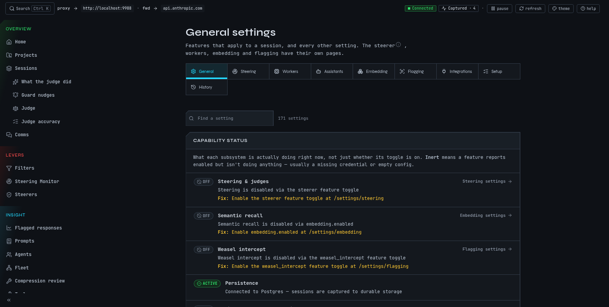
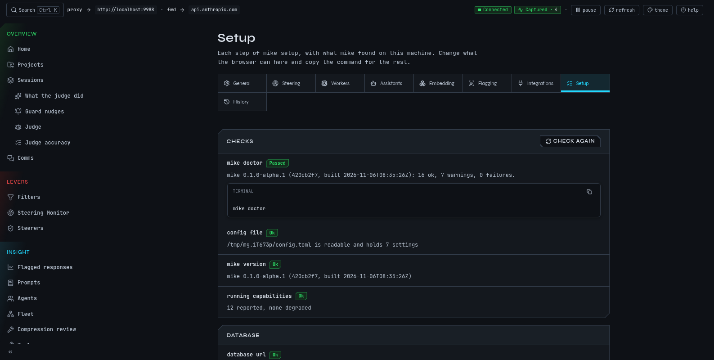

# Change mike's settings

mike has two kinds of settings. **Boot settings** decide where mike listens and which database it uses. They come from a configuration file, environment variables and command-line flags, and they take effect when mike starts. **Everything else**, including every feature switch, is changed in the web UI at <http://localhost:9990/settings> and stored in the database. This page covers both, and says what a fresh install has on.

Open <http://localhost:9990/settings>, or run `mike features` and `mike print-config` from a terminal.

This is a fictional example: the `docs` session in `~/projects/site` is being captured, and nothing here is a real person's setting.

## What a fresh install does

A fresh install captures sessions and forwards your requests and Anthropic's answers as they are. Most features that rewrite a request, change an answer or send captured text to another service are off. A few background jobs that only work on your own machine are on; they are listed [below](#on-by-default).

A setting you have saved is never replaced by a newer default. After an upgrade, open the settings page if you want to be sure what is on.

## Turn features on or off

The example: Claude Code kept putting the Linux install first on the `docs` page, and you corrected it with "Put Homebrew first on the install page." You want mike to keep that correction as a lesson and offer it to later sessions. That needs the lesson switches on.

1. Open <http://localhost:9990/settings>.
2. Read the **capability panel** at the top. It says which features are working, which are waiting for something such as a key or a login, and links to the page where you fix it.
3. In **Session features**, switch on `recall_injector`, `agent_lessons` and `reminders`. Each is marked *Applies to new sessions*.
4. Start a new session. The `docs` session you already have keeps the behaviour it started with.

You should now see a `<system-reminder>` note with your Homebrew correction in what Claude Code sends to Anthropic on the next session's requests. [Memory](memory.md) shows how to read it back.

Or do the same from a terminal with `mike features recommended`, described next.

## The three starting points

`mike features <choice>` sets every feature switch at once, reads them back and reports any that did not change. The setup step called `features` starts on **recommended**.

| Choice | What it sets |
|---|---|
| `watch-only` | Every switch at its default. |
| `recommended` | Watch only, plus `recall_injector`, `agent_lessons` and `reminders`, and the setting `reminders.inject_lessons`. All four add a `<system-reminder>` note to what Claude Code sends to Anthropic. None sends text anywhere else. |
| `everything` | Every switch on, plus `reminders.inject_lessons`. That includes switches that rewrite requests and ones that call a model. The ones that call a model do nothing until you have set up a provider (`mike setup models`). |

The switches live in the database, so the command needs one. When mike is not running, the choice is saved in the configuration file as `setup_features` and applied the next time mike starts.

## The settings page

The page has:

- **A capability panel** at the top.
- **Session features.** The switches that change what a session sends or receives. A session already running keeps the behaviour it started with.
- **Global settings** and the settings of each other page.
- **Every setting**, a searchable list. Each row says when a change applies. Type in **Find a setting** to narrow the page.

Related pages:

| Page | Path | What it holds |
|---|---|---|
| Setup | `/settings/setup` | The setup steps in the browser. Steps that need your terminal show a **Run this step in a terminal** button, because the browser does not run them. |
| Steering | `/settings/steering` | The steerers that watch a session for drift. |
| Workers | `/settings/workers` | The background jobs, such as the turn and session judges, and their evaluations. |
| Assistants | `/settings/assistants` | The assistants mike can start, with their sign-in state. |
| Embedding | `/settings/embedding` | Search by meaning: its on switch, address and model. |
| Flagging | `/settings/flagging` | Flagging of weak answers, and the forbidden-word intercept. |
| Integrations | `/settings/integrations` | Connections to outside services and what they have cost. |
| Configuration history | `/settings/history` | Every change to a setting, filterable by kind and by where it came from. |

[Setup](setup.md) walks through the setup steps. [Memory](memory.md), [Steering](steering.md), [Judge](judge.md), [Filters](filters.md) and [Compression](compression.md) explain the features behind these pages.

## What is on and off by default

Defaults below are the ones in this build. "Rewrites" means the request mike forwards, or the answer you receive, differs from what the other side sent. The original request is still captured as Claude Code sent it.

### Off by default: rewrites what mike forwards to Anthropic

| Switch | What it does when on |
|---|---|
| `reminders` | Adds a note built from the weak-answer findings on the previous request. |
| `recall_injector` | Adds a note of lessons that match the topic. |
| `agent_lessons` | Adds lessons for a helper session started inside another. |
| `self_identity_reminder` | Adds a note saying which session this is. |
| `mailbox_redelivery` | Delivers messages between sessions again when they were delivered but not read. |
| `proxy_tools` | Gives a session mike's own tools and answers their calls itself. |
| `repeated_notices` | Removes repeats of Claude Code's standard notices from the copy sent on. |
| `file_read_compression`, `shell_output_compression` | Shorten older file reads and command output in a conversation's history. Each starts in `shadow` mode, which only records what it would cut. See [Compression](compression.md). |
| `reminder_on_token` | Replaces a marker some hooks add with a note. |

### Off by default: changes what you receive

| Switch | What it does when on |
|---|---|
| `weasel_intercept` | Watches a streamed answer for words you list. When one completes, mike cuts the answer before it, asks again with a correction, and continues the same message. It does nothing until you add at least one word. See [Flagged responses](flagged-responses.md). |

### Off by default: sends captured text to another service

All of these need a model provider, such as an OpenRouter key, except where noted. [Privacy](privacy.md) says what each sends.

| Switch | What it does when on |
|---|---|
| `steerer` | Runs steerers that judge drift and queue corrections for the next turn. See [Steering](steering.md). |
| `judge_worker` | Judges each turn. See [Judge](judge.md). |
| `session_judge` | Judges whole sessions. |
| `judge_lessons`, `session_end_shadow` | Further judging jobs. The settings page describes each; treat them as sending captured text to your provider when on. |
| `turn_guard` | Checks a turn's closing text against a few questions. |
| `steerer.correction.enabled` | Decides whether you were correcting the model. |
| `lesson_relations.enabled` | Compares stored lessons. |
| `embedding.enabled` | Embeds turns and lessons for search by meaning. Needs no key. Text goes to the address in `embedding.url`, `http://127.0.0.1:7997` unless you change it. |

### Off by default: other

These are off, and none of the first four sends text to another service:

| Switch | What it does when on |
|---|---|
| `dossier_builder` | Builds a record of each closed turn from captured data: how it ended, checks run, session class. No model call. |
| `directive_proposer` | Proposes standing directives from corrections you restated across sessions. Proposals wait on [Memory](memory.md); nothing is injected. No model call. |
| `change_record` | Keeps a record of what happened in each checkout a session works in, so fleets can ask what others changed without git. Nothing leaves the machine. |
| `change_record_tail` | Adds a few lines saying what others changed to some answers inside a fleet. Needs `change_record`. |
| `memory_keeper` | Keeps a short card for each open work thread: where it stands, what is next, blockers, the last handoff and decisions since. Built from the database; nothing leaves the machine. Turning it back on needs a restart. |
| `seat_memory_index` | Knowledge search also finds fleet seats' briefs, reports and mail, labelled by seat and run and ranked below your own material. Turning it back on needs a restart. |
| `wright` | Wright watches mike's own signals (tool errors, hook errors, failed jobs) and records each recurring fault as a problem with its episodes. Reads only this machine's database. Turning it off stops the checks at once. The checks are stored rows, not code: list, add, change, disable and remove them while mike runs with the `wright_checks` tool. |
| `codex_diagnostic_capture` | Keeps the request and response bodies of Codex sessions' traffic for diagnosis, up to a fixed size per call; a body that does not fit is not kept. Without it, mike keeps only short facts about each Codex call. Stored in this machine's database; nothing leaves the machine. Applies at once. |

`workspace_briefing`, `context_focus_question`, `native_peer_mail`, `mod_lesson_delivery` and the `client_serves_*` switches other than `client_serves_self_identity` are also off. They relate to fleets, messages between sessions and mods; the settings page describes each.

### On by default

| Switch | What it does |
|---|---|
| `lesson_worker` | Tidies stored lessons. Local. |
| `harvester` | Saves lessons that a session writes into its own answers as `<mem:update>` tags. No model call. |
| `retention_sweep` | Deletes sessions older than `default_ttl`, 365 days by default. |
| `channel_link_sweep` | Keeps Remote Control channels linked to their sessions. |
| `workspace_capture_registration` | Lists captured sessions in the roster used for messages between sessions. |
| `db_resync` | Copies captures written to a backup database back to the main one. Only matters if you set up a backup database, which a normal install does not have. |
| `semantic_context` | Uses search by meaning, only while the embedding address is on your machine. |
| `fleet_auto_start` | Starts a fleet when its definition is ready. Off means it waits for `mike fleet start`. |
| `prompt_assistant` | The prompt assistant; its sign-in and limits are on `/settings/assistants`. |
| `launch_brief` | Sends a started session's long brief as mail from mike and keeps it as the session's note. Off, the brief is written to a file the session is told to read. |
| `client_serves_self_identity` | When a client such as a Claude Code mod supplies a session's identity note, mike stands aside for that session. |

A switch can be on in this list and still do nothing. `semantic_context` needs an embedding service, and `embedding.enabled` is off in the boot defaults. If the settings page shows `embedding.enabled` or `lesson_relations.enabled` as on in a fresh install, that is the page's own default and the capability panel says whether it works.

## Boot settings and environment variables

From lowest to highest, a boot setting comes from:

1. Built-in defaults.
2. The configuration file.
3. `MIKE_*` environment variables.
4. Command-line flags.

An exported variable in your shell therefore beats a value saved in the file, and a flag beats both. `mike print-config` shows what mike would start with, which variables it found, and then, after a line reading `LIVE OVERLAY`, the settings you changed in the web UI. The second part is what a running mike uses.

Settings that change where mike listens, which database it uses, or where it writes files take effect when mike restarts. Settings in the web UI say when they apply.

mike does not read a `.env` file from the current folder. To bring one in, use `mike config import-env` or `mike import-dotenv`; see [Run mike from the command line](command-line.md#move-settings-in-and-out-of-files).

### Where the files are

`mike print-config --paths` prints the real folders for your installation as JSON. In general:

| What | Where |
|---|---|
| Configuration file | `~/.config/mike/config.toml`, or under `$XDG_CONFIG_HOME` when that is an absolute path. `mike config path` prints it. |
| State: machine identity, database files, `service-token.<port>`, logs | `~/.local/state/mike`, or under `$XDG_STATE_HOME`. `mike config path --state` prints it. |
| Data folder | `~/.local/share/mike` on Linux; `~/Library/Application Support/mike` on macOS. `MIKE_DATA_DIR` moves it. |

When you pass `--config` with another file, mike keeps that installation's data, state and logs in a folder named `.mike-<id>` beside the file. Keep these folders private to your account: mike refuses a configuration folder that other users can enter.

### The configuration file

The file is TOML. Each key is the name of a `MIKE_*` variable without the prefix, in lower case: `database_url` for `MIKE_DATABASE_URL`. Values are read literally, so a `$` in a password stays a `$`. Setup and `mike claude-code` also keep a few notes of their own in the file, such as `setup`, `setup_features`, `claude_route` and `launch_auto_trust`.

To keep a key out of the file, write `<name>_from_env = "VARIABLE"`: mike then reads the key from that environment variable. For the OpenRouter key, `steerer_openrouter_api_key_from_env = "OPENROUTER_API_KEY"` does this, and setup stores only the variable's name when you type one.

### Environment variables you may need

Only `MIKE_` names are read. A variable still named `PROXY_...` is from an older version and is ignored.

| Variable | Flag | Effect and default |
|---|---|---|
| `MIKE_DATABASE_URL` | `--database-url` | The PostgreSQL address. Setup writes it for you. |
| `MIKE_PERSIST_ENABLED` | `--persist-enabled` | `0` runs without a database; captures are kept in memory and lost on restart. Default on. |
| `MIKE_LISTEN_ADDR` | `--proxy-listen-addr` | Where the capture listens. Default `127.0.0.1:9988`. |
| `MIKE_INSPECT_ADDR` | `--inspect-listen-addr` | Where the local API listens. Default `127.0.0.1:9989`. |
| `MIKE_SPA_BIND` | `--spa-bind` | Where the web UI listens. Default `127.0.0.1:9990`. |
| `MIKE_SPA_ENABLED` | `--spa-enabled` | `0` turns the web UI listener off. The API stays on port 9989, so this does not reduce what a local program can reach. |
| `MIKE_UPSTREAM_URL` | `--upstream-url` | Where requests are forwarded. Default `https://api.anthropic.com`. |
| `MIKE_DATA_DIR` | `--data-dir` | Moves the data folder. |
| `MIKE_DEFAULT_TTL` | `--default-ttl` | How long a session is kept before the retention sweep removes it. Default `365d`. |
| `MIKE_MAX_REQUEST_BODY_BYTES`, `MIKE_MAX_RESPONSE_BODY_BYTES` | same names with `--` and dashes | Largest request (16 MiB) and response (32 MiB) mike will carry. |
| `MIKE_LOG_FORMAT` | `--log-format` | Log layout. Default `pretty`. |
| | `--log-level` | Log detail. Default `info`. Also the configuration key `log_level`. |
| `MIKE_LAUNCH_BACKEND` | `--launch-backend` | The terminal program `mike spawn` opens sessions in. Default `none`, which makes `mike spawn open` exit 69. |
| `MIKE_STEERER_OPENROUTER_API_KEY` | | An OpenRouter key for the features that call a model. `OPENROUTER_API_KEY` works as a fallback. mike never writes the key to the database. |
| `MIKE_INSPECT_ALLOWED_HOSTS` | | Extra host names the local API accepts. Leave it empty; adding a name does not add a login. |
| `MIKE_INSPECT_URL` | | For `mike-mcp`: where to find the local API. Default `http://127.0.0.1:9989`. |
| `MIKE_MCP_PROFILE` | | For `mike-mcp`: `core` (default) or `full`; see [Run mike from the command line](command-line.md#mike-mcp). |

`mike --help` lists every other flag, including the `--launch-*` and `--mailbox-*` ones.

mike refuses to start with a listener that is not on a loopback address. Do not work around this; [Privacy](privacy.md) explains why.

## When something is off

| You see | Why | Do this |
|---|---|---|
| A feature is on but nothing happens | It needs a provider key or an embedding service | Read the capability panel; run `mike setup models` or `mike setup embeddings`. |
| A switch you turned on is not in effect | It says *Applies to new sessions* | Start a new session. |
| `mike features` says it saved the choice but applied nothing | mike is not running | Start mike; the choice is applied then. |
| A variable you exported has no effect | A flag overrides it, or it starts with `PROXY_` | Check `mike print-config` for the source of each `MIKE_` variable. |
| mike will not start and names the configuration folder | Other users can enter it | Make the folder private to your account. |
| Your settings look different after an upgrade | Saved settings are kept; new defaults apply only to settings you never saved | Open the settings page and check. |
