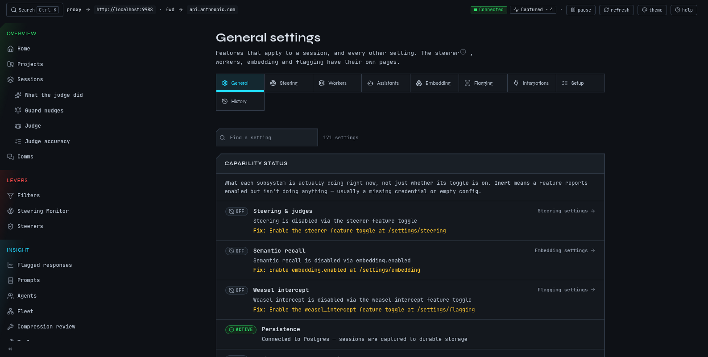
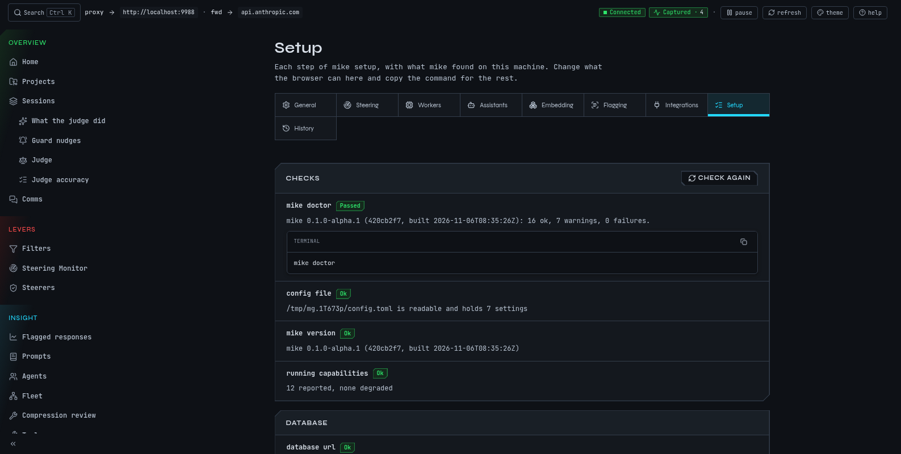

# Change mike's settings

mike has two kinds of settings. **Boot settings** decide where mike listens and which database it uses. They come from a configuration file, environment variables and command-line flags, and they take effect when mike starts. **Everything else**, including every feature switch, is changed in the web UI at <http://localhost:9990/settings> and stored in the database. This page covers both, and says what a fresh install has on.

Open <http://localhost:9990/settings>, or run `mike features` and `mike print-config` from a terminal.

This is a fictional example: the `docs` session in `~/projects/site` is being captured, and nothing here is a real person's setting.

## What a fresh install does

A fresh install captures sessions and forwards your requests and Anthropic's answers as they are. Most features that rewrite a request, change an answer or send captured text to another service are off. A few background jobs that only work on your own machine are on; they are listed [below](#on-by-default).

A setting you have saved is never replaced by a newer default. After an upgrade, open the settings page if you want to be sure what is on.

## Turn features on or off

The example: Claude Code kept putting the Linux install first on the `docs` page, and you corrected it with "Put Homebrew first on the install page." First [record and verify the lesson](memory.md#keep-a-correction-as-a-lesson). Turning delivery on does not by itself turn an earlier correction into a stored lesson.

1. Open <http://localhost:9990/settings>.
2. Read the **capability panel** at the top. It says which features are working, which are waiting for something such as a key or a login, and links to the page where you fix it.
3. Find **Inject lessons** (`reminders.inject_lessons`) and turn it on. This controls project-lesson delivery to primary sessions; recall, agent lessons and diagnostic reminders are different features.
4. Start a new session in the same project and ask about the installation instructions. The `docs` session you already have keeps the delivery settings it started with.

Inspect whether the relevant lesson was selected and supplied, then whether Claude followed it. A stored lesson is not guaranteed on every request. [Memory](memory.md#get-a-lesson-into-the-next-session) shows the evidence to look for.

For a broader starting point, `mike features recommended` enables additional context, including code findings in newer builds, as described next.

## The three starting points

`mike features <choice>` sets feature toggles and session-lessons delivery, reads the toggles back and reports failures. The setup step called `features` starts on **recommended**.

| Choice | What it sets |
|---|---|
| `watch-only` | Feature toggles at their defaults, with `reminders.inject_lessons` off. |
| `recommended` | Default toggles plus `recall_injector`, `agent_lessons`, `reminders` and `reminders.inject_lessons`. In builds after alpha.5 containing code-findings delivery, also enables `code_findings`, `change_record` and `code_scan`, retaining default-on `code_findings_push`. Lesson, diagnostic and code-finding context goes to Anthropic; code findings can prompt further work over Remote Control. |
| `everything` | Every switch on, plus `reminders.inject_lessons`. That includes switches that rewrite requests and ones that call a model. The ones that call a model do nothing until you have set up a provider (`mike setup models`). |

Presets do not remove filter rules or reset every setting. In particular, an existing embedding configuration (or reranking on builds after alpha.5) is not disabled by choosing `watch-only`. Review [what the presets change](setup.md#choose-features) before using one on an established installation.

The live switches are stored in the database, so applying a preset to a running mike needs one. When mike is not running, the choice is saved in the configuration file as `setup_features` and applied the next time mike starts.

## The settings page

The page has:

- **A capability panel** at the top.
- **Session features.** The switches that change what a session sends or receives. A session already running keeps the behaviour it started with.
- **Global settings** and the settings of each other page.
- **Every setting**, a searchable list. Each row says when a change applies. Type in **Find a setting** to narrow the page.

Related pages:

| Page | Path | What it holds |
|---|---|---|
| Setup | `/settings/setup` | The setup steps in the browser. Steps that need your terminal show a **Run this step in a terminal** button, because the browser does not run them. |
| Steering | `/settings/steering` | The steerers that watch a session for drift. |
| Workers | `/settings/workers` | The background jobs, such as the turn and session judges, and their evaluations. |
| Assistants | `/settings/assistants` | The assistants mike can start, with their sign-in state. |
| Embedding | `/settings/embedding` | Search by meaning: its on switch, address and model. |
| Reranker (after alpha.5) | `/settings/reranker` | Reordering search candidates: its on switch, server, model and limits. |
| Flagging | `/settings/flagging` | Flagging of weak answers, and the forbidden-word intercept. |
| Integrations | `/settings/integrations` | Connections to outside services and what they have cost. |
| Configuration history | `/settings/history` | Every change to a setting, filterable by kind and by where it came from. |

[Setup](setup.md) walks through the setup steps. [Memory](memory.md), [Steering](steering.md), [Judge](judge.md), [Filters](filters.md) and [Compression](compression.md) explain the features behind these pages.

## What is on and off by default

Defaults below are the ones in this build. "Rewrites" means the request mike forwards, or the answer you receive, differs from what the other side sent. The original request is still captured as Claude Code sent it.

### Off by default: rewrites what mike forwards to Anthropic

| Switch | What it does when on |
|---|---|
| `reminders` | Adds a note built from the weak-answer findings on the previous request. |
| `recall_injector` | Adds a note of lessons that match the topic. |
| `agent_lessons` | Adds lessons for a helper session started inside another. |
| `self_identity_reminder` | Adds a note saying which session this is. |
| `mailbox_redelivery` | Delivers messages between sessions again when they were delivered but not read. |
| `proxy_tools` | Gives a session mike's own tools and answers their calls itself. |
| `repeated_notices` | Removes repeats of Claude Code's standard notices from the copy sent on. |
| `file_read_compression`, `shell_output_compression` | Shorten older file reads and command output in a conversation's history. Each starts in `shadow` mode, which only records what it would cut. See [Compression](compression.md). |
| `reminder_on_token` | Replaces a marker some hooks add with a note. |
| `code_findings` | Adds a note naming the code-check findings in the session's own recent edits. Needs `code_scan`. |

### Off by default: changes what you receive

| Switch | What it does when on |
|---|---|
| `weasel_intercept` | Watches a streamed answer for words you list. When one completes, mike cuts the answer before it, asks again with a correction, and continues the same message. It does nothing until you add at least one word. See [Flagged responses](flagged-responses.md). |

### Off by default: sends captured text to another service

All of these need a model provider, such as an OpenRouter key, except where noted. [Privacy](privacy.md) says what each sends.

| Switch | What it does when on |
|---|---|
| `steerer` | Runs steerers that judge drift and queue corrections for the next turn. See [Steering](steering.md). |
| `judge_worker` | Judges each turn. See [Judge](judge.md). |
| `session_judge` | Judges whole sessions. |
| `judge_lessons`, `session_end_shadow` | Further judging jobs. The settings page describes each; treat them as sending captured text to your provider when on. |
| `turn_guard` | Checks a turn's closing text against a few questions. |
| `decisions` | Asks a small model, Jev, narrow yes or no questions at mike's decision points, such as whether a turn-guard nudge is worth sending. Sends your ask, the end of the answer and what changed to OpenRouter. Each point has its own mode of off, shadow or on. See [Decisions](decisions.md). |
| `steerer.correction.enabled` | Decides whether you were correcting the model. |
| `lesson_relations.enabled` | Compares stored lessons. |
| `embedding.enabled` | Embeds turns and lessons for search by meaning. Needs an embedding server. Text goes to the address in `embedding.url`, `http://127.0.0.1:7997` unless you change it. |
| `rerank.enabled` (after alpha.5) | Sends a search query and candidate passages to the server in `rerank.url` to reorder the results. The default address is `http://127.0.0.1:11435`; a remote server receives that text. |

### Off by default: other

These are off, and none of the first four sends text to another service:

| Switch | What it does when on |
|---|---|
| `dossier_builder` | Builds a record of each closed turn from captured data: how it ended, checks run, session class. No model call. |
| `directive_proposer` | Proposes standing directives from corrections you restated across sessions. Proposals wait on [Memory](memory.md); nothing is injected. No model call. |
| `change_record` | Keeps a record of what happened in each checkout a session works in, so fleets can ask what others changed without git. Nothing leaves the machine. |
| `change_record_tail` | Adds a few lines saying what others changed to some answers inside a fleet. Needs `change_record`. |
| `memory_keeper` | Keeps a short card for each open work thread: where it stands, what is next, blockers, the last handoff and decisions since. Built from the database; nothing leaves the machine. Turning it back on needs a restart. |
| `side_calls` | Fills each interactive session's roster row (name, goal, next steps) from its recent turns on a cheap model: a local one first, then OpenRouter, then Claude Haiku, capped per hour. |
| `conditions` | A session can register what it waits for (a time, another session's turn, a fleet event, a read-only SQL fact) and what mike does when it holds: return to the session, start one, or mail one. Off, registered conditions wait. |
| `seat_memory_index` | Knowledge search also finds fleet seats' briefs, reports and mail, labelled by seat and run and ranked below your own material. Turning it back on needs a restart. |
| `wright` | Off by default. Watches mike's faults and can apply remedies, investigate with a model, land repairs and file GitHub issues for ordinary fixer sessions. This is not a read-only monitor. Read [Wright's authority and controls](#review-wright-before-enabling-it) before switching it on. |
| `codex_diagnostic_capture` | Keeps the complete request and response bodies of Codex sessions for diagnosis, within the byte, row and age limits shown on the settings page. Off, Codex sessions keep only bounded facts. Nothing leaves the machine. |

`workspace_briefing`, `context_focus_question`, `native_peer_mail`, `mod_lesson_delivery` and the `client_serves_*` switches other than `client_serves_self_identity` are also off. They relate to fleets, messages between sessions and mods; the settings page describes each.

### On by default

| Switch | What it does |
|---|---|
| `lesson_worker` | Tidies stored lessons. Local. |
| `harvester` | Saves lessons that a session writes into its own answers as `<mem:update>` tags. No model call. |
| `retention_sweep` | Deletes sessions older than `default_ttl`, 365 days by default. |
| `channel_link_sweep` | Keeps Remote Control channels linked to their sessions. |
| `workspace_capture_registration` | Lists captured sessions in the roster used for messages between sessions. |
| `db_resync` | Copies captures written to a backup database back to the main one. Only matters if you set up a backup database, which a normal install does not have. |
| `semantic_context` | Uses search by meaning, only while the embedding address is on your machine. |
| `fleet_auto_start` | Starts a fleet when its definition is ready. Off means it waits for `mike fleet start`. |
| `prompt_assistant` | The prompt assistant; its sign-in and limits are on `/settings/assistants`. |
| `launch_brief` | Sends a started session's long brief as mail from mike and keeps it as the session's note. Off, the brief is written to a file the session is told to read. |
| `client_serves_self_identity` | When a client such as a Claude Code mod supplies a session's identity note, mike stands aside for that session. |
| `code_scan` | Locally scans recorded edits with ast-grep. Needs `change_record`, which is off by default. Separate delivery switches control whether findings reach Claude. |
| `code_findings_push` | Attempts proactive Remote Control delivery of queued code findings. Needs `code_scan` and `code_findings`; can prompt further model work. |

A switch can be on in this list and still do nothing. `semantic_context` needs an embedding service, and `embedding.enabled` is off in the boot defaults. If the settings page shows `embedding.enabled` or `lesson_relations.enabled` as on in a fresh install, that is the page's own default and the capability panel says whether it works.

## Choose how code findings reach a session

This path needs a post-alpha.5 build with code scanning and delivery. It is not in the
alpha.5 release. In **Every setting**, search for these exact toggle names:

| Your choice | Settings |
|---|---|
| Record and inspect, without sending findings | `change_record` and `code_scan` on; `code_findings` off |
| Send findings only on a later request | Above, with `code_findings` on and `code_findings_push` off |
| Also attempt proactive delivery | All four on |

Before applying a preset, read its row above: **recommended** chooses the third option in
these builds. The compiled defaults are different: `change_record` and `code_findings` are
off, while `code_scan` and `code_findings_push` are on but depend on the other switches.

For the fictional `~/projects/site` checkout, first choose record-and-inspect. Work in a
captured session, then open <http://localhost:9990/code-findings>. Check the watched checkout,
scan result and rule catalogue before enabling feedback. A scan finding is not a failing
test, and no finding is not proof that all the code was checked. Unsupported languages,
size limits and scan errors can leave files unchecked. Scanning starts from new recorded
changes, not a historical scan of the whole repository. A broken project rule file leaves
built-in rules running; inspect the project-rule error rather than assuming your rules loaded.

Delivery sends paths, line numbers, rule messages and suggested fixes to Claude/Anthropic.
The scanner itself makes no model call or code edit, but its message asks the session to fix
the finding or explain why the code should stay. Proactive delivery can start further work
and model usage. See [Privacy](privacy.md).

A later request takes at most three queued findings. With proactive delivery enabled, a
worker checks every two seconds for findings left queued for at least eight seconds and
tries up to five over a live Remote Control channel. This is not an exact eight-second
promise or a guarantee that the session is idle. If pushing is unavailable, the findings
remain for a later request. A delivery record is not proof the session acted on it; a push
can also lack a request link until a later capture, or retain no link if none arrives.

To stop proactive messages only, switch off `code_findings_push`. To stop both delivery
paths, switch off `code_findings`. Stopping change recording alone does not cancel already
queued feedback. The API's scanning/delivering/pushing flags describe enabled settings,
not successful scans or delivery. Inspect the scan and delivery records for the session.

## Add a searchable knowledge source

This needs a post-alpha.5 build containing configurable knowledge kinds and its matching
database migrations. These instructions describe the source implementation, not proof
that a particular running machine has been upgraded. Check the running version first.

Open **Settings**, **Knowledge** at <http://localhost:9990/settings/knowledge>. A kind tells
mike how to read rows already in its database; it does not connect a new external database
or import an arbitrary folder. Adding a source creates indexing metadata and watches for
changes, then backfills existing rows. Review [the privacy implications](privacy.md#knowledge-sources-and-standing-lessons)
before exposing a table to search or embeddings.

For a fictional project-notes table you already maintain:

1. Choose **Table** and a unique lowercase name such as `project_notes`, with a label and
   description. Use the actual table and column names, not these illustrative words.
2. Select its key, title, body and project columns. The project column must identify Mike's
   project id or UUID; the table form's optional label is misleading in this build, because
   the server requires a project column. Read a field-specific refusal rather than guessing
   a shared project. An existing-view definition is a separate advanced option.
3. Choose which column changes trigger re-embedding and the settle time. The default watched
   columns cover the title, body and project. Avoid including private fields just because
   they are available.
4. Choose **Preview**. It returns one example's reference, header and body without keeping
   the proposed kind. Check that all three identify the intended project data. A single
   sample is not proof every row is correct. An empty preview does not prove indexing works.
5. Only choose **Add source** when the preview and scope are right. Saving immediately
   enables the new kind and starts its indexing work; there is no separate activation step.
   Then check its item,
   embedded, waiting and failed counts. A saved definition is not completed indexing.
   Search a known example and read the full result before relying on it in a session.

If a kind fails or falls behind, inspect its latest error and the **project knowledge**
capability. Fix the named field or embedding prerequisite rather than repeatedly adding
copies. An **Update failed** banner means the displayed counts may be stale.

Switching a kind off is the reversible control to try first. Deleting a custom kind removes
its indexed items and embeddings, watches and generated view, but does not delete the source
table's rows. There is no promised undo of that index deletion. Built-in kinds cannot be
deleted here. Turning off or deleting a source does not recall text already returned to a
session or sent to its model provider.

## Review Wright before enabling it

This journey applies to post-alpha.5 builds with Wright and its follow-up worker. Alpha.5
does not include this operator journey. Open <http://localhost:9990/wright> to inspect the
records before changing anything. **Enabling Wright is not just enabling local checks:**
it can change settings, call a model, publish issues and commit fixes for later batch publication and merge.
Read [Wright privacy](privacy.md#wright-evidence-and-external-follow-ups) first.

There are distinct paths, not one universal sandbox:

| Path | What it can do |
|---|---|
| Checks | Inspect local signals and record problems and episodes |
| Known remedies | Apply enabled fixes through their owning subsystem, within remedy limits; some change settings or filter rules |
| Internal investigation | Run a bounded Claude investigation with restricted access and record a finding; this still sends evidence to the model provider |
| Internal code repair | Prepare a constrained patch and commit it into a shared daily batch. A later batch process gates, publishes and merges the combined changes; it does not deploy |
| Follow-up fixer | File a GitHub issue and start an ordinary fixer session in the shared daily worktree. Current instructions require committing its own paths, not pushing, opening a PR or merging. An issue needing no change can instead be explained and closed |

The internal repair's restrictions, including its 20-file/600-line patch limit, do **not**
apply to ordinary follow-up fixers. A fixer uses that machine's available tools and access.
Commit-only instructions are not an additional access-control boundary. Review the fix
host's tools, credentials and repository audience before enabling this path.

### Understand the daily batch

The following behavior requires source containing PR #409, not every post-alpha.5 build.
Internal repairs and follow-up fixers share `wright/fixes-YYYY-MM-DD` on the configured
fix host. A committed internal repair can be **batched** without being merged. After the
UTC day ends, Wright waits for active editing and handed-off fixers before closing the
batch and attempting its combined gate and merge. Publication is not guaranteed at midnight.

Gate retries and corrective rounds can occur. Inspect a failed or blocked batch rather
than repeatedly launching the same repair. Preserve the shared worktree and its committed
fixes while investigating.

`GET /api/wright/fix-batches` lists batch state. The operator-only
`POST /api/wright/fix-batches/{id}/land` requests early closure of an eligible batch so a
later fix-host tick can gate and land it. This can lead to publication and merge: it is
not a status check, and a successful response does not prove the batch has merged.

### Check the internal engineer's instructions

Current post-alpha.5 source selects `wright-engineer` for internal investigations and
answers. Internal repairs select an agent from the finding's owning code area: frontend,
release scripts, other scripts, public guide, other docs and database work have named
specialists; other areas default to `rust-developer`. This selection is not an extra
permission grant and does not change the repair limits above.

The internal launcher exposes existing `.claude/agents`, `.claude/rules` and
`.claude/skills` directories from the Mike checkout as read-only directories in its
private Claude home. The checkout comes from `MIKE_WRIGHT_REPO`, or the working directory
of `mike serve`. These are not imports of your normal home directory's agent definitions.
Check that checkout's definitions before relying on a selected agent name: the launcher
passes `--agent` but does not check that the named definition exists or substitute a
general-purpose agent. Selection alone does not prove a live run loaded the intended
instructions; inspect the run's outcome and logs.

Investigation and answer runs have a read-only source workspace. Internal repair runs
have a writable repair worktree, while the instruction directories mounted into their
private home remain read-only. Neither arrangement describes an ordinary follow-up fixer.

### Check destinations and limits first

Read the current follow-up configuration at
<http://localhost:9989/api/wright/followup-limits>. The defaults target `temet-ai/mike`.
An empty `fixers` list selects the local checkout; it does not disable handoff. Current
source also requires a reachable target matching `fix_host`. Verify the
actual repository and every configured machine/checkout before permitting this path.
Do not casually change the repository with outstanding follow-ups: later handoff and polling
use the current repository with the stored issue number. Review those records first.

The `daily_filed` budget controls new issue filings; `daily_handoffs` controls new fixer
launches. Setting either to zero disables that step, not the other one. These are separate
from internal engineer limits and remedy limits. Changes to follow-up limits require the
operator token through the limits API; the page shows the records, not a universal approval
queue. Do not enable the feature assuming each issue or merge will ask you first.

Switching off `wright` stops subsequent worker passes, but is not a recall of published
issues or a reliable cancellation of work already handed to an ordinary fixer. Budget
changes also govern future steps, not already-started fixers. To stop ongoing work, inspect
the listed fixer session and its current state separately before taking action.

### Pair only your own browser

If you want to post in Wright's conversation or use an eligible undo, run
`mike wright pair --open` in your own terminal. It prints a credential-bearing URL even
with `--open`. Do not paste that URL into chat, a GitHub issue or a shared terminal log.
The page stores the token in browser local storage and removes it from the address bar;
that removal does not revoke the credential. Pair only a browser profile you control.

For the fictional `docs` session, start by asking Wright to explain an existing problem,
not by requesting a repair. Read the linked episode, finding and action evidence yourself.
A valid link proves the row exists, not that the explanation or proposed cause is correct.
Conversation replies can include a supported control change, so review the recorded change
and its effect rather than treating the conversation as read-only.

### Verify the result and the recovery limit

For an internal repair, **batched** means committed for batch processing, **landed** means merged, **deployed** means the running build
contains that merge, and **healthy** needs the problem's subsequent check to heal it.
A successful merge alone does not prove the live fault is fixed. For follow-ups, an issue closed as not planned or duplicate becomes **dropped**; other
closed issues become **fixed**, possibly with a linked PR recorded. This path does not
independently verify the PR's merge status. Read the resolution and check the live result
rather than equating either label with deployment or healthy.

Remedy undo exists only for eligible setting and filter-rule changes, in verified or
ineffective states, while the resource still matches the recorded effect. A conflict
protects later changes: inspect it rather than forcing the old value back. Conversation
control changes have their own undo and version checks. Neither is a universal undo for
closed launches, messages, published issues, merged code or an ordinary fixer's work.

## Boot settings and environment variables

From lowest to highest, a boot setting comes from:

1. Built-in defaults.
2. The configuration file.
3. `MIKE_*` environment variables.
4. Command-line flags.

An exported variable in your shell therefore beats a value saved in the file, and a flag beats both. `mike print-config` shows what mike would start with, which variables it found, and then, after a line reading `LIVE OVERLAY`, the settings you changed in the web UI. The second part is what a running mike uses.

Settings that change where mike listens, which database it uses, or where it writes files take effect when mike restarts. Settings in the web UI say when they apply.

mike does not read a `.env` file from the current folder. To bring one in, use `mike config import-env` or `mike import-dotenv`; see [Run mike from the command line](command-line.md#move-settings-in-and-out-of-files).

### Where the files are

`mike print-config --paths` prints the real folders for your installation as JSON. In general:

| What | Where |
|---|---|
| Configuration file | `~/.config/mike/config.toml`, or under `$XDG_CONFIG_HOME` when that is an absolute path. `mike config path` prints it. |
| State: machine identity, database files, `service-token.<port>`, logs | `~/.local/state/mike`, or under `$XDG_STATE_HOME`. `mike config path --state` prints it. |
| Data folder | `~/.local/share/mike` on Linux; `~/Library/Application Support/mike` on macOS. `MIKE_DATA_DIR` moves it. |

When you pass `--config` with another file, mike keeps that installation's data, state and logs in a folder named `.mike-<id>` beside the file. Keep these folders private to your account: mike refuses a configuration folder that other users can enter.

### The configuration file

The file is TOML. Each key is the name of a `MIKE_*` variable without the prefix, in lower case: `database_url` for `MIKE_DATABASE_URL`. Values are read literally, so a `$` in a password stays a `$`. Setup and `mike claude-code` also keep a few notes of their own in the file, such as `setup`, `setup_features`, `claude_route` and `launch_auto_trust`.

To keep a key out of the file, write `<name>_from_env = "VARIABLE"`: mike then reads the key from that environment variable. For the OpenRouter key, `steerer_openrouter_api_key_from_env = "OPENROUTER_API_KEY"` does this, and setup stores only the variable's name when you type one.

### Environment variables you may need

Only `MIKE_` names are read. A variable still named `PROXY_...` is from an older version and is ignored.

| Variable | Flag | Effect and default |
|---|---|---|
| `MIKE_DATABASE_URL` | `--database-url` | The PostgreSQL address. Setup writes it for you. |
| `MIKE_PERSIST_ENABLED` | `--persist-enabled` | `0` runs without a database; captures are kept in memory and lost on restart. Default on. |
| `MIKE_LISTEN_ADDR` | `--proxy-listen-addr` | Where the capture listens. Default `127.0.0.1:9988`. |
| `MIKE_INSPECT_ADDR` | `--inspect-listen-addr` | Where the local API listens. Default `127.0.0.1:9989`. |
| `MIKE_SPA_BIND` | `--spa-bind` | Where the web UI listens. Default `127.0.0.1:9990`. |
| `MIKE_SPA_ENABLED` | `--spa-enabled` | `0` turns the web UI listener off. The API stays on port 9989, so this does not reduce what a local program can reach. |
| `MIKE_UPSTREAM_URL` | `--upstream-url` | Where requests are forwarded. Default `https://api.anthropic.com`. |
| `MIKE_DATA_DIR` | `--data-dir` | Moves the data folder. |
| `MIKE_DEFAULT_TTL` | `--default-ttl` | How long a session is kept before the retention sweep removes it. Default `365d`. |
| `MIKE_MAX_REQUEST_BODY_BYTES`, `MIKE_MAX_RESPONSE_BODY_BYTES` | same names with `--` and dashes | Largest request (16 MiB) and response (32 MiB) mike will carry. |
| `MIKE_LOG_FORMAT` | `--log-format` | Log layout. Default `pretty`. |
| | `--log-level` | Log detail. Default `info`. Also the configuration key `log_level`. |
| `MIKE_LAUNCH_BACKEND` | `--launch-backend` | The terminal program `mike spawn` opens sessions in. Default `none`, which makes `mike spawn open` exit 69. |
| `MIKE_STEERER_OPENROUTER_API_KEY` | | An OpenRouter key for the features that call a model. `OPENROUTER_API_KEY` works as a fallback. mike never writes the key to the database. |
| `MIKE_INSPECT_ALLOWED_HOSTS` | | Extra host names the local API accepts. Leave it empty; adding a name does not add a login. |
| `MIKE_INSPECT_URL` | | For `mike-mcp`: where to find the local API. Default `http://127.0.0.1:9989`. |
| `MIKE_MCP_PROFILE` | | For `mike-mcp`: `core` (default) or `full`; see [Run mike from the command line](command-line.md#mike-mcp). |

`mike --help` lists every other flag, including the `--launch-*` and `--mailbox-*` ones.

mike refuses to start with a listener that is not on a loopback address. Do not work around this; [Privacy](privacy.md) explains why.

## When something is off

| You see | Why | Do this |
|---|---|---|
| A feature is on but nothing happens | It needs a provider key or an embedding service | Read the capability panel; run `mike setup models` or `mike setup embeddings`. |
| A switch you turned on is not in effect | It says *Applies to new sessions* | Start a new session. |
| `mike features` says it saved the choice but applied nothing | mike is not running | Start mike; the choice is applied then. |
| A variable you exported has no effect | A flag overrides it, or it starts with `PROXY_` | Check `mike print-config` for the source of each `MIKE_` variable. |
| mike will not start and names the configuration folder | Other users can enter it | Make the folder private to your account. |
| Your settings look different after an upgrade | Saved settings are kept; new defaults apply only to settings you never saved | Open the settings page and check. |
