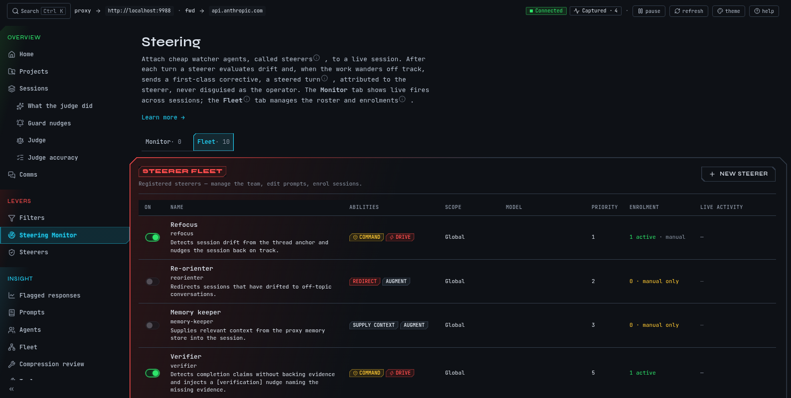

# Steer a session that drifts

A steerer is a small watcher you attach to a live session. After each turn it asks a model
whether the work is still on the task you described. If it has wandered, mike queues a short
corrective note and adds it to the session's next request. Steering changes what is sent to
Anthropic and sends the session's text to the model that runs the steerer, so it is off until
you turn it on. It does not stop a session, edit files or answer for you; the session reads
the note and decides what to do with it.

Open **Steering Monitor** in the menu for what steerers are doing now, or **Steerers** to
manage them. Both are tabs of one page, <http://localhost:9990/steering>: **Monitor** and
**Fleet**. Settings for the whole feature are at <http://localhost:9990/settings/steering>.

This is a fictional example. The `docs` session in `~/projects/site` is a small
demonstration; nothing here comes from a real capture.

## Steer the example session

Continue the example from [Quickstart](quickstart.md): the `docs` session has the goal
"Rewrite the install page", and you corrected it with "Put Homebrew first on the install page."
Suppose Claude then starts restyling the whole site instead. You want something to bring it back
without you typing.

1. Open <http://localhost:9990/settings/steering> and switch on **Steerer — acts on live
   sessions**. The page keeps the switch disabled until an OpenRouter key is set; the
   note beside it reads "Configure your OpenRouter key in Integrations to enable the steerer." You should see the switch on and the model table below it.
2. Open **Steerers**. With none yet, the page reads **No steerers registered yet**. Choose
   **Create your first steerer**.
3. Step 1, **Which session do you want to steer?** Search for `docs` and select it. Step 2
   shows the session's recent turns so you can see what it has been doing.
4. Step 3, **What should the steerer watch for?** Type what the session should stay on, for
   example `Rewrite the install page only. Put Homebrew first. Do not touch the site's styles.`
   This is the prompt anchor: the steerer compares each new turn with it. **Help me write this**
   asks a model to draft the anchor and the settings below; **Accept suggestion** keeps them
   and **Edit manually** lets you change them.
5. Choose how forceful a correction is and how it arrives (both are explained below), then
   **Review + create →** and **Create + enrol session**.
6. Open the **Monitor** tab. Until the first evaluation it reads **Watching 1 enrolled
   session…**. After the next turn an event appears in the feed; select it to see the
   **Injected payload**, the exact note that went into the session.

If the docs session drifts, the next request carries a note headed "Steering note from the
operator's proxy", inside a `<system-reminder>` block. The note is labelled as coming from the
steerer's proxy, not typed by you. Only a steerer set to **command** asks the session to say so
in a line when the note is already done or does not apply.

## What you choose for a steerer

| Setting | Choices | What it does |
|---|---|---|
| **Authority** | **supply context**, **redirect**, **command** | How forceful the note is. Supply context adds background Claude may ignore. Redirect suggests a change of direction and Claude can push back. Command is a binding directive treated as an operator instruction; use it only for a steerer you have watched work. |
| **Mode** | **augment**, **drive** | **Augment** adds the note beside the session's own context and is recommended. **Drive** replaces the session's next turn with the steerer's message; use it only when augment has repeatedly failed. |
| **Trigger** | **On assistant response**, **On user prompt**, **On turn end** | When the steerer looks. |
| **Invocation** | **Every turn**, **Pattern pre-filter** | A pre-filter runs the model only when a keyword or regular expression you list (one per line) matches. |
| **Confidence threshold** | 0.0 to 1.0 | A steerer fires when its score reaches this number. The guided flow starts at 0.7. |
| **Debounce** | turns | The least number of turns between two fires. The guided flow starts at 2. |
| **Model** | a model name | What the steerer asks. See [what leaves your machine](#what-leaves-your-machine). |
| **Project scope** | **Global (all projects)** or one project | A project steerer only evaluates sessions whose folder belongs to that project. |

A change to authority or mode takes effect on the next evaluation. **Priority** orders steerers
when several are enrolled; the lower number is evaluated first.

## Enrol and disenrol a session

A steerer only watches sessions enrolled in it. The guided flow enrols the session you picked.
To enrol another, open the session and find **Steering activity**, then **Enrol in a steerer**
and choose one. If no steerer is enabled, the panel says **No enabled steerers available** and
offers **Create one for this session**. **Disenrol** on the same panel stops it. Switching a
steerer off in the Fleet table, or deleting it from its page (**Delete**, then **Confirm
delete**, which cannot be undone), stops it for every session.

## Read the Monitor and the Fleet

The **Fleet** tab lists each steerer with **On**, **Name**, **Abilities** (its authority and
mode), **Scope**, **Model**, **Priority**, **Enrolment** and **Live activity**. Use the switch in
the first column to turn one on or off, **New steerer** to add one and the name to edit it.

The **Monitor** tab is a live feed across all enrolled sessions. Each event shows what the
steerer decided. A steerer's decision is one of:

| Verdict | Meaning |
|---|---|
| fired | A note was queued for the session |
| suppressed (debounce) | The session drifted but a note was sent too recently |
| suppressed (arbitration) | Another steerer's note took its place |
| no drift | The turn was on task |
| gate miss | The pattern pre-filter did not match, so no model was asked |
| failed closed | The model call failed, so nothing was sent |

A fired note can later read as processed (the session took it), expired or reverted.

## Guard questions

The turn guard is a separate, narrower watcher. It asks four fixed questions of finished turns
and may wake the model or add a note to its reply when one fires:

- Does this reply repeat a correction you already made?
- Did the model wait on something it never backed up?
- Did the model hand back work it was authorised to keep going on?
- Did the last turn's work actually ship?

It is off by default and has its own switch in Settings. Every note it sent appears at
**Guard nudges** (<http://localhost:9990/sessions/improvement/guard>), one panel per question,
and you can mark each nudge right or wrong there. mike withholds a share of would-be nudges at
random (10% by default) so it can compare sessions with and without them. See
[Judge](judge.md) for the pages that show what these labels led to.

## What leaves your machine

- **Sent to Anthropic:** yes. A note from a steerer that corrects the session is first pushed
  to it as a message over Remote Control when the session has an open Remote Control
  connection. If it has none, or another note woke the session in the last 30 seconds, the
  note is queued: mike retries the push every 10 seconds while a connection exists, and
  otherwise adds the note to the session's next request. Notes about efficiency, and notes about a
  subagent the session dispatched, are always queued for the next request.
- **Sent to another service:** yes. Each evaluation sends the session's recent prompts,
  assistant text and a summary of tool calls to the steerer's model. The model name decides
  where: a name that begins `claude/` (for example `claude/sonnet`) runs the `claude`
  program on this machine, `codex/` runs the local Codex program, and other names such as
  `openai/…` or `google/…` go to OpenRouter.
- **Stored:** every decision and every note, so the Monitor and the session page can show them.

See [Privacy](privacy.md) for everything mike stores or sends.

## When there is nothing to see

| What you see | Why and what to do |
|---|---|
| **No steerers registered yet** | None created. **Create your first steerer** |
| **No sessions enrolled for steering** on the Monitor | No session is enrolled. **Go to Fleet**, or enrol one from its session page |
| **Watching 1 enrolled session…** | Enrolled and waiting for its next turn |
| **No steering events in the current window** | Steerers are watching but none has fired recently |
| The switch is off, or cannot be switched on | A fresh install has it off. The page disables the switch until an OpenRouter key is set; add one in Settings, Integrations, then switch it on |
| **Couldn't load steerers** | The page could not reach mike. Check [Troubleshooting](troubleshooting.md) and retry |

`mike features everything` switches steering on together with every other feature; the
`watch-only` and `recommended` choices leave it off. See [Setup](setup.md).
