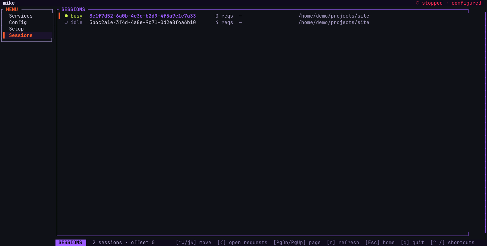

# Use mike in the terminal

Run `mike` with no arguments in a terminal and it opens a small full-screen app: whether
mike is running and healthy, a few switches, the sessions it has captured and the
requests inside them. It is for the quick look and the first setup, from an SSH session
or a pane beside Claude Code. It is not a second web UI: it shows less, and everything
deeper (the timeline, search, memory, steering, filters) is in the [web UI](web-ui.md).

Only a terminal gets the app. If `mike` is run with its output piped or redirected, it
starts the server instead, as `mike serve` does.

## Open it and leave it

1. Run `mike` in a terminal.
2. On a machine that has not finished [setup](setup.md), the app opens on the **Setup**
   screen. Otherwise it opens on **Services**.
3. Press `?` for the keys of the screen you are on. Press `Esc` or `?` again to close the list.
4. Press `q` to leave. The terminal returns to how it was.

`Esc` goes back one screen (from a request to its session list, from a session list to
Services). It does not quit. `Ctrl` and `/` also opens the key list, which matters while
you are typing into a setup field, where `?` is a literal character.

`mike setup` opens the same app on the Setup screen, and `mike setup <step>` opens it at
one step. See [Setup](setup.md).

## What the screens show

The left menu lists four screens: **Services**, **Config**, **Setup** and **Sessions**.
The bar at the top says whether mike is `online` or `stopped`.

### Services

The first screen on a configured machine. It lists:

- **Binds**: each address mike listens on (the proxy, the inspect API and the web UI),
  each `up` or `down`.
- **System**: how much the store holds, mike's memory use, and whether `mike-mcp` is on
  your `PATH` and can reach the inspect API.
- **Capabilities**: each background feature, `up`, `degraded`, `inert` or `off`.

Keys: `t` or `⏎` starts mike when it is stopped and stops it when it is running; `r`
restarts it; `l` opens a full screen of the service's log, with `x` to stop, `r` to
restart and `Tab` to move between panels; `s` opens Setup.

### Config

The switches of the **Settings** panel, each `on` or `off`, with the number of
capabilities active at the bottom. `↑` and `↓` (or `j` and `k`) move; `⏎` flips the
selected on/off switch. Settings that are not on/off, such as a text value, are shown
but cannot be edited here; the screen points to `/settings/workers` for those. It
reads and writes the same settings as the web UI's [Settings](settings.md).

### Setup

The first-run steps, ten in all, from "welcome" to "ready". They are the steps of
`mike setup` and `/settings/setup`, described in [Setup](setup.md). On the last step, `⏎`
starts Claude Code through mike, so the first session is already captured. `f` leaves
setup and keeps the answers so far.

### Sessions

One line per captured session, newest first: `busy` or `idle`, the session id, the
number of requests, the first model it used, the project and the session's title. Fifty
sessions show per page; `PgDn` and `PgUp` move between pages and `r` refreshes.

`⏎` on a session lists its requests: status (`complete`, `streaming`, `pending` or
`error`), request number, method, who started the turn, model and how many tools were
offered. `⏎` on a request shows it in three views, cycled with `Tab`: its details, its
request body and its response body. `↑`/`↓`, `PgUp`/`PgDn` scroll, `g` returns to the
top, `r` refreshes.

The sessions here are the ones mike captured, not only those started with
[`mike spawn`](sessions.md). The `docs` session of the example would appear here once it
has made a request.

## Keys

| Key | What it does |
|---|---|
| `↑` `↓` or `j` `k` | Move in the menu or list |
| `g` / `G` | Jump to the first / last row |
| `Tab` / `Shift`+`Tab` | Move from the menu into the screen, or back |
| `⏎` | Open, edit or confirm the selected row |
| `Esc` | Back one screen |
| `PgDn` / `PgUp` | Next / previous page in a list |
| `r` | Refresh the screen |
| `?` or `Ctrl` `/` | Show the keys for this screen |
| `q` | Quit |

The menu on the left has focus first, so `↑` and `↓` there change the screen. Press `⏎` or
`Tab` to move into the screen, `Shift`+`Tab` to return to the menu. The terminal app has
no mouse support.

## What it leaves to the web UI

The terminal app has no timeline, no search, no memory or steering, no filters, no
projects and no messages between sessions. The request bodies are shown as stored, one
scrolling view each, without the conversation laid out. For any of those open the web UI
at `http://localhost:9990/`, which the setup's last step also offers with `b`.

## When it shows nothing or fails

| What you see | Why | What to do |
|---|---|---|
| `mike setup` says it needs a terminal | The output is not a terminal. | Run it in a terminal; `mike doctor` lists what is missing without one. |
| Top bar says `stopped` | mike is not running. | On Services press `t`, or run `mike serve`. |
| A bind is `down` | Nothing is listening at that address. | Press `r` to restart; `l` opens the log. |
| Sessions says `sessions unavailable — live store unreachable` | The inspect API or database does not answer. | Start mike, then `r`; run `mike doctor` for the cause. |
| Sessions says `no sessions captured yet` | Nothing has gone through mike. | Start Claude Code through mike, `mike claude` or `mike spawn open`. |
| Config says `capabilities unavailable — live store unreachable` | As above. | As above. |
| Services shows `usage unavailable (persistence off, or unreachable)` | The store has no usage to report. | The same checks as above. |
