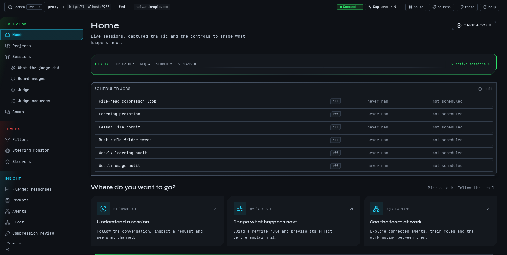

# Find your way around the web UI

The web UI is where you read what mike captured and where you change what it does. Open
`http://localhost:9990` while mike is running. It updates as new requests arrive, so you can
leave it open beside Claude Code. This page covers the parts every screen shares: the menu,
search, the top bar, the tour and Help. What each screen shows is on the page for its part,
listed in [Find a page](pages.md).

The web UI has no login. Open it only on the machine mike runs on. See [Privacy](privacy.md).

This is a fictional example capture: a session named `docs` in `~/projects/site`, working on
"Rewrite the install page". Nothing in it comes from a real machine.

## Open the web UI

1. Start mike and Claude Code as in the [quickstart](quickstart.md).
2. Open `http://localhost:9990` in a browser.
3. You land on **Home**. With a session running, you see a strip of live counts, then the
   sessions running now, grouped by project, and cards for every other page.

If nothing has been captured yet, Home shows a short getting-started panel instead of the
cards. Send one request through mike and it fills in. If the page does not load at all, mike
is not running: see [Troubleshooting](troubleshooting.md).

## Move between pages

The left-hand menu lists every page in four groups. Hover an item for a one-line description.

| Group | What its pages do |
|---|---|
| Overview | Home, Projects, Sessions, the judge's pages and Comms: what is happening and what was said |
| Levers | Filters, Steering Monitor and Steerers: pages that change what mike does to traffic |
| Insight | Flagged responses, Prompts, Agents, Fleet, Compression review, Tools and Agent dispatches: pages that only read what was captured |
| System | Memory, Skills, Proposals, Memory diagnostics, Settings and Help |

The judge's pages and the Settings sub-pages sit indented under their parent in the menu. The
chevron at the foot of the menu collapses it to icons; on a narrow window it becomes a menu
button at the top left.

Every page, its address and its guide are in [Find a page](pages.md).

## Search

Press `Ctrl K` (`⌘ K` on a Mac), or click **Search** in the top bar, and type. The box
searches:

- **Recent** pages you opened,
- **Pages**, by name,
- **Actions**, such as pinning the current session or opening the filter workbench,
- **Help** topics and the glossary,
- **Sessions**, by title, session id or project, once you type two or more characters.

Choose a result with the arrow keys and `Enter`. When nothing matches, the box says "No
matches" and suggests a page name, session id or project.

To find something *said* in a conversation, use the search box on the Sessions page instead:
see [Find something a session said](reading-sessions.md#find-something-a-session-said).

## The top bar

The top bar is on every page.

| Control | What it does |
|---|---|
| **Search** | Opens the search box above |
| `proxy → http://localhost:9988` | The address Claude Code sends its requests to |
| `fwd → api.anthropic.com` | Where mike forwards them |
| Status indicators | Whether the page is connected to mike, how many requests were captured (click it for the feed), and **Persistence off** when mike is not saving what it captures |
| **pause** / **resume** | Stops and restarts live updates in your browser. Capture carries on |
| **refresh** | Reloads the counts |
| **theme** | Choose a colour theme. It applies at once and is remembered in your browser |
| **help** | Opens the Help drawer |

**pause** only freezes what you see. mike keeps capturing while the page is paused.

## Take the tour

On **Home**, choose **Take a tour**, or open `http://localhost:9990/?tour=1`. The tour dims the
page and points at six areas in turn: the live counts, the "start from a task" shortcuts, the
sessions running now, and the Insight, Levers and System groups. Replay it any time from the
same button. Home is the only page with a tour.

## Read Help

Choose **Help** in the menu to open `/help`. It has:

- **How-to guides**: getting Claude Code talking to mike, inspecting a captured request,
  rewriting outbound system prompts, investigating a prompt anomaly, keeping the data you care
  about, and how steering works;
- a **glossary** of the terms the interface uses;
- the documentation bundled with mike, such as installed setup and recovery.

The **help** button in the top bar opens the same material in a drawer beside the page you are
on, so you do not lose your place. Hovering a dotted label anywhere in the interface shows a
short definition and, where there is one, a link to its glossary entry.

## When a page is empty

An empty page almost always means nothing has been captured, or the feature behind it is off.

| You see | Why | What to do |
|---|---|---|
| Home shows a getting-started panel | No request has reached mike yet | Follow the [quickstart](quickstart.md) |
| **No sessions yet** on Sessions | Claude Code has not sent a request through mike | Check Claude Code points at mike: [Troubleshooting](troubleshooting.md) |
| **Thread comms aren't live yet** on Comms | The running mike does not answer for message threads | Restart mike from the same install; see [Troubleshooting](troubleshooting.md) |
| **No threads yet** on Comms | No session has messaged another | See [Sessions](sessions.md) |
| The judge, Memory, Skills or Proposals pages are empty | Those features are off in a fresh install, or have nothing to show yet | Turn them on in [Settings](settings.md); see [Memory](memory.md) and [Judge](judge.md) |
| A page says it could not load | The page asked mike for data and mike did not answer | Press **Retry**; if it keeps failing see [Troubleshooting](troubleshooting.md) |

## Next steps

- [Read a session](reading-sessions.md): the page you will use most.
- [Find a page](pages.md): every page and command in one list.
- [Decide what to turn on](settings.md).
